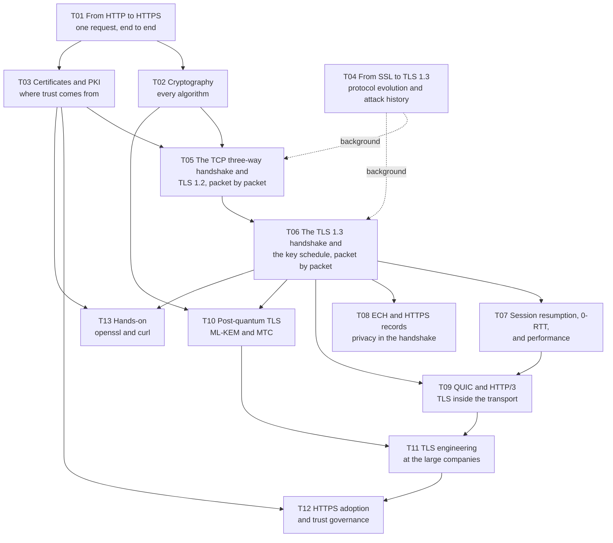
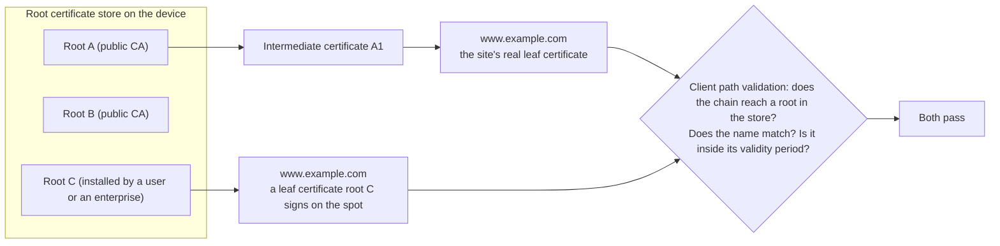
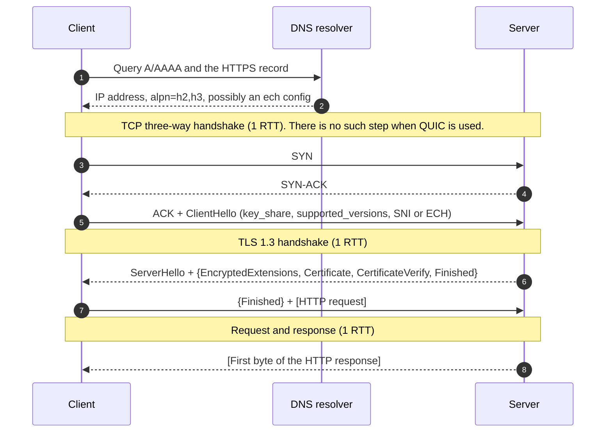

# TLS series · Overview and reading path

> Scope: from plaintext HTTP to HTTPS, from the TCP three-way handshake to the TLS 1.3 key schedule, from certificates and PKI to ECH, QUIC, and post-quantum key exchange, then to engineering practice at the large companies and the governance that moved the Web onto HTTPS.
> Standards baseline: TLS 1.3 follows RFC 8446 and its revision RFC 9846, published 2026-07 (each note cites section numbers from the familiar RFC 8446). ECH follows RFC 9849. Certificates follow RFC 5280. QUIC follows RFC 9000/9001. Post-quantum hybrid key exchange follows RFC 10024. The full list is in [[T99_glossary-and-standards-index|T99 glossary and standards index]].
> Companion page: `html/index.html`. Open it directly in a browser. The workbench steps through the handshakes, expands a certificate chain, and shows the key schedule derivation tree.
> Compiled: 2026-10-16 (standards status and measured data collected 2026-10-17 UTC)

## What these notes are

Two machines that have never met, across a network where anyone can read and tamper, have to agree in one round trip on a key that only the two of them know, and the client has to be sure the other side is the server it meant to reach. Every handshake message, every algorithm, and every layer of the certificate system answers one face of that question, or closes a hole that some past break opened. These notes follow that question. They take HTTPS apart from the lock in the address bar, down to each handshake message, each field, each step of key derivation, and the mathematical intuition underneath, then put it back in the real world: which designs were forced by which attack, what each of the large companies did, how the Web went from mostly plaintext to almost entirely encrypted over ten years, and what is still moving at this moment in 2026.

TLS is hard not because any one part goes especially deep, but because it is three things tangled together: a cryptography of key agreement, a public-key infrastructure of certificates and trust, and an engineering protocol that keeps evolving for performance and privacy. The notes split along those three lines. T02 is the cryptography. T03 is certificates and trust. T05 through T09 are the protocol and performance. T10 through T12 are the evolution and the governance now underway.

Each note follows the specification and cites it down to the section. The end of each note lists the standards and sources it used. Figures are mostly mermaid (they render directly in Obsidian). Message flows use sequence diagrams. Derivations use flowcharts. Byte layouts use ASCII diagrams inside code blocks. The handshakes, certificates, HTTPS records, session resumption, and 0-RTT data in the text were captured for real on this Mac, with OpenSSL 4.0.3, against public websites. The small-number examples (RSA, DH, elliptic curves, LWE, HKDF, and QUIC Initial keys) were checked with programs.

## The whole series in one diagram

An arrow means the note it leaves is best read before the note it enters. The history in T04 can be picked up at any point. T13 fits after T03 and T06, done while checking the notes.

## Chapter table

| Note | Question it answers | Primary standards |
| --- | --- | --- |
| [[T01_http-to-https-request-lifecycle\|T01]] | Where plaintext HTTP is unsafe, which layer TLS occupies, and how many round trips one HTTPS request takes from pressing Enter to the first byte | RFC 9110, 9112, 9113, 9114, 7301, 6797 |
| [[T02_cryptography-foundations-for-tls\|T02]] | What a hash, HMAC, AEAD, RSA, DH, elliptic curves, signatures, and HKDF each do, and why the mathematics holds | RFC 2104, 5116, 5869, 7748, 8017, 8032, 8439 |
| [[T03_certificates-and-pki\|T03]] | What a certificate contains, how a certificate chain is validated, why a root certificate is trusted, what "any certificate this root signs is trusted" means, and how revocation and certificate transparency work | RFC 5280, 9525, 6960, 6962, 8555, 8659 |
| [[T04_ssl-to-tls13-evolution-and-attacks\|T04]] | What each version of SSL and TLS changed, and which designs the famous attacks of twenty years forced | RFC 6101, 2246, 4346, 5246, 8446, 9846, 8996, 7457 |
| [[T05_tcp-and-tls12-handshake\|T05]] | Each field of the TCP three-way handshake, each TLS 1.2 handshake message, how the master secret is derived, and why the handshake is 2-RTT | RFC 9293, 5246, 7627, 8422 |
| [[T06_tls13-handshake-and-key-schedule\|T06]] | The TLS 1.3 1-RTT handshake field by field, the full key schedule derivation tree, how the record layer encrypts, and how downgrade protection works | RFC 8446, 9846, 10024 |
| [[T07_session-resumption-0-rtt-and-performance\|T07]] | How session resumption and 0-RTT save round trips, how replay risk is kept under control, and where certificate size, record size, kTLS, and connection reuse each save time | RFC 5077, 8446, 8470, 8879, 7413 |
| [[T08_ech-and-https-record-privacy\|T08]] | What plaintext remains in the handshake, how ECH hides the entire real ClientHello, and what HPKE and the HTTPS record do in that design | RFC 9849, 9848, 9180, 9460 |
| [[T09_quic-and-http3\|T09]] | How QUIC borrows the TLS 1.3 handshake without using its record layer, how packet protection and header protection work, and how HTTP/3 is discovered | RFC 9000, 9001, 9002, 9114 |
| [[T10_post-quantum-tls\|T10]] | What a quantum computer threatens, how ML-KEM hybrid key exchange is wired into TLS 1.3, and why post-quantum certificates are harder | FIPS 203, 204, 205, RFC 10024 |
| [[T11_tls-engineering-practices\|T11]] | What Google, Cloudflare, Apple, Meta, Mozilla, Microsoft, AWS, and Let's Encrypt each built and pushed, and what ShangMi TLS is | Public material from each of them, RFC 8998 |
| [[T12_https-adoption-and-trust-governance\|T12]] | How the Web moved to HTTPS across the board, what HSTS, certificate transparency, root programs, and certificate lifetime each govern, and how to configure your own server | RFC 6797, 9325, CA/B Forum Baseline Requirements |
| [[T13_observing-tls-with-openssl-and-curl\|T13]] | How to see all of the above yourself with openssl, curl, and dig | The notes above |
| [[T99_glossary-and-standards-index\|T99]] | Glossary and standards index | |

## Three ways to read

For a complete intuition, read T01, T03, T06, T08, and T10. In each note, start with the figures and the first paragraph of each section, and skip the byte layouts and the derivation detail. At the end you can say what happens inside one HTTPS connection, where trust comes from, and what is still changing in 2026.

To learn the protocol properly, read T02, T05, T06, T07, and T09. Read the key schedule in T06 against the PRF in T05. Use the workbench and the derivation tree on the HTML page, then use the experiments in T13 to find each message in real output. At the end you can read every line of `openssl s_client -trace`.

For deployment and operations, read T03, T07, T11, and T12. The focus is certificate automation, why revocation is unreliable and certificate lifetimes are therefore shrinking, recommended configurations, the optimizations each company uses, and the post-quantum migration checklist at the end of T10.

## Look up by question

Why the handshake takes two round trips, and how TLS 1.3 removes one: the last section of T05, and T06. A site is slow and the first byte is late: the performance work in T07, and the round-trip ledger in T01. Why a packet capture shows the domain you are about to visit, and what ECH is for: T08. Certificate errors, an incomplete certificate chain, and how revocation works: T03, with troubleshooting output at the end of T13. Why a capture tool can decrypt HTTPS from some apps and cannot decrypt it from others: the trust model in T03, and the certificate pinning section in T12. Which part of TLS a quantum computer actually threatens, and whether to act now: T10. To type the commands and watch a real handshake: T13.

## One question first: what "any certificate this root signs" means

That sentence is the key to the HTTPS trust model. The full account is in [[T03_certificates-and-pki|T03]].

The operating system or the browser holds a root certificate store. The system root store on this Mac contains 158 root certificates. When a client validates a website certificate, it checks only three things. Following "who signed whom" upward from the website certificate, the chain has to reach some root in the store, and every signature on that path has to verify. The certificate has to be inside its validity period, and the key usage has to match. The domain name written in the certificate has to match the domain being visited.

The first check asks only whether the chain can reach some root in the store. It does not ask which CA this site usually uses, and the client has no way to know that. Every root in the store can therefore sign, for any domain name in the world, a certificate this device will accept. The security of the whole system equals the security of the weakest CA in the store. "Any certificate this root signs will be trusted" is that fact: once a root is in your store, your device accepts a certificate it signs, whatever domain name is written on it.

This has happened in practice. In 2011 the Dutch CA DigiNotar was compromised. The attackers signed more than 500 forged certificates, including `*.google.com`. The `*.google.com` certificate was used for a man-in-the-middle attack on users at about 300,000 IP addresses in Iran. Chrome noticed the anomaly because it had public-key pins built in for Google domains. DigiNotar was then removed from every browser root store, and it went bankrupt.

The same mechanism explains a root certificate a user installs. Debugging tools and enterprise TLS inspection proxies ask you to install their root and trust it. That root becomes a member of the root store on your device, so the tool can sign a certificate on the spot for any domain, and ordinary path validation still succeeds. An app that does only standard path validation can be decrypted this way. An app that also pins certificates, and accepts only a few public keys of its own, rejects such a certificate.

The industry has stacked several mechanisms to narrow "any root can sign any domain." Certificate transparency puts every certificate a public CA issues on a public log, so a bad issuance is visible. A CAA record lets the domain holder declare which CAs are allowed to issue. nameConstraints confines a CA to a stated set of names. Root programs remove a CA that has failed from the root store. An app can pin certificates on its own. Shorter certificate lifetimes make a mis-issued certificate expire sooner. T03 and T12 take these up separately.

## One HTTPS connection, end to end

Ignoring DNS, a fresh connection of TCP plus TLS 1.3 can send the first request only after two round trips, and the first byte of the response arrives on the third round trip. TLS 1.2 can send the request only after three round trips. A first QUIC connection can send the request after one round trip. Session resumption with 0-RTT, on QUIC or on TLS 1.3, lets the request leave together with the handshake. The round-trip ledger for each combination is in [[T01_http-to-https-request-lifecycle|T01]]. How each round trip is removed is in [[T07_session-resumption-0-rtt-and-performance|T07]] and [[T09_quic-and-http3|T09]].

## Where things stand in October 2026

The main body of TLS has been stable since RFC 8446 was published in 2018. Change over the last two years is concentrated in the directions below. Keep their dates in mind while reading these notes.

| Direction | Status (2026-10) | See |
| --- | --- | --- |
| TLS 1.3 specification | Revision RFC 9846 was published in 2026-07. It replaces RFC 8446. The protocol version is unchanged. | T04, T06 |
| Post-quantum key exchange | X25519MLKEM768 is the default in mainstream browsers, in OpenSSL 3.5 and later, in Go 1.24 and later, and on iOS 26. The specification, RFC 10024, was published in 2026. | T10 |
| Post-quantum authentication | A post-quantum signature on a traditional certificate is too large. Chrome and Cloudflare are trying Merkle Tree Certificates, which are still a draft. The specification for using ML-DSA in TLS is in the RFC Editor queue. | T10, T11 |
| SNI privacy | ECH was published as RFC 9849 in 2026-03. Firefox and Chrome already support it. Deployment is concentrated at Cloudflare. | T08 |
| Certificate lifetime | CA/B Forum SC-081: a maximum of 200 days from 2026-03-15, 100 days in 2027, and 47 days in 2029. Let's Encrypt plans a 45-day default in 2028, and it shut down OCSP in 2025. | T03, T12 |
| Default HTTPS | Chrome 154 (2026-10) plans to turn "Always use secure connections" on by default. | T12 |

## How these notes treat facts

The protocol sections follow the RFC text. Developments since 2024 (publication of standards, post-quantum deployment, certificate policy, changes to root programs) name the source and the date they were checked. Figures such as deployment share differ widely between organizations, so every figure names its source. Anything that could not be found is written down as not found. Publication status follows the RFC Editor and the IETF datatracker. Status in second-hand reports and blogs is often behind.

The measurements come with a background that has to be kept in mind. During collection, this Mac was running Clash Verge in TUN mode, and traffic was forwarded through local mihomo and a proxy node. The handshake contents are unaffected (the proxy forwards bytes, every certificate chain passed validation, and every issuer was a real CA), but connection timing is affected. Experiment 9 in T13 is about that point.

## The companion HTML page

`html/index.html` is the visual companion to these notes. It does not depend on the network. Open it directly in a browser. It turns the parts of the text that are hardest to picture into diagrams you can operate. The workbench steps through four handshakes: TLS 1.2, TLS 1.3, TLS 1.3 resumption plus 0-RTT, and QUIC. Each step marks which key protects that message. A certificate chain can be expanded field by field, and the page demonstrates that any one root can sign any domain. The TLS 1.3 key schedule derivation tree can be inspected node by node, with the input, the label, and the output. There is also a timeline from SSL 2.0 to post-quantum. Each part of the page is labeled with the matching note. These Markdown notes are the authority for the content.

## Boundaries

These notes cover the standards, the mechanisms, and legitimate engineering practice. Where they discuss a man-in-the-middle attack, they explain why the attack can succeed, and which mechanisms in the protocol and in the certificate system stop it. Where they discuss certificate pinning, they explain how to design and operate it inside your own application. Where they discuss ECH, they explain the privacy goal and the mechanism defined by RFC 9849. Where they discuss historical attacks, they stop at the mechanism and the fix. The hands-on experiments target only public websites and your own connections, and they observe those with standard tools.

## How to continue

Several places depend on standards that are still changing, and these notes will have to be updated. Standardization of Merkle Tree Certificates, progress on Chrome's quantum-resistant root store, and whether Cloudflare's public CA can start issuing MTCs in the first quarter of 2027 will rewrite the conclusions of T10 and T11. Once draft-ietf-tls-mlkem and draft-ietf-tls-mldsa are published as RFCs, the status statements in T10 have to be updated. The CA/B Forum certificate-lifetime schedule does not finish until 2029. Check T03 and T12 at each milestone. After Chrome 154 ships, check the actual default-HTTPS behavior described in T12.

<!-- note-assistant:index:start -->
## Index

Generated automatically. Do not edit by hand. Maintained by `node .tools/vault.mjs index`.

### Notes

- [[T01_http-to-https-request-lifecycle|T01 · From HTTP to HTTPS: one request, end to end]] #tls #https #http #network-layers #rtt #hsts #alpn
- [[T02_cryptography-foundations-for-tls|T02 · Cryptography: every algorithm TLS uses]] #tls #cryptography #hash #hmac #aead #aes-gcm #chacha20 #rsa #diffie-hellman #ecdh #x25519 #ecdsa #ed25519 #hkdf #forward-secrecy
- [[T03_certificates-and-pki|T03 · Certificates and PKI: where trust comes from]] #tls #pki #x509 #certificate-chain #root-certificate #ca #ocsp #crl #crlite #certificate-transparency #caa #acme #lets-encrypt
- [[T04_ssl-to-tls13-evolution-and-attacks|T04 · From SSL to TLS 1.3: protocol evolution and attack history]] #tls #ssl #protocol-evolution #attack-history #beast #crime #heartbleed #poodle #logjam #drown #robot #formal-verification
- [[T05_tcp-and-tls12-handshake|T05 · The TCP three-way handshake and the TLS 1.2 handshake, packet by packet]] #tls #tcp #three-way-handshake #tls12 #record-layer #clienthello #ecdhe #prf #master-secret #cipher-suite
- [[T06_tls13-handshake-and-key-schedule|T06 · The TLS 1.3 handshake and key schedule, packet by packet]] #tls #tls13 #rfc8446 #handshake #key_share #hkdf #key-schedule #record-layer #downgrade-protection #helloretryrequest #x25519mlkem768
- [[T07_session-resumption-0-rtt-and-performance|T07 · Session resumption, 0-RTT, and handshake performance]] #tls #performance #session-resumption #session-ticket #psk #0-rtt #early-data #replay #false-start #tcp-fast-open #certificate-compression #ktls #connection-reuse
- [[T08_ech-and-https-record-privacy|T08 · ECH and HTTPS records: privacy in the handshake]] #tls #ech #esni #sni #hpke #svcb #https-rr #doh #grease #privacy
- [[T09_quic-and-http3|T09 · QUIC and HTTP/3: TLS inside the transport]] #tls #quic #http3 #rfc9000 #rfc9001 #packet-protection #header-protection #connection-migration #qpack #alt-svc
- [[T10_post-quantum-tls|T10 · Post-quantum TLS: ML-KEM hybrid key exchange and Merkle Tree Certificates]] #tls #post-quantum #pqc #ml-kem #kyber #ml-dsa #x25519mlkem768 #hybrid-key-exchange #merkle-tree-certificates #shor #grover
- [[T11_tls-engineering-practices|T11 · TLS engineering practice at the large companies]] #tls #engineering-practice #google #cloudflare #apple #meta #mozilla #microsoft #aws #lets-encrypt #boringssl #openssl #rustls #shangmi #tlcp
- [[T12_https-adoption-and-trust-governance|T12 · HTTPS adoption and trust governance]] #tls #https #hsts #preload #mixed-content #ca-b-forum #root-program #certificate-transparency #hpkp #certificate-pinning #dane #mta-sts #bcp195 #recommended-config
- [[T99_glossary-and-standards-index|T99 · Glossary and standards index]] #tls #glossary #standards-index #rfc

### Deployment and operations handbook

- [[T13_observing-tls-with-openssl-and-curl|T13 · Hands-on: watching the handshake with openssl and curl]] #tls #hands-on #openssl #s_client #curl #dig #keylog #wireshark #packet-capture

### From other directories (tag: tls)

- [[../../../V000_NiceThinking_tech/记一次mcp被阿里云SNI阻断与绕过/mcp遇到SNI阻断|An MCP TLS failure misread as "Alibaba Cloud SNI blocking"]] #MCP #TLS #Codex #Node.js #OpenSSL #network-troubleshooting: the fault analysis, the evidence notes in the same directory, and the client-implementation comparison are directly related. The SNI blocking note supplies the necessary background.

<!-- note-assistant:index:end -->
