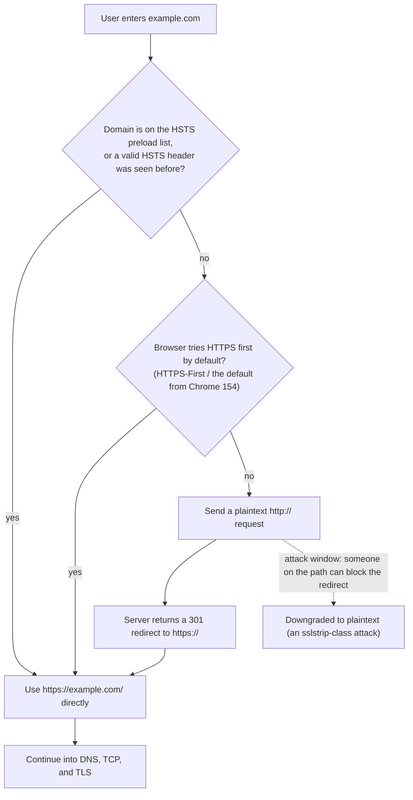
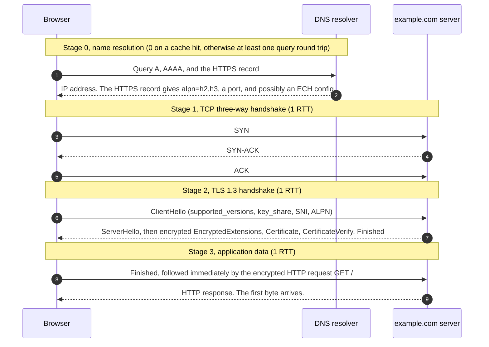
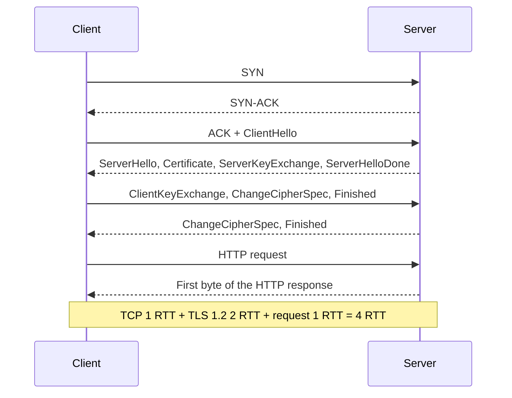
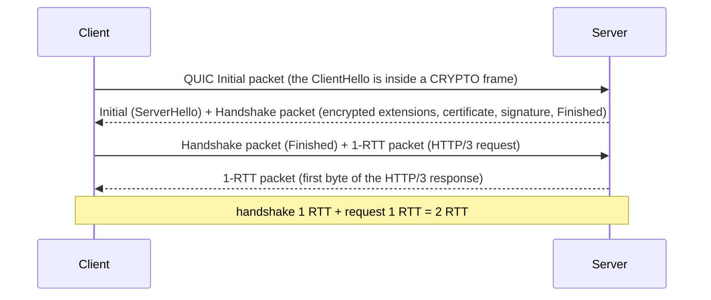
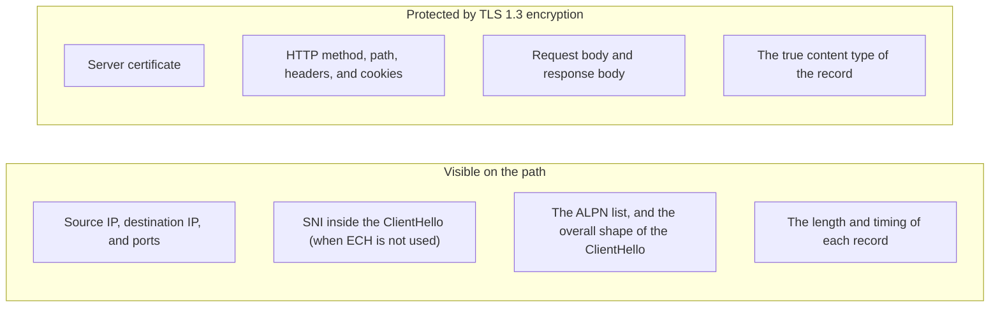

# T01 · From HTTP to HTTPS: one request, end to end

> Series: [[00_tls-series-overview|TLS series overview]] · Next: [[T02_cryptography-foundations-for-tls|T02 cryptography]]
> Prerequisites: the TCP/IP layers, the fact that HTTP is request and response, and the fact that DNS turns a domain name into an IP address. That is all you need.
> Primary standards: RFC 9110 (HTTP semantics), RFC 9112 (HTTP/1.1), RFC 9113 (HTTP/2), RFC 9114 (HTTP/3), RFC 2818 (HTTP over TLS), RFC 8446 (TLS 1.3), RFC 6066 (SNI), RFC 7301 (ALPN), RFC 6797 (HSTS), RFC 9460 (HTTPS records)
> Compiled: 2026-10-16

This note does not go into any single handshake message. It lays out the shape of the whole thing first: where plaintext HTTP leaks, which layer of the stack TLS occupies and why it sits there, what happens on the network and in what order between pressing Enter on an address and the first byte appearing on the screen, and how many round trips each combination of protocols costs. Every later note magnifies one piece of this picture. The picture has to come first, or the later notes are easy to get lost in.

## Where plaintext HTTP leaks

HTTP itself handles only semantics. A request has a method, a path, headers, and a body. A response has a status code, headers, and a body (RFC 9110). HTTP does not decide how those bytes are delivered safely. Under it, HTTP/1.1 and HTTP/2 use TCP to deliver bytes reliably to the peer, and TCP uses IP to route packets. From your device to the target server, the path crosses the router at home, the carrier's access network, several backbone routers, and the switches in the target data center. On public Wi-Fi, the other devices on the same hotspot are on that path too. Any node on the path that can see your packets can do three things to plaintext HTTP.

The first is to read. The request line, every cookie, every form field, and every stretch of the response body are plaintext to an observer on the path. The browser extension Firesheep (2010) turned this into a one-click operation. On the open Wi-Fi of a cafe, it captured session cookies off the air from other people's visits to Facebook and Twitter, and one click logged in as that person. It used no vulnerability. It made "a plaintext cookie is readable by anyone" concrete enough to speed up those sites' move to site-wide HTTPS by default.

The second is to modify. A node in the middle can rewrite the response body and inject a script or an advertisement. Carriers, in China and elsewhere, have inserted pop-up ads and data-usage notices into HTTP pages. The user has no way to notice, because nothing checks that the bytes received are the bytes the server sent. The Great Cannon incident of 2015 went further. A device in the middle replaced JavaScript inside some plaintext HTTP responses, and sent large numbers of visitors' browsers to attack specific projects on GitHub.

The third is to impersonate. With no way to verify who is on the other side, a node in the middle can simply play the server. You believe you are talking to the bank. You are talking to the node. Poisoned DNS, spoofed ARP, and a spoofed hotspot name can all steer your connection to the impostor.

These three acts match the three goals of security: confidentiality (other people cannot read it), integrity (if someone changes it, you can tell), and authentication (you can confirm who is on the other side). HTTPS has to provide all three together. Encryption on its own fails, because the party you encrypt toward may be the impostor. You have only built a very safe channel to the attacker. This point comes back throughout the series. In the TLS handshake, key agreement and authentication are bound together and completed as one. The server uses the private key that matches the public key in the certificate to sign the whole handshake, proving that the party who agreed this key with you is the holder of the domain name written on the certificate.

One boundary is easy to miss. These three goals protect the transmission. They do not protect the two ends. The server logging your request, the browser caching the page to disk, malware installed on the phone: HTTPS covers none of that. HTTPS protects the stretch that is on the path.

## Where TLS sits in the stack

TLS (Transport Layer Security) sits above TCP and below the application protocol. To the TCP underneath, TLS is an ordinary application. It sends and receives its own data on TCP's reliable byte stream. To the HTTP above, the interface TLS offers is almost the same as TCP's. Both say "deliver this stretch of bytes reliably to the peer." The difference is that on the path those bytes are encrypted and protected against tampering, and the peer's identity has been authenticated. The interface barely changes, so HTTP barely has to be rewritten to run on TLS. RFC 2818 defines HTTPS in only a few pages: establish TLS first, then speak HTTP on top of it, use port 443 by default, and check the hostname against the name in the certificate.

```
                          HTTP/1.1, HTTP/2                                HTTP/3
               +------------------------------------+   +----------------------------------------+
  application  | HTTP semantics and frames          |   | HTTP/3 frames and QPACK                |
               +------------------------------------+   +----------------------------------------+
  security     | TLS record layer and handshake     |   | QUIC                                   |
               +------------------------------------+   | (embedded TLS 1.3 handshake and        |
  transport    | TCP                                |   |  packet protection)                    |
               +------------------------------------+   +----------------------------------------+
                                                        | UDP                                    |
  network      | IP                                 |   | IP                                     |
               +------------------------------------+   +----------------------------------------+
```

The left side is the most common HTTPS today. HTTP/1.1 or HTTP/2 runs on TLS, and TLS runs on TCP. The right side is HTTP/3. QUIC runs on UDP. It does not use the TLS record layer. It borrows the TLS 1.3 handshake messages to agree keys, then protects each packet in its own format (RFC 9001). In QUIC, transport and security are the same layer.

There is a reason to put TLS between TCP and the application. Placed lower, inside the IP layer, as IPsec does, it is transparent to every application. But it cannot see where one application ends and the next begins, and a certificate at that layer can authenticate only a machine, not a domain name, so it is hard to configure per website. Placed higher, with each application encrypting its own bytes, every application has to implement the cryptography again, and the mistakes pile up. In the middle, any TCP-based application can reuse TLS. HTTPS, IMAPS, SMTPS, and database connections are the same TLS plus a different application. TLS can also see where a connection starts and ends, so it agrees parameters once and authenticates once, at the scope of the connection.

This layering also explains a fact that runs through the whole series. TLS sits above TCP, so a TCP connection has to exist before the TLS handshake can start. The TCP three-way handshake and the TLS handshake, one after the other, are why a first HTTPS connection is slower than HTTP, and they are why QUIC merges the two layers (see [[T09_quic-and-http3|T09]]).

Inside TLS there are two layers again. The lower one is the record layer. It cuts the data handed down from above into records, encrypts them, adds an integrity check, and hands them to TCP. On receipt it reverses that: decrypt, check, reassemble. Above the record layer are several sub-protocols. The handshake protocol agrees the version and the algorithms, exchanges key material, and completes authentication. The alert protocol carries errors and close notifications. TLS 1.2 and earlier also have the change cipher spec protocol, which announces that the next record will switch to the new keys. Handshake messages themselves go out through the record layer. The earliest ones have no key available yet, so they are plaintext. [[T05_tcp-and-tls12-handshake|T05]] walks this structure byte by byte.

## Before Enter: the URL, HSTS, and that redirect

Before any packet leaves the device, the browser has to decide which protocol to connect with. In the address bar the user usually types only `example.com`, with no scheme. Browsers used to fill in `http://` by default, send a plaintext request, take a `301` or `302` from the server to `https://example.com/`, and connect all over again. That redirect has two costs. It spends a full TCP connection plus the time of one request and response. The heavier cost is that the first plaintext request is itself an attack window. sslstrip, published by Moxie Marlinspike in 2009, demonstrated this. An attacker on the path intercepts that plaintext request, blocks the redirect, speaks HTTPS to the server, and keeps speaking HTTP to the user. The page the user sees looks normal. The address bar is simply missing the lock.

HSTS (HTTP Strict Transport Security, RFC 6797) is the answer to that problem. The server sends a header such as `Strict-Transport-Security: max-age=31536000; includeSubDomains` on an HTTPS response. The browser remembers: for `max-age` seconds, this domain and its subdomains can be reached only over HTTPS. If the user types `http://`, the browser rewrites it locally to `https://`. If the certificate is wrong, the user is not offered a button to continue anyway. The weak point of HSTS is the first visit. The browser has not seen the header yet. That is why the HSTS preload list exists: a domain list built into the browser. Domains on the list are forced onto HTTPS from the first visit. A larger change is still scheduled for 2026. Chrome plans to turn on "Always use secure connections" by default in Chrome 154 (October 2026). For public sites it tries HTTPS first, and it asks the user before opening a site that has no HTTPS (Google Security Blog, 2025-10). That adoption line is covered in full in [[T12_https-adoption-and-trust-governance|T12]].



## The full timeline of one HTTPS request

Now take the widest view of what a visit to `https://example.com/` actually goes through. Assume HTTP/2 over TLS 1.3, one of the most common combinations in 2026. Each step below is marked with the round trips it spends (RTT, round-trip time, the time for one message to go and come back). For the question "why is this slow," the number of round trips matters more than bandwidth. Bandwidth decides how much fits. Round trips decide how many times you wait.



Stage 0 is name resolution. The browser has to turn `example.com` into an IP address. A hit in the local cache or the system cache costs nothing. Otherwise the browser queries a resolver, and if the resolver cache misses, the resolver has to walk the recursion out to the authoritative servers. Besides A (IPv4) and AAAA (IPv6), a modern browser also queries the HTTPS record, one of the SVCB-type records defined by RFC 9460. In one answer, that record tells the browser which application protocols the domain supports (`alpn=h2,h3`), which port to use, which alternative addresses exist, and even the public-key configuration for ECH. Without it, the browser can only connect over TCP first, learn from the `Alt-Svc` response header that the peer supports HTTP/3, and use that on a later connection. The HTTPS record is one of the main subjects of [[T08_ech-and-https-record-privacy|T08]]. A DNS query is plaintext by default, which is why DoH (DNS over HTTPS, RFC 8484) and DoT (DNS over TLS, RFC 7858) exist. They run on TLS too.

Stage 1 is the TCP three-way handshake, fixed at one round trip. The client sends SYN, the server replies SYN-ACK, the client replies ACK, and the TCP connection is up. The client's ACK can leave in the same packet as the first data of the next step, so for the data the three-way handshake costs only one round trip. The detail is in [[T05_tcp-and-tls12-handshake|T05]].

Stage 2 is the TLS handshake. An ordinary TLS 1.3 handshake is one round trip. The ClientHello does more than declare the versions and algorithms it supports. It also carries the client's key-exchange material directly, in key_share. The client guesses which key-exchange group the server will pick, and sends its public key ahead of time. The server answers in one flight with its own key_share, the certificate, the signature over the handshake transcript (CertificateVerify), and Finished. Apart from the ServerHello, that flight is already encrypted under the handshake keys. Once the client has the flight, it can compute the session keys, validate the certificate and the signature, and send its own Finished. TLS 1.2 takes two round trips at this step, because it agrees the algorithms first and exchanges the key material second. How TLS 1.3 compresses that into one round trip is the core of [[T06_tls13-handshake-and-key-schedule|T06]].

Stage 3 is the HTTP request and the response. The client puts Finished and the first HTTP request into the same flight, and does not wait for the server to speak again. The server handles the request and returns the response. The first byte arrives, and the browser starts parsing and rendering.

Add the round trips up. Ignoring DNS, one fresh connection of TCP plus TLS 1.3 costs one round trip for TCP and one round trip for TLS before the request can be sent, and the first byte of the response arrives on the third round trip. The next section adds up the ledger for every combination.

## The round-trip ledger: how long each combination waits

Round trips are the hardest constraint in HTTPS performance. One round trip can be 5 milliseconds on a same-city path, 150 to 200 milliseconds from China to the US West Coast, and longer still on a mobile network with a weak signal. The table below starts when the client sends the first packet. It excludes DNS. It lists how many handshake round trips pass before the first HTTP request can be sent, and how many round trips pass in total before the first byte of the response arrives.

| Combination | Handshake round trips before the request | Round trips to the first byte | Notes |
| --- | --- | --- | --- |
| Plaintext HTTP over TCP | 1 | 2 | TCP handshake only, as a baseline |
| TCP + a full TLS 1.2 handshake | 3 | 4 | TLS 1.2 takes two round trips (T05) |
| TCP + TLS 1.2 session resumption, or False Start | 2 | 3 | Resumption skips the certificate and the key exchange. False Start allows data to be sent early (T07). |
| TCP + a full TLS 1.3 handshake | 2 | 3 | The most common first connection in 2026 |
| TCP + TLS 1.3 PSK resumption with 0-RTT data | 1 | 2 | The request travels with the ClientHello. There is a replay risk (T07). |
| QUIC (HTTP/3), first connection | 1 | 2 | The transport handshake and the TLS handshake merge into one round trip (T09) |
| QUIC resumption with 0-RTT data | 0 | 1 | The first packet already carries the request |

The numbers in the table are the ideal case. In practice, there are three common sources of extra round trips. One is a certificate chain that is too large. During TCP slow start the initial congestion window is generally 10 segments (RFC 6928), about 14KB. If the server's certificate chain plus the other handshake messages exceeds that, the server has to stop halfway and wait for the client's ACK, which inserts an extra round trip. Certificate compression (RFC 8879) and ECDSA certificates are there to fix that. The second is HelloRetryRequest. The key-exchange group the client guessed in key_share is one the server does not support, the server asks for the ClientHello to be sent again, and that costs another round trip. The third is the HTTP-to-HTTPS redirect described above, and the protocol-upgrade probe that happens when there is no HTTPS record. [[T07_session-resumption-0-rtt-and-performance|T07]] takes each of these apart.

The next two diagrams put the two most common comparisons side by side. TLS 1.2 first. Across the middle two round trips, the server and the client each speak once.



Then a first HTTP/3 connection. The first QUIC packet is the TLS 1.3 ClientHello. The transport handshake and the cryptographic handshake finish at the same time.



This is why the round-trip count is the key to HTTPS performance. On a modern processor with AES hardware instructions, the CPU cost of encryption and decryption is almost negligible. What the user actually waits on is these round trips. TLS 1.3, session resumption, 0-RTT, QUIC, HTTPS records, and connection reuse are all ways of waiting fewer times.

## After the connection is up: reuse matters more than the handshake

A page is not one request. It is tens or hundreds: HTML, stylesheets, scripts, images, fonts, API calls. If every request opened a new connection, the round-trip ledger above would be multiplied by tens. HTTP has always looked for ways to reuse a connection, and HTTPS makes that more important.

HTTP/1.1 uses persistent connections by default (RFC 9112 §9.3). Several requests can go out in sequence on one connection, but only one request can be waiting for a response at a time. Browsers therefore open about six parallel connections per domain, and each one pays for a TCP handshake plus a TLS handshake. HTTP/2 (RFC 9113) carries many requests at once, as multiplexed streams inside one connection. One connection per domain is enough, and the handshake is paid once. It also allows connection coalescing. If `a.example.com` and `b.example.com` resolve to the same IP, and the server certificate covers both names, the browser can reuse the connection it already has, and the handshake is skipped entirely (RFC 9113 §9.1.1). HTTP/3 does the same multiplexing on QUIC, and it removes head-of-line blocking at the TCP layer. A lost packet affects only the stream it belongs to, not the whole connection.

The choice of application protocol is itself placed inside the TLS handshake. The ALPN extension (Application-Layer Protocol Negotiation, RFC 7301) lets the client list, in the ClientHello, the protocols it speaks (`h2`, `http/1.1`). The server picks one during the handshake. Without ALPN, the connection has to come up first, and some upgrade mechanism then agrees the protocol, which is another round trip. Browsers use HTTP/2 only on TLS. They never accept plaintext HTTP/2. In practice, using HTTPS and getting the faster HTTP/2 and HTTP/3 are tied together, and that tie is one of the forces behind HTTPS adoption.

| Version | Specification | Transport | Concurrency on one connection | Head-of-line blocking |
| --- | --- | --- | --- | --- |
| HTTP/1.1 | RFC 9112 | TCP, usually with TLS | One request at a time. Concurrency comes from opening more connections. | Present at the application layer and at the TCP layer |
| HTTP/2 | RFC 9113 | TCP + TLS (browsers support it only when encrypted) | Multiplexed streams | Solved at the application layer. Still present at the TCP layer. |
| HTTP/3 | RFC 9114 | QUIC over UDP, with TLS 1.3 embedded | Multiplexed streams | Largely solved |

## What the encrypted shell covers, and what stays outside

After the handshake, the connection enters the application-data phase, and every HTTP message is wrapped by the TLS record layer. What that shell protects, and what it leaves exposed, matters for many of the later notes.

What is protected is the content of the record: the HTTP request line, every header (including cookies and authentication tokens), and the body. TLS 1.3 even puts the content-type field, the one that says whether the record is a handshake message or application data, inside the ciphertext. On the outside, every record is labeled application data (RFC 8446 §5.2). An observer on the path sees ciphertext records of unequal length. The observer knows that data is flowing, roughly how much, and at what rhythm. The observer cannot read the content, and cannot change it. If any bit is modified, the receiver's integrity check fails, and the connection aborts.

What stays outside is metadata. The observer can see both IP addresses and the ports. Port 443 is, in practice, HTTPS. A few things are still plaintext during the handshake. The domain the client wants to visit is placed in the clear inside the ClientHello, through the SNI extension (Server Name Indication, RFC 6066 §3). The ALPN list the client declares is visible. The overall shape of the ClientHello, which algorithms it supports and the order of the extensions, is enough to make a rough guess at what software the client is. In the TLS 1.2 era the server certificate was also sent in the clear, and anyone could read the domain name out of it. TLS 1.3 moved the certificate into messages that come after encryption starts.

SNI deserves a sentence of its own. One IP often hosts hundreds or thousands of domains. At the very start of the handshake, before it has sent a certificate, the server has to know which domain the client wants, so it can pick the matching certificate. SNI is the name the client reports in the clear for that purpose. It solves virtual hosting. The cost is that "which site you are visiting" is exposed to an observer on the path. ECH (Encrypted Client Hello, published as RFC 9849 in March 2026) exists to encrypt that name as well. [[T08_ech-and-https-record-privacy|T08]] is devoted to it. Even when the content and the name are both encrypted, the size and the timing pattern of the traffic can still leak information. Traffic analysis is a side of TLS that the design has not fully closed, and that is hard to close completely.



## Where trust comes from: a first intuition

The server authentication described above rests on certificates. How does a browser decide that a certificate is trustworthy? In short, the operating system or the browser ships with a root certificate store, holding the certificates of more than a hundred root CAs (certificate authorities). The site's certificate is signed by some CA. That CA's certificate is signed by one above it. Path validation follows the chain to some root in the store. If the domain name written in the certificate matches the domain you are visiting, and the certificate is inside its validity period, validation passes.

One fact seems counterintuitive at first, and it is the key to the whole trust model. Path validation asks only whether this chain can reach some root in the store. It does not ask which CA the site usually goes to. Any root in the store can therefore sign, for any domain, a certificate this device will accept. That is what "any certificate this root signs will be trusted" means. The strength of the whole system depends on the weakest CA in the store. The forged `*.google.com` certificates signed after DigiNotar was compromised are the real price of that weakness. When you install the root certificate of Loon or Charles on a phone and trust it, you are adding a root to this store by hand, and the tool can then sign a certificate on the spot for any domain. Certificate transparency, CAA, and certificate pinning exist to narrow "any root can sign any domain." The full account is in [[T03_certificates-and-pki|T03]].

## HTTP and HTTPS are more than one extra layer

On the surface, going from HTTP to HTTPS inserts a TLS layer between TCP and HTTP. The actual effect is much wider. The port changes from 80 to 443, and firewalls and middleboxes use that to tell plaintext traffic from encrypted traffic. The default is reversing. Years ago, `https://` had to be written out. By 2026, HTTP is becoming the exception that needs the user to confirm it. Application protocols moved with it. HTTP/2 and HTTP/3 are available only on an encrypted connection. Operations changed too. Certificates have to be issued, renewed, and rotated. From March 2026, the maximum validity of a public TLS certificate is already down to 200 days, and in 2029 it goes down to 47 days (CA/B Forum SC-081). The era of managing certificates by hand is essentially over. ACME automation is the default (see [[T03_certificates-and-pki|T03]] and [[T12_https-adoption-and-trust-governance|T12]]).

So today HTTPS is not an optional security patch on HTTP. It is the default form of the Web, and plaintext HTTP has become the exception that has to be explained.

## Common misconceptions

HTTPS means the website is safe. What HTTPS guarantees is confidentiality of the transmission, integrity of the transmission, and the identity of the server. It does not guarantee that the server itself means well, and it does not guarantee that the page content is true. A phishing site can hold a perfectly valid HTTPS certificate. The lock icon means only that the channel between you and this server is secure. Certificate checks establish "you really did connect to example.com." They do not establish "example.com is a good actor."

The lock icon means the site was reviewed. Early browsers used a green address bar and a company name to emphasize the "high assurance" of an EV certificate. Research found that users could not judge a site from that display, and around 2019 the major browsers removed those stronger indicators. Today's lock means only that the connection is encrypted and that domain validation passed.

HTTPS makes a site noticeably slow. On modern hardware the CPU cost of encryption and decryption is almost negligible. The real cost is the round trips of the handshake, and TLS 1.3, session resumption, 0-RTT, QUIC, and connection reuse are cutting that cost down, step by step. In many cases, HTTPS together with HTTP/2 or HTTP/3 is faster than old plaintext HTTP/1.1.

Once it is encrypted, nothing is visible. IP addresses, ports, traffic size, and timing patterns stay visible. When ECH is not in use, the domain name inside SNI is visible too. HTTPS hides the content. The fact of who you are communicating with stays observable.

TLS is only for web pages. TLS is a general secure transport. HTTPS is its best-known use. Mail, databases, message queues, gRPC, DoH, and many VPNs all run on TLS. These notes follow HTTPS as the main line. The mechanisms hold for the other applications as well.

TLS and SSL are two different things. SSL is the predecessor of TLS. TLS 1.0 is essentially SSL 3.0, revised and renamed. An "SSL certificate" or an "SSL handshake," as people say those words today, almost always means TLS. The SSL protocol itself was deprecated long ago, by RFC 7568 and related documents (see [[T04_ssl-to-tls13-evolution-and-attacks|T04]]). The name stayed. The protocol has gone through several generations since.

## Sources cited in this note

- RFC 9110, HTTP Semantics, https://www.rfc-editor.org/rfc/rfc9110
- RFC 9112, HTTP/1.1, https://www.rfc-editor.org/rfc/rfc9112
- RFC 9113, HTTP/2, https://www.rfc-editor.org/rfc/rfc9113
- RFC 9114, HTTP/3, https://www.rfc-editor.org/rfc/rfc9114
- RFC 2818, HTTP Over TLS, https://www.rfc-editor.org/rfc/rfc2818
- RFC 8446, The Transport Layer Security (TLS) Protocol Version 1.3, https://www.rfc-editor.org/rfc/rfc8446
- RFC 9001, Using TLS to Secure QUIC, https://www.rfc-editor.org/rfc/rfc9001
- RFC 6066, TLS Extensions: Extension Definitions (SNI is in §3), https://www.rfc-editor.org/rfc/rfc6066
- RFC 7301, TLS Application-Layer Protocol Negotiation Extension, https://www.rfc-editor.org/rfc/rfc7301
- RFC 6797, HTTP Strict Transport Security (HSTS), https://www.rfc-editor.org/rfc/rfc6797
- RFC 9460, Service Binding and Parameter Specification via the DNS (SVCB and HTTPS Resource Records), https://www.rfc-editor.org/rfc/rfc9460
- RFC 6928, Increasing TCP's Initial Window, https://www.rfc-editor.org/rfc/rfc6928
- RFC 8879, TLS Certificate Compression, https://www.rfc-editor.org/rfc/rfc8879
- RFC 8484, DNS Queries over HTTPS (DoH), https://www.rfc-editor.org/rfc/rfc8484
- RFC 7858, Specification for DNS over Transport Layer Security (TLS), https://www.rfc-editor.org/rfc/rfc7858
- RFC 9849, TLS Encrypted Client Hello, https://www.rfc-editor.org/rfc/rfc9849
- Chrome's plan for HTTPS by default, Google Security Blog (2025-10), https://security.googleblog.com/2025/10
- CA/B Forum Ballot SC-081v3 ballot thread, https://groups.google.com/a/groups.cabforum.org/g/servercert-wg/c/bvWh5RN6tYI/m/ffUEDfhwCgAJ
