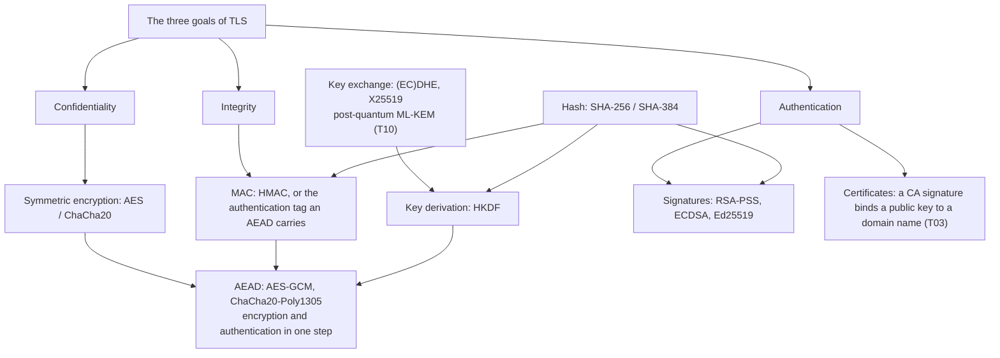
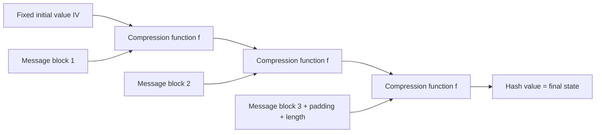
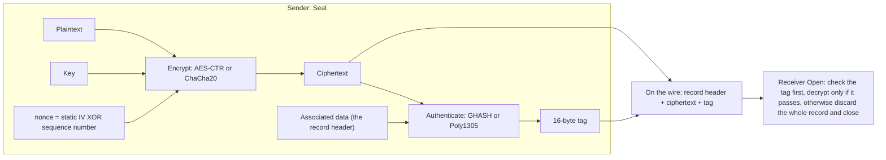
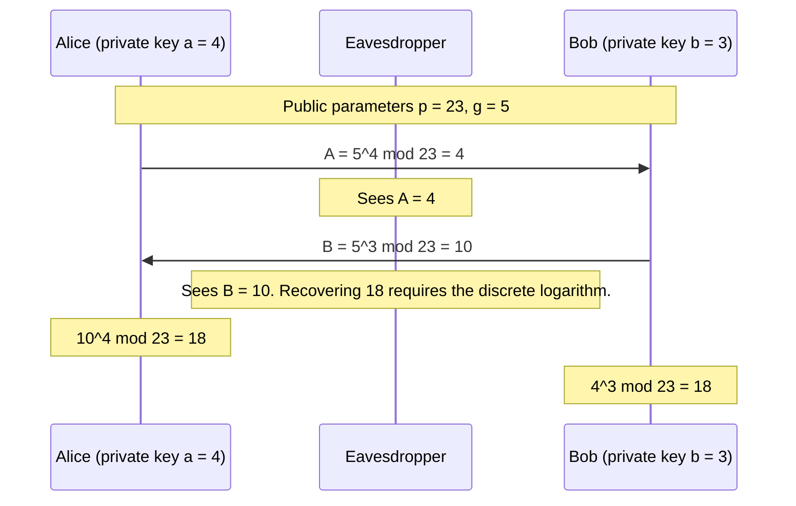
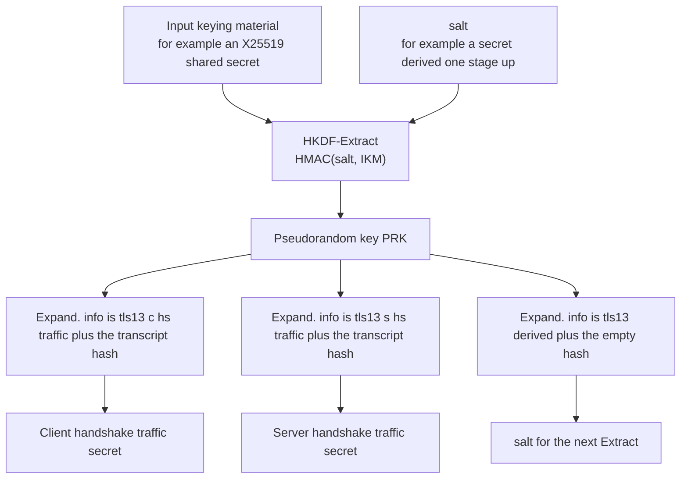
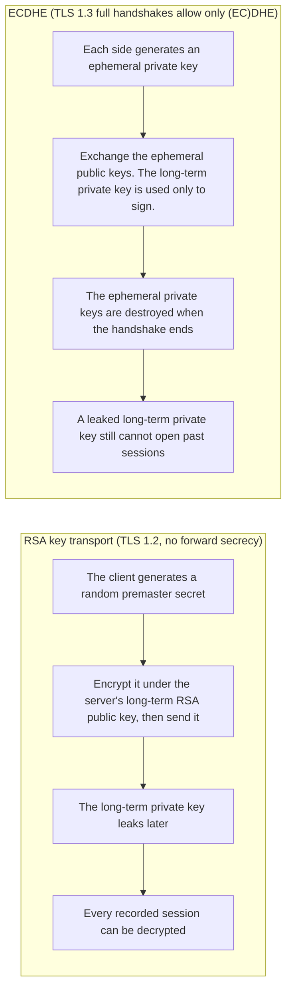

# T02 · Cryptography: every algorithm TLS uses

> Series: [[00_tls-series-overview|TLS series overview]] · Previous: [[T01_http-to-https-request-lifecycle|T01 one request, end to end]] · Next: [[T03_certificates-and-pki|T03 certificates and PKI]]
> Prerequisites: the basic idea of modular arithmetic (congruences), and what XOR is.
> Primary standards: FIPS 180-4 (SHA-2), RFC 2104 (HMAC), FIPS 197 (AES), NIST SP 800-38D (GCM), RFC 5116 (the AEAD interface), RFC 8439 (ChaCha20-Poly1305), RFC 8017 (PKCS #1 v2.2), RFC 7919 (FFDHE groups), RFC 7748 (X25519/X448), FIPS 186-5 (ECDSA, EdDSA), RFC 8032 (EdDSA), RFC 5869 (HKDF)
> Compiled: 2026-10-16

TLS has to provide confidentiality, integrity, and authentication at the same time, on a network that is not safe, and it has a small set of tools for that. There are about a dozen cryptographic primitives, and each one has a definite job. This note walks through them in one order: what problem it solves, why the mathematics holds, where TLS uses it, and where it has failed before. The small-number examples in the text were checked with programs. The size of the real parameters is marked separately. Post-quantum algorithms are in [[T10_post-quantum-tls|T10]] on their own.

The division of labor, before each section expands it:



In one sentence: during the handshake, a key-exchange algorithm gives both sides the same shared secret, a signature and a certificate prove the server's identity, a hash compresses the whole handshake into a digest so it can be signed and checked, HKDF derives a set of unrelated keys from the shared secret, and after that every data record is encrypted and authenticated with an AEAD.

## Hash functions: compress data of any length into a fixed fingerprint

A cryptographic hash function H maps an input of any length to an output of fixed length. SHA-256 outputs 32 bytes. SHA-384 outputs 48 bytes. It has to satisfy three properties. Preimage resistance: given an output y, finding an x such that H(x) = y is infeasible. Second-preimage resistance: given x, finding a different x' such that H(x') = H(x) is infeasible. Collision resistance: finding any pair of distinct inputs x and x' with the same hash is infeasible. For an n-bit output, a brute-force search for a preimage takes about 2^n attempts. A search for a collision, by the birthday paradox, takes only about 2^(n/2) attempts. The collision resistance of SHA-256 is therefore 128 bits, which is why it is paired with AES-128 and with X25519.

The internal structure of the SHA-2 family (FIPS 180-4) is Merkle-Damgård. Pad the message out to a multiple of the block length. Start from a fixed initial value. For each message block in turn, feed the block and the current state into the compression function, and take the result as the new state. The final state is the hash value.



This structure has a direct consequence, called length extension. The hash value is the final internal state. Given H(m) and the length of m, and without knowing m itself, one can continue the computation and obtain H(m || padding || m'). So "put the key in front of the message and hash," that is H(K || m), cannot serve as a message authentication code. An attacker can forge a valid extended message without knowing K. That is the hole HMAC is built to avoid. SHA-3, which uses a sponge construction, does not have this problem. The five cipher suites of TLS 1.3 use only SHA-256 and SHA-384.

Hashes show up everywhere in TLS. TLS 1.3 uses one to maintain the transcript hash of the whole handshake. Signatures and the Finished message are computed over that digest. HKDF and HMAC are built on top of it. A certificate signature is a signature over the hash of the certificate contents. Collisions in SHA-1 and in MD5 have been constructed in practice. SHAttered, in 2017, produced the first pair of PDFs that collide under SHA-1. TLS 1.3 forbids both in handshake signatures. MD5 is gone from TLS 1.3 entirely, and SHA-1 remains only as a deprecated legacy option for signatures inside certificates (RFC 8446 §4.2.3).

## HMAC: a keyed fingerprint

A message authentication code (MAC) answers this question: was this data sent by someone who holds the same key, and was it altered on the path? HMAC (RFC 2104) builds a MAC out of a hash function:

```
HMAC(K, m) = H( (K' ⊕ opad) || H( (K' ⊕ ipad) || m ) )

K'   = pad the key out to the hash block length (64 bytes for SHA-256). Hash it first if it is longer.
ipad = 0x36 repeated out to the block length
opad = 0x5c repeated out to the block length
```

The two nested layers exist to close length extension. The input to the outer hash is the result of the inner hash, plus another value derived from the key. An attacker who sees the HMAC output cannot recover the inner state and keep extending. The security of HMAC reduces to the assumption that the compression function is a pseudorandom function. Even when the collision resistance of the underlying hash is damaged, HMAC often stays safe. That is why HMAC-MD5 did not collapse outright for a long time after collision attacks against MD5 succeeded.

The CBC cipher suites in TLS 1.2 use HMAC as the integrity check on each record. The PRF in TLS 1.2, and HKDF and the Finished message in TLS 1.3, are all built on HMAC. In TLS 1.3, the integrity of the record itself is provided by the AEAD. HMAC is left with key derivation and with checking the handshake.

## Symmetric encryption: AES and block modes

Symmetric encryption uses the same key to encrypt and to decrypt. It is fast, and it is what protects the actual data. AES (FIPS 197) is a block cipher. It takes a 16-byte plaintext block and a key of 16, 24, or 32 bytes, and it outputs a 16-byte ciphertext block. Inside, it repeats a number of rounds: 10 rounds for AES-128, 14 rounds for AES-256. Each round does four things. It substitutes every byte through a fixed S-box (SubBytes, which supplies the nonlinearity). It rotates the bytes within each row (ShiftRows). It multiplies each column by a matrix over the finite field GF(2^8) (MixColumns, which spreads a change in one byte across the whole column). It XORs in that round's round key (AddRoundKey). After a few rounds, every bit of the plaintext depends on every bit of the key, in a complicated way. There is still no practical attack that is much faster than exhaustive search. Modern x86 and ARM processors have dedicated AES instructions (AES-NI, and the ARMv8 Crypto Extensions). One core can encrypt several GB per second.

A block cipher handles 16 bytes at a time. Encrypting data of any length needs a mode of operation. ECB mode encrypts each block on its own, so identical plaintext blocks become identical ciphertext blocks. The famous ECB penguin picture still shows its outline after encryption, so ECB is never used in TLS. CBC mode XORs each plaintext block with the previous ciphertext block, then encrypts. The first block is XORed with a random initialization vector (IV). CBC in TLS 1.0 uses the last ciphertext block of the previous record as the IV of the next record, so the IV is predictable. That was the way in for the BEAST attack in 2011. TLS 1.1 changed this so that each record carries an explicit random IV. CTR mode turns the block cipher into a stream cipher. It encrypts "nonce plus counter" to produce a keystream, then XORs the keystream with the plaintext. It can run in parallel, and it needs no padding.

CBC has a deeper problem inside TLS. The practice in TLS 1.2 and earlier was to compute the MAC, then pad, then encrypt (MAC-then-Encrypt). The receiver has to decrypt, check the padding, and then check the MAC. Differences in whether those steps succeed, and in how long they take, leak information. In 2002 Vaudenay described the padding oracle attack. In 2013, Lucky Thirteen showed that even a tiny timing difference is enough to recover the plaintext byte by byte. In 2014, POODLE used the fact that SSL 3.0 does not check its padding. The right combination is to encrypt first and then compute the MAC (Encrypt-then-MAC). RFC 7366 added that extension for TLS. The more thorough answer is AEAD. The history of these attacks is in [[T04_ssl-to-tls13-evolution-and-attacks|T04]].

## AEAD: encryption and authentication in one step

AEAD (Authenticated Encryption with Associated Data, RFC 5116) combines encryption and authentication into one interface that is hard to misuse:

```
Seal(key, nonce, plaintext, aad) -> ciphertext || tag
Open(key, nonce, ciphertext || tag, aad) -> plaintext or failure
```

The aad (associated data) is data that has to be authenticated but does not need to be encrypted, such as the record header. On opening, if the ciphertext, the tag, the nonce, or the aad is wrong anywhere, Open fails as a whole and returns no part of the plaintext. Padding oracle problems disappear at the interface. TLS 1.3 allows only AEAD cipher suites. There are five:

| Suite | Code point | AEAD | Hash |
| --- | --- | --- | --- |
| TLS_AES_128_GCM_SHA256 | 0x1301 | AES-128-GCM | SHA-256 |
| TLS_AES_256_GCM_SHA384 | 0x1302 | AES-256-GCM | SHA-384 |
| TLS_CHACHA20_POLY1305_SHA256 | 0x1303 | ChaCha20-Poly1305 | SHA-256 |
| TLS_AES_128_CCM_SHA256 | 0x1304 | AES-128-CCM | SHA-256 |
| TLS_AES_128_CCM_8_SHA256 | 0x1305 | AES-128-CCM, 8-byte tag | SHA-256 |

The first three are the ones actually deployed at scale. CCM shows up mostly on IoT devices. A TLS 1.3 suite name no longer names a key exchange or a signature algorithm. Those two are negotiated by separate extensions (see [[T06_tls13-handshake-and-key-schedule|T06]]).

AES-GCM (NIST SP 800-38D) has two parts. CTR mode encrypts the data. GHASH computes the authentication tag. GHASH splits the associated data and the ciphertext into 16-byte blocks, treats the blocks as elements of the finite field GF(2^128), and evaluates a polynomial whose unknown is the hash subkey H = AES_K(0^128). It then XORs the result with AES_K applied to the initial counter block derived from the nonce, and that produces a 16-byte tag. Mathematically it is polynomial evaluation at the point H. With a carry-less multiply instruction (PCLMULQDQ) it is very fast. The GCM nonce is 12 bytes. TLS 1.3 builds it as the per-record sequence number XORed with a static IV, which guarantees that the nonce never repeats under the same key.

A nonce that never repeats is what GCM's security depends on. If the same nonce is used twice under the same key, the two ciphertexts were produced with the same keystream, and XORing them yields the XOR of the two plaintexts. Worse, an attacker can solve for the GHASH subkey H from that, and then forge a valid tag on any message. An Internet scan in 2016 found 184 devices, among HTTPS servers, that reused a GCM nonce (Böck et al., "Nonce-Disrespecting Adversaries"). That is an implementation error, not a defect in the algorithm, but it is enough to show why TLS 1.3 writes the nonce construction into the protocol, and does not leave it for each implementation to invent.

ChaCha20-Poly1305 (RFC 8439) is the other route. ChaCha20 is a stream cipher designed by Daniel Bernstein. The state is 16 words of 32 bits: constants, a 256-bit key, a 32-bit block counter, and a 96-bit nonce. Each 64-byte block of keystream is produced by 20 rounds built from quarter-round operations that use only addition, XOR, and rotation (ARX). It needs no lookup tables. It is naturally constant time. On a device without AES hardware instructions it is much faster than AES in software, and it is less exposed to cache-timing side channels. Poly1305 is a one-time authenticator. It takes the first 32 bytes of ChaCha20 block 0 as a one-time key (r, s), treats the message blocks as integers modulo the prime 2^130 - 5, evaluates the polynomial at the point r, and adds s. Around 2014, Google brought it into Chrome and into Google's own servers, mainly for the Android phones of that time, which had no AES instructions. A common choice on the server is this: if the client's cipher_suites list puts ChaCha20 ahead of AES-GCM, a sign that the client probably has no AES hardware, pick ChaCha20. Otherwise pick AES-GCM.



AEAD also has a usage limit that is easy to overlook. The amount of data encrypted under one key cannot grow without a bound, or the advantage of a distinguishing attack accumulates. RFC 8446 §5.5 gives a suggested limit for AES-GCM of about 2^24.5 full-size records per key. Use KeyUpdate to replace the key before crossing that limit. The limit for ChaCha20-Poly1305 is so high that practice does not reach it.

## Public-key cryptography: RSA

Symmetric encryption requires the two sides to share a key beforehand. Talking to an unfamiliar server on the Internet is exactly the case where that premise is missing. Public-key cryptography gives each party a key pair. The public key is public. The private key stays secret. Something encrypted under the public key can be decrypted only with the private key. Something signed with the private key can be verified by anyone who has the public key.

The mathematics of RSA (1977) is that multiplying two large primes is easy, and factoring the product is hard. Key generation picks two large primes p and q, computes n = pq and φ(n) = (p-1)(q-1), picks a public exponent e (in practice almost always 65537), and finds the private exponent d such that e·d ≡ 1 (mod φ(n)). Encryption is c = m^e mod n. Decryption is m = c^d mod n. Decryption recovers the message because Euler's theorem gives m^(e·d) = m^(1 + kφ(n)) ≡ m (mod n).

A small example that can be checked by hand: take p = 61 and q = 53, so n = 3233 and φ(n) = 3120. Take e = 17. Then d = 2753, because 17 × 2753 = 46801 = 15 × 3120 + 1. Encrypt the message m = 65: c = 65^17 mod 3233 = 2790. Decrypt 2790^2753 mod 3233 = 65, which is the original message again. Real RSA uses a 2048-bit or 3072-bit n, that is, two primes of 1024 bits or 1536 bits each. The best algorithm for factoring a 2048-bit n, the number field sieve, is far from feasible on a classical computer. The equivalent security strength is about 112 bits. A 3072-bit n is about 128 bits.

Textbook RSA cannot be used directly. It is deterministic: the same plaintext always produces the same ciphertext. It is also multiplicatively homomorphic, so an attacker can build related ciphertexts. Real use has to add padding. PKCS #1 v1.5 encryption padding (RFC 8017 §7.2) is the format TLS 1.2 and earlier used for RSA key transport: `00 02 | random nonzero bytes | 00 | message`. In 1998 Bleichenbacher found that if the server gives a distinguishable answer to "was the padding valid after decryption," an attacker who sends about a million carefully built ciphertexts can decrypt any ciphertext. That is the million-message attack. Over the following twenty years the attack kept coming back in one variant after another. ROBOT, in 2017, found that the TLS implementations at many large companies could still be broken by it. OAEP (RFC 8017 §7.1) is an encryption padding with a security proof. PSS (RFC 8017 §8.1) is a signature padding with a security proof.

Inside TLS, RSA used to hold two jobs at once. One was key transport. In the RSA key exchange of TLS 1.2, the client generates a random premaster secret, encrypts it under the RSA public key in the server certificate, and sends it to the server. The fatal problem with that use is that there is no forward secrecy. Once the server's private key leaks, every session recorded in the past can be decrypted. The other job was signatures. The server signs the handshake with its RSA private key, and that proves it holds the certificate. TLS 1.3 removed RSA key transport completely. RSA keeps only the signature job, and an RSA signature in the handshake has to use PSS (`rsa_pss_rsae_sha256` and the related names). A PKCS #1 v1.5 signature is allowed only as the signature on the certificate itself (RFC 8446 §4.2.3).

## Diffie-Hellman: a shared secret on a public channel

The key exchange Diffie and Hellman proposed in 1976 answers a question that looks impossible. If two people are overheard in everything they say, can they still agree a secret that only they know?

In the finite-field version, the two sides publicly agree a large prime p and a generator g. Alice picks a random private key a and sends A = g^a mod p. Bob picks a random private key b and sends B = g^b mod p. Alice computes B^a = g^(ab) mod p. Bob computes A^b = g^(ab) mod p. The two of them hold the same number. An eavesdropper sees p, g, A, and B. Recovering a from A is the discrete logarithm problem. For a large prime that has been chosen with care, no efficient algorithm is known.

A small-number example: p = 23 and g = 5. Alice picks a = 4 and sends A = 5^4 mod 23 = 4. Bob picks b = 3 and sends B = 5^3 mod 23 = 10. Alice computes 10^4 mod 23 = 18. Bob computes 4^3 mod 23 = 18. The shared secret is 18.



DH on its own authenticates nobody. A man in the middle can run a separate DH with each side, and each side believes it is talking to the other. TLS therefore always binds DH to a signature. The server signs the DH public key it sends. In TLS 1.2 that signature covers the parameters inside ServerKeyExchange. In TLS 1.3 it covers the whole handshake transcript.

DH that uses a fresh random private key for every connection, and discards it after use, is called ephemeral DH (DHE). That is where forward secrecy comes from. It has a section of its own below. Choosing parameters for finite-field DH is a trap. A prime that is too short can be broken by precomputation. The Logjam attack in 2015 showed that 512-bit export-grade DH can be broken online, and it estimated that a nation-state adversary could precompute a break of the few 1024-bit primes that a large share of servers were reusing at the time. RFC 7919 specifies a set of standardized safe-prime groups for TLS (ffdhe2048, ffdhe3072, and others). TLS today has mostly moved to the elliptic-curve version. Finite-field DH is now rare.

## Elliptic curves: shorter keys, the same hard problem

Elliptic-curve cryptography replaces the multiplicative group modulo p with a different group. Over a finite field, every point that satisfies y^2 = x^3 + ax + b, together with a point at infinity O, forms a group. The group operation is point addition. The geometric picture is: draw the line through two points, take the third intersection with the curve, and reflect that point across the x-axis. The result is the sum. Adding a point to itself uses the tangent line. Scalar multiplication kP means adding P to itself k times. In practice a double-and-add algorithm does it in about log k steps. Computing kP in the forward direction is fast. Recovering k from P and kP is the elliptic curve discrete logarithm problem (ECDLP). The best general algorithm still takes about √n steps. A 256-bit elliptic curve therefore provides about 128 bits of security strength. Finite-field DH and RSA need 3072 bits to reach that same level.

An example on a small curve. Over the field modulo 17, take the curve y^2 = x^3 + 2x + 2, with base point G = (5, 1). The subgroup it generates has order 19: 2G = (6, 3), 3G = (10, 6), ..., 18G = (5, 16), 19G = O. ECDH corresponds to DH exactly. Alice picks a = 3 and publishes A = 3G = (10, 6). Bob picks b = 10 and publishes B = 10G = (7, 11). Alice computes 3B. Bob computes 10A. Both equal 30G = 11G = (13, 10). The shared secret is the x coordinate of that point, which is 13.

TLS commonly uses two families of curves. The NIST curves P-256 and P-384 (secp256r1, secp384r1) are prime-field curves in Weierstrass form. They are the most widely deployed, and settings that have to meet government compliance rules often require them. Implementations have to be careful. A public-key point received from the peer has to be checked, and it has to lie on the curve. Otherwise an attacker can send a point that lands on a weak curve and extract the private key step by step (an invalid curve attack). Research in 2015 found this class of bug in several TLS libraries.

X25519 (RFC 7748) is the DH function on Curve25519, which Bernstein designed in 2006. It is now the key-exchange group used most often in TLS 1.3. The design goal was to make it hard to implement wrong. It uses the Montgomery curve y^2 = x^3 + 486662x^2 + x, defined over the prime 2^255 - 19. It operates on the x coordinate only, using the Montgomery ladder, and that computation is naturally constant time. Any 32-byte string can be accepted as a public-key input. It does not need the point check that P-256 needs. RFC 8446 §7.4.2 still requires a check that the shared secret just computed is not all zeros. Before the private key is used, its low 3 bits and its highest bit are cleared, and bit 254 is set (clamping), which avoids the small-subgroup problem. The public key and the private key are both 32 bytes, half the 65 bytes of an uncompressed P-256 point. In the TLS 1.3 key_share, the X25519 public key is those 32 bytes.

## Digital signatures: proof that "I said this"

A signature is produced with the private key and checked with the public key. It answers this: the data really did come from the holder of the private key, and it has not been modified. Signatures appear in two places in TLS. Inside a certificate, a CA signs the certificate contents with its own private key. Inside the handshake, the server signs the handshake with the private key that corresponds to the certificate. In TLS 1.3 that signature is CertificateVerify.

An RSA signature is the mirror image of the decryption operation. Pad the hash of the message, then compute s = pad(H(m))^d mod n. The verifier computes s^e mod n and checks the padding and the hash. PKCS #1 v1.5 signature padding is deterministic, and it has had forgery problems at the implementation layer. In 2006 Bleichenbacher pointed out that some implementations parsed the padding too loosely when e = 3, and that signatures could be forged. PSS adds a random salt, and it has a security proof.

ECDSA (FIPS 186-5) signs on an elliptic curve. Each time, the signer picks a random number k, takes the x coordinate of the point kG modulo n to get r, then computes s = k^(-1)(H(m) + r·d) mod n. The signature is the pair (r, s). This k has to be truly random. It must never be repeated, and it must never leak. If two signatures use the same k, the private key d falls straight out of the two equations. In 2010 the fail0verflow team recovered the Sony PS3 firmware signing key that way, because Sony's implementation used the same k every time. In 2013 a defect in the Android random-number generator let the ECDSA private keys of a batch of Bitcoin wallets be computed. Even when k does not repeat, a bias in a few bits of k is enough for lattice methods to recover the private key. RFC 6979 proposes generating k deterministically from the private key and the message hash, which avoids this risk.

The algorithm used most often from EdDSA (RFC 8032) is Ed25519. The design removes the random number. The nonce is a hash of a secret derived from the private key, together with the message. The same message always produces the same signature. Distinct messages are overwhelmingly unlikely to land on the same nonce. That class of ECDSA failure is gone. An Ed25519 public key is 32 bytes, and a signature is 64 bytes. Verification is fast, and the implementation is simple. The signature_algorithms list in TLS 1.3 includes `ed25519` (0x0807). Certificates that CAs issue in the public Web PKI are still mostly RSA and ECDSA on P-256 or P-384, because EdDSA certificates arrived late in the CA/B Forum Baseline Requirements and in the major root programs.

| Algorithm | Public key size | Signature size | Classical security strength | Example code point in TLS 1.3 |
| --- | --- | --- | --- | --- |
| RSA-2048 PSS | 256-byte modulus | 256 bytes | about 112 bits | rsa_pss_rsae_sha256 (0x0804) |
| ECDSA P-256 | 65 bytes (uncompressed point) | about 70 to 72 bytes (DER encoding) | about 128 bits | ecdsa_secp256r1_sha256 (0x0403) |
| Ed25519 | 32 bytes | 64 bytes | about 128 bits | ed25519 (0x0807) |

## HKDF: grow a set of keys from one secret

The shared secret that DH computes cannot be used directly as an AES key. Its distribution is not uniform. It is an element of a group, not a uniformly random string of bits. The length may be wrong as well. And one handshake needs several keys that are unrelated to each other: one for the client to send with, one for the server to send with, one for the handshake phase, one for the application-data phase, and one for session resumption. A key derivation function (KDF) is what does that job.

HKDF (RFC 5869) is a two-step KDF built on HMAC. Extract first, then expand:

```
Extract: PRK = HKDF-Extract(salt, IKM) = HMAC-Hash(salt, IKM)
Expand:  T(0) = empty string
         T(i) = HMAC-Hash(PRK, T(i-1) || info || i), with i represented by one byte
         OKM  = T(1) || T(2) || ... truncated to the first L bytes
```

The extract step concentrates input keying material (IKM) whose distribution may be uneven, such as a DH shared secret, into one uniform pseudorandom key, the PRK. The expand step uses different info strings to derive as many mutually independent keys as needed from that same PRK. When the info strings differ, the derived keys are unrelated as far as computation can tell. Knowing one of them does not let you derive another. That is called key separation.

Test vector 1 in Appendix A of RFC 5869 can be used directly to check an implementation. The IKM is 22 bytes of 0x0b. The salt runs from 0x00 through 0x0c, 13 bytes in all. The info runs from 0xf0 through 0xf9. L = 42. With SHA-256, the result is PRK = `077709362c2e32df0ddc3f0dc47bba6390b6c73bb50f9c3122ec844ad7c2b3e5` and OKM = `3cb25f25faacd57a90434f64d0362f2a2d2d0a90cf1a5a4c5db02d56ecc4c5bf34007208d5b887185865`. Both values were recomputed on this machine with Node.js `crypto.hkdfSync`, and they match the RFC.

The whole TLS 1.3 key schedule is a chain of HKDF calls. It defines `HKDF-Expand-Label`, and it writes the label as `"tls13 " + purpose name` (for example `"tls13 c hs traffic"`). That label, together with the transcript hash at that moment, is the info. From one main chain it derives, in order, the handshake keys, the application keys, the resumption secret, and the exporter secret. That derivation tree is the focus of [[T06_tls13-handshake-and-key-schedule|T06]]. TLS 1.2 uses a different construction, called the PRF, which is an iteration of P_hash based on HMAC. It is covered in [[T05_tcp-and-tls12-handshake|T05]].



## Forward secrecy: today's private key must not open yesterday's traffic

Forward secrecy (also called perfect forward secrecy, PFS) means this: if the server's long-term private key leaks at some later date, an attacker still cannot decrypt sessions that were recorded before the leak.

RSA key transport cannot provide it. The premaster secret is encrypted under the server's long-term RSA public key. Whoever obtains that private key can open every recorded handshake and derive the keys of every session. Recording traffic now and decrypting it later is a real practice. The bulk traffic collection disclosed in the Snowden documents of 2013 made the industry alert to it. With that practice in the world, the missing forward secrecy is unacceptable.

With ephemeral DH (DHE, ECDHE), the session keys come from DH private keys that the two sides generate at random for that connection and then discard. The long-term private key is used only to sign, to prove identity. It takes no part in generating the key. The recorded traffic contains only the DH public keys. Decrypting it requires the DH private keys, and those are already gone. A leaked long-term private key only lets an attacker impersonate the server on future connections. It does not open the past.



TLS 1.3 makes forward secrecy mandatory. A full handshake can use only (EC)DHE. On session resumption, the `psk_dhe_ke` mode runs another DH in addition to the PSK, which keeps the forward secrecy. The exceptions are pure PSK mode and 0-RTT early data. That exception is covered in [[T07_session-resumption-0-rtt-and-performance|T07]]. TLS 1.2 had another hole that was easy to miss. A session ticket is encrypted under a ticket key that the server holds. If that key goes a long time without rotation, it becomes a new "long-term private key". Anyone who steals that key can open every session resumed with a ticket, so ticket keys have to be rotated often.

## Randomness: the foundation of everything

Every algorithm above assumes random numbers of high quality: the 32-byte random in the TLS handshake, the DH private keys, the k in ECDSA, the session tickets, the padding. If the random numbers fail, the strongest algorithm fails with them.

Two real lessons. In 2006, a Debian maintainer deleted two lines of OpenSSL that fed entropy into the random pool, in order to silence a warning from a memory checker. For nearly two years after that, every key generated on Debian and Ubuntu drew its entropy essentially from the process ID. There were only a little over 30,000 possibilities in all. When this was found in 2008, every affected SSH key and TLS key had to be invalidated and generated again. The other lesson is Dual_EC_DRBG, an elliptic-curve random number generator that NIST had standardized. There was no way to explain where its constants came from. The Snowden documents of 2013 indicated that a backdoor had likely been planted in it. In 2015, Juniper's firewalls were found to have had those parameters replaced, which made it possible to decrypt VPN traffic passively. The practice today is to use the operating system's CSPRNG, such as `getrandom` on Linux and `SecRandomCopyBytes` on macOS. Do not build your own.

ServerHello.random in TLS 1.3 has one more duty. When a server supports TLS 1.3 but is forced to negotiate a lower version, it has to write a fixed downgrade sentinel into the last 8 bytes of random. The client uses that value to recognize a downgrade attack (RFC 8446 §4.1.3). See [[T06_tls13-handshake-and-key-schedule|T06]].

## Security strength, side by side

Key lengths from different algorithms cannot be compared directly. They have to be converted into a count of bits: how many elementary operations an attacker would need. The table below is the usual comparison on a classical computer, following NIST SP 800-57 Part 1. What a quantum computer changes is covered in T10.

| Security strength | Symmetric encryption | Hash (collision resistance) | RSA / finite-field DH | Elliptic curve |
| --- | --- | --- | --- | --- |
| about 112 bits | 3DES (retired) | SHA-224 | 2048 bits | 224 bits |
| about 128 bits | AES-128 | SHA-256 | 3072 bits | P-256, X25519 |
| about 192 bits | AES-192 | SHA-384 | 7680 bits | P-384 |
| about 256 bits | AES-256 | SHA-512 | 15360 bits | P-521 (X448 is about 224 bits, between the 192-bit and 256-bit rows) |

Cipher suites and parameter choices in TLS are usually made so that the strength of each stage roughly matches. TLS_AES_128_GCM_SHA256 together with X25519 and ECDSA P-256 is the 128-bit tier. TLS_AES_256_GCM_SHA384 together with P-384 is the 192-bit tier. The strength of a chain is the strength of its weakest link. Pair AES-256 with an RSA-2048 signature, and the whole thing is still the 112-bit tier.

## Common misconceptions

Encryption is enough, and a separate integrity check is unnecessary. Encryption that does not authenticate is malleable. Under CTR, and under a stream cipher, flipping one bit of the ciphertext flips the matching bit of the plaintext exactly. An attacker can alter the data without knowing what it says. The largest share of historical TLS vulnerabilities came from the way encryption and authentication were combined. That is why an AEAD is the only option.

Public-key encryption is what you use to encrypt data. A public-key operation is several orders of magnitude slower than symmetric encryption. TLS never uses it to encrypt application data. Public-key cryptography does two things in TLS. It agrees a shared secret, which is key exchange. It proves identity, which is a signature. The data is always protected by a symmetric AEAD.

A longer RSA key is always better, so 4096 bits is much safer than 2048 bits. 4096 bits is indeed harder to factor. Signing and decryption take about 6 to 8 times as long as they do at 2048 bits, and the certificate is larger, which slows the handshake. Against a classical computer, 3072 bits already provides 128-bit strength. Against a quantum computer, RSA of any length is not enough. The right direction is a move to post-quantum algorithms (T10).

Using ECDHE means forward secrecy comes with it. Forward secrecy requires that the ephemeral private key really is discarded after use. If a server reuses the same ECDHE private key for a long time in order to save CPU, or if the session ticket key goes a long time without rotation, forward secrecy is weakened in practice.

A hash is a form of encryption. A hash is one-way, and it has no key. There is nothing to decrypt. What it provides is a fingerprint, and the basis of an integrity check. Storing a password as SHA-256 and calling that "encrypted" mixes up two different ideas. Passwords should be stored with a dedicated slow hash, such as Argon2, scrypt, or bcrypt. That has nothing to do with TLS, and it is a common misuse of the same kind.

## Sources cited in this note

- FIPS 180-4, Secure Hash Standard (SHS), https://csrc.nist.gov/pubs/fips/180-4/upd1/final
- RFC 2104, HMAC: Keyed-Hashing for Message Authentication, https://www.rfc-editor.org/rfc/rfc2104
- FIPS 197, Advanced Encryption Standard (AES), https://csrc.nist.gov/pubs/fips/197/final
- NIST SP 800-38D, Galois/Counter Mode (GCM) and GMAC, https://csrc.nist.gov/pubs/sp/800/38/d/final
- RFC 5116, An Interface and Algorithms for Authenticated Encryption, https://www.rfc-editor.org/rfc/rfc5116
- RFC 8439, ChaCha20 and Poly1305 for IETF Protocols, https://www.rfc-editor.org/rfc/rfc8439
- RFC 7366, Encrypt-then-MAC for TLS and DTLS, https://www.rfc-editor.org/rfc/rfc7366
- RFC 8017, PKCS #1: RSA Cryptography Specifications Version 2.2, https://www.rfc-editor.org/rfc/rfc8017
- RFC 7919, Negotiated Finite Field Diffie-Hellman Ephemeral Parameters for TLS, https://www.rfc-editor.org/rfc/rfc7919
- RFC 7748, Elliptic Curves for Security (X25519, X448), https://www.rfc-editor.org/rfc/rfc7748
- FIPS 186-5, Digital Signature Standard (DSS), https://csrc.nist.gov/pubs/fips/186-5/final
- RFC 8032, Edwards-Curve Digital Signature Algorithm (EdDSA), https://www.rfc-editor.org/rfc/rfc8032
- RFC 6979, Deterministic Usage of DSA and ECDSA, https://www.rfc-editor.org/rfc/rfc6979
- RFC 5869, HMAC-based Extract-and-Expand Key Derivation Function (HKDF), https://www.rfc-editor.org/rfc/rfc5869
- RFC 8446, The Transport Layer Security (TLS) Protocol Version 1.3 (downgrade protection in §4.1.3, signature algorithms in §4.2.3, limits on key usage in §5.5), https://www.rfc-editor.org/rfc/rfc8446
- NIST SP 800-57 Part 1 Rev. 5, Recommendation for Key Management, https://csrc.nist.gov/pubs/sp/800/57/pt1/r5/final
- Böck, Zauner, Devlin, Somorovsky, Jovanovic, "Nonce-Disrespecting Adversaries: Practical Forgery Attacks on GCM in TLS", USENIX WOOT 2016, https://www.usenix.org/conference/woot16/workshop-program/presentation/bock
- Adrian et al., "Imperfect Forward Secrecy: How Diffie-Hellman Fails in Practice" (Logjam), CCS 2015, https://weakdh.org/
- Böck, Somorovsky, Young, "Return Of Bleichenbacher's Oracle Threat (ROBOT)", USENIX Security 2018, https://robotattack.org/
