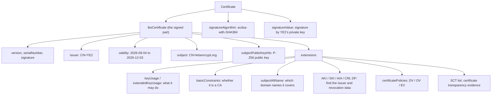
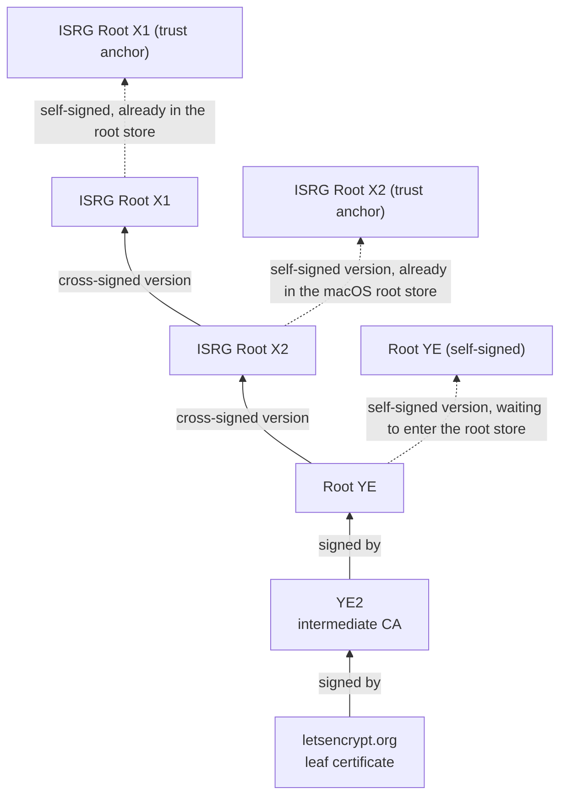
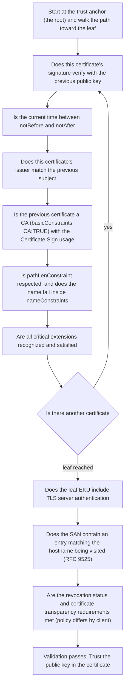
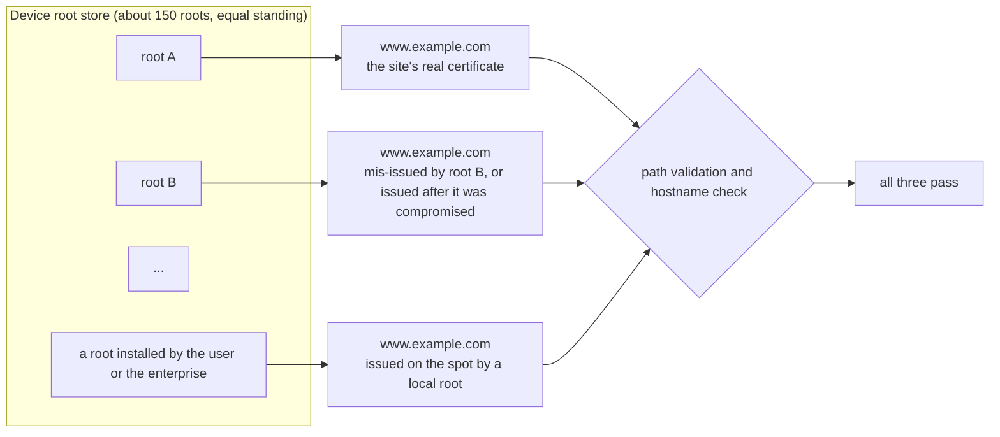
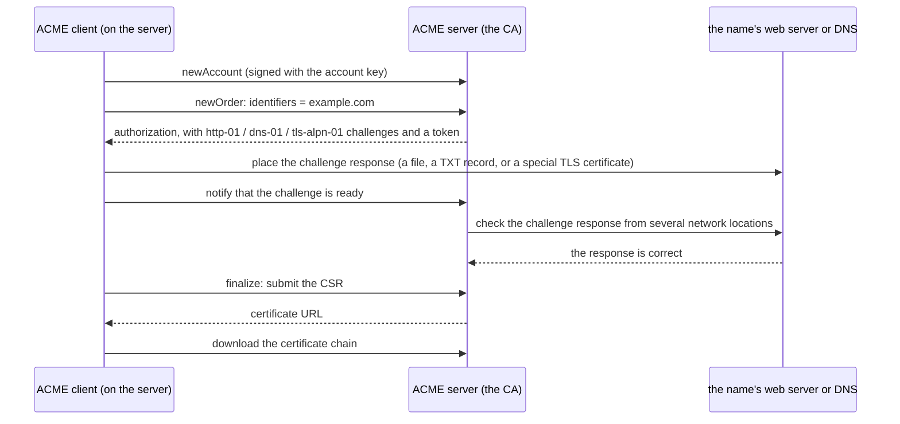
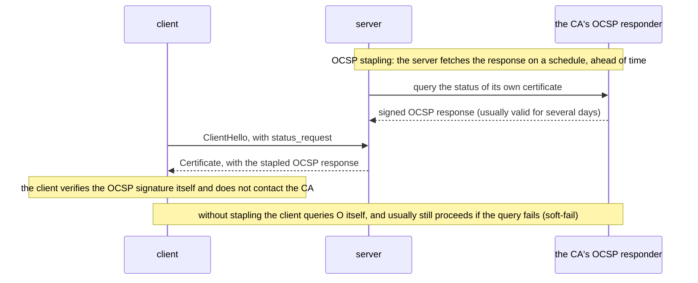
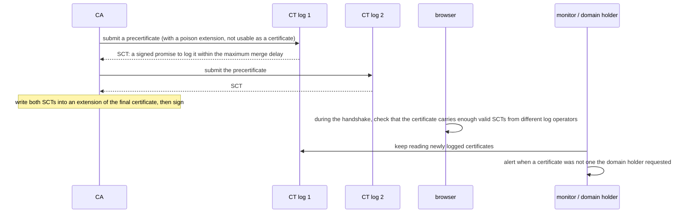

# T03 · Certificates and PKI: where trust comes from

> Series: [[00_tls-series-overview|TLS series overview]] · Previous: [[T02_cryptography-foundations-for-tls|T02 cryptography basics]] · Next: [[T04_ssl-to-tls13-evolution-and-attacks|T04 protocol history and attacks]]
> Prerequisites: digital signatures and hashes from T02.
> Primary standards: RFC 5280 (X.509 certificates and CRLs), RFC 9525 (service identity checking in TLS), RFC 6960 (OCSP), RFC 6066 §8 (OCSP stapling), RFC 7633 (Must-Staple), RFC 6962 and RFC 9162 (certificate transparency), RFC 8659 (CAA), RFC 8555 (ACME), RFC 8737 (TLS-ALPN-01), CA/B Forum Baseline Requirements
> Compiled: 2026-10-16 (the real certificate in this note was fetched from letsencrypt.org at 2026-10-17 02:49 UTC)

T02 covered signatures: sign with the private key, verify with the public key. A signature only proves "this data came from some private key". It does not answer a more basic question: whose public key is this? In the TLS handshake the server sends a public key and signs with the matching private key to prove it holds that key. If an attacker sits in the middle and substitutes their own public key and their own signature, the client still verifies successfully. It has verified the attacker. Certificates and PKI (Public Key Infrastructure) exist to answer "who does this public key belong to". This note starts from a real certificate and covers its structure, how a certificate chain is validated, and why a root store is trusted. It then spells out what "any certificate this root signs is trusted" means, and what that costs. It ends with the mechanisms that keep the system credible: issuance, revocation, certificate transparency, and certificate lifetime.

## What problem a certificate solves

The most direct idea is to give the client every site's public key in advance. There are over a hundred million sites, and public keys change, so that does not work. A certificate introduces a third party both sides trust, a certificate authority (CA). After the CA checks that the applicant really controls `example.com`, it writes the statement "the public key of `example.com` is this one", together with a validity period, a purpose, and similar information, into a structured document, and signs that document with the CA's own private key. The signed document is the certificate. A client that already trusts the public keys of a small number of CAs can validate any site's certificate. Verify the CA's signature, confirm that the domain name in the certificate is the one it is trying to reach, and it can believe that the public key in the certificate belongs to the holder of that domain.

Trust is transferred and compressed. The client does not need to know a hundred million sites. It only needs to know a bit more than a hundred CAs. The cost is that the client's judgment of a site's identity rests entirely on the assumption that these CAs will not mis-issue. Most of the mechanisms in the second half of this note are patches on that assumption.

## A real certificate

Start with a real certificate. Below is the server certificate fetched from `letsencrypt.org` on 2026-10-17, decoded with OpenSSL 4.0.3 `openssl x509 -noout -text`, with the hexadecimal detail of the public key and the signature removed:

```
Certificate:
    Data:
        Version: 3 (0x2)
        Serial Number: 05:43:93:3b:e3:86:b3:a2:b3:ad:d5:34:f2:10:3b:c8:b6:5f
        Signature Algorithm: ecdsa-with-SHA384
        Issuer: C=US, O=Let's Encrypt, CN=YE2
        Validity
            Not Before: Sep  4 14:34:32 2026 GMT
            Not After : Dec  3 14:34:31 2026 GMT
        Subject: CN=letsencrypt.org
        Subject Public Key Info:
            Public Key Algorithm: id-ecPublicKey
                Public-Key: (256 bit field, 128 bit security level)
                ASN1 OID: prime256v1
                NIST CURVE: P-256
        X509v3 extensions:
            X509v3 Key Usage: critical
                Digital Signature
            X509v3 Extended Key Usage:
                TLS Web Server Authentication
            X509v3 Basic Constraints: critical
                CA:FALSE
            X509v3 Subject Key Identifier: 16:68:8D:1E:...
            X509v3 Authority Key Identifier: B9:59:F2:8E:...
            Authority Information Access:
                CA Issuers - URI:http://ye2.i.lencr.org/
            X509v3 Subject Alternative Name:
                DNS:cp.letsencrypt.org, DNS:cp.root-x1.letsencrypt.org, ... (11 names)
            X509v3 Certificate Policies:
                Policy: 2.23.140.1.2.1
            X509v3 CRL Distribution Points:
                URI:http://ye2.c.lencr.org/96.crl
            CT Precertificate SCTs:
                Signed Certificate Timestamp: Log ID D8:09:55:3B:...  Timestamp: Sep  4 15:33:02.377 2026 GMT
                Signed Certificate Timestamp: Log ID 46:AF:86:3D:...  Timestamp: Sep  4 15:33:02.552 2026 GMT
    Signature Algorithm: ecdsa-with-SHA384
    Signature Value: 30:65:02:31:00:ee:1d:b0:...
```

The certificate says quite a bit. The issuer is Let's Encrypt's intermediate CA `YE2`. Validity runs from 2026-09-04 to 2026-12-03, exactly 90 days, which is Let's Encrypt's current default certificate lifetime. The public key is a P-256 elliptic-curve key. Use is limited to digital signature and TLS server authentication. It is not a CA (`CA:FALSE`), so it cannot sign certificates for anyone else. It covers 11 domain names. The policy OID `2.23.140.1.2.1` marks it as a domain-validated (DV) certificate. It carries two timestamps from different certificate transparency logs. It has a CRL distribution point and no OCSP address, which matches Let's Encrypt shutting down its OCSP service in 2025. The fields are explained one by one below.

## The structure of X.509

The certificate format TLS uses is X.509 version 3. The profile for Internet use is RFC 5280. The structure is described in ASN.1 and encoded as bytes with DER (Distinguished Encoding Rules). The outer layer has three fields:

```
Certificate ::= SEQUENCE {
    tbsCertificate       TBSCertificate,      -- the content to be signed
    signatureAlgorithm   AlgorithmIdentifier, -- the signature algorithm the issuer used
    signatureValue       BIT STRING           -- the issuer's signature over tbsCertificate
}

TBSCertificate ::= SEQUENCE {
    version         [0]  EXPLICIT Version DEFAULT v1,   -- v3 is encoded as 2
    serialNumber         CertificateSerialNumber,       -- unique within the issuer; CA/B requires at least 64 random bits
    signature            AlgorithmIdentifier,           -- must match the outer signatureAlgorithm
    issuer               Name,                          -- the issuer's name
    validity             Validity,                      -- notBefore, notAfter
    subject              Name,                          -- the subject's name
    subjectPublicKeyInfo SubjectPublicKeyInfo,          -- algorithm + public key, the SPKI
    issuerUniqueID  [1]  IMPLICIT UniqueIdentifier OPTIONAL,
    subjectUniqueID [2]  IMPLICIT UniqueIdentifier OPTIONAL,
    extensions      [3]  EXPLICIT Extensions OPTIONAL   -- v3 extensions
}
```

tbs is short for "to be signed". The CA hashes the DER bytes of tbsCertificate and signs that hash. The result goes into signatureValue. To validate, the client checks that signature with the issuer's public key. Change any byte and the signature no longer matches.

DER is a TLV (type, length, value) encoding. After DER encoding this certificate is 1098 bytes. The opening bytes look like this:

```
offset  bytes                        meaning
0       30 82 04 46                  SEQUENCE, length in 2 bytes: 0x0446 = 1094, the whole certificate
4       30 82 03 cc                  SEQUENCE, length 0x03cc = 972, tbsCertificate
8       a0 03 02 01 02               [0] explicit tag, containing INTEGER 2, that is version = v3
13      02 12 05 43 93 ... b6 5f     INTEGER, length 0x12 = 18 bytes, the serial number
33      30 0a 06 08 2a 86 48 ce      SEQUENCE containing an OBJECT IDENTIFIER, length 8
        3d 04 03 03                  1.2.840.10045.4.3.3 = ecdsa-with-SHA384
45      30 33 31 0b 30 09 06 03 ...  issuer name, starting with C=US
```

`openssl asn1parse` prints the whole certificate at this level of structure. The full procedure is in [[T13_observing-tls-with-openssl-and-curl|T13]]. DER matters because a certificate is an exact binary document, and the signature covers those exact bytes. Many historical certificate-validation bugs, such as parsers disagreeing about a NUL byte embedded in a name, came from inconsistent ASN.1 parsing.



## Extensions: what a certificate actually says

The v3 extensions are the real body of a modern certificate. Each extension has an OID, a critical flag, and a value. Critical means: if the validator does not recognize the extension, it must reject the whole certificate. It must not ignore the extension (RFC 5280 §4.2).

subjectAltName (SAN, RFC 5280 §4.2.1.6) lists the names the certificate covers. A name can be a DNS name, an IP address, an email address, and so on. Hostname checking looks only at the SAN. The CN (Common Name) in the subject used to carry a domain name as well, but RFC 9525 (2023, replacing RFC 6125) states clearly that a TLS client must not use the CN for hostname matching. Starting with Chrome 58 (2017), Chrome matches only the SAN. A wildcard `*.example.com` matches only one label. It matches `www.example.com`. It does not match `example.com` itself, and it does not match `a.b.example.com`.

basicConstraints (§4.2.1.9) says whether this certificate is a CA, and how many further CA layers may sit under it (pathLenConstraint). The leaf above is `CA:FALSE`. Its issuer, YE2, is `CA:TRUE, pathlen:0`, which means YE2 may sign leaf certificates directly and may not sign a subordinate CA. Around 2002, clients such as IE did not check this field. Anyone with an ordinary website certificate could act as a CA and sign certificates for any name. That is the cautionary case for checking basicConstraints strictly.

keyUsage (§4.2.1.3) and extendedKeyUsage (§4.2.1.12) limit what the public key may be used for. The leaf's keyUsage is `Digital Signature`, which means this ECDSA public key is used only to verify signatures (CertificateVerify in TLS 1.3). An RSA certificate used for RSA key transport in TLS 1.2 also needs `Key Encipherment`. The EKU is `TLS Web Server Authentication` (OID 1.3.6.1.5.5.7.3.1), which means it may be used only for TLS servers. Intermediate certificates and root certificates have `Certificate Sign` and `CRL Sign` in keyUsage.

The Authority Key Identifier and the Subject Key Identifier (§4.2.1.1, §4.2.1.2) identify a public key. While building a certificate chain, the AKI of this certificate is matched to the SKI of the issuer's certificate. That match matters especially when an issuer has several certificates with the same name.

Authority Information Access (AIA, §4.2.2.1) tells the client where to download the issuer's certificate (CA Issuers) and where to query OCSP. The certificate above has only the CA Issuers entry. CRL Distribution Points (§4.2.1.13) give the URL of the revocation list.

The OIDs in certificatePolicies (§4.2.1.4) state the validation level. The CA/B Forum assigns these OIDs: `2.23.140.1.2.1` is domain validation (DV), `2.23.140.1.2.2` is organization validation (OV), `2.23.140.1.2.3` is individual validation (IV), and `2.23.140.1.1` is extended validation (EV).

The SCT list (OID 1.3.6.1.4.1.11129.2.4.2, RFC 6962 §3.3) carries timestamps issued by certificate transparency logs. That is covered on its own later.

nameConstraints (§4.2.1.10) appears only in CA certificates. It can limit a CA to issuing for certain names (permittedSubtrees), or forbid issuance for certain names (excludedSubtrees). It is the standard way to narrow a CA's power to a specified range, and an enterprise-internal CA in particular should use it.

## The certificate chain: why an intermediate is required

The root CA's private key is the most valuable thing in the system. If it leaks, everything it has signed becomes untrustworthy. The root CA's private key is therefore usually kept in an offline hardware security module (HSM), in a physically isolated room, and powered on only for a few ceremonial occasions, such as issuing an intermediate certificate or issuing a CRL. Day-to-day issuance of website certificates is handed to an intermediate CA, whose certificate is signed by the root. If an intermediate CA goes wrong, it can be revoked or retired on its own. The whole root does not have to be replaced. Replacing a root requires every operating system and browser to update its root store, and that cycle is measured in years.

That forms a chain. The leaf certificate (also called an end-entity certificate) is signed by an intermediate certificate. The intermediate certificate is signed by a root certificate. The root certificate signs itself (self-signed). Its trust does not come from the signature. It comes from being preinstalled in the root store. In the handshake's Certificate message the server sends the leaf and the intermediates. It usually does not send the root. The client has to already possess the root before it can trust it, so sending the root does nothing.

The chain letsencrypt.org actually sent on 2026-10-17 has four certificates:

```
 0 s:CN=letsencrypt.org                                   leaf, P-256, 1098 bytes
   i:C=US, O=Let's Encrypt, CN=YE2
 1 s:C=US, O=Let's Encrypt, CN=YE2                        intermediate CA, P-384, pathlen:0, 656 bytes
   i:C=US, O=ISRG, CN=Root YE
 2 s:C=US, O=ISRG, CN=Root YE                             new-generation root Root YE (the version cross-signed by X2), 682 bytes
   i:C=US, O=Internet Security Research Group, CN=ISRG Root X2
 3 s:C=US, O=Internet Security Research Group, CN=ISRG Root X2   X2 (the version cross-signed by X1), 1140 bytes
   i:C=US, O=Internet Security Research Group, CN=ISRG Root X1
```

This chain shows an important mechanism: cross-signing. When a new root CA is first created, it is not yet in anyone's root store, and it takes several years before enough devices include it. In the meantime it asks an old root that is already widely trusted to sign a certificate for it. The new root's public key then has two certificates: a self-signed one, waiting to enter root stores, and one signed by the old root, so old devices can still validate. Let's Encrypt itself took this path. In 2015, when ISRG Root X1 was not yet trusted, it started with a cross-signature from IdenTrust's DST Root CA X3. In the chain above, Root YE is cross-signed by ISRG Root X2, and X2 is cross-signed by X1. The macOS system root store on this machine contains ISRG Root X1 and X2, and does not contain Root YE. macOS therefore builds the path leaf, YE2, Root YE (the version signed by X2), X2, and stops at X2, because X2 itself is a trust anchor.



This shows that a "certificate chain" is not really one fixed chain. It is a graph. The server sends a bag of certificates. Starting from the leaf, the client searches that bag, intermediates cached locally, and, when needed, certificates downloaded from an AIA URL, and finds a path that reaches any root it trusts. That is called path building. Different clients have different root stores, so the paths they build can differ. The same leaf may validate through X1 on one device and through X2 on another, and both are correct. When the server omits an intermediate, Chrome and Apple platforms download it from AIA to fill the gap. Firefox relies on a list of intermediates built in ahead of time. Command-line tools usually just report an error. That is a common reason a browser can open the site while curl reports an error.

## Path validation: what the client actually checks

Once it has a candidate path, the client checks level by level using the path validation algorithm in RFC 5280 §6. The simplified steps are:



The last two steps are outside the core algorithm of RFC 5280. Hostname matching is specified by RFC 9525. How strict revocation checking is, and what certificate transparency requires, is policy set by each browser and operating system. One more thing: no step in this algorithm asks which CA is supposed to issue this name. That is the subject of the next section.

## Trust stores and root programs

Trust anchors, that is root certificates, live in a root store (also called a trust store). Each major platform keeps its own. Apple's store is used by macOS, iOS, Safari on those systems, and most apps. Microsoft's is used by Windows. Mozilla's NSS store is used by Firefox, and many Linux distributions and open-source projects (including Homebrew's ca-certificates) treat it as the de facto standard. Starting in 2022, Google has been moving Chrome on every platform onto its own Chrome Root Store, instead of depending on the operating system's store. The numbers on this machine on 2026-10-17: the macOS system store `/System/Library/Keychains/SystemRootCertificates.keychain` holds 158 root certificates, and the bundle used by Homebrew OpenSSL holds 193.

For a CA to enter a root store, it has to meet the requirements of the corresponding root program. It follows the CA/B Forum Baseline Requirements (which specify domain validation methods, certificate contents, validity periods, key protection, and so on), passes an independent WebTrust or ETSI audit every year, discloses all of its intermediate certificates and audit reports in the public database CCADB, and, after an incident, publishes a report as required. A root program can remove a CA that does not follow the rules at any time. That is the strongest sanction in the system. The Symantec and Entrust cases are in [[T12_https-adoption-and-trust-governance|T12]].

## "Any certificate this root signs is trusted"

The claim can now be stated precisely.

Every root in the store has exactly the same standing in the path validation algorithm. Validation asks three things: whether the chain reaches some root in the store, whether the signature, validity period, usage, and constraints are correct at every level, and whether the name in the leaf matches the domain name being visited. It does not ask which CA `www.example.com` usually uses, and the client has no way to know that. So any root in the store, or any intermediate CA under any such root, can issue a certificate that says `www.example.com`, and that certificate is valid on every device that trusts the root, whether or not the owner of `example.com` knows about it or agrees. "Any certificate this root signs" means: once a root is in your root store, your device will accept a certificate it signs for any domain name.



This is a structural weakness. The identity security of the whole Web equals the security of the weakest CA in the root store, the so-called weakest link. More than a hundred roots, and behind them over a thousand intermediate CAs, are spread across dozens of countries. Any one of them, if compromised, coerced, or tripped by a process error, can issue a usable certificate for any site. This is not a hypothetical. It has happened.

In 2011 the Dutch CA DigiNotar was compromised. The attackers issued more than five hundred forged certificates, including `*.google.com`. The `*.google.com` certificate was used for a man-in-the-middle attack on users at about 300,000 IP addresses in Iran (the figure is from the Fox-IT post-incident report). It was noticed because of the public-key pins Chrome had built in for Google names: a Chrome user in Iran reported a certificate whose public key did not match the expected one. DigiNotar was then removed from the root stores of every major browser and operating system, and went bankrupt a few weeks later.

In late 2012, Google found, through the same pinning mechanism, a `*.google.com` certificate issued by the Turkish CA TURKTRUST. In 2011 TURKTRUST had mistakenly issued two certificates that should have been ordinary website certificates as intermediate CA certificates. One of them was installed in a firewall, used to inspect encrypted traffic. In 2015, an intermediate certificate that the Chinese CNNIC had issued to MCS Holdings of Egypt was installed in a man-in-the-middle proxy. Chrome's pinning mechanism found that one too, and Google and Mozilla then stopped trusting CNNIC's root. In 2019 Kazakhstan required its citizens to install a government root certificate, used to inspect HTTPS traffic inside the country. Mozilla, Google, and Apple promptly blocked that root inside their browsers.

The same mechanism explains a root the user installs. An enterprise TLS inspection proxy, and debugging tools such as Charles, mitmproxy, and Loon, all ask you to install and trust a root certificate they generate. Once that root is trusted, it is a member of this device's root store. On each connection the tool can issue a certificate on the spot for the name being visited, and the system's path validation passes as usual. Platforms have specific defenses against this. On iOS, after a configuration profile is installed, full trust still has to be turned on by hand under Settings > General > About > Certificate Trust Settings before the root is used for TLS. Starting with Android 7.0, an app whose target API level is 24 or higher does not trust a user-installed CA by default, unless the app explicitly opts in through its network security config (older apps that target a lower level still trust them). Certificate transparency requirements apply only to public CAs. A locally installed root is not bound by them, but it is also effective only on the device where it was installed.

To narrow "any root can sign any name", the industry has stacked several mechanisms. Each one acts at a different point:

| Mechanism | Where it acts | How it narrows the power |
| --- | --- | --- |
| Certificate transparency (CT) | After issuance, discovery after the fact | Every certificate a public CA issues must enter a public log. Browsers reject a certificate with no SCT. The domain holder can watch for certificates issued for their domain |
| CAA record | Before issuance, the CA checks | The domain holder declares in DNS which CAs may issue for it. Other CAs must refuse |
| nameConstraints | At validation, the client checks | Limit a CA to a specified set of names. A certificate issued outside that set fails validation |
| Certificate pinning | At validation, the app checks | The app accepts only a public key it specified in advance. See T12 |
| Root program governance | After an incident | Remove the offending CA from the root store. Every certificate it signed stops being trusted with it |
| Short certificate lifetime | The whole time | A mis-issued or stolen certificate works at most until it expires. From 2029 the maximum is 47 days |

None of these mechanisms solves the problem alone. CT discovers a bad certificate after the fact. CAA depends on the CA following the rules. Pinning works only for a single app. Stacked together, they make an incident like DigiNotar hard to carry out in silence.

## Validation levels: DV, OV, and EV

Before issuance, the CA has to check the applicant. How far that check goes determines the certificate's level. DV (domain validation) checks only that the applicant controls the domain. It is fully automatic and finishes in a few minutes. Let's Encrypt issues only DV. OV (organization validation) also checks that the applicant organization really exists, and the organization name is written into the subject. EV (extended validation) follows the CA/B Forum EV guidelines and does a stricter review of the legal entity.

EV used to make the browser show the company name in green in the address bar, meant to help users recognize a legitimate site. Studies repeatedly found that users neither notice nor understand that display, and researchers also demonstrated getting an EV certificate for a shell company with the same name. In 2019, Chrome 77 and then Firefox 70 removed the EV company name from the address bar. From the point of view of TLS today, DV, OV, and EV provide exactly the same security for the connection. The difference is only how much review the CA did before issuance, and which extra identity fields the certificate contains.

## Issuance: how ACME made certificates automatic

Before Let's Encrypt, applying for a certificate was a manual procedure: generate a CSR, pay on the CA's website, follow a link in an email to validate the domain, download the certificate, install it on the server by hand, and do it again in a year or two. Sites going down because a certificate expired were a regular event. In 2015 Let's Encrypt, and the ACME protocol it pushed through standardization (Automatic Certificate Management Environment, published as RFC 8555 in 2019), turned that whole procedure into a conversation between machines.

The ACME client first registers an account with an account key. After that, every request is a JWS signed by that key. The issuance flow is: the client submits an order (newOrder) listing the names to be issued; the CA returns an authorization for each name, listing the available challenges; the client completes one challenge and proves it controls the name; after the CA's check passes, the client submits a CSR to finalize the order and downloads the certificate.



The three challenges fit different situations. HTTP-01 requires a file at `http://<domain>/.well-known/acme-challenge/<token>` whose content is the token plus the account-key thumbprint. The CA fetches it only on port 80. It is simple, but it cannot issue a wildcard certificate. DNS-01 requires a TXT record under `_acme-challenge.<domain>`, whose value is the SHA-256 hash of that same content. It can issue a wildcard certificate, and the server does not have to expose any port. The cost is that the ACME client needs write access to DNS, and that API token itself becomes a high-value credential that has to be protected. TLS-ALPN-01 (RFC 8737) requires port 443 to answer ALPN value `acme-tls/1` with a special self-signed certificate whose acmeIdentifier extension carries that hash. It fits a host that opens only 443.

A concrete case: on 2026-10-16, while renewing the certificate for a self-hosted DoH server, the Cloudflare API token that the existing DNS-01 setup depended on had already been deleted, so renewal failed every day. It was switched to HTTP-01, and acme.sh opens port 80 only for the duration of validation (see §16 of [[self-host-dns|self-hosted DNS]]). The choice between DNS-01 and HTTP-01 is typical here. DNS-01 puts a credential at risk and does not touch ports. HTTP-01 has to open port 80 and needs no cloud token.

When a CA checks a challenge, the CA/B Forum requires it to validate from several network locations and to require the results to agree (Multi-Perspective Issuance Corroboration), so that an attacker who hijacks one network path (a BGP hijack, for example) cannot fool the check. That requirement became mandatory in phases starting in 2025. Let's Encrypt's ACME server also offers a choice of profile (`classic`, `tlsserver`, `shortlived`), and the ARI (ACME Renewal Information) extension, so the CA can tell the client ahead of time "please renew this certificate inside a given time window" and clients can replace certificates early when a mass revocation is needed.

## Revocation: why retiring a certificate early is so hard

A certificate may have to be voided before it expires: the private key leaked, the name changed hands, or the CA found that it mis-issued. That is revocation. Revocation is widely regarded as the worst-done part of PKI. Understanding why it is hard is understanding why certificate lifetimes keep getting shorter.

A CRL (Certificate Revocation List, RFC 5280 §5) is a signed list of revoked serial numbers that the CA publishes on a schedule, with a this-update time and a next-update time. The problem is that it keeps growing. A large CA's CRL can be tens of megabytes, and a client cannot download it on every handshake. The current practice is to shard the CRL. The CRL URL on the certificate above, `http://ye2.c.lencr.org/96.crl`, is shard 96 of YE2.

OCSP (Online Certificate Status Protocol, RFC 6960) switches to a query on demand. The client takes the serial number to the CA's OCSP responder and asks "is this certificate still valid", and the responder returns a signed answer. It has three problems. First, privacy: the CA learns who visited which site, and when. Second, latency and availability: the handshake waits for an extra query to a third party, and if the responder is down the whole site fails to open with it. Third, and the most damaging, soft-fail: so that a responder outage does not take sites offline, browsers generally proceed when they cannot get an OCSP answer. An attacker who can man-in-the-middle you, and who holds a revoked certificate, can also block your request to the OCSP responder. Chrome engineer Adam Langley compared soft-fail OCSP to "a seatbelt that snaps in a crash". Since 2012, Chrome has not done online OCSP checks by default.

OCSP stapling tries to solve the first two problems. The server fetches the OCSP response itself on a schedule, and during the handshake staples it to the certificate and sends them together (TLS 1.2 uses the status_request extension in RFC 6066 §8; TLS 1.3 puts it in the per-certificate extensions of the Certificate message). The client no longer has to ask the CA, so privacy and latency are both solved. But as long as the attacker can simply omit the staple, soft-fail remains. Must-Staple (RFC 7633) adds an extension to the certificate that says "reject me if no OCSP response is stapled". Deployment is rare. If the server cannot fetch a response, it takes its own site down, which is operationally fragile.



Browsers eventually took another path: the browser vendor collects revocation data itself and pushes it to the client. Chrome's CRLSets (from 2012) are a selected subset, containing only important revocations, pushed through component updates. Firefox's CRLite goes further. Mozilla uses certificate transparency logs to enumerate every public certificate, combines that with each CA's CRL, and builds a very compact encoding. The client updates every 12 hours, about 300 KB a day on average, and can look up, locally, offline, and privately, whether any public certificate has been revoked. Starting with Firefox 137, CRLite is enabled for all desktop users (Mozilla Hacks, 2025-08).

Against that background, the CA/B Forum passed ballot SC-063 in 2023, making OCSP optional for public TLS certificates and making CRLs mandatory. Let's Encrypt then, starting in May 2025, stopped writing an OCSP address into certificates, and in August 2025 shut down its OCSP responder. The AIA of the certificate above contains only CA Issuers, and no OCSP, which is the result of that change.

## Certificate transparency: every certificate is on the record

The root of the weakest-link problem is that a mis-issued certificate can exist in silence. The CA signed it, only the attacker and the victim have seen it, and the domain holder has no idea. Certificate transparency (CT) makes every public certificate enter a public ledger, so a mis-issuance will be seen. Ben Laurie and Adam Langley at Google proposed it after the DigiNotar incident in 2011. It was published as the experimental RFC 6962 in 2013, and RFC 9162 in 2021 defines version 2.0.

CT has three roles. A log is an append-only public ledger, run by several independent operators. Internally it is a Merkle tree: every certificate is a leaf, every internal node is the hash of its two children, and the root hash represents the state of the whole ledger at one moment. The log periodically signs and publishes that root (the Signed Tree Head). A monitor keeps reading the log, for example crt.sh and Cert Spotter, and a domain holder can subscribe to a notice that "someone issued a certificate for my domain". An auditor checks the log's behavior. Any certificate can be shown to be in the tree with about log2(n) hashes (an inclusion proof). The trees at any two moments can also show that the later one is the earlier one plus appended entries (a consistency proof). If a log quietly deletes or rewrites history, that gets caught.



An SCT (Signed Certificate Timestamp) is the signed promise the log returns immediately when it accepts a precertificate. The CA writes it into the final certificate. The two SCTs in the certificate above come from two different logs. An SCT can also be delivered to the client in a TLS extension or in a stapled OCSP response, but embedding it in the certificate is the most common way. From 2018-04-30, Chrome requires every newly issued public certificate to carry SCTs that meet its CT policy, and otherwise refuses to trust it. The required number depends on the certificate lifetime, and the SCTs must come from different log operators. Apple has a similar policy.

CT's force showed as early as 2015. Symantec issued a precertificate for `google.com` without authorization (said to be for internal testing). Google found it in a CT log, and that incident became one of the starting points of browsers later distrusting Symantec entirely. CT does not stop mis-issuance. It makes mis-issuance impossible to hide, and together with the root program's sanctions, the cost of a CA signing the wrong certificate changes from "maybe nobody will know" to "it will be seen". In recent years the logs themselves have been upgraded. A new log API based on static tiles has appeared, which lowers the cost of running a log at large scale.

## CAA: saying no before issuance

CAA (Certification Authority Authorization, RFC 8659) is an instruction the domain holder writes in DNS for CAs to read:

```
example.com.  CAA 0 issue "letsencrypt.org"
example.com.  CAA 0 issuewild ";"
example.com.  CAA 0 iodef "mailto:security@example.com"
```

The first line says only Let's Encrypt may issue a certificate for this name. The second says no CA may issue a wildcard certificate. The third is the address that receives notice of a violating request. Since September 2017, the CA/B Forum has required every public CA to check CAA before issuance, searching up the name tree (if `www.example.com` has no record, check `example.com`). RFC 8657 added the `accounturi` and `validationmethods` parameters, which can narrow issuance further to one ACME account, or to one validation method.

The limit of CAA should be kept in view. The CA checks it at issuance time. A browser does not check it when validating a certificate, so it constrains only a CA that follows the rules. It does not stop a CA that has been compromised or that does not follow the rules. It is a cheap layer, worth setting on every domain, but it is not the last line of defense.

## Why certificate lifetimes keep getting shorter

Since revocation is unreliable, the most reliable way to limit the damage from a mis-issued or stolen certificate is to make it expire sooner. That is the core reason certificate lifetimes keep getting shorter. Two further reasons: the result of domain validation should not stay valid for long, because the name may have changed hands already; and a short lifetime forces everyone to automate, and automation is the precondition for any later large migration, such as moving to a post-quantum algorithm or replacing a CA that has gone wrong.

| Effective | Maximum lifetime of a public TLS certificate | Source |
| --- | --- | --- |
| Before 2015 | commonly 5 years | early practice. The 2012 Baseline Requirements set a cap of 60 months |
| 2015-04 | 39 months | Baseline Requirements |
| 2018-03 | 825 days | CA/B Forum Ballot 193 |
| 2020-09 | 398 days | Apple set it first in its own root program policy. Google and Mozilla followed (the earlier CA/B ballot SC-22 failed in 2019) |
| 2026-03-15 | 200 days | CA/B Forum SC-081v3 (passed 2025-04) |
| 2027-03-15 | 100 days | SC-081v3 |
| 2029-03-15 | 47 days | SC-081v3. At the same time, the reuse period for domain-validation data finally drops to 10 days |

Let's Encrypt has issued only 90-day certificates since 2015, and it is moving faster than the industry schedule. In January 2026 it formally offered 6-day short-lived certificates. From 2026-05-13 the optional `tlsserver` profile issues 45-day certificates. On 2027-02-10 the default `classic` profile changes to 64 days, and on 2028-02-16 it changes to 45 days (Let's Encrypt, announcement of 2025-12). A site that is already well automated will barely notice. For a system that still replaces certificates by hand, this is a definite deadline.

## Which key a certificate uses: RSA or ECDSA

The type of public key in the certificate affects the size of the handshake and the server's computation. An RSA-2048 certificate has a public key of about 256 bytes, and a CA signature with RSA is another 256 bytes. An ECDSA P-256 certificate has a 65-byte public key and a signature of about 70 bytes. More important, the server signs with its private key once on every handshake (CertificateVerify in TLS 1.3), and an ECDSA P-256 signature is about an order of magnitude faster than the RSA-2048 private-key operation. Modern deployments therefore tend toward ECDSA certificates. letsencrypt.org itself uses a P-256 leaf and a P-384 intermediate. The four certificates it sent measure 3576 bytes in total (1098, 656, 682, 1140), well under the roughly 14 KB threshold of the TCP initial congestion window, so the certificates do not cost an extra round trip by being too large (see [[T07_session-resumption-0-rtt-and-performance|T07]]).

To stay compatible with old clients that support only RSA, many servers deploy an RSA certificate and an ECDSA certificate at the same time, and choose which one to send from the signature_algorithms in the client's ClientHello. nginx, Caddy, and others support this dual-certificate configuration. Post-quantum signatures make this size problem tens of times larger. That is the subject of [[T10_post-quantum-tls|T10]].

## Common misconceptions

A certificate encrypts data. A certificate does one thing: it binds a public key to a name, and a CA vouches for that binding. Encryption of the data is done by the symmetric key negotiated in the handshake. In TLS 1.3 the public key in the certificate is used only to verify a signature. It takes no part in generating the keys.

The server should send the root certificate too. A root certificate means something only if it is already in the client's root store. If the server sends it, that copy is not treated as a basis for trust. It only adds to the handshake size. What the server should send is the leaf plus every intermediate.

An EV certificate is safer. EV only means the CA did more identity review before issuance. The encryption and authentication strength of the connection are exactly the same as DV, and browsers stopped giving it a special display long ago.

Once a certificate is revoked, it stops working immediately. On most clients, revocation information spreads slowly, and online OCSP queries generally soft-fail. Whether revocation takes effect depends on whether the browser has a local mechanism such as CRLite or CRLSets, and on how soon the certificate itself expires.

CAA means the name will not be mis-issued. CAA is checked by the CA, on its own initiative. A compromised CA, or a CA that does not follow the rules, is not bound by it, and browsers do not check CAA. It has to be used together with CT monitoring.

A wildcard certificate covers every subdomain. `*.example.com` matches only a subdomain of exactly one label. It does not match `example.com` itself, and it does not match `a.b.example.com`.

A self-signed certificate is unsafe. The problem with a self-signed certificate is not the cryptography. It is trust distribution: no already-trusted third party vouches for it. In an environment you control, if this certificate or its public key is distributed to the client in advance (pinning between internal services, or between an app and its own backend), a self-signed certificate can be entirely safe.

## Sources cited in this note

- RFC 5280, Internet X.509 Public Key Infrastructure Certificate and CRL Profile, https://www.rfc-editor.org/rfc/rfc5280
- RFC 9525, Service Identity in TLS (replaces RFC 6125), https://www.rfc-editor.org/rfc/rfc9525
- RFC 6960, X.509 Internet PKI Online Certificate Status Protocol (OCSP), https://www.rfc-editor.org/rfc/rfc6960
- RFC 6066, TLS Extensions (§8 Certificate Status Request), https://www.rfc-editor.org/rfc/rfc6066
- RFC 7633, X.509v3 TLS Feature Extension (Must-Staple), https://www.rfc-editor.org/rfc/rfc7633
- RFC 6962, Certificate Transparency, https://www.rfc-editor.org/rfc/rfc6962
- RFC 9162, Certificate Transparency Version 2.0, https://www.rfc-editor.org/rfc/rfc9162
- RFC 8659, DNS Certification Authority Authorization (CAA) Resource Record, https://www.rfc-editor.org/rfc/rfc8659
- RFC 8657, CAA Record Extensions for Account URI and ACME Method Binding, https://www.rfc-editor.org/rfc/rfc8657
- RFC 8555, Automatic Certificate Management Environment (ACME), https://www.rfc-editor.org/rfc/rfc8555
- RFC 8737, ACME TLS Application-Layer Protocol Negotiation (ALPN) Challenge Extension, https://www.rfc-editor.org/rfc/rfc8737
- CA/Browser Forum Baseline Requirements, https://cabforum.org/working-groups/server/baseline-requirements/
- CA/B Forum Ballot SC-081v3 ballot thread, https://groups.google.com/a/groups.cabforum.org/g/servercert-wg/c/bvWh5RN6tYI/m/ffUEDfhwCgAJ
- A write-up of the SC-081 timeline (secondary source), https://shop.sslinsights.com/blog/ca-browser-forum-47-day-certificate-roadmap/
- Let's Encrypt, Decreasing Certificate Lifetimes to 45 Days (2025-12), https://letsencrypt.org/2025/12/02/from-90-to-45
- Feisty Duck, The Slow Death of OCSP, https://www.feistyduck.com/newsletter/issue_121_the_slow_death_of_ocsp
- Mozilla Hacks, CRLite: Fast, private, and comprehensive certificate revocation checking in Firefox (2025-08), https://hacks.mozilla.org/2025/08/crlite-fast-private-and-comprehensive-certificate-revocation-checking-in-firefox/
- Fox-IT, Black Tulip: Report of the investigation into the DigiNotar Certificate Authority breach (2012-08, the investigation report commissioned by the Dutch government)
- Measured on this machine: `openssl s_client -connect letsencrypt.org:443 -showcerts` (OpenSSL 4.0.3, 2026-10-17 02:49 UTC), `security find-certificate -a -p /System/Library/Keychains/SystemRootCertificates.keychain`
