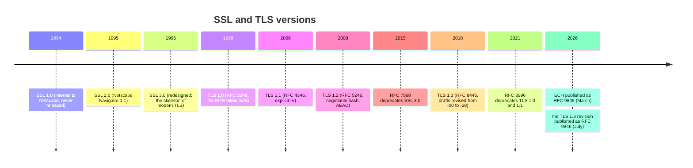
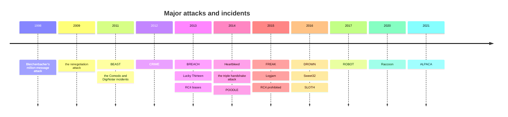
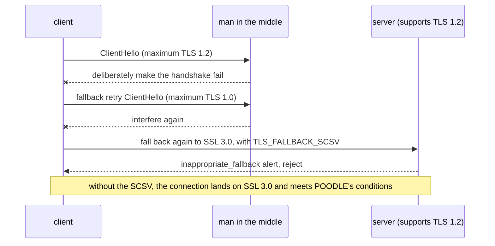
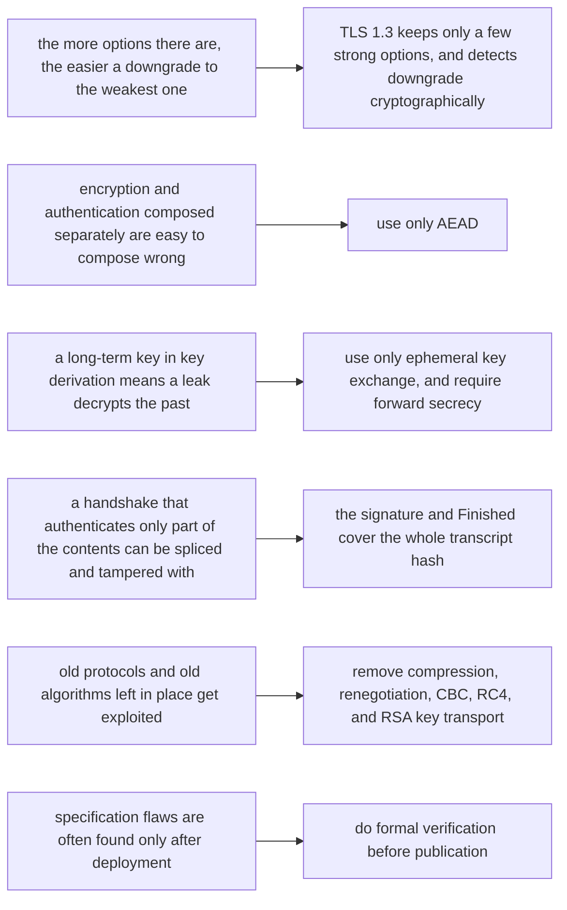

# T04 · From SSL to TLS 1.3: protocol evolution and attack history

> Series: [[00_tls-series-overview|TLS series overview]] · Previous: [[T03_certificates-and-pki|T03 certificates and PKI]] · Next: [[T05_tcp-and-tls12-handshake|T05 the TCP and TLS 1.2 handshakes]]
> Prerequisites: the CBC, MAC, RSA padding, and DH concepts from T02.
> Primary standards: RFC 6101 (SSL 3.0), RFC 6176 (prohibiting SSL 2.0), RFC 7568 (deprecating SSL 3.0), RFC 2246 (TLS 1.0), RFC 4346 (TLS 1.1), RFC 5246 (TLS 1.2), RFC 8446 (TLS 1.3), RFC 8996 (deprecating TLS 1.0 and 1.1), RFC 7457 (survey of known attacks), RFC 5746, RFC 7465, RFC 7507, RFC 7627
> Compiled: 2026-10-16

TLS 1.3 looks almost obviously simple: only five cipher suites, all of them AEAD; only ephemeral key exchange; a handshake of one round trip; everything after ServerHello is encrypted. Behind each deletion is a real attack, and each addition plugs a hole that was shown to exist. This note walks through what each version of the protocol changed, in time order, then sorts the most important attacks of twenty years by what the mechanism is, which versions they affect, and how they were finally fixed. The aim is to understand the design. Attacks are described only at the level of the principle.

## Version timeline

The TLS 1.3 revision (draft name draft-ietf-tls-rfc8446bis) was published in July 2026 as RFC 9846. The title is still "The Transport Layer Security (TLS) Protocol Version 1.3". It revises RFC 8446, folds in the errata and clarifications since publication, replaces RFC 8446, obsoletes RFC 5077, 5246, 6961, 7627, and 8422, and updates RFC 5705 and 6066. The protocol version number is still TLS 1.3. When this series cites section numbers, it uses the more familiar RFC 8446. Section numbers may differ when compared with RFC 9846.

## SSL 1.0 and 2.0: make it work first

SSL (Secure Sockets Layer) was designed by Netscape so a browser could do online transactions safely. Version 1.0 was found, internally, to have serious flaws in 1994, and was never released. SSL 2.0, shipped with Navigator 1.1 in 1995, was the first widely used version. It set the shape that is still familiar: the client says hello, the server sends a certificate, the two sides agree on a session key, and symmetric encryption protects the data after that.

SSL 2.0's problems were numerous enough that in 2011 the IETF wrote RFC 6176 specifically to prohibit it. The handshake has no integrity protection. A man in the middle can delete cipher suites from both lists until only the weakest remains, and neither side notices. That is the start of the downgrade-attack family. It uses the same key for encryption and for the MAC. Under the export restrictions, that means the MAC is also only 40 bits strong. Its MAC is a "secret prefix plus MD5" construction, which has a length-extension problem. It has no secure close. An attacker simply drops the TCP connection, and the receiver cannot tell "the data is finished" from "the data was truncated".

## SSL 3.0: the skeleton of modern TLS

In 1996 Paul Kocher, with Netscape's Phil Karlton and Alan Freier, redesigned SSL 3.0 (published in 2011 as a historic document, RFC 6101). It laid down the structure that lasted, with no large change, through TLS 1.2: a layered record protocol and handshake protocol; a Finished message that MACs the whole handshake, so the handshake cannot be tampered with; separate MAC keys and encryption keys; a close_notify alert before the connection is closed, to prevent truncation; session resumption; support for DH key exchange.

The leftover problem is mainly CBC-mode padding. SSL 3.0 does not specify the contents of the padding bytes and does not check them. It looks only at the final length byte. That looseness looked harmless, and in 2014 the POODLE attack exploited it fully, which ended SSL 3.0. RFC 7568 formally deprecated it in 2015.

## TLS 1.0: the IETF takes over

In 1999 the IETF published TLS 1.0 (RFC 2246) on the base of SSL 3.0. The rename was mainly to say that it was an open standard, not a proprietary Netscape protocol. The on-the-wire version number is written 3.1. The TLS version field still carries that history (TLS 1.2 is 0x0303, and the legacy_version of TLS 1.3 is also written 0x0303). Compared with SSL 3.0, the main changes are a standard HMAC in place of SSL 3.0's homemade MAC construction, and a pseudorandom function (PRF) that uses both MD5 and SHA-1, in the hope that the construction stays safe if at least one of the two hashes is not broken.

The largest hazard in TLS 1.0 is the CBC IV. Each record's IV is taken directly from the last ciphertext block of the previous record, so an attacker can predict the next record's IV. This was pointed out in 2002, and it was taken seriously only when BEAST turned it into a practical attack in 2011.

## TLS 1.1: patching CBC

TLS 1.1 (RFC 4346), from 2006, is a small change. The core is an explicit random IV on every CBC record, which closes the predictable-IV problem. It also requires a padding error and a MAC error to return the same alert, which reduces what a padding-oracle attack can learn. It also drops negotiation of export-grade cipher suites. TLS 1.1 was never widely deployed. Most implementations jumped from 1.0 straight to 1.2.

## TLS 1.2: negotiable cryptography

TLS 1.2 (RFC 5246), from 2008, changed "cryptographic algorithms are fixed in the protocol" into "they can be negotiated". The PRF is no longer fixed as MD5 plus SHA-1. The cipher suite specifies it (usually SHA-256). A new signature_algorithms extension lets the two sides negotiate which hash and which algorithm to use for signatures. AEAD cipher suites are introduced (AES-GCM is defined in RFC 5288, ChaCha20-Poly1305 in RFC 7905). For the following ten years TLS 1.2 was almost all of HTTPS, and it is the version where attacks concentrated. Its flexibility is also its burden. It kept RSA key transport, CBC, RC4, compression, renegotiation, and custom DH parameters, options later shown one by one to be problems. Whether a deployment is safe depends heavily on configuration.

## TLS 1.3: delete everything suspicious

Design of TLS 1.3 started in 2014. The draft was revised from draft-ietf-tls-tls13-00 through -28 (29 drafts in all), and published in August 2018 as RFC 8446. The design principle can be summarized as "delete every option that has failed in the past, or that is too complex to analyze", and at the same time shorten the handshake to one round trip.

| Removed | Why |
| --- | --- |
| RSA key transport, static DH | No forward secrecy. RSA padding-oracle attacks kept coming back (Bleichenbacher, ROBOT) |
| CBC mode and MAC-then-Encrypt | A long series of padding and timing problems: BEAST, Lucky Thirteen, POODLE, and others |
| RC4, 3DES, export-grade ciphers | RC4 biases, Sweet32, FREAK, Logjam |
| MD5 and SHA-1 signatures and the PRF | Collision attacks. SLOTH showed the damage from a transcript-hash collision |
| Compression | CRIME |
| Renegotiation | The 2009 renegotiation attack, and the triple handshake attack |
| Custom DH groups | Logjam. Weak parameters and backdoored parameters are hard to detect |
| The ChangeCipherSpec protocol | State-machine complexity, and the CCS injection bug (OpenSSL CVE-2014-0224 in 2014) |

The additions aim at specific problems too. Every key exchange is ephemeral, so forward secrecy is the default. Every handshake message after ServerHello is encrypted, so the certificate is no longer exposed in the clear. The server signs the whole handshake transcript (CertificateVerify), not just the key-exchange parameters. Key derivation uses HKDF, with an independent key for each purpose. ServerHello.random embeds a downgrade sentinel, so a forced negotiation of an old version can be detected. 0-RTT early data is supported, with an explicit statement of the replay risk.

The deployment of TLS 1.3 is a piece of history in itself. The early drafts used a new version number, and a large number of middleboxes (enterprise firewalls, antivirus software, load balancers) dropped the connection when they saw a version they did not recognize. That behavior is called protocol ossification. In 2017, experiments by Chrome and Firefox found a failure rate too high to ship. The eventual approach is camouflage. ClientHello.legacy_version is fixed at TLS 1.2's 0x0303, and the real version goes in the supported_versions extension. Each side also sends a meaningless ChangeCipherSpec record, and the server echoes the non-empty session_id the client sent, so that to a middlebox the handshake "looks like a TLS 1.2 resumption". That is middlebox compatibility mode (RFC 8446 Appendix D.4). GREASE (RFC 8701) was proposed in the same setting. The client randomly inserts reserved meaningless values, forcing servers and middleboxes to ignore values they do not recognize, so the protocol does not ossify again later.

## Attack history

The attacks with the largest impact, in time order. Each entry covers only the mechanism, the impact, and the fix. These are conclusions from the public literature.

### 1998: Bleichenbacher's million-message attack

Mechanism: in RSA key transport, used through TLS 1.2, the client encrypts the premaster secret with PKCS #1 v1.5 padding and sends it to the server. If the server shows any observable difference between "the decrypted padding is well formed" and "it is not" (a different alert, a different response time), that difference is an oracle. Daniel Bleichenbacher showed that, using the multiplicative property of RSA, about a million carefully transformed ciphertexts sent to this oracle can narrow the plaintext step by step until an intercepted premaster secret is recovered. The attacker can then decrypt that session, or produce one signature with the server's private key. Impact: every SSL and TLS version that uses RSA key transport. Fix: the TLS specification says that on decryption failure the server generates a random premaster secret and continues the handshake, so failure and success are indistinguishable from the outside (RFC 5246 §7.4.7.1). That requires the implementation to be fully constant time, and over twenty years implementations have repeatedly failed to do it. The final fix is that TLS 1.3 removes RSA key transport.

### 2009: the renegotiation attack

Mechanism: TLS allows a new handshake inside an existing connection (renegotiation), but the new handshake is not cryptographically bound to the old connection. A man in the middle can first connect to the server and send some data of its own, then splice the client's handshake onto that connection as a "renegotiation". The server treats the attacker's data and the client's later request as one continuous input from the same authenticated user, so the attacker can prepend content in front of the victim's request. Disclosed by Marsh Ray and Steve Dispensa in 2009. Fix: RFC 5746 defines the renegotiation_info extension, which binds the renegotiation handshake to the previous Finished value. TLS 1.3 simply removes renegotiation.

### 2011: BEAST

Mechanism: a CBC record in TLS 1.0 uses the last ciphertext block of the previous record as the IV of the next record, so the IV is predictable. Thai Duong and Juliano Rizzo demonstrated a chosen-plaintext attack in a browser, combined with an injected script, that guesses the contents of a cookie one byte at a time. Impact: CBC suites in SSL 3.0 and TLS 1.0. Fix: the explicit IV in TLS 1.1; browsers used 1/n-1 record splitting on TLS 1.0 as a mitigation; the lasting fix is AEAD and TLS 1.3.

### 2012: CRIME and 2013: BREACH

Mechanism: compression makes ciphertext length depend on the plaintext. If an attacker can cause a string they control and a secret (a cookie, for example) to be compressed together, a correct character guess compresses better and the ciphertext is shorter. Watching the length recovers the secret one character at a time. CRIME (2012, Duong and Rizzo) targets compression in TLS and in SPDY. BREACH (2013, Gluck, Harris, and Prado) targets gzip of the HTTP response body. It is independent of TLS, so TLS itself cannot fix it. Fix: TLS compression was widely turned off, and TLS 1.3 deletes it outright. Header compression in HTTP/2 and HTTP/3 uses HPACK and QPACK, which were designed to resist this class of attack. BREACH can only be mitigated at the application layer, for example by applying a random mask to the CSRF token on every response, and by not reflecting user input and a secret in the same compressed response. This class of attack illustrates a general point: encryption hides content, but it does not hide length.

### 2013: Lucky Thirteen

Mechanism: for a MAC-then-Encrypt CBC record, the receiver decrypts, strips the padding, then computes the MAC. Different padding lengths mean different amounts of data enter the MAC, so the computation time differs by a small amount. Nadhem AlFardan and Kenny Paterson showed that the timing difference is enough to build a padding oracle and, under ideal conditions, recover plaintext one byte at a time. The name comes from the 13 bytes of header data that are included in the MAC (the 8-byte sequence number plus the 5-byte record header). Impact: the CBC suites of almost every TLS implementation. Fix: implementations rewrote CBC decryption to be truly constant time, which is very hard to get right. The fundamental fix is AEAD.

### 2013 to 2015: RC4 biases

Mechanism: the output keystream of the RC4 stream cipher is not statistically uniform. The first few hundred bytes are especially biased. After BEAST, many sites switched to RC4 to avoid the CBC problem. In 2013 AlFardan and others showed that if the same secret (a cookie, for example) is encrypted over and over across a large number of connections, those biases can recover it statistically. Further work in 2015 brought the amount of data required down into a practical range. Fix: RFC 7465 (2015) prohibits RC4 in TLS.

### 2014: Heartbleed

Mechanism: this is an implementation bug, not a protocol bug. OpenSSL's implementation of the TLS heartbeat extension (RFC 6520) did not check that the payload length declared in the request matched the actual length. The peer declares 64 KB and sends 1 byte, and the server copies the adjacent 64 KB of its own memory straight into the response. Repeated requests read session keys and user passwords out of server memory, and even the server's private key. CVE-2014-0160. It affects OpenSSL 1.0.1 through 1.0.1f. At the time, an estimated hundreds of thousands of HTTPS servers were affected. Fix: patch, then revoke and replace every certificate private key that might have leaked. The longer effect was that the industry started funding critical open-source infrastructure (the Linux Foundation's Core Infrastructure Initiative), and two forks appeared: LibreSSL, and Google's BoringSSL.

### 2014: the triple handshake attack

Mechanism: the miTLS team (Bhargavan and others) found that, combining RSA key transport, resumption, and renegotiation, an attacker can make two different connections produce the same master secret and the same Finished value. That bypasses the renegotiation protection in RFC 5746 and, in a setting that uses client-certificate authentication, impersonates the user. Fix: RFC 7627 defines the extended master secret, which makes the master secret depend on a hash of the whole handshake (the session hash). If two connections differ in handshake content, their master secrets differ. The TLS 1.3 key schedule binds the transcript hash by construction.

### 2014: POODLE

Mechanism: CBC padding in SSL 3.0 does not check the padding contents. It looks only at the final length byte, which is an easy padding oracle. When Bodo Möller, Thai Duong, and Krzysztof Kotowicz of Google disclosed it, SSL 3.0 was already rarely used on purpose, but browsers had a "fallback retry" compatibility behavior: if a TLS handshake fails, try again at a lower version. An attacker who disrupts the handshake a few times can force the connection all the way down to SSL 3.0, and then run the attack. Fix: browsers disabled SSL 3.0. RFC 7507 defines TLS_FALLBACK_SCSV. A client that is retrying at a lower version includes this signaling value. A server that supports a higher version sees it, knows this is a forced downgrade, and rejects the connection. TLS 1.3 gives a more complete protection with the downgrade sentinel in ServerHello.random.

### 2015: FREAK and Logjam

Both are tied to US export controls in the 1990s. To comply, SSL and TLS defined "export-grade" cipher suites that used only 512-bit RSA or 512-bit DH. Twenty years later nobody chose them on purpose, but they were still present in many implementations.

FREAK (Beurdouche and others, from the miTLS team's state-machine work) found that some clients would accept a 512-bit ephemeral RSA key from the server even when they had not offered an export suite. That is a flaw in a TLS state-machine implementation. A man in the middle tampers with the handshake so the server uses export-grade RSA, factors that 512-bit key within a few hours, and can then decrypt the session. Logjam (Adrian and others, 2015) is a similar downgrade against DHE_EXPORT. It also showed that 512-bit DH can be broken online, and that many servers share a small set of 1024-bit primes, so a nation-state adversary who does one large precomputation can passively decrypt a substantial share of the traffic. Fix: remove every export-grade suite, use DH of at least 2048 bits, use the standard groups in RFC 7919, or switch to ECDHE. TLS 1.3 does not allow custom DH groups.

### 2016: DROWN, Sweet32, SLOTH

DROWN (Aviram and others) is a cross-protocol attack. If some server still has SSL 2.0 enabled, and its RSA private key is also used by another server that speaks only TLS (shared certificates are common), an attacker can use SSL 2.0 as a Bleichenbacher oracle to decrypt sessions recorded from that TLS server. At disclosure, about one third of HTTPS servers were estimated to be affected. It shows that an old protocol, even when it is enabled only on an unrelated port, can compromise the security of the whole key.

Sweet32 (Bhargavan and Leurent) targets ciphers with a 64-bit block (3DES, Blowfish). After about 2^32 blocks encrypted under the same key (about 32 GB), the birthday paradox produces colliding ciphertext blocks, which leaks plaintext. This is feasible on a long connection that carries a lot of data. Fix: stop using 3DES.

SLOTH (Bhargavan and Leurent) showed that using MD5, or even SHA-1, in handshake signatures in TLS 1.2 and earlier allows a transcript-hash collision. An attacker can build two handshakes with the same hash. Fix: prohibit MD5 and SHA-1 in signatures and in the transcript hash.

### 2017: ROBOT

Böck, Somorovsky, and Young used automated scanning and found that Bleichenbacher's oracle had never really gone away in the nearly twenty years after 1998. Devices from F5, Citrix, Cisco, and others, and some servers at Facebook and PayPal, gave a distinguishable response to a padding error. An attacker can use them to decrypt a recorded session, or to sign with the server's key. This result was the last heavy blow behind "RSA key transport has to be removed".

### 2020: Raccoon and 2021: ALPACA

Raccoon (Merget and others) uses a detail of the DH computation in TLS 1.2 and earlier: leading zero bytes of the shared secret are stripped, so the time of the following hash varies with the secret. Under very demanding conditions the premaster secret can be recovered. It is hard to exploit. TLS 1.3 is not affected, because it keeps the leading zeros and uses ephemeral keys.

ALPACA (Brinkmann and others) is a cross-protocol attack. One certificate is often valid for HTTPS, FTPS, SMTPS, and similar services at once. A man in the middle can redirect a request the browser sent to the HTTPS server toward an FTP or mail server under the same name. That server processes the bytes in the wrong protocol context, and under some conditions this leaks cookies or enables cross-site scripting. Fix: the server checks ALPN and SNI strictly, and rejects a connection that does not match its own protocol. The reminder from this class of problem is that TLS authenticates a name, not which service on that name.

## CA incidents: attacks on the trust system itself

Outside the protocol, the certificate system has its own attack history. These incidents drove the certificate transparency, CAA, and root-program governance covered in T03:

| Year | Incident | Consequence |
| --- | --- | --- |
| 2011 | A Comodo registration authority was compromised and issued 9 forged certificates, including `login.live.com` and `mail.google.com` | The certificates were revoked. The incident exposed the risk in a CA's downstream registration authorities |
| 2011 | DigiNotar was compromised and issued more than 500 forged certificates. `*.google.com` was used in a large-scale man-in-the-middle attack | Removed from every browser's root store, then bankrupt. This directly led to certificate transparency |
| 2013 | TURKTRUST mistakenly issued two intermediate CA certificates. One of them was used to issue `*.google.com` | The intermediates in question were revoked and blocked by each vendor |
| 2015 | An intermediate certificate issued by CNNIC was installed in a man-in-the-middle proxy | Google and Mozilla stopped trusting CNNIC's root |
| 2015 to 2017 | Repeated mis-issuance under Symantec, including an unauthorized `google.com` test certificate | In 2018 Chrome stopped trusting every Symantec-family certificate, in two steps |
| 2016 | WoSign backdated SHA-1 certificates and concealed its acquisition of StartCom | Both were removed from root stores (announced in October 2016, enforced from January 2017 by Chrome 56 and Firefox 51) |
| 2024 | Entrust failed for a long time to handle mis-issuance as required | From 2024-11, Chrome, Apple, and Mozilla no longer trust its newly issued certificates |

## Design lessons from the attacks

Twenty years of attacks reduce to a few lessons, and they are written directly into the design of TLS 1.3:

The last one is worth a longer look. TLS 1.3 is the first mainstream security protocol to receive extensive formal analysis before publication. Cremers and others used the Tamarin prover for a symbolic-model analysis of the drafts, and found a problem in an early draft when client authentication was combined with PSK. Bhargavan and others used ProVerif and CryptoVerif for analysis in both the symbolic and the computational model, and the miTLS project wrote a verified reference implementation in F*. Dowling and others gave a computational security proof of the handshake. The conclusions of these analyses were fed back into revisions of the draft. "Prove it, then publish" is one of the largest differences between TLS 1.3 and the versions before it.

## Common misconceptions

TLS 1.2 is already unsafe. TLS 1.2 can still be used safely, provided the only cipher suites enabled are ECDHE plus AEAD, the extended master secret is turned on, and renegotiation and compression are disabled. The problem is that it permits a large number of unsafe configurations, so safety depends on how it is operated. TLS 1.3 removes those unsafe options from the protocol.

Attacks are all problems of protocol design. Heartbleed, the CCS injection bug, most of the ROBOT cases, and GCM nonce reuse are implementation errors. Protocol design decides how much room an implementation has to get something wrong. Many of the options TLS 1.3 deleted went because they were "safe on paper, but almost nobody can implement them correctly".

Upgrading to TLS 1.3 means the old versions can be ignored. DROWN showed that if the same private key is still used by any service that supports an old protocol, the new protocol can be dragged in with it. The right action is to disable the old versions together, on every service that shares the key and the certificate.

An SSL certificate and a TLS certificate are two kinds of certificate. The certificate format (X.509) does not depend on the protocol version. A so-called SSL certificate is the certificate TLS uses. The name simply stayed.

## Sources cited in this note

- RFC 6101, The Secure Sockets Layer (SSL) Protocol Version 3.0, https://www.rfc-editor.org/rfc/rfc6101
- RFC 6176, Prohibiting Secure Sockets Layer (SSL) Version 2.0, https://www.rfc-editor.org/rfc/rfc6176
- RFC 7568, Deprecating Secure Sockets Layer Version 3.0, https://www.rfc-editor.org/rfc/rfc7568
- RFC 2246, The TLS Protocol Version 1.0, https://www.rfc-editor.org/rfc/rfc2246
- RFC 4346, The TLS Protocol Version 1.1, https://www.rfc-editor.org/rfc/rfc4346
- RFC 5246, The TLS Protocol Version 1.2, https://www.rfc-editor.org/rfc/rfc5246
- RFC 8446, The TLS Protocol Version 1.3 (Appendix D.4, middlebox compatibility mode), https://www.rfc-editor.org/rfc/rfc8446
- RFC 9846, The Transport Layer Security (TLS) Protocol Version 1.3 (2026-07, replaces RFC 8446), https://www.rfc-editor.org/info/rfc9846
- RFC 8996, Deprecating TLS 1.0 and TLS 1.1, https://www.rfc-editor.org/rfc/rfc8996
- RFC 7457, Summarizing Known Attacks on TLS and DTLS, https://www.rfc-editor.org/rfc/rfc7457
- RFC 5746, TLS Renegotiation Indication Extension, https://www.rfc-editor.org/rfc/rfc5746
- RFC 7465, Prohibiting RC4 Cipher Suites, https://www.rfc-editor.org/rfc/rfc7465
- RFC 7507, TLS Fallback Signaling Cipher Suite Value (SCSV), https://www.rfc-editor.org/rfc/rfc7507
- RFC 7627, TLS Session Hash and Extended Master Secret Extension, https://www.rfc-editor.org/rfc/rfc7627
- RFC 8701, Applying GREASE to TLS Extensibility, https://www.rfc-editor.org/rfc/rfc8701
- RFC 6520, TLS and DTLS Heartbeat Extension, https://www.rfc-editor.org/rfc/rfc6520
- Heartbleed, https://heartbleed.com/
- DROWN, https://drownattack.com/
- Logjam and FREAK (the WeakDH project), https://weakdh.org/ , https://mitls.org/pages/attacks/SMACK
- Sweet32, https://sweet32.info/
- ROBOT, https://robotattack.org/
- Raccoon, https://raccoon-attack.com/
- ALPACA, https://alpaca-attack.com/
- Cremers et al., "A Comprehensive Symbolic Analysis of TLS 1.3", CCS 2017
- Bhargavan et al., "Verified Models and Reference Implementations for the TLS 1.3 Standard Candidate", IEEE S&P 2017
