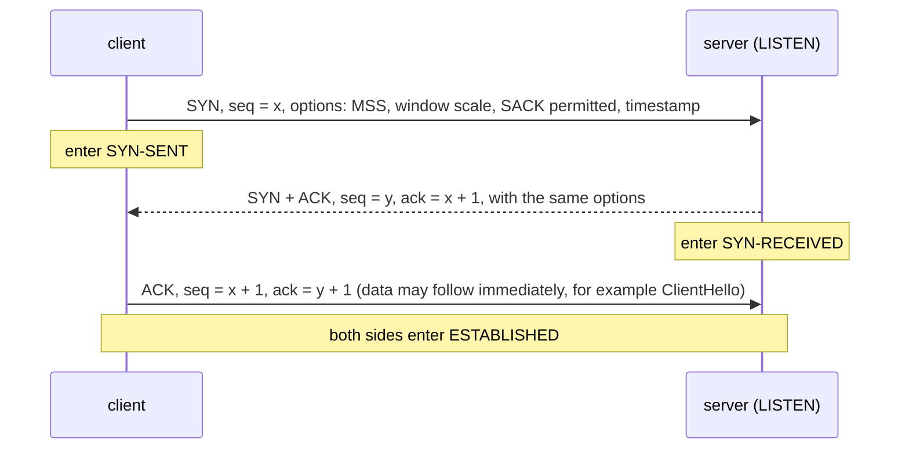
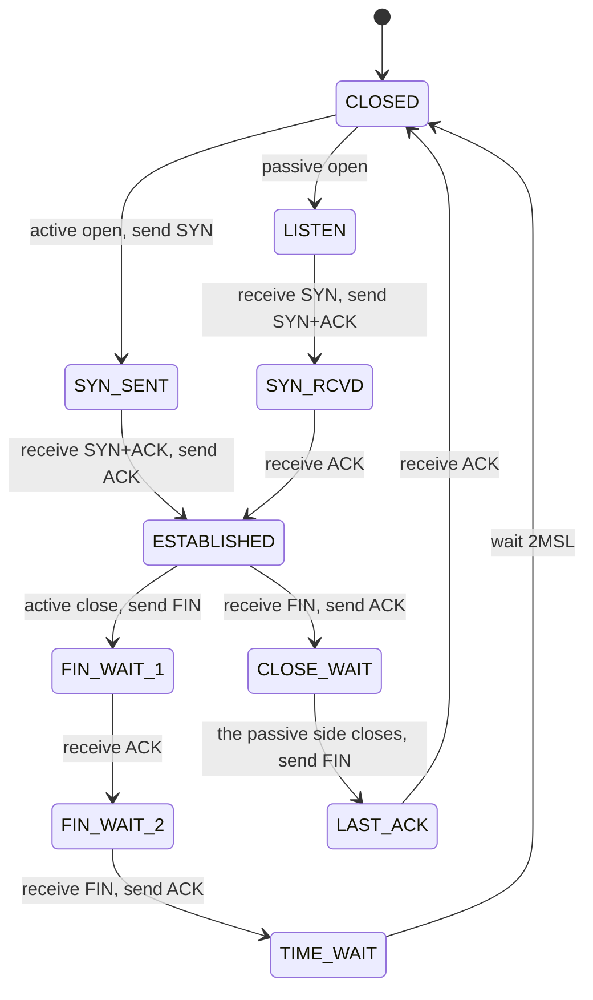
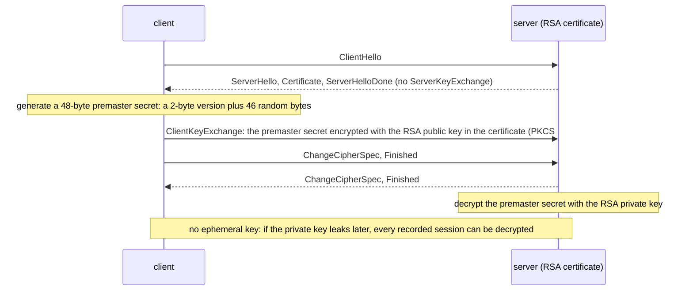
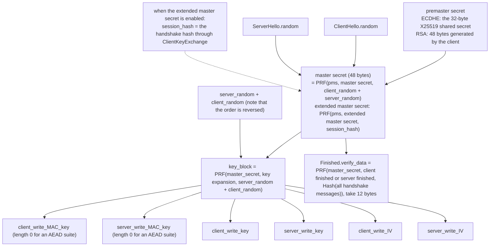
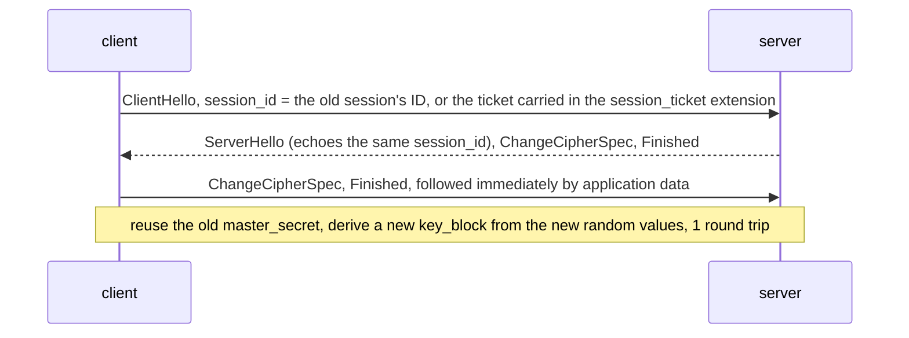

# T05 · The TCP handshake and TLS 1.2, packet by packet

> Series: [[00_tls-series-overview|TLS series overview]] · Previous: [[T04_ssl-to-tls13-evolution-and-attacks|T04 protocol history and attacks]] · Next: [[T06_tls13-handshake-and-key-schedule|T06 the TLS 1.3 handshake and key schedule]]
> Prerequisites: DH, ECDH, signatures, and HMAC from T02; the certificate chain from T03.
> Primary standards: RFC 9293 (TCP), RFC 7323 (window scale and timestamps), RFC 2018 (SACK), RFC 6528 (ISN generation), RFC 7413 (TCP Fast Open), RFC 5246 (TLS 1.2), RFC 8422 (ECC cipher suites), RFC 7627 (extended master secret), RFC 5288 (AES-GCM suites), RFC 7905 (ChaCha20-Poly1305 suites), RFC 5077 (session tickets)
> Compiled: 2026-10-16 (the TLS 1.2 handshake in this note is a real capture of www.cloudflare.com at 2026-10-17 02:57 UTC, OpenSSL 4.0.3 `-trace`)

The first round trip of an HTTPS connection belongs to TCP. The next two round trips belong to TLS 1.2. This note takes apart every packet in those three round trips: the fields of the TCP header and the state changes of the three-way handshake, the format of the TLS record layer, every message and every field of a full TLS 1.2 handshake, and how the session keys are derived from the handshake, step by step. TLS 1.2 is being replaced by 1.3, but its structure is the base for understanding 1.3. Many choices in 1.3 make sense only when they are set next to 1.2. The TLS 1.2 handshake in this note is a real capture, not a sketch.

## The TCP header

TCP (RFC 9293) provides a reliable, ordered byte stream, with flow control and congestion control, on top of IP. Every TCP segment starts with a header of at least 20 bytes:

```
 0                   1                   2                   3
 0 1 2 3 4 5 6 7 8 9 0 1 2 3 4 5 6 7 8 9 0 1 2 3 4 5 6 7 8 9 0 1
+-+-+-+-+-+-+-+-+-+-+-+-+-+-+-+-+-+-+-+-+-+-+-+-+-+-+-+-+-+-+-+-+
|        Source Port (16)       |     Destination Port (16)     |
+-+-+-+-+-+-+-+-+-+-+-+-+-+-+-+-+-+-+-+-+-+-+-+-+-+-+-+-+-+-+-+-+
|                      Sequence Number (32)                     |
+-+-+-+-+-+-+-+-+-+-+-+-+-+-+-+-+-+-+-+-+-+-+-+-+-+-+-+-+-+-+-+-+
|                   Acknowledgment Number (32)                  |
+-+-+-+-+-+-+-+-+-+-+-+-+-+-+-+-+-+-+-+-+-+-+-+-+-+-+-+-+-+-+-+-+
|HdrLen | Resvd |C|E|U|A|P|R|S|F|           Window (16)         |
| (4)   |       |W|C|R|C|S|S|Y|I|                               |
|       |       |R|E|G|K|H|T|N|N|                               |
+-+-+-+-+-+-+-+-+-+-+-+-+-+-+-+-+-+-+-+-+-+-+-+-+-+-+-+-+-+-+-+-+
|         Checksum (16)         |      Urgent Pointer (16)      |
+-+-+-+-+-+-+-+-+-+-+-+-+-+-+-+-+-+-+-+-+-+-+-+-+-+-+-+-+-+-+-+-+
|              Options (variable, at most 40 bytes)             |
+-+-+-+-+-+-+-+-+-+-+-+-+-+-+-+-+-+-+-+-+-+-+-+-+-+-+-+-+-+-+-+-+
```

HdrLen is the 4-bit header length, and Resvd is the reserved field. The sequence number is the number, in the whole byte stream, of the first data byte in this segment. The acknowledgment number is "the number of the next byte I expect from you", which means "I have received everything before that". The flags that matter to the handshake are SYN (synchronize sequence numbers, open the connection), ACK (the acknowledgment number is valid), FIN (I am done sending), and RST (reset the connection). The receive window tells the peer "how many more bytes I can accept". It is the core of flow control.

## The three-way handshake

The point of opening a connection is that each side confirms the other can receive and can send, and that each side tells the other its initial sequence number (ISN).



Why three messages and not two. Two messages let the server confirm "the client can send", and let the client confirm "the server can receive and can send". The server cannot confirm that the client received its ISN. More important, an old, expired SYN may still be wandering around the network. If the server opened a connection as soon as it saw a SYN, it would allocate resources for an old connection that no longer exists. The third message, the ACK, lets the client confirm "this is the connection I am opening now". SYN and FIN each consume one sequence number, so the acknowledgment number is x + 1, not x.

The ISN must not start at 0, and it must not be predictable. If an attacker can guess the server's ISN, they can forge a TCP connection from an arbitrary source address without seeing the reply. Robert Morris described this attack in 1985, and Kevin Mitnick used it to break into a machine in 1994. RFC 6528 says the ISN is a counter that grows with time, plus a hash of the four-tuple and a secret key, so it is unpredictable from the outside.

A few options in the SYN are negotiated during the handshake and then used for the whole connection. MSS (Maximum Segment Size) tells the peer the largest segment it can receive. On Ethernet that is usually 1460 bytes. Window scale (RFC 7323) shifts the 16-bit window field left by some number of bits, so the window can exceed 64 KB. A high-bandwidth, long-distance path has to use it. SACK permitted (RFC 2018) means selective acknowledgment is supported, so after loss the receiver can tell the peer which segments arrived. Timestamps (RFC 7323) measure the round-trip time more precisely and protect against sequence-number wraparound.

After receiving a SYN, the server has to keep state for the half-open connection. That gives an attacker a SYN flood: send SYNs from a large number of forged source addresses and exhaust the server's queue of half-open connections. SYN cookies are the standard defense. The server keeps no state. It encodes the connection information into the ISN it sends back, and decodes it from the acknowledgment number when the third ACK returns.

The client's third packet (the ACK) may carry data. In HTTPS, ClientHello usually goes out together with that ACK, so for application data the three-way handshake costs one round trip. TCP Fast Open (RFC 7413) tries to remove that round trip as well. On the first connection the client receives a cookie from the server, and later connections can carry data in the SYN. It is rarely deployed in practice. The reasons are covered in [[T07_session-resumption-0-rtt-and-performance|T07]].

## Connection state and closing

Each end of a TCP connection keeps its own state machine. The main paths for the handshake and for closing are:



Closing is a four-way teardown, because TCP is full duplex and the two directions close separately. The side that closes actively sends FIN, meaning it will send no more. The peer replies with ACK, and may still have data to send. When the peer is finished, it sends its own FIN. The active side replies with ACK. The side that closed actively then stays in TIME_WAIT for twice the maximum segment lifetime (2MSL), so that if the last ACK is lost it can still be retransmitted, and so that leftover segments from the old connection disappear from the network and are not accepted by mistake by a new connection with the same four-tuple. The RFC sets MSL at 2 minutes. Linux fixes TIME_WAIT at 60 seconds. A large pile of TIME_WAIT sockets on a server with many short-lived connections is another reason connection reuse (HTTP keep-alive, HTTP/2) matters.

TLS has its own close on top of the TCP close: it sends a close_notify alert, telling the peer "the data ends here". Without it, the receiver cannot tell a normal end from a truncation caused by an attacker forging a FIN. SSL 2.0 was open to truncation attacks because it lacked this mechanism.

## The TLS record layer

Once the TCP connection is up, everything in TLS is carried as records. The TLS 1.2 record format (RFC 5246 §6.2) is a 5-byte header plus the content:

```
offset  length  field
0       1       ContentType: 20 change_cipher_spec, 21 alert, 22 handshake, 23 application_data
1       2       ProtocolVersion: TLS 1.2 is 0x0303
3       2       length: content length. Plaintext at most 2^14 = 16384 bytes, ciphertext at most 2^14 + 2048
5       n       content: a handshake message, an alert, or application data (ciphertext once encrypted)

example: 16 03 01 00 d7 ...   handshake, version in the record header 0x0301, length 0xd7 = 215
```

A handshake message has another header of its own inside the record body: a 1-byte message type (1 ClientHello, 2 ServerHello, 4 NewSessionTicket, 11 Certificate, 12 ServerKeyExchange, 14 ServerHelloDone, 16 ClientKeyExchange, 20 Finished, and so on) plus a 3-byte length. One handshake message may be split across several records, and several handshake messages may be packed into one record.

In the captured ClientHello below, the record header writes version 0x0301 (TLS 1.0), while the ClientHello message itself declares 0x0303 (TLS 1.2). This is not an error. RFC 5246 Appendix E.1 allows the client to write a lower version in the header of the first record, for compatibility with old servers and middleboxes that disconnect when they see a record version they do not recognize. That small compatibility lie becomes systematic camouflage in TLS 1.3 (see T04 and T06).

## A complete TLS 1.2 handshake: a real capture

Below is a complete handshake captured on 2026-10-17 with `openssl s_client -connect www.cloudflare.com:443 -tls1_2 -trace`. The key exchange is ECDHE. The whole exchange first:

```mermaid
sequenceDiagram
    participant C as client (OpenSSL 4.0.3)
    participant S as www.cloudflare.com
    Note over C,S: TLS round trip 1: negotiate parameters; the server presents its identity and its DH public key
    C->>S: ClientHello (215-byte record)
    S-->>C: ServerHello: selects ECDHE_ECDSA_WITH_CHACHA20_POLY1305_SHA256
    S-->>C: Certificate (2511 bytes, leaf plus intermediate)
    S-->>C: ServerKeyExchange: 32-byte X25519 public key + ECDSA signature
    S-->>C: ServerHelloDone
    Note over C,S: TLS round trip 2: the client sends its DH public key; both sides confirm
    C->>S: ClientKeyExchange: 32-byte X25519 public key
    C->>S: ChangeCipherSpec
    C->>S: Finished (encrypted, verify_data is 12 bytes)
    S-->>C: NewSessionTicket (the ticket is 192 bytes, lifetime hint 64800 seconds)
    S-->>C: ChangeCipherSpec
    S-->>C: Finished (encrypted)
    Note over C,S: application data after this is encrypted with the negotiated keys
```

### ClientHello

```
ClientHello, Length=211
  client_version=0x303 (TLS 1.2)
  Random:
    gmt_unix_time=0x9EAEC6D9
    random_bytes (len=28): 62A6B6787AD08CFA49C63774DF49D77A92F045FFBE0F6CC397C128B9
  session_id (len=0)
  cipher_suites (len=54)          27 suites, a selection:
    {0xC0, 0x2C} TLS_ECDHE_ECDSA_WITH_AES_256_GCM_SHA384
    {0xC0, 0x30} TLS_ECDHE_RSA_WITH_AES_256_GCM_SHA384
    {0x00, 0x9F} TLS_DHE_RSA_WITH_AES_256_GCM_SHA384
    {0xCC, 0xA9} TLS_ECDHE_ECDSA_WITH_CHACHA20_POLY1305_SHA256
    ...
    {0x00, 0x2F} TLS_RSA_WITH_AES_128_CBC_SHA
  compression_methods (len=1): No Compression (0x00)
  extensions, length = 116
    renegotiate(65281)            empty, meaning secure renegotiation is supported (RFC 5746)
    ec_point_formats(11)          uncompressed
    supported_groups(10)          x25519, secp256r1, x448, secp384r1, secp521r1, ffdhe2048, ffdhe3072
    session_ticket(35)            empty, meaning a session ticket is wanted (RFC 5077)
    encrypt_then_mac(22)          if a CBC suite is selected, use Encrypt-then-MAC (RFC 7366)
    extended_master_secret(23)    use the extended master secret (RFC 7627)
    signature_algorithms(13)      0x0403 ecdsa_secp256r1_sha256, 0x0503, 0x0603, 0x0807 ed25519, 0x0808,
                                  0x0809..0x080b rsa_pss_pss, 0x0804..0x0806 rsa_pss_rsae, 0x0401.. rsa_pkcs1 ...
    server_name(0)                www.cloudflare.com
```

Field by field:

client_version is the highest version the client supports. 0x0303 is TLS 1.2. In ServerHello the server picks a version no higher than that.

random is 32 bytes. As RFC 5246 defines it, the first 4 bytes are gmt_unix_time (the current time) and the remaining 28 bytes are random. In this capture the "time" is 0x9EAEC6D9, which converts to a date in 2054, so it is obviously random. Modern implementations generally randomize all 32 bytes, because writing a clock into the handshake leaks information about the device's time and has no practical use. The role of random is to give key derivation a fresh input on every handshake. Even if the premaster secret is the same, the master secret differs, and an old handshake cannot be replayed.

session_id is empty, so the client has no session it can resume. If it did, it would put the ID of that earlier session here and ask for an abbreviated handshake.

cipher_suites is the client's list of cipher suites, ordered by preference. Each suite is 2 bytes. A TLS 1.2 suite name packs four facts into one string. Take `TLS_ECDHE_ECDSA_WITH_AES_256_GCM_SHA384`:

| Piece | Meaning |
| --- | --- |
| ECDHE | Key exchange: ephemeral elliptic-curve DH (forward secrecy) |
| ECDSA | Authentication: the server certificate holds an ECDSA public key, used to sign ServerKeyExchange |
| AES_256_GCM | Record encryption: AES-256 in GCM mode (AEAD) |
| SHA384 | The hash the PRF uses (an AEAD suite no longer needs a separate MAC) |

A name such as `TLS_RSA_WITH_AES_128_CBC_SHA` contains only one RSA. RSA does both key transport and authentication. There is no forward secrecy. The SHA suffix means the record MAC is HMAC-SHA1. OpenSSL 4.0.3 still lists these old suites at the end by default, for compatibility with old servers, and they are ranked last.

compression_methods contains only null. TLS compression has been turned off in every mainstream implementation because of the CRIME attack.

extensions are the main way features were added through the TLS 1.2 era. Each extension has the form "2-byte type, 2-byte length, content". Among the extensions listed above, supported_groups (formerly called elliptic_curves) tells the server which DH groups the client supports. The first in the list is x25519. signature_algorithms tells the server which signature algorithms the client can verify. The server uses that to choose which certificate to send and which hash to sign with. server_name is SNI. It writes `www.cloudflare.com` in the clear. That is the cleartext name that T01 and T08 keep coming back to. In the raw bytes of the trace, the ASCII string `www.cloudflare.com` can be read directly.

The byte layout of ClientHello can be drawn like this:

```
record header     16 03 01 00 d7                         handshake, version 0x0301, length 215
handshake header  01 00 00 d3                            ClientHello, length 211
version           03 03
random            9e ae c6 d9 62 a6 b6 78 ... (32 bytes)
session_id length  00
cipher_suites length 00 36 (54 bytes = 27 suites)
                  c0 2c c0 30 00 9f cc a9 ...
compression length 01, content 00
extensions length 00 74 (116 bytes)
                  ff 01 00 01 00                         renegotiate, length 1, content 00
                  00 0b 00 02 01 00                      ec_point_formats
                  00 0a 00 10 00 0e 00 1d 00 17 ...      supported_groups, x25519 = 0x001d
                  ...
                  00 00 00 17 00 15 00 00 12 77 77 77 2e ... server_name, www.cloudflare.com
```

(The record header, the handshake header, and the field lengths come from parsing this capture. The extension bytes are laid out by each extension's encoding rules, to show the format.)

### ServerHello

```
ServerHello, Length=63
  server_version=0x303 (TLS 1.2)
  Random: gmt_unix_time=0x6AD2E40C, random_bytes (len=28): 787BEAE1...4E47524401
  session_id (len=0)
  cipher_suite {0xCC, 0xA9} TLS_ECDHE_ECDSA_WITH_CHACHA20_POLY1305_SHA256
  compression_method: No Compression
  extensions: server_name, extended_master_secret, renegotiate, ec_point_formats, session_ticket
```

The server selected one suite from the client's list, and echoed back the extensions it supports. extended_master_secret means both sides agree to use the extended master secret. session_ticket means it will send a ticket at the end of the handshake.

One detail is worth noticing. The client ranked AES-256-GCM first, but the server chose ChaCha20-Poly1305, even though the client here is an Apple M3 Mac with AES hardware instructions. The server chooses. It picks from the client's list by its own policy. BoringSSL supports "equal preference groups": the server can mark several suites as equally preferred, and then pick inside the group by the client's order. In this OpenSSL default list, ChaCha20 ranks ahead of AES-128-GCM, and Cloudflare most likely chose ChaCha20 on that basis. (That is an inference from the capture. No public Cloudflare document stating the exact configuration was found.) The two are in the same security class. Both are AEAD.

### Certificate

The server sends the certificate chain. This time it is 2511 bytes. The leaf `CN=www.cloudflare.com` is issued by Google Trust Services' intermediate CA `WE1`, with a P-256 public key, valid from 2026-10-12 to 2027-01-10, again 90 days. TLS 1.2 sends certificates in the clear. Any observer on the path can read every name in the certificate. TLS 1.3 puts the certificate in the encrypted part. Certificate validation is covered in [[T03_certificates-and-pki|T03]].

### ServerKeyExchange

```
ServerKeyExchange, Length=110
  KeyExchangeAlgorithm=ECDHE
    named_curve: ecdh_x25519 (29)
    point (len=32): E24618F1AC362B86F1E3E9A2BB0D58640C8E8BFF9CFD66A03FA21EB5451A7D1F
  Signature Algorithm: ecdsa_secp256r1_sha256 (0x0403)
  Signature (len=70): 30440220539C78C874F15EC30D5C3247...
```

This is the core of an ECDHE handshake. The server generates an ephemeral X25519 private key, sends the matching 32-byte public key, and signs it with the certificate's private key (ECDSA P-256). The signature covers `client_random + server_random + curve parameters + public key` (RFC 8422 §5.4). The client verifies that signature with the public key in the certificate, and so knows "this DH public key really came from the holder of the certificate". A man in the middle cannot replace it. Both sides' random values are included in the signature so that an attacker cannot replay a ServerKeyExchange from an old handshake.

A structural weakness of TLS 1.2 sits here too. The signature covers only the DH parameters and the random values. It does not cover the rest of the handshake, such as the cipher-suite list the client offered. The rest of the handshake is protected by Finished at the end, and Finished depends on the keys that were just negotiated. If the key exchange is downgraded to parameters weak enough to break online (FREAK and Logjam are exactly that case), the attacker can forge Finished as well. In TLS 1.3, CertificateVerify signs the whole handshake transcript, which closes this at the root.

### ServerHelloDone, ClientKeyExchange, ChangeCipherSpec, and Finished

ServerHelloDone has length 0. It is only a marker that says "I am done speaking", because in this flight a TLS 1.2 server may send a variable number of messages (it might also send CertificateRequest, asking for a client certificate).

```
ClientKeyExchange, Length=33
  KeyExchangeAlgorithm=ECDHE
    ecdh_Yc (len=32): F17CB43B6E922E4BEB6AFAB2263603CC85F0D5062E6CE276C63E5A6A5AB86C0E
```

The client generates its own ephemeral X25519 private key and sends the 32-byte public key to the server. At this moment both sides have the other's public key, and each computes the same 32-byte shared secret, the premaster secret (pre_master_secret).

ChangeCipherSpec is a separate sub-protocol. Its content is a single byte, 0x01, meaning "starting with my next record, use the keys just negotiated". The client then sends Finished. That is the first encrypted handshake message. Its content is 12 bytes of verify_data, a keyed digest of every handshake message so far. The server checks it, and confirms that both sides saw exactly the same handshake, with no tampering.

### NewSessionTicket and the server Finished

The server first sends NewSessionTicket (the lifetime hint is 64800 seconds, which is 18 hours; the ticket itself is 192 bytes, session state encrypted under the server's own ticket key), then ChangeCipherSpec and its own Finished. After the client verifies the server's Finished, the handshake is complete and application data can be sent. From ClientHello to here, TLS used two full round trips.

## RSA key transport: the path that was removed

TLS 1.2 also allows a completely different key exchange: RSA key transport, with suite names of the form `TLS_RSA_WITH_AES_128_GCM_SHA256`.



It is one message shorter than ECDHE. The server does one RSA private-key decryption per handshake, which was attractive in the 2000s, when CPU time was expensive. The cost is that there is no forward secrecy, plus the Bleichenbacher family of padding-oracle attacks (T04). The first two bytes of the premaster secret are set to the client's highest version, so the server can detect a version rollback. That check itself became part of attacks such as ROBOT. TLS 1.3 removed this path.

## How the keys are derived

Key derivation in TLS 1.2 is built around one function, the PRF (pseudorandom function, RFC 5246 §5). For the ordinary TLS 1.2 suites, the PRF is based on HMAC-SHA256 (suites whose names end in SHA384 use HMAC-SHA384):

```
P_hash(secret, seed) = HMAC_hash(secret, A(1) + seed) +
                       HMAC_hash(secret, A(2) + seed) +
                       HMAC_hash(secret, A(3) + seed) + ...
where A(0) = seed, A(i) = HMAC_hash(secret, A(i-1))

PRF(secret, label, seed) = P_hash(secret, label + seed), truncated to however many bytes are needed
```

All of the keys are derived from it in three steps:



The first step mixes the premaster secret with both sides' random values into a 48-byte master secret. The extended master secret in RFC 7627 replaces the second input with a hash of the whole handshake, so the master secret is bound to everything in this handshake, including the certificate and the DH parameters. The triple handshake attack therefore fails. In this capture both sides negotiated extended_master_secret, so the second algorithm is the one in use.

The second step uses the master secret and the random values to produce a key_block long enough to use, then slices it, in order, into six pieces: for each direction, a MAC key, an encryption key, and an IV. The random values here are in the order `server_random + client_random`, the reverse of the first step. That convention is left over from SSL 3.0, and it is easy to get wrong in an implementation of one's own. For an AEAD suite the MAC key has length 0. An AES-GCM suite takes only 4 bytes of IV, as the implicit part, and each record then carries an 8-byte explicit nonce (RFC 5288). A ChaCha20-Poly1305 suite takes a 12-byte IV, and the nonce of each record is the IV XOR a 64-bit sequence number (RFC 7905), which is the same approach TLS 1.3 uses.

The third step is Finished. verify_data is the PRF output over a hash of every handshake message so far, truncated to 12 bytes. The client and the server use different labels (`client finished`, `server finished`), so one side's Finished cannot be reflected and passed off as the other's.

The two directions use different keys so that ciphertext from one direction cannot be reflected into the other. Each record's sequence number enters the MAC or the nonce, and it is not sent on the wire. Deleting, reordering, or replaying a record fails the check.

## Resumption: an abbreviated handshake in one round trip

Of the two round trips in a full handshake, the expensive parts are sending the certificate, verifying the signature, and the DH computation. If the client shook hands with this server not long ago, it can skip those and reuse the previous master secret:



The session ID approach requires the server to keep session state in memory, and several servers have to share that cache. A session ticket (RFC 5077) encrypts the state and gives it to the client to hold, so the server is stateless. Both have a forward secrecy hazard. The ticket captured here is an example: it is encrypted under a long-term ticket key held by the server. If that key leaks, or is not rotated for a long time, every session resumed with a ticket may be decryptable. TLS 1.3 redesigns resumption around a PSK. See [[T07_session-resumption-0-rtt-and-performance|T07]].

## Why TLS 1.2 takes two round trips

Looking back at the structure of the full handshake, in the first round trip the client is waiting until the server has chosen and has handed over its DH parameters. Only in the second round trip does the client send its own DH public key. It cannot go faster, because negotiation in TLS 1.2 is serial. In ClientHello the client only says "here is what I support". It provides no key material. It has to wait until the server has chosen the group and the algorithm before it knows what kind of public key to generate.

TLS False Start (RFC 7918) is a compromise. After sending its own Finished, and before receiving the server's Finished, the client starts sending application data, which brings the effective latency down to one round trip. The cost is that if the handshake was tampered with, the earliest data may already have been sent to the attacker. So this is allowed only when a forward-secret suite and strong algorithms are in use.

The idea in TLS 1.3 is that the client guesses ahead. ClientHello directly attaches a public key (key_share) for the group the client thinks the server is most likely to pick. If the guess is right, the server can finish the key exchange in its first reply and start encrypting. If the guess is wrong, the server sends HelloRetryRequest and names the group to use, at the cost of an extra round trip. Because almost every server supports X25519, the guess is almost always right. That change, together with putting the certificate and the signature into the first reply, compresses the handshake into one round trip. That is the subject of [[T06_tls13-handshake-and-key-schedule|T06]].

## Common misconceptions

The TCP three-way handshake has to finish before any data can be sent, so HTTPS must cost three more round trips than HTTP. The third ACK can carry ClientHello, so the TCP handshake costs one round trip. TLS 1.2 adds two more, TLS 1.3 adds one, and resumption and 0-RTT can cost still less.

ChangeCipherSpec is a handshake message. It is a separate sub-protocol (content type 20). It is not part of the handshake protocol (content type 22), and it is not included in the Finished hash. Because it sits outside the handshake state machine, the CCS injection bug appeared in 2014. TLS 1.3 removes its real function, and sends a fake one only in compatibility mode.

The cipher suite selected in ServerHello is the encryption algorithm. A TLS 1.2 suite decides four things at once: key exchange, authentication, record encryption, and the PRF hash. TLS 1.3 moves the first two out into extensions. The suite is only an AEAD and a hash.

The timestamp inside random is required. RFC 5246 does define gmt_unix_time, but the specification also says the client and the server do not need a correct clock. Modern implementations generally fill the whole field with random bytes. Both random values in this capture are like that.

## Sources cited in this note

- RFC 9293, Transmission Control Protocol (TCP), https://www.rfc-editor.org/rfc/rfc9293
- RFC 7323, TCP Extensions for High Performance (window scale, timestamps), https://www.rfc-editor.org/rfc/rfc7323
- RFC 2018, TCP Selective Acknowledgment Options, https://www.rfc-editor.org/rfc/rfc2018
- RFC 6528, Defending against Sequence Number Attacks, https://www.rfc-editor.org/rfc/rfc6528
- RFC 7413, TCP Fast Open, https://www.rfc-editor.org/rfc/rfc7413
- RFC 5246, The TLS Protocol Version 1.2 (§5 PRF, §6.2 record layer, §7.4 handshake, §8.1 master secret, Appendix E.1 version compatibility), https://www.rfc-editor.org/rfc/rfc5246
- RFC 8422, Elliptic Curve Cryptography (ECC) Cipher Suites for TLS Versions 1.2 and Earlier (§5.4 ServerKeyExchange), https://www.rfc-editor.org/rfc/rfc8422
- RFC 7627, TLS Session Hash and Extended Master Secret Extension, https://www.rfc-editor.org/rfc/rfc7627
- RFC 5288, AES Galois Counter Mode (GCM) Cipher Suites for TLS, https://www.rfc-editor.org/rfc/rfc5288
- RFC 7905, ChaCha20-Poly1305 Cipher Suites for TLS, https://www.rfc-editor.org/rfc/rfc7905
- RFC 7366, Encrypt-then-MAC for TLS and DTLS, https://www.rfc-editor.org/rfc/rfc7366
- RFC 5077, TLS Session Resumption without Server-Side State, https://www.rfc-editor.org/rfc/rfc5077
- RFC 5746, TLS Renegotiation Indication Extension, https://www.rfc-editor.org/rfc/rfc5746
- RFC 7918, TLS False Start, https://www.rfc-editor.org/rfc/rfc7918
- Measured on this machine: `openssl s_client -connect www.cloudflare.com:443 -servername www.cloudflare.com -tls1_2 -trace` (OpenSSL 4.0.3, 2026-10-17 02:57 UTC)
