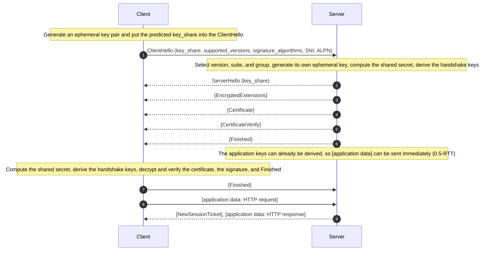
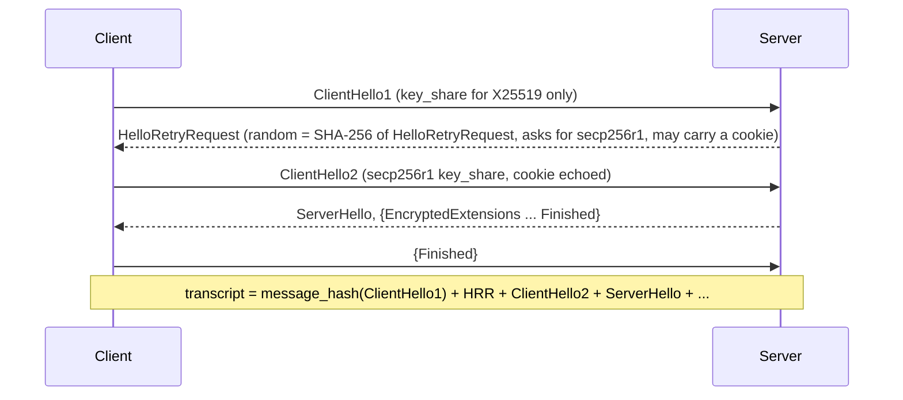
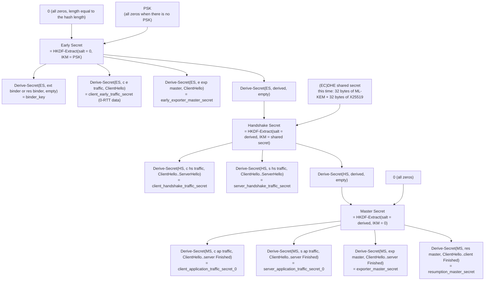

# T06 · The TLS 1.3 handshake and key schedule, packet by packet

> Series: [[00_tls-series-overview|TLS series overview]] · Previous: [[T05_tcp-and-tls12-handshake|T05 TCP and the TLS 1.2 handshake]] · Next: [[T07_session-resumption-0-rtt-and-performance|T07 Session resumption and 0-RTT]]
> Prerequisites: HKDF, AEAD, ECDH, and signatures from T02; the TLS 1.2 handshake structure from T05 (this note compares against it throughout).
> Primary standards: RFC 8446 (TLS 1.3) and its revision RFC 9846 (2026-07, which replaces RFC 8446; section numbers in this note follow RFC 8446), RFC 8701 (GREASE), RFC 10024 (hybrid post-quantum key exchange, 2026)
> Compiled: 2026-10-16 (the handshake in this note is a real capture of www.cloudflare.com at 2026-10-17 03:00 UTC, OpenSSL 4.0.3 `-trace` and `-keylogfile`)

This is the core note of the series. TLS 1.3 finishes key exchange and server authentication in one round trip. Everything after the ServerHello is encrypted. Every key comes from a single HKDF derivation tree, and each key is bound to the entire handshake transcript up to that point. This note takes the messages in the order they appear on the wire. For each one it covers the fields, the values, the role, and the design reason, then draws the key schedule in full, and finally explains how the record layer uses those keys. The handshake here is a real capture: the client is OpenSSL 4.0.3, the server is Cloudflare, the negotiated key-exchange group is the hybrid post-quantum group X25519MLKEM768, and the cipher suite is TLS_AES_256_GCM_SHA384.

## Design goals and overall shape

The goals listed in RFC 8446 §1 fall into four. The handshake is faster (a full handshake is 1-RTT, and resumption can be 0-RTT). The handshake is more private (every handshake message after the ServerHello is encrypted, and the certificate is no longer in the clear). The protocol is simpler and harder to misconfigure (the long list of old options in T04 is gone). Security is stronger and easier to analyze (forward secrecy is mandatory, the signature covers the whole transcript, key derivation uses HKDF and binds the transcript hash at every step, and the design went through a large amount of formal verification).

The overall shape is as follows. In the diagram, `{}` marks a message encrypted with the handshake keys, and `[]` marks a message encrypted with the application keys. A message with no brackets is in the clear:



Set next to the TLS 1.2 handshake in T05, three structural changes are immediate. The client hands over key-exchange material in the first message. The server's first flight completes key exchange, authentication, and handshake confirmation together. The certificate and the signature both travel under encryption. The messages below are taken one by one.

## ClientHello

The captured ClientHello is 1469 bytes, seven times the 211-byte TLS 1.2 ClientHello in T05. Almost all of the growth is the hybrid post-quantum key_share.

```
Record header: Version = TLS 1.0 (0x301), Content Type = Handshake (22), Length = 1473
ClientHello, Length=1469
  client_version=0x303 (TLS 1.2)                         i.e. legacy_version
  Random: 3337A9B0 E3EAE7DE93A7632CE801E9EE888276853EDC886995F6319F09944641
  session_id (len=32): BE835F13C5934BE85F79E78C0E4CFE1F64388AE16E62701387DE59220E15E5D6
  cipher_suites (len=6)
    {0x13, 0x02} TLS_AES_256_GCM_SHA384
    {0x13, 0x03} TLS_CHACHA20_POLY1305_SHA256
    {0x13, 0x01} TLS_AES_128_GCM_SHA256
  compression_methods (len=1): No Compression (0x00)
  extensions, length = 1390
    supported_groups(10): X25519MLKEM768 (4588), SecP256r1MLKEM768 (4587), curveSM2MLKEM768 (4590),
                          x25519 (29), secp256r1 (23), x448 (30), secp384r1 (24), secp521r1 (25),
                          curveSM2 (41), ffdhe2048 (256), ffdhe3072 (257)
    session_ticket(35), encrypt_then_mac(22), extended_master_secret(23)      offered for TLS 1.2 servers
    signature_algorithms(13): mldsa65 (0x0905), mldsa87, mldsa44, ecdsa_secp256r1_sha256 (0x0403), ...,
                              ed25519 (0x0807), ..., rsa_pss_rsae_sha256 (0x0804), ..., sm2sig_sm3 (0x0708)
    supported_versions(43): TLS 1.3 (772 = 0x0304)
    psk_key_exchange_modes(45): psk_dhe_ke (1)
    key_share(51), length=1258
        NamedGroup: X25519MLKEM768 (4588)   key_exchange (len=1216): CA2156AE653F0F94...
        NamedGroup: ecdh_x25519 (29)        key_exchange (len=32):   80CDDA2AF368BEAD...
    server_name(0): www.cloudflare.com
```

legacy_version is fixed at 0x0303. TLS 1.3 does not announce itself here, because of the middlebox ossification described in T04: a version number the box does not recognize makes it drop the connection. Real version negotiation moved to the supported_versions extension (RFC 8446 §4.2.1). The client lists the versions it supports, and 0x0304 is TLS 1.3. The server must read supported_versions and ignore legacy_version.

random is still 32 bytes of random. Its job in TLS 1.3 is smaller than in 1.2, because every key is bound to the whole transcript (and the transcript already contains random), but it still makes each handshake unique. Note the value `3337A9B0E3EAE7DE...`. It appears again later in the key log.

legacy_session_id has no resumption role in TLS 1.3 (resumption uses a PSK), but it is filled with 32 random bytes here. This is middlebox compatibility mode (RFC 8446 Appendix D.4). A non-empty session_id, the server echoing the same value, and the fake ChangeCipherSpec that follows, make the whole handshake look like a TLS 1.2 session resumption to a middlebox that understands only TLS 1.2, so the box lets it through.

cipher_suites lists only the three TLS 1.3 suites (OpenSSL does not offer the two CCM suites by default). Each suite decides only the AEAD algorithm and the hash HKDF uses. The key exchange and the signature algorithm are negotiated separately, in the extensions below. This time OpenSSL ranked AES-256-GCM first, and the server selected it on that basis.

legacy_compression_methods must be exactly the single byte 0 (null). Otherwise the server must abort the handshake.

### Extensions

Most TLS 1.3 negotiation lives in extensions. The table lists what appeared in this ClientHello, together with the main extensions TLS 1.3 defines:

| Extension | Code point | Role | Value this time |
| --- | --- | --- | --- |
| supported_versions | 43 | The real version negotiation | TLS 1.3 |
| supported_groups | 10 | Supported key-exchange groups, in preference order | Three hybrid post-quantum, eight classical |
| key_share | 51 | Ephemeral public keys sent ahead of time; more than one is allowed | X25519MLKEM768 (1216 bytes) and X25519 (32 bytes) |
| signature_algorithms | 13 | Handshake signature algorithms the client can verify | Includes ML-DSA, ECDSA, EdDSA, RSA-PSS, and SM2 |
| signature_algorithms_cert | 50 | Signature algorithms acceptable in the certificate chain (if omitted, same as the row above) | Not sent |
| server_name | 0 | SNI, the target domain name in the clear | www.cloudflare.com |
| application_layer_protocol_negotiation | 16 | ALPN | openssl specified none this time, so it was not sent; a browser sends h2 and http/1.1 |
| psk_key_exchange_modes | 45 | Modes allowed on resumption | psk_dhe_ke only |
| pre_shared_key | 41 | The PSK identity and binder used for resumption; must be the last extension | First connection, not sent |
| early_data | 42 | Announces that 0-RTT data will follow | Not sent |
| cookie | 44 | Echoes the cookie the server supplied after a HelloRetryRequest | Not sent |
| padding | 21 | Pads the ClientHello out to some length, to dodge middlebox bugs | Not sent |

session_ticket, encrypt_then_mac, and extended_master_secret are TLS 1.2 extensions. A client that supports both 1.2 and 1.3 must send a ClientHello that both kinds of server can understand, so these three ride along. A TLS 1.3 server ignores them.

A browser ClientHello also carries GREASE (RFC 8701): reserved values shaped like 0x0A0A, 0x1A1A, ..., 0xFAFA are inserted at random into lists such as cipher_suites, supported_groups, and extension types. A correct implementation must ignore a value it does not recognize. GREASE makes the failure "disconnect on anything unknown" show up today, rather than waiting until a new extension arrives and every such implementation breaks together. The server in this capture also put an empty extension of type 47802 (0xBABA) in the later NewSessionTicket. That is GREASE as well.

### key_share: the client guesses first

key_share (RFC 8446 §4.2.8) is why TLS 1.3 can finish in 1-RTT. The client does more than say which groups it supports. It generates an ephemeral key for the group it expects the server to pick, and puts the public key in the extension. Each entry is a 2-byte group id, a 2-byte length, and the public key:

| Group | Code point | Client key_share size | Server key_share size |
| --- | --- | --- | --- |
| x25519 | 0x001D | 32 bytes | 32 bytes |
| secp256r1 | 0x0017 | 65 bytes (uncompressed point: 04, then x, then y) | 65 bytes |
| X25519MLKEM768 | 0x11EC (4588) | 1216 bytes = ML-KEM-768 encapsulation public key 1184 + X25519 public key 32 | 1120 bytes = ML-KEM-768 ciphertext 1088 + X25519 public key 32 |

This time OpenSSL sent two key_share entries: the hybrid post-quantum group X25519MLKEM768, and classical X25519. If the server does not support the first, the second is still there, and the handshake avoids an extra round trip. The cost is a ClientHello of 1469 bytes, which is more than one Ethernet TCP segment can carry (the MSS is usually 1460 bytes), so the ClientHello goes out in two TCP segments. Some middleboxes assume the ClientHello always fits in one packet and break when it is segmented. That is one of the practical problems the post-quantum migration runs into (see [[T10_post-quantum-tls|T10]]).

If every guess misses (the server supports some group the client listed, but the client sent no key_share for it), the server answers with a HelloRetryRequest, covered on its own below.

## ServerHello

```
Record header: Version = TLS 1.2 (0x303), Content Type = Handshake (22), Length = 1210
ServerHello, Length=1206
  server_version=0x303 (TLS 1.2)                          i.e. legacy_version
  Random: B5AC8BC2 FB36823C082D3AD7BED3EEADD231F44BC29CC743297A69C7209A16EA
  session_id (len=32): BE835F13C5934BE8... (echo of the client's value)
  cipher_suite {0x13, 0x02} TLS_AES_256_GCM_SHA384
  compression_method: No Compression (0x00)
  extensions, length = 1134
    key_share(51): NamedGroup X25519MLKEM768 (4588), key_exchange (len=1120): 2601F76364A0E6F6...
    supported_versions(43): TLS 1.3 (772)
```

The ServerHello is the last handshake message in the clear. It carries only the three extensions required to agree on keys: supported_versions (TLS 1.3 was selected), key_share (the server's own ephemeral public key, here a 1088-byte ML-KEM ciphertext plus a 32-byte X25519 public key), and, on resumption, pre_shared_key (which PSK was selected). Every other extension response, such as which ALPN was chosen and whether the SNI was accepted, goes into the EncryptedExtensions that follow, under encryption. That split, the extension-placement table in RFC 8446 §4.2, is part of the privacy improvement in TLS 1.3: encrypt whatever can be encrypted, and leave in the clear only what is required to compute the keys.

By the time the server sends the ServerHello it already holds both public keys and can compute the shared secret. For X25519MLKEM768 the shared secret is the concatenation of two parts: the 32-byte ML-KEM shared secret (the server gets it by encapsulation, the client by decapsulation), plus 32 bytes from X25519, 64 bytes in all. That concatenation is the input to the Handshake Secret step of the key schedule. If either algorithm is still unbroken, the shared secret is safe. That is what "hybrid" means.

### Downgrade protection: the sentinel at the end of random

If a TLS 1.3 server negotiates TLS 1.2 or lower, because the client supports only an older version or because a man in the middle altered the handshake, it must write a fixed value into the last 8 bytes of ServerHello.random (RFC 8446 §4.1.3):

```
When negotiating TLS 1.2: 44 4F 57 4E 47 52 44 01    i.e. ASCII "DOWNGRD" followed by 0x01
When negotiating TLS 1.1 or lower: 44 4F 57 4E 47 52 44 00
```

A client that supports TLS 1.3, and that receives a TLS 1.2 ServerHello whose random ends in this value, knows someone is downgrading it and must abort the handshake. random is covered by the TLS 1.2 ServerKeyExchange signature (T05), so a man in the middle cannot change this value without breaking the signature.

This mechanism left real evidence in the captures for this series. In T05, `-tls1_2` forced OpenSSL to offer only TLS 1.2 to the same Cloudflare server. The server's ServerHello.random was:

```
random_bytes (len=28): 787BEAE192ED9360AA8D07DF0346F16AE1D3488C444F574E47524401
                                                          ^^^^^^^^^^^^^^^^
                                                          44 4F 57 4E 47 52 44 01 = "DOWNGRD\x01"
```

The last 8 bytes are exactly `DOWNGRD\x01`. The server supports TLS 1.3, was asked to speak 1.2, and left the sentinel as the specification requires. That client had offered only 1.2, so continuing the handshake was correct. A client that also offered 1.3 would abort on seeing this value.

### HelloRetryRequest

If the server supports a group in the client's supported_groups but the client did not offer a key_share for it, or if the server needs the client to echo a cookie (to check the address, for example, or to stay stateless), the server replies with a HelloRetryRequest (HRR, §4.1.4). An HRR has the format of a ServerHello, except that random is set to a fixed magic value, the SHA-256 of the string "HelloRetryRequest":

```
CF 21 AD 74 E5 9A 61 11 BE 1D 8C 02 1E 65 B8 91
C2 A2 11 16 7A BB 8C 5E 07 9E 09 E2 C8 A8 33 9C
```

The key_share extension in the HRR carries only a group id, telling the client to resend with that group. The client resends the ClientHello with the same parameters and the matching key_share. The cost is one extra round trip. The first ClientHello is replaced in the transcript by a synthetic message_hash message whose content is the hash of that ClientHello. This lets a server send a stateless HRR: it stores only the hash of the first ClientHello in the cookie, rather than the whole intermediate hash state (§4.4.1).



When the client predicts well, an HRR is rare. Almost every server supports X25519, so a browser usually sends only X25519, or X25519MLKEM768 plus X25519. An old server that supports only P-256 costs this extra round trip.

## The server's encrypted messages

After the ServerHello, the server first sends a ChangeCipherSpec record of 1 byte. Compatibility mode requires this fake message, and the receiver must ignore it. Then comes one record of 2679 bytes. The outer content type is 23 (application_data). After decryption the inner type is 22 (handshake), and the plaintext holds four handshake messages in order. The record length adds up exactly:

```
EncryptedExtensions   4-byte handshake header +    6 =   10
Certificate           4-byte handshake header + 2518 = 2522
CertificateVerify     4-byte handshake header +   74 =   78
Finished              4-byte handshake header +   48 =   52
                                                   subtotal  2662
+ 1 byte of inner content type (22)
+ 16-byte AES-GCM authentication tag
= 2679 bytes, matching the captured record length
```

The outer type is always written as application_data. An observer on the path therefore cannot tell whether the record holds handshake messages or application data, and cannot see how many messages are inside.

### EncryptedExtensions

```
EncryptedExtensions, Length=6
  extensions, length = 4
    extension_type=server_name(0), length=0
```

This is where every extension response that does not affect key calculation goes. An empty server_name means the server confirms that it used the SNI the client supplied. If the client sent ALPN, the protocol the server selected is here as well (for example `h2`). If the client tried 0-RTT, the early_data extension here says whether the server accepts early data. In TLS 1.2 all of this was in the clear. Now only the two handshake peers can see it.

If the server also requires a client certificate (mutual TLS, mTLS), a CertificateRequest follows, and the client sends Certificate and CertificateVerify before its own Finished. The client certificate is encrypted in transit in TLS 1.3 as well.

### Certificate

```
Certificate, Length=2518
  context (len=0)
  certificate_list, length=2514
    ASN.1Cert, length=930    (leaf certificate CN=www.cloudflare.com)
      No extensions
    ASN.1Cert, ...           (intermediate certificate WE1)
```

The TLS 1.3 Certificate message (§4.4.2) differs from TLS 1.2 in two places. It starts with certificate_request_context, which is always empty when the server is authenticating, and is used only when the client answers a post-handshake authentication request, to tie the response to that request. Each certificate may also be followed by its own extensions (CertificateEntry). The OCSP stapling response and the certificate-transparency SCTs go in the extensions of the leaf, rather than as a separate message or a handshake extension the way they did in 1.2. This leaf was followed by no extensions: the SCTs are already embedded in the certificate itself (T03), and Cloudflare's certificate comes from Google Trust Services; the server did not staple an OCSP response this time either.

### CertificateVerify

```
CertificateVerify, Length=74
  Signature Algorithm: ecdsa_secp256r1_sha256 (0x0403)
  Signature (len=70): 3044022020C03CC39578CBF6...
```

This is where the server proves "I hold the certificate private key", and it is the largest difference between the TLS 1.3 authentication model and TLS 1.2. The signed content (§4.4.3) is:

```
0x20 repeated 64 times                            64 bytes of spaces
"TLS 1.3, server CertificateVerify"               context string (client when the client signs)
0x00                                              separator byte
Transcript-Hash(ClientHello ... Certificate)      transcript hash from the ClientHello through the Certificate
```

The signature covers the hash of the whole handshake transcript so far, where a TLS 1.2 signature covered the DH parameters alone. Every option offered in the ClientHello, everything selected in the ServerHello, both key_share values, and the certificate itself are endorsed by the server's private key. T05 explained that gap, and the downgrade attacks FREAK and Logjam used it. In TLS 1.3, a man in the middle who changes any byte of the handshake makes this signature fail.

The 64 spaces at the front are there to stop cross-protocol attacks. A TLS 1.2 ServerKeyExchange signature starts with the 32-byte client_random, and client_random is chosen freely by the client, who may be the attacker. If TLS 1.3 signed content could also start with attacker-controlled bytes, an attacker could present a TLS 1.2 server signature as a TLS 1.3 signature, or the other way around. A fixed 64-byte prefix plus the context string means TLS 1.3 signed content can never be parsed as a valid TLS 1.2 signature structure. Two different context strings, server and client, mean a server signature cannot be reflected as a client signature (the text of RFC 8446 §4.4.3 explains this design).

TLS 1.3 requires RSA signatures to use PSS (rsa_pss_rsae_* or rsa_pss_pss_*). This capture is an ECDSA P-256 signature, a DER-encoded (r, s) of 70 bytes.

### Finished

```
Finished, Length=48
  verify_data (len=48): 5E96E2C1FE8829AFDC13118B1B7EC80EE4FD32B7A03495CD...
```

Finished (§4.4.4) is a keyed digest over the whole handshake. It proves that the sender knows the handshake keys, and that the handshake it saw matches the peer's exactly:

```
finished_key = HKDF-Expand-Label(BaseKey, "finished", "", Hash.length)
verify_data  = HMAC(finished_key, Transcript-Hash(ClientHello ... CertificateVerify))
```

The server's BaseKey is server_handshake_traffic_secret. The client's is client_handshake_traffic_secret. The length equals the hash length. This suite uses SHA-384, so the value is 48 bytes. TLS 1.2 Finished is truncated to a fixed 12 bytes.

### The client's second flight

```
Sent: ChangeCipherSpec (the fake message required by compatibility mode)
Sent: application_data record, Length = 69, inner type Handshake
  Finished, Length=48, verify_data: 656656D6E6A9CF48BDC01CA3103B5431...
```

69 bytes is the 4-byte handshake header plus 48 bytes of verify_data, plus 1 byte of inner type and the 16-byte tag. Once the client has checked the certificate chain, the CertificateVerify, and the server's Finished, it sends its own Finished, and it can send the HTTP request encrypted under the application keys immediately after. In this capture the client's GET follows this record.

Once the server has sent its own Finished, it can already derive the application keys. The specification allows it to start sending application data at that moment. That data is called 0.5-RTT data. The server has not yet received the client's Finished. In mutual TLS it does not yet know who the client is, so 0.5-RTT data cannot be content that depends on the client's identity.

## Key schedule

Every secret in TLS 1.3 is derived along one HKDF chain (§7.1). Two helpers come first:

```
HKDF-Expand-Label(Secret, Label, Context, Length) = HKDF-Expand(Secret, HkdfLabel, Length)

struct {
    uint16 length = Length;                      output length
    opaque label<7..255> = "tls13 " + Label;     the label, with a fixed prefix
    opaque context<0..255> = Context;            usually the transcript hash
} HkdfLabel;

Derive-Secret(Secret, Label, Messages) =
    HKDF-Expand-Label(Secret, Label, Transcript-Hash(Messages), Hash.length)
```

The prefix `"tls13 "` separates every TLS 1.3 derivation from any other protocol's use of HKDF. Context carries the transcript hash, so every derived secret depends on every message the two sides have exchanged up to that moment.

The full derivation tree is below. From top to bottom there are three Extract stages, and each stage derives the secrets that stage needs:



A few design choices in this tree repay a closer look.

The three Extract stages match three phases, and each stage mixes in a new source of entropy. The first mixes in the PSK (the previous secret, used on resumption). The second mixes in the (EC)DHE shared secret (fresh, and it provides forward secrecy). The third mixes in no new entropy (the IKM is zero). It exists so that application-stage secrets and handshake-stage secrets are separate in the structure. If either the PSK or the DH shared secret is safe, every secret after that point is safe.

The `derived` step between each pair of stages produces the salt for the next Extract from the previous secret, rather than feeding the previous secret in directly as that salt. No secret is then used for two purposes at once. The rule that each key has only one purpose is called key separation, and the formal proofs depend on it.

The Context of each traffic secret is a transcript hash of a different length. The handshake traffic secrets are bound through the ServerHello. The application traffic secrets are bound through the server Finished. The resumption master secret is bound through the client Finished. If any part of the handshake is altered, every later key comes out different, and the two sides cannot decrypt each other at all. That binding and the Finished check are two independent safeguards.

The two directions use different secrets. Client-to-server data and server-to-client data are encrypted separately, which blocks reflection attacks.

### From a secret to keys

Each traffic secret is then expanded into the AEAD key and IV actually used for that direction and that stage (§7.3):

```
[sender]_write_key = HKDF-Expand-Label(traffic_secret, "key", "", key_length)   32 bytes for AES-256-GCM
[sender]_write_iv  = HKDF-Expand-Label(traffic_secret, "iv",  "", iv_length)    12 bytes
```

Over the whole handshake, the client and the server each go through three stages in order. The cleartext stage (ClientHello, ServerHello) has no keys. The handshake stage uses keys derived from the handshake traffic secret to encrypt from EncryptedExtensions through Finished. The application stage uses keys derived from the application traffic secret.

### A real key log

OpenSSL's `-keylogfile` option writes the traffic secrets derived for this connection in the NSS key log format. That is the standard way to decrypt, in Wireshark, packets you captured yourself (T13). The key log for this connection looks like this (only the start of each secret is kept):

```
CLIENT_HANDSHAKE_TRAFFIC_SECRET  3337a9b0e3eae7de...  80867c6c48dd7ac4...  (48 bytes)
SERVER_HANDSHAKE_TRAFFIC_SECRET  3337a9b0e3eae7de...  26dc2583208f5a1b...  (48 bytes)
CLIENT_TRAFFIC_SECRET_0          3337a9b0e3eae7de...  4879f4f9197d4fcc...  (48 bytes)
SERVER_TRAFFIC_SECRET_0          3337a9b0e3eae7de...  469c3e7b98cb8507...  (48 bytes)
EXPORTER_SECRET                  3337a9b0e3eae7de...  1560030e8c5c9e09...  (48 bytes)
```

Each line has three columns: a label, the ClientHello.random of this handshake (it matches the secret to a specific connection, and it is the `3337A9B0E3EAE7DE...` from the ClientHello above), and the secret itself. The five labels line up with five nodes in the derivation tree: c hs traffic, s hs traffic, c ap traffic, s ap traffic, and exp master. Each secret is 48 bytes because the suite's hash is SHA-384. There was no PSK and no 0-RTT, so there is no early traffic secret.

This file contains everything required to decrypt this one connection, so the file itself is sensitive data. Use it only while debugging a connection of your own, and delete it when you are done.

### The resumption PSK

After the handshake, the NewSessionTicket from the server lets the client resume later. The PSK used on resumption is derived from resumption_master_secret and the nonce in the ticket (§4.6.1):

```
PSK = HKDF-Expand-Label(resumption_master_secret, "resumption", ticket_nonce, Hash.length)
```

This time the server sent two tickets at once, with nonces `00` and `01`, so they correspond to two different PSKs. Servers often do this so the client can use each ticket only once, which reduces the chance that the same ticket shows up on several connections and links them. How the resumption handshake uses this PSK, and the details of binder_key and 0-RTT, are in [[T07_session-resumption-0-rtt-and-performance|T07]].

### Exporters and key updates

exporter_master_secret lets an upper-layer protocol export keying material bound to this TLS connection (§7.5; the export interface was first defined by RFC 5705). One use is channel binding (tls-exporter in RFC 9266), which proves that some application-layer authentication happened on this particular TLS connection.

On a long-lived connection, either side can send a KeyUpdate message at any time and replace the key for its own sending direction (§4.6.3). The new secret is derived one way from the old secret, and the old secret is then discarded:

```
application_traffic_secret_N+1 = HKDF-Expand-Label(application_traffic_secret_N, "traffic upd", "", Hash.length)
```

One-way derivation means a key leaked at one moment does not reveal earlier keys. KeyUpdate can also carry the update_requested flag, asking the peer to update its own direction. The AES-GCM usage limit mentioned in T02 (about 2^24.5 full-length records per key, §5.5) is observed by means of KeyUpdate.

## Record layer

The TLS 1.3 encrypted record (§5.2) hides the real content type inside the ciphertext:

```
TLSCiphertext (on the wire):
  opaque_type            1 byte    always 23 (application_data)
  legacy_record_version  2 bytes   always 0x0303
  length                 2 bytes   length of encrypted_record, at most 2^14 + 256
  encrypted_record       n bytes   AEAD ciphertext; the last 16 bytes are the tag

TLSInnerPlaintext (before encryption):
  content                the actual content (a handshake message, application data, or an alert)
  type                   1 byte    the real content type
  zeros                  any number of 0x00 padding bytes, used to hide the length
```

The client's Finished record is an example:

```
17 03 03 00 45                     record header: type 23, version 0x0303, length 69
[ 53 bytes of ciphertext ]         encrypted TLSInnerPlaintext:
                                     14 00 00 30 + 48 bytes of verify_data   the Finished handshake message
                                     16                                       real type 22
                                     (no padding)
[ 16-byte authentication tag ]
```

The AEAD additional data (aad) is these 5 bytes of record header, so the header is covered by the integrity check and an attacker cannot change the length or the type. The nonce of each record is built from the IV and the sequence number (§5.3):

```
nonce = write_iv XOR (the 64-bit record sequence number, zero-padded on the left to 12 bytes)
```

The sequence number starts at 0, increases by 1 for each record sent, and resets to 0 whenever the keys change (the switch from the handshake stage to the application stage, and each KeyUpdate). The sequence number is not sent on the wire. Each side counts for itself, so deleting, replaying, or reordering a record makes decryption fail. This nonce construction guarantees that a nonce never repeats under the same key. The class of GCM nonce-reuse failure from T02 cannot happen at the protocol level.

The zeros padding lets the sender pad a record to any length and hide the true size of the content. The specification provides the mechanism and states no padding policy. Most implementations send no padding by default, which is one reason traffic analysis still works.

Alerts are encrypted in TLS 1.3 as well, from the handshake stage onward, so an observer cannot see which error closed the connection. close_notify means the sender will send no further data. TLS 1.3 allows one side to close its own sending direction and keep receiving, which matches TCP half-close.

## NewSessionTicket

After the handshake completes, the server sends two tickets, encrypted under the application keys:

```
NewSessionTicket, Length=210
  ticket_lifetime_hint=64800          seconds, i.e. 18 hours; the specification caps this at 604800 seconds (7 days)
  ticket_age_add=1424153705           a random value added to the reported ticket age; it obscures the numerical age, not reuse of the ticket identity
  ticket_nonce (len=1): 00            used to derive this ticket's PSK from resumption_master_secret
  ticket (len=192): 8A8BC9AE...       session state encrypted by the server, opaque to the client
  extensions: UNKNOWN(47802)          0xBABA, a GREASE value
(the second ticket: ticket_age_add=2978717119, ticket_nonce=01)
```

There is no early_data extension, so OpenSSL reports `Max Early Data: 0`, which means these two tickets do not allow 0-RTT. That is Cloudflare's choice for this kind of connection. The server decides whether 0-RTT is enabled.

## Security properties in brief

Each mechanism in this note lines up with a definite security property:

| Property | What provides it |
| --- | --- |
| Forward secrecy | A full handshake uses only ephemeral (EC)DHE; the long-term private key is used only to sign |
| Handshake integrity and downgrade resistance | CertificateVerify signs the whole transcript, Finished MACs the whole transcript, the keys themselves are bound to the transcript, and ServerHello.random carries the downgrade sentinel |
| Server identity kept from a passive observer | The certificate is sent encrypted after the ServerHello (SNI is still in the clear; hiding it takes ECH, see T08) |
| Key separation | One label and one Derive-Secret per purpose, and the derived step between Extracts |
| Confidentiality, integrity, and order of records | AEAD, with aad covering the record header, and a nonce built from a sequence number that is not sent on the wire |
| Resistance to passive quantum decryption (when a hybrid group is used) | The X25519MLKEM768 shared secret depends on both ML-KEM and X25519 |

Most of these properties were analyzed formally before TLS 1.3 was finished. Tamarin and ProVerif verified authentication and secrecy in the symbolic model. CryptoVerif, and several computational security proofs, gave reductions in the cryptographic model. Problems found during that analysis (for example a flaw in an early draft when a PSK was combined with delayed client authentication) were fixed before publication (see T04).

## Common misconceptions

A TLS 1.3 cipher suite decides the key-exchange algorithm. A TLS 1.3 suite contains only an AEAD and a hash. The key-exchange group is negotiated with supported_groups and key_share, and the signature algorithm is negotiated with signature_algorithms. The same TLS_AES_128_GCM_SHA256 can be paired with X25519, with P-256, or with X25519MLKEM768.

legacy_version is 0x0303, so this connection is TLS 1.2. In TLS 1.3 that field is frozen. The real version is read only from supported_versions. A capture tool that reads only this field reports every TLS 1.3 handshake as 1.2.

TLS 1.3 still contains ChangeCipherSpec, so the message still does something. That CCS record is a fake message sent for compatibility mode. The receiver must ignore it, and it triggers no key change. When the keys change is decided entirely by the handshake state.

In a TLS 1.3 handshake, everything except the ClientHello is encrypted. The ServerHello is also in the clear, and so are the SNI, the ALPN, and the lists of supported algorithms inside the ClientHello. Encryption starts after the ServerHello.

1-RTT means one packet. 1-RTT is a count of round trips. This ClientHello is 1469 bytes and takes two TCP segments. The server's first flight is more than 4,000 bytes and takes several segments. The number of round trips stays the same, but the number of packets and their size both affect performance, and hybrid post-quantum key exchange makes that harder to ignore.

Finished is 12 bytes. That figure is TLS 1.2. In TLS 1.3, verify_data equals the hash length: 32 bytes for a SHA-256 suite, 48 bytes for a SHA-384 suite.

## Sources cited in this note

- RFC 8446, The Transport Layer Security (TLS) Protocol Version 1.3 (§4.1.2 ClientHello, §4.1.3 ServerHello and downgrade protection, §4.1.4 HelloRetryRequest, §4.2 extensions, §4.2.8 key_share, §4.4 authentication messages, §4.6 post-handshake messages, §5 record layer, §7 key schedule, Appendix D.4 compatibility mode), https://www.rfc-editor.org/rfc/rfc8446
- RFC 9846, The Transport Layer Security (TLS) Protocol Version 1.3 (2026-07), https://www.rfc-editor.org/info/rfc9846
- RFC 5869, HKDF, https://www.rfc-editor.org/rfc/rfc5869
- RFC 8701, Applying GREASE to TLS Extensibility, https://www.rfc-editor.org/rfc/rfc8701
- RFC 5705, Keying Material Exporters for TLS, https://www.rfc-editor.org/rfc/rfc5705
- RFC 9266, Channel Bindings for TLS 1.3, https://www.rfc-editor.org/rfc/rfc9266
- RFC 10024, Post-Quantum Traditional (PQ/T) Hybrid Key Agreement Mechanisms for TLS 1.3 (2026, draft name draft-ietf-tls-ecdhe-mlkem), https://www.rfc-editor.org/info/rfc10024
- NSS Key Log Format, https://firefox-source-docs.mozilla.org/security/nss/legacy/key_log_format/index.html
- Cremers et al., "A Comprehensive Symbolic Analysis of TLS 1.3", CCS 2017
- Bhargavan et al., "Verified Models and Reference Implementations for the TLS 1.3 Standard Candidate", IEEE S&P 2017
- Local measurement: `openssl s_client -connect www.cloudflare.com:443 -servername www.cloudflare.com -tls1_3 -trace -keylogfile` (OpenSSL 4.0.3, 2026-10-17 03:00 UTC); the downgrade sentinel is from a `-tls1_2` capture of the same server (02:57 UTC)
