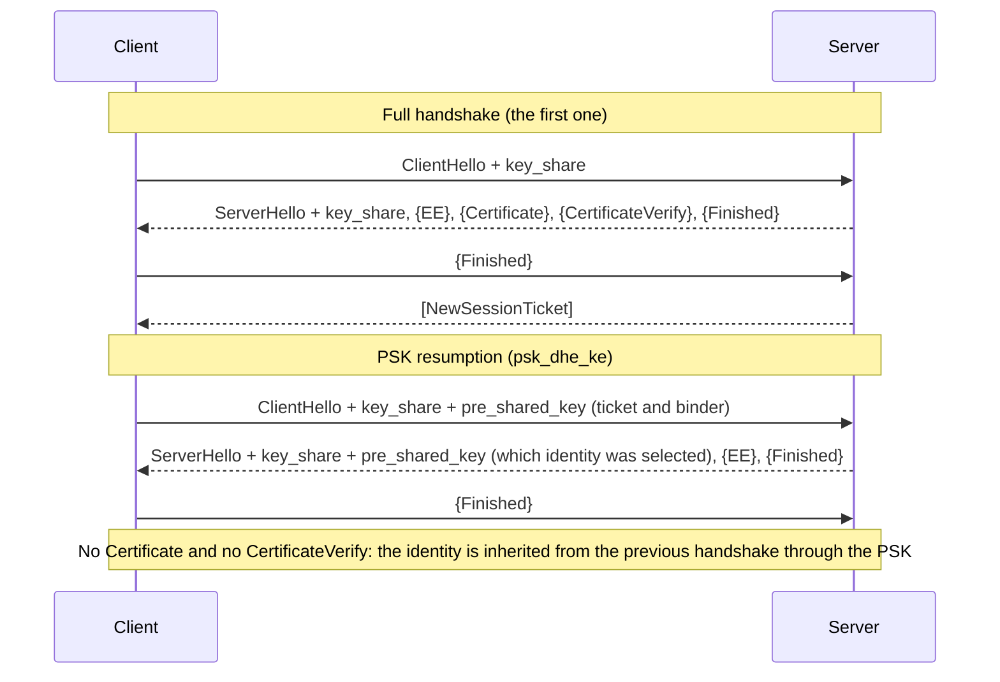
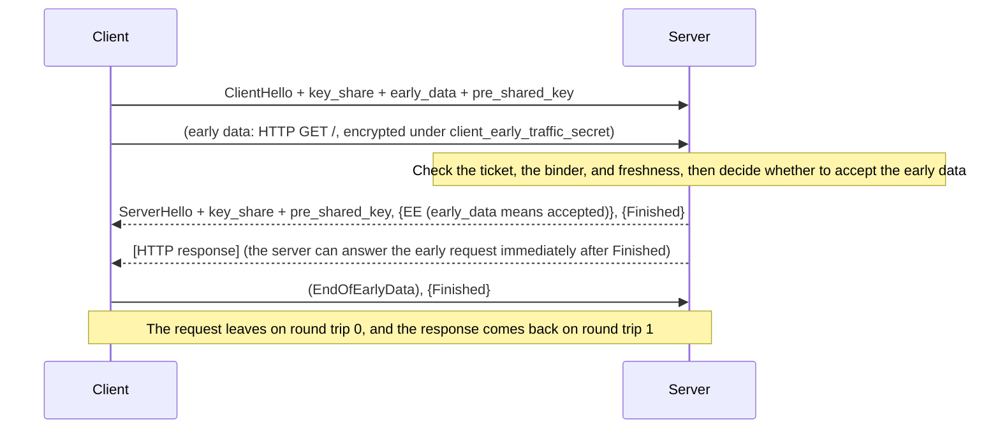
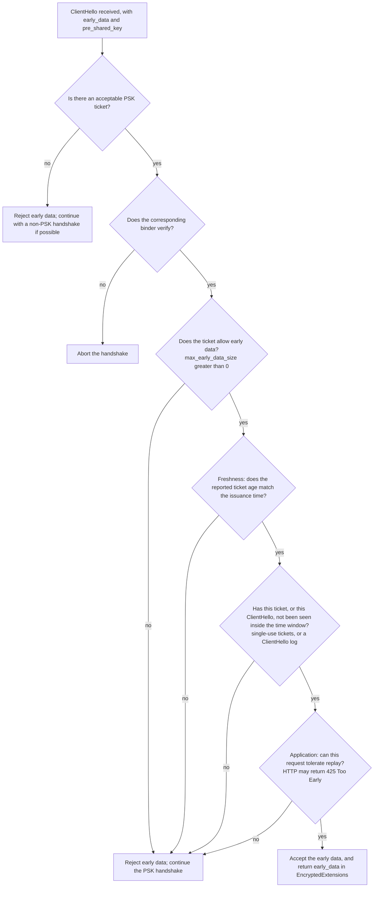
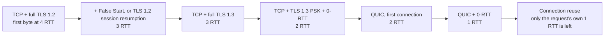

# T07 · Session resumption, 0-RTT, and handshake performance

> Series: [[00_tls-series-overview|TLS series overview]] · Previous: [[T06_tls13-handshake-and-key-schedule|T06 TLS 1.3 handshake and key schedule]] · Next: [[T08_ech-and-https-record-privacy|T08 ECH and HTTPS records]]
> Prerequisites: the round-trip accounting in T01, TLS 1.2 session resumption in T05, and the key schedule and NewSessionTicket in T06.
> Primary standards: RFC 5077 (session tickets), RFC 8446 (§2.2, §2.3, §4.2.10, §4.2.11, §8), RFC 8470 (early data in HTTP), RFC 7918 (False Start), RFC 7413 (TCP Fast Open), RFC 6928 (initial congestion window), RFC 8879 (certificate compression), RFC 9113 §9.1.1 (connection reuse), RFC 8336 (the ORIGIN frame), RFC 8297 (103 Early Hints)
> Compiled: 2026-10-16 (the resumption and 0-RTT experiments in this note were measured against public sites at 2026-10-17 03:04 UTC with OpenSSL 4.0.3)

T01 counted the round trips: a fresh TCP connection plus TLS 1.3 takes two round trips before the first HTTP request can leave. This note is about saving those round trips and those bytes, one at a time. Session resumption skips the certificate and the signature. 0-RTT lets the request leave together with the handshake. False Start and TCP Fast Open take time back from two different layers. Certificate compression and ECDSA certificates fit the handshake into fewer packets. kTLS and hardware instructions lower the cost of each byte. Connection reuse means the handshake is done fewer times in the first place. Every optimization has a cost, and the cost of 0-RTT needs the clearest account.

## Where the time goes

The cost of a handshake falls into three kinds. The first is round trips. Every point that must wait for the peer's reply pays one RTT, a hundred or two hundred milliseconds on a transoceanic path, and that is the part a user feels most. The second is bytes. The certificate chain, the key_share, and the extensions all consume bandwidth, and the sharper question is whether they exceed the TCP initial congestion window, because going past it means waiting another round trip. The third is computation. Signatures, key exchange, certificate verification, and symmetric encryption and decryption, multiplied by thousands of handshakes a second on a server, are real CPU time and a real electricity bill.

| Optimization | What it mainly saves | Cost or prerequisite |
| --- | --- | --- |
| Session resumption (PSK) | Transfer of the certificate, and the computation and bytes of signing and verifying | The client must cache the ticket, and the server must manage ticket keys |
| 0-RTT early data | One round trip | Early data can be replayed, and it has no forward secrecy if the PSK leaks |
| False Start (TLS 1.2) | One round trip | Only for strong suites that provide forward secrecy |
| TCP Fast Open | One TCP round trip | Poor middlebox compatibility, and little deployment |
| Certificate compression, ECDSA certificates | Bytes, and with them an extra round trip | Both sides have to support it |
| Dynamic record sizing | Time to first screen | Needs a server-side implementation |
| kTLS, hardware offload | Server CPU | Kernel and NIC support |
| Connection reuse and coalescing | The entire handshake | A certificate that covers several names, on the same IP |

## TLS 1.2 resumption: session IDs and session tickets

T05 covered the abbreviated TLS 1.2 handshake. The client puts the old session's session_id in the ClientHello. If the server still remembers that session, it skips the certificate and the key exchange, derives new keys from the old master secret plus the new random values, and the handshake shrinks from two round trips to one. The problem with a session ID is that the server has to keep state. More than a hundred servers behind one load balancer have to share a session cache, or the lookup misses.

Session tickets (RFC 5077) turn that state around and give it to the client. The server encrypts the session state under its own ticket key and sends the client a ticket. Next time the client returns the ticket unchanged, the server decrypts it and resumes, and the server stores nothing. In the real capture in T05, Cloudflare sent a 192-byte ticket, with an 18-hour lifetime hint, at the end of the TLS 1.2 handshake.

The hazard in a ticket is forward secrecy. The ticket holds the master secret, and the ticket is encrypted under a long-term ticket key. Whoever obtains that ticket key can open every recorded session that resumed with a ticket, and the original sessions that issued those tickets. Ticket keys therefore have to rotate often (large services usually rotate on the order of hours), stay only in memory, and be distributed safely inside the cluster. A large-scale measurement in 2016 (Springall, Durumeric, and Halderman, "Measuring the Security Harm of TLS Crypto Shortcuts", IMC 2016) found that quite a few large sites left their ticket keys unchanged for weeks or longer, which in practice cancelled the forward secrecy ECDHE had provided.

## PSK resumption in TLS 1.3

TLS 1.3 folds session resumption into the pre-shared key (PSK) mechanism (RFC 8446 §2.2). From the NewSessionTicket the server sends after the handshake in T06, the client can compute a PSK:

```
PSK = HKDF-Expand-Label(resumption_master_secret, "resumption", ticket_nonce, Hash.length)
```

On the next connection the client supplies the ticket and a binder in pre_shared_key, which must be the last extension of the ClientHello:

```
pre_shared_key extension (must be the last extension in the ClientHello)
  identities:
    identity               the ticket itself (opaque data the server encrypted)
    obfuscated_ticket_age  (ticket age in milliseconds + ticket_age_add) mod 2^32
  binders:
    binder                 HMAC(the binder's finished_key, Transcript-Hash(the ClientHello with the binders portion removed))
```

The binder proves that the client really holds this PSK, and it binds the PSK to this particular ClientHello. binder_key is derived from the Early Secret (`res binder` in the derivation tree in T06), and the HMAC is then computed the same way as Finished. The HMAC input is the ClientHello with the binders list removed. An attacker who has a ticket but not the matching PSK cannot compute the binder. Moving the binder onto another ClientHello will not verify either. pre_shared_key has to be the last extension because the binder must cover everything that precedes it.

obfuscated_ticket_age lets the server check that the ticket "age" is plausible (the freshness check used for 0-RTT) without showing the real age to an observer on the path. Each ticket has a random ticket_age_add, which obscures its numerical age. It does not by itself prevent linkability when the same ticket identity is reused. The maximum ticket lifetime is 7 days (§4.6.1).

The psk_key_exchange_modes extension says how the PSK is used on resumption. `psk_ke` uses only the PSK and does no DH. The computation is the cheapest, but the session keys depend entirely on the PSK and there is no forward secrecy. `psk_dhe_ke` performs one more (EC)DHE alongside the PSK. The PSK enters the Early Secret, and the DH shared secret enters the Handshake Secret. Even if the ticket key leaks later, the resumed session stays safe. In T06, OpenSSL offered only `psk_dhe_ke`, and browsers generally use only that mode as well.



What the resumption handshake saves is the certificate chain (several KB), the server's signature operation, and the client's certificate verification (chain building and revocation checks included). The round-trip count is still one. On 2026-10-17, a second connection to each of four sites reported `Reused, TLSv1.3`, and none of the resumed handshakes contained a Certificate message:

| Site | Resumption result | Early data the ticket allows |
| --- | --- | --- |
| www.cloudflare.com | Reused, TLS_AES_256_GCM_SHA384 | 0 |
| www.google.com | Reused, TLS_AES_256_GCM_SHA384 | 14336 bytes |
| www.facebook.com | Reused, TLS_CHACHA20_POLY1305_SHA256 | 4294967295 bytes (0xFFFFFFFF) |
| www.apple.com | Reused, TLS_AES_256_GCM_SHA384 | 0 |

The last column comes from the early_data extension in the ticket (max_early_data_size). It is the maximum amount of 0-RTT data the server is willing to accept. 0 means 0-RTT is not accepted. Facebook's 0xFFFFFFFF is the protocol's uint32 maximum, about 4 GiB: effectively a very large advertised limit, not an unlimited one. Its TLS stack is Meta's in-house Fizz (see [[T11_tls-engineering-practices|T11]]).

## 0-RTT: the request leaves with the handshake

On resumption the two sides already share a PSK, so the client can encrypt the request with it in the first packet. That is 0-RTT early data (RFC 8446 §2.3). The client derives client_early_traffic_secret from the PSK (`c e traffic`, under the Early Secret in the derivation tree; it depends only on the PSK and the ClientHello) and sends encrypted application data immediately after the ClientHello, without waiting for the server.



A live capture matches that diagram. On 2026-10-17 a measurement against www.google.com did a full handshake first and saved the ticket, then used `openssl s_client -sess_in ... -early_data req.txt` to send a `GET /` as early data. The result was:

```
>>> TLS 1.3, Handshake [length 06f6], ClientHello          1782 bytes (including the 4-byte handshake header), carrying pre_shared_key and early_data
<<< TLS 1.3, Handshake [length 04c0], ServerHello          with a hybrid post-quantum key_share and pre_shared_key
<<< TLS 1.3, Handshake [length 000a], EncryptedExtensions  contains early_data, meaning accepted
<<< TLS 1.3, Handshake [length 0034], Finished
>>> TLS 1.3, Handshake [length 0004], EndOfEarlyData       the client announces that early data has ended
>>> TLS 1.3, Handshake [length 0034], Finished
Reused, TLSv1.3, Cipher is TLS_AES_256_GCM_SHA384
Early data was accepted
<<< NewSessionTicket ×2
HTTP/1.1 200 OK
```

There is no Certificate and no CertificateVerify. The request left with the ClientHello, the server accepted the early data, and it returned 200. The ServerHello still contains a hybrid key_share of 1120 bytes, so this is psk_dhe_ke, and data after the handshake still has forward secrecy.

### The two costs of 0-RTT

The first cost is replay. Early data is encrypted only under the PSK, and it has already been sent before the server replies. The server has no fresh exchange with which to confirm that the data was not recorded and sent again. An attacker on the path can send that ClientHello, together with the early data, a second time, unchanged, even to another server in the same cluster. If the early data says "transfer 100 yuan", a replay means the transfer happens twice.

RFC 8446 §8 gives three defenses on the server, and none of them is complete. Single-use tickets: the server remembers which tickets have already been used, and a distributed cluster is strict about this only if that memory is synchronized globally. A log of ClientHello messages already seen: this also has to be shared inside the cluster, and it is limited to a time window. A freshness check: estimate the ticket age from obfuscated_ticket_age, compare it with the issuance time the server recorded, and reject a request that is obviously too old. That shrinks the window, and replay is still possible. The specification therefore requires an application protocol that uses 0-RTT to define, for itself, which data may be sent as early data. If no acceptable PSK is selected, the server can reject early data and continue with a non-PSK handshake. If it selects a PSK, a missing or invalid corresponding binder aborts the handshake; it is not an early-data fallback. The remaining early-data checks can reject early data while the PSK handshake continues:



For HTTP, the rule is in RFC 8470. A client should put into early data only requests that are safe, idempotent, and free of side effects. GET is the typical case. A proxy or CDN in the middle, if it received the request as early data, adds an `Early-Data: 1` header when it forwards to the origin. If the origin decides the request cannot take the replay risk, it returns `425 Too Early`, and the client sends the request again after the handshake completes. The usual browser practice is to put into 0-RTT only requests that can be retried safely.

The second cost is forward secrecy. The keys for early data come only from the PSK. They have not been through a fresh DH. Once the ticket key leaks, every recorded piece of early data can be opened. Even under psk_dhe_ke, the DH protects only the data that follows the handshake.

Those two costs are why many services leave 0-RTT off by default. In the measurements, neither the Cloudflare tickets nor the Apple tickets allowed early data. Cloudflare offers 0-RTT as a switch a customer can turn on, and the customer judges whether its own application can tolerate replay. Companies such as Google and Facebook, which fully control the meaning of requests to their own applications, are willing to turn it on in exchange for one round trip.

## False Start and TCP Fast Open

These two optimizations each take one round trip back, one from TLS and one from TCP.

TLS False Start (RFC 7918) is a TLS 1.2 optimization. After the client sends its own Finished, it starts sending application data without waiting for the server's Finished. The effective delay of a full handshake therefore drops from two round trips to one, the same as TLS 1.3. The risk is that the client has not yet confirmed that the handshake was left intact. If a man in the middle downgrades the handshake to an algorithm that can be broken in real time, the client's earliest data is already in the attacker's hands. RFC 7918 therefore allows False Start only when the key exchange provides forward secrecy and the algorithms are strong enough. Browsers generally enabled it during the TLS 1.2 years. The 1-RTT handshake of TLS 1.3 made False Start unnecessary.

TCP Fast Open (RFC 7413) lets a TCP SYN carry data. On the first connection the client asks the server for a cookie. Later connections put the cookie and the data in the SYN. The data can be a ClientHello. Once the server has checked the cookie, it can hand the data to the application before the handshake finishes. In theory this can bring the first byte of TCP plus TLS 1.3 plus 0-RTT down to one round trip. Real deployment is rare, for several reasons. Many middleboxes drop or rewrite a SYN that carries data. Data inside the SYN can be replayed, just as 0-RTT data can, and the application has to deal with that itself. The cookie can be used to track the client. QUIC implements 0-RTT connection setup itself, on UDP, and to a large extent it replaces what TCP Fast Open was trying to do ([[T09_quic-and-http3|T09]]).

## Bytes: do not add a round trip to the handshake

TCP slow start says that just after a connection is established, the sender may emit only as much data as the initial congestion window, and must then wait for an ACK before sending more. RFC 6928 sets the initial window at 10 segments, about 14KB with an MSS of 1460 bytes. If the server's first flight (ServerHello, EncryptedExtensions, Certificate, CertificateVerify, Finished) exceeds that size, the server has to stop halfway and wait for the client's ACK, which inserts an extra round trip.

The byte count of the handshake therefore affects latency directly. A few measured figures: the Certificate message for www.cloudflare.com is 2522 bytes (including the 4-byte handshake header), www.google.com's is 2477 bytes, and the four certificates for letsencrypt.org in T03 add up to 3576 bytes. All of them are ECDSA chains. Hybrid post-quantum key exchange adds about 1.1KB to the ServerHello (a key_share of 1120 bytes). Together with the certificate chain and the signature, the server's first flight for these sites is about 4KB, with room left under 14KB. What tends to go over the limit is an old configuration that carries an RSA-4096 certificate, several intermediates, and a stapled OCSP response, and, later on, post-quantum signature certificates ([[T10_post-quantum-tls|T10]]).

There are three ways to shrink the handshake. Use an ECDSA certificate in place of an RSA certificate: both the public key and the signature are much smaller (T03). Send only the intermediates that are required, and do not send the root. Certificate compression (RFC 8879): TLS 1.3 defines the compress_certificate extension and the CompressedCertificate message, with three algorithms, zlib, brotli, and zstd. The client announces which of them it supports, and the server can then send the whole Certificate message compressed. A certificate repeats a lot of structure and a lot of names, so it compresses well. Chrome and Cloudflare both support brotli certificate compression. The local OpenSSL 4.0.3 build is not linked against those compression libraries (`openssl version -a` does not list them). The ClientHello did not announce support, so the captures received uncompressed certificates. There is no locally measured compression ratio to report here.

## Record size and the first screen

A TLS record is at most 16KB. The receiver has to collect an entire record and check the authentication tag before it can decrypt a single byte. If the server sends 16KB records from the start of the connection, and one record spans a dozen or more TCP segments, the browser has to wait until every segment has arrived before it can start parsing HTML. Loss and retransmission of any one segment stalls the whole record.

Dynamic record sizing is a server-side practice used by Google, Cloudflare, and others. At the start of a connection, use small records (each one fits in a single TCP segment, about 1.4KB), so the browser gets data early and can start rendering. Once the connection is stable and the window has grown, switch to 16KB records to cut overhead. After an idle stretch, go back to small records. nginx sets a fixed record size with the `ssl_buffer_size` directive. The default is 16KB. Sites that care about the first screen often lower it to about 4KB. That is a trade-off between throughput and latency.

## Computation: signatures, key exchange, and symmetric encryption

Each full handshake costs the server one signature and one key exchange. An ECDSA P-256 signature is about an order of magnitude faster than an RSA-2048 signature, which is another reason large services prefer ECDSA certificates. On the verifying side, RSA is actually faster for the client, but one client verifies only a few times, so the difference hardly matters. X25519 is very cheap. ML-KEM-768 runs in the same range as X25519; the main cost is bytes, not CPU (T10). Session resumption skips the signature and the certificate verification, and the CPU saved on the server is large.

For the symmetric part, a processor with AES hardware instructions can handle several gigabytes per second per core with AES-GCM, which is almost never the bottleneck. On a low-end device without those instructions, ChaCha20-Poly1305 is faster. T02 and T05 described how a server picks the suite on that basis.

At genuinely high throughput, the bottleneck moves off the encryption itself and onto copying data between the kernel and user space. kTLS (kernel TLS) puts the record layer's symmetric encryption and decryption in the kernel. The handshake is still performed by a TLS library in user space. When it finishes, the traffic keys are handed to the kernel, and the application can `sendfile` a file from disk straight into the encrypted socket, without reading it into user space, encrypting it, and writing it back. Linux has supported kTLS for sending since 4.13, and FreeBSD has a complete implementation. Some NICs go further and offload TLS record encryption onto the hardware. Netflix delivers video on FreeBSD with kTLS plus NIC TLS offload, and has publicly described encrypted throughput on the order of 400Gb/s from a single server.

## Connection reuse: the best handshake is no handshake

Add up every handshake optimization and the total still falls short of skipping the handshake entirely. HTTP/2 carries every request for one name on a single connection (RFC 9113). Connection coalescing (RFC 9113 §9.1.1) goes further and lets the browser place a request for `a.example.com` onto a connection already open for `b.example.com`, provided the two names resolve to the same IP and the certificate on that connection covers both names. A CDN often uses one certificate with many SANs to raise the chance of coalescing. The ORIGIN frame (RFC 8336) lets the server tell the client which other origins this connection can also serve, without relying on the DNS answers agreeing. HTTP/3 has the same mechanism.

A page can also open connections ahead of time. `<link rel="preconnect">` makes the browser finish DNS, TCP, and the TLS handshake for a name early. 103 Early Hints (RFC 8297) lets the server, before the real response is ready, send an informational response that says these resources and these names will be needed in a moment. The browser can spend that wait on preconnect and preload.

## Round-trip budget

Set the round-trip table from T01 next to the optimizations in this note. Count from the first packet the client sends, and leave DNS out:



Three further things decide whether those numbers are actually reached. The handshake has to stay inside the initial congestion window. The client's key_share guess has to be right, or a HelloRetryRequest appears. DNS has to avoid an extra lookup, through a cache or through an HTTPS record.

## Common misconceptions

Session resumption is 0-RTT. Session resumption (PSK) saves the certificate and the signature, and the round-trip count is still one. 0-RTT, built on top of resumption, additionally lets the request leave with the ClientHello. It requires the server to allow it explicitly (max_early_data_size on the ticket greater than 0), and it carries a replay risk. All four measured sites support resumption. Only two of them allow 0-RTT.

0-RTT data is as safe as ordinary data. It can be replayed, and it has no forward secrecy against compromise of the ticket key. Only a request that can safely run more than once should be placed there.

Once ECDHE is on, session tickets do not affect forward secrecy. A TLS 1.2 ticket contains the master secret directly, so a leaked ticket key opens those sessions. TLS 1.3 with psk_dhe_ke can keep forward secrecy for data after the handshake, but early data still has none.

A somewhat larger certificate does not matter, because there is enough bandwidth. The constraint is the TCP initial congestion window, not the raw bandwidth. Past about 14KB there is another round trip to wait for, and on a high-latency path that wait matters much more than sending a few extra KB.

TLS encryption burns a lot of CPU. On a current processor the cost of symmetric encryption is small. Signatures and key exchange are the main computational cost of the handshake, and session resumption together with ECDSA certificates cuts that cost sharply. At high throughput the bottleneck is often the copying of data, and that is the problem kTLS is aimed at.

## Sources cited in this note

- RFC 5077, TLS Session Resumption without Server-Side State, https://www.rfc-editor.org/rfc/rfc5077
- RFC 8446, TLS 1.3 (§2.2 resumption and PSK, §2.3 0-RTT, §4.2.10 early_data, §4.2.11 pre_shared_key, §4.6.1 NewSessionTicket, §8 0-RTT and anti-replay), https://www.rfc-editor.org/rfc/rfc8446
- RFC 8470, Using Early Data in HTTP, https://www.rfc-editor.org/rfc/rfc8470
- RFC 7918, TLS False Start, https://www.rfc-editor.org/rfc/rfc7918
- RFC 7413, TCP Fast Open, https://www.rfc-editor.org/rfc/rfc7413
- RFC 6928, Increasing TCP's Initial Window, https://www.rfc-editor.org/rfc/rfc6928
- RFC 8879, TLS Certificate Compression, https://www.rfc-editor.org/rfc/rfc8879
- RFC 9113, HTTP/2 (§9.1.1 connection reuse), https://www.rfc-editor.org/rfc/rfc9113
- RFC 8336, The ORIGIN HTTP/2 Frame, https://www.rfc-editor.org/rfc/rfc8336
- RFC 8297, An HTTP Status Code for Indicating Hints (103 Early Hints), https://www.rfc-editor.org/rfc/rfc8297
- Linux kernel documentation, Kernel TLS, https://docs.kernel.org/networking/tls.html
- Netflix, "Serving Netflix Video at 400Gb/s on FreeBSD" (Drew Gallatin, EuroBSDCon 2021)
- Local measurement: `openssl s_client -tls1_3 -sess_out` / `-sess_in` / `-early_data` / `-msg` (OpenSSL 4.0.3, 2026-10-17 03:04 UTC), against www.cloudflare.com, www.google.com, www.facebook.com, and www.apple.com
