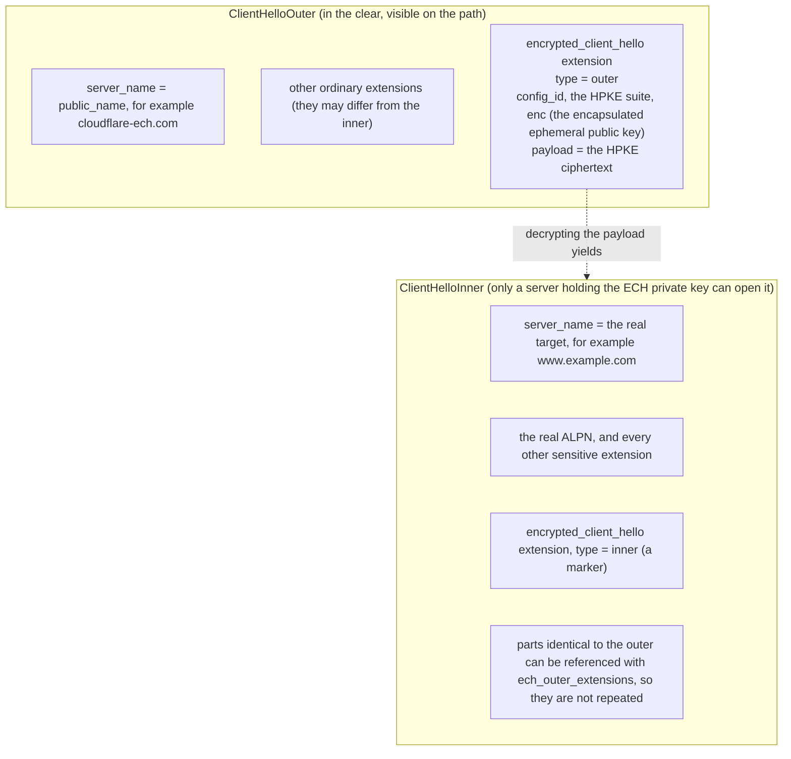
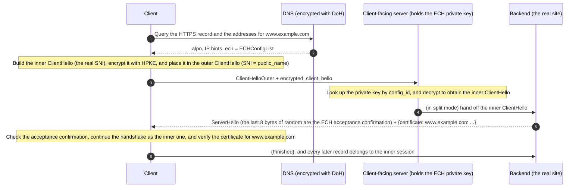
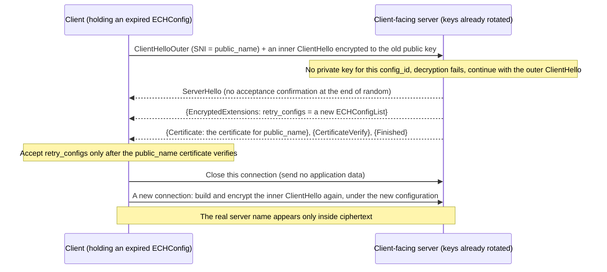

# T08 · ECH and HTTPS records: privacy in the handshake

> Series: [[00_tls-series-overview|TLS series overview]] · Previous: [[T07_session-resumption-0-rtt-and-performance|T07 Session resumption and 0-RTT]] · Next: [[T09_quic-and-http3|T09 QUIC and HTTP/3]]
> Prerequisites: the ClientHello structure and the downgrade-sentinel idea from T06, and AEAD and X25519 from T02.
> Primary standards: RFC 9849 (TLS Encrypted Client Hello, 2026-03), RFC 9848 (bootstrapping ECH with DNS service bindings, 2026-03), RFC 9934 (the PEM format for ECH keys), RFC 9180 (HPKE), RFC 9460 (SVCB and HTTPS records), RFC 6066 §3 (SNI), RFC 8484 (DoH), RFC 7858 (DoT), RFC 9250 (DoQ), RFC 8701 (GREASE)
> Compiled: 2026-10-16 (the HTTPS records in this note are real results queried through 1.1.1.1 at 2026-10-17 03:07 UTC)

TLS 1.3 encrypts the certificate and most of the handshake, but the ClientHello is still in the clear, and the ClientHello names the site you are about to open. This note first lists what plaintext a TLS 1.3 handshake still exposes, then why SNI has to exist and why it has stayed in the clear, then how Encrypted Client Hello (ECH) hides the entire real ClientHello under public-key encryption, and finally where the client obtains the public key it encrypts to: the DNS HTTPS record. ECH was published as RFC 9849 in March 2026. This note follows the RFC for the goals and the mechanism.

## What plaintext a TLS 1.3 handshake still exposes

| What is visible | Where it appears | What can be inferred |
| --- | --- | --- |
| Source IP, destination IP, and port | The IP header and the TCP or UDP header | Which server is on the other end; if that IP hosts only one site, the site is known |
| The DNS query | The DNS message, when DNS is not encrypted | Which name is being visited |
| SNI | The server_name extension of the ClientHello | Which name is being visited |
| ALPN | The ClientHello | Whether the protocol is HTTP/2, HTTP/3, or something else |
| The lists of cipher suites, groups, and extensions, and their order | The ClientHello | Which client software this is, and which version (a fingerprint) |
| Record lengths and timing | Each record | Traffic analysis can guess the kind of page being visited |
| The server certificate | In the clear under TLS 1.2 | Already encrypted in TLS 1.3 |

A DNS query can be encrypted with DoH or DoT, and the certificate is already encrypted in TLS 1.3. What still exposes the target most directly is SNI.

## Why SNI exists, and why it is in the clear

SNI (Server Name Indication) was first defined in RFC 3546 in 2003. The current definition is RFC 6066 §3. The problem it solves is virtual hosting. Many sites share one IP address, and the server has to decide which certificate to send at the very start of the handshake. Under the TLS design, the server knows nothing at that moment. The HTTP Host header is sent only after the handshake finishes. The client therefore says, in the ClientHello, "the name I want is www.example.com", and the server picks the certificate from that. Without SNI, every HTTPS site would need an IP of its own. That was not workable while IPv4 addresses grew scarce, and a CDN, one IP serving tens of thousands of names, could not exist.

SNI is in the clear for a simple reason. It sits in the first message of the handshake, and at that point the two sides share no key that could encrypt it. To encrypt it, the client has to hold some public key of the server already, and that public key cannot come from this handshake itself. That chicken-and-egg problem is what ESNI and ECH set out to solve.

## From ESNI to ECH

In 2018 the IETF's first proposal was called ESNI (Encrypted SNI, an early version of draft-ietf-tls-esni). Cloudflare and Firefox ran deployment experiments that same year. The idea was to encrypt only the server_name extension. The server publishes a public key in a DNS TXT record, and the client encrypts the SNI to it.

The limits showed up quickly. Encrypting the SNI alone is not enough. Other extensions in the ClientHello leak as well, ALPN among them, and any extension that only one particular service would send. Each new sensitive extension would need an encryption design of its own, which does not scale. Key rotation and failure recovery were also poorly designed: there was no safe answer for a client whose public key had expired. From 2020 the proposal was redesigned and renamed ECH. It no longer encrypts a single extension. It encrypts a complete, real ClientHello as a whole, and places that ciphertext inside an outer ClientHello that looks harmless. After several more years and more than twenty draft revisions, it was published as RFC 9849 in March 2026.

## ECH roles and the outer and inner ClientHello

ECH introduces two roles. The server the client connects to directly is the client-facing server, and it holds the ECH private key. The server that actually serves the target site is the backend server. The two may be the same machine (shared mode), or they may be separate, with the client-facing server decrypting and then handing the connection to the backend (split mode). A typical deployment is a CDN. Every customer's site sits behind the same client-facing server, which publishes one public name (public_name). Cloudflare uses `cloudflare-ech.com`.

The handshake the client sends contains two ClientHello messages:



The outer ClientHello is a complete, valid ClientHello, and the server name it carries is the public name. The real ClientHello is encoded, encrypted with HPKE, and placed in the outer encrypted_client_hello extension. So that the outer ClientHello does not grow too large, an inner extension that is identical to the outer one (key_share and supported_groups often are) need not be carried twice. The ech_outer_extensions extension can say "copy these extensions from the outer".

## HPKE: public-key encryption for one shot

ECH encrypts with HPKE (Hybrid Public Key Encryption, RFC 9180). HPKE is a general standard construction for encrypting a blob of data to a recipient's public key. It combines a KEM (key encapsulation mechanism), a KDF, and an AEAD:

```
Sender (the client):
  enc, ctx = SetupBaseS(pkR, info)       encapsulate a shared secret to the recipient public key pkR; enc is the encapsulation sent to the recipient
  ct       = ctx.Seal(aad, plaintext)    encrypt under the AEAD key derived from the shared secret
Recipient (the client-facing server):
  ctx      = SetupBaseR(enc, skR, info)  recover the same shared secret with its own private key skR and with enc
  pt       = ctx.Open(aad, ct)

In ECH:
  info      = "tls ech" + 0x00 + ECHConfig      bind the encryption to one specific configuration
  aad       = ClientHelloOuterAAD               the outer ClientHello, with the payload field set to zeros
  plaintext = EncodedClientHelloInner           the inner ClientHello, encoded and padded
```

When the KEM is X25519 (HPKE calls it DHKEM(X25519, HKDF-SHA256)), encapsulation means generating an ephemeral X25519 key pair. enc is the ephemeral public key, and the shared secret comes from DH between the ephemeral private key and the recipient's public key. In concept that is the ECDH from T02, followed by HKDF. The aad is the outer ClientHello, so a change to any byte of the outer ClientHello means the inner one will not open. An attacker cannot keep the ciphertext and alter the outer ClientHello at the same time. info contains the whole ECHConfig, so the ciphertext can be opened only by the private key that belongs to this configuration.

## A real ECHConfig

Where does the client get pkR? From a DNS HTTPS record. On 2026-10-17 the HTTPS record for `crypto.cloudflare.com` was queried. The local `dig` 9.10.6 is too old to know the HTTPS type, so the query used `TYPE65` and came back as hexadecimal in the RFC 3597 unknown-type format. Decoded, it is:

```
SvcPriority  1                          service mode (ServiceMode)
TargetName   .                          this name itself
alpn         h2
ipv4hint     162.159.135.79, 162.159.136.79
ipv6hint     2606:4700:7::a29f:874f, 2606:4700:7::a29f:884f
ech          71 bytes, an ECHConfigList:
  ECHConfig
    version               0xfe0d        version of this ECH configuration
    length                65
    config_id             117           the id of this configuration; the client echoes it, and the server uses it to find the private key
    kem_id                0x0020        DHKEM(X25519, HKDF-SHA256)
    public_key            32 bytes      ad5cf6ae627c0841...
    cipher_suites         (kdf 0x0001 HKDF-SHA256, aead 0x0001 AES-128-GCM)
    maximum_name_length   0             the longest backend name is unknown; use the default padding rule
    public_name           cloudflare-ech.com
    extensions            empty
```

Each field lines up with the ECHConfig definition in RFC 9849 §4. The public_name `cloudflare-ech.com` is the name the outer ClientHello will carry, and an observer on the path sees only that. config_id is a single byte. The server uses it to look up the private key quickly, and the client echoes it unchanged inside the outer encrypted_client_hello. An HTTPS record for `www.cloudflare.com`, queried at the same time, contained only `alpn=h3,h2` and the IP hints, with no ech parameter. This shows that ECH is configured one name at a time.

## How the handshake runs



How does the server tell the client that it opened the inner ClientHello and used it? It replaces the last 8 bytes of ServerHello.random with a confirmation value. That value is computed with HKDF from the inner ClientHello's random and from the handshake transcript, under the label `ech accept confirmation` (RFC 9849 §7.2). Only a server that actually opened the inner ClientHello can compute it. The client computes the same value and thereby confirms that ECH was accepted. The idea matches the downgrade sentinel in T06. Both of them pass a signal in ServerHello.random, and to a bystander the field still looks like a random number.

If the server cannot open the inner ClientHello (the client used an expired configuration, or the server has already rotated the keys), ECH has a safe fallback. The server behaves as if there were no ECH, continues the handshake with the outer ClientHello, presents the certificate for public_name, and attaches a fresh retry_configs inside the encrypted EncryptedExtensions. The client checks that the public_name certificate really is valid, then accepts the new configuration, closes this connection, and connects again with the new configuration. Through the whole process the real server name never appears in the clear. The cost is one extra connection. The client must verify the public_name certificate before it trusts retry_configs. Otherwise a man in the middle can hand it a forged configuration.



## Padding, GREASE, and the anonymity set

Once the contents are encrypted, length can still leak. `a.com` and `a-very-long-name.example.org` come out at different lengths. ECH has the client pad the inner ClientHello (RFC 9849 §6.1.3, a SHOULD-level recommendation). Pad the server name at least out to maximum_name_length (when that length is unknown, follow the default rule in the specification), then round the length of the whole inner ClientHello up to a multiple of 32 bytes, so that handshakes aimed at different targets look the same length.

GREASE ECH deals with a different leak. If only a client that really uses ECH sent the encrypted_client_hello extension, then "this connection uses ECH" would itself be a signal, and a network could treat those connections differently. A client that has no ECH configuration therefore also sends a fake extension of exactly the same shape, filled with random contents (RFC 9849 §6.2). Looking only at the outer ClientHello, an observer cannot tell which connections actually use ECH. The GREASE described in T04 and T06 (RFC 8701) is the same idea: make unrecognized values ordinary on the network, so that the protocol does not ossify.

How much privacy ECH provides depends on the size of the anonymity set. What it hides is which name, among those behind this client-facing server, you are visiting. If one public_name has more than a million sites behind it, an observer learns only that the visit is to one of them. If a server hosts a single site, ECH encrypts the SNI and the IP address gives the target away anyway. That is why ECH deployment naturally concentrates on large CDNs, and why the privacy actually gained has to be judged together with what the IP layer reveals, and together with traffic analysis.

## An HTTPS record does more than carry ECH

RFC 9848 specifies how an ECHConfig is published: in the `ech` parameter of SVCB and HTTPS records (RFC 9460). An HTTPS record does much more than that one job. T01 mentioned it. The parameters are these:

| Parameter | Key | Role |
| --- | --- | --- |
| alpn | 1 | Application protocols the service supports, for example h3 and h2. The client can connect with QUIC directly, instead of connecting with TCP first and learning the alternative from Alt-Svc |
| no-default-alpn | 2 | The default http/1.1 is not supported |
| port | 3 | A port other than the default |
| ipv4hint, ipv6hint | 4, 6 | Address hints, which save the wait for an A or AAAA query |
| ech | 5 | The ECHConfigList (RFC 9848) |

Two further uses are easy to miss. One is AliasMode (SvcPriority 0): an apex name such as `example.com` can point at a CDN hostname, which solves the old problem that a CNAME cannot sit at the zone apex. The other is the upgrade to HTTPS. RFC 9460 §9.5 says that when a client finds an HTTPS record for a name, it should take an `http://` visit straight to `https://`. The effect is similar to HSTS, and it skips the cleartext redirect (T01).

## DNS has to be encrypted as well

The ECH public key arrives through DNS, and that rests on one precondition: the DNS query itself must be encrypted too. Otherwise two things happen. An observer can read the name being visited out of the cleartext DNS query, and encrypting the SNI no longer helps. Someone on the path can also delete the ech parameter from a cleartext DNS answer, so the client concludes that the name does not support ECH.

Encrypted DNS has three standard forms. DoT is DNS over TLS, RFC 7858, on port 853. DoH is DNS over HTTPS, RFC 8484, sharing port 443 with ordinary HTTPS. DoQ is DNS over QUIC, RFC 9250. A browser that turns ECH on usually also requires DoH, or encrypted DNS supplied by the system. From version 129, Firefox can obtain the ECH configuration through the operating system's DNS resolver (Mozilla wiki). Each of these three itself runs over TLS or QUIC. DNS privacy and TLS privacy are two sides of the same thing. A complete deployment record for a self-hosted DoH server is in [[self-host-dns]].

## Deployment status (2026-10)

RFC 9849 was published in March 2026, but browsers had implemented ECH while it was still a draft. Firefox has implemented ECH since version 98, and since version 129 it can fetch the configuration through the system DNS. Chrome has enabled it by default since version 117 (that version number comes from a secondary source). On the server side, Cloudflare is the main deployer today, and the real ECHConfig above comes from it. Among TLS libraries, BoringSSL (used by Chrome) and NSS (used by Firefox) both support ECH, and `s_client` in the local OpenSSL 4.0.3 already offers ECH-related options. The system network stack on Apple platforms does not enable ECH by default. On the Apple Developer Forums, a developer filed feedback asking to enable ECH by default on iOS. Whether iOS 26 changed that had not been confirmed from an authoritative source when this note was compiled.

## Limits and controversy

ECH does not hide the IP address, so its effect depends heavily on the anonymity set. It does not hide record lengths or timing, so traffic analysis still works. The fingerprint of the outer ClientHello, which is a signature of the client software, is still visible. It has to be paired with encrypted DNS. Without that, the gain is limited.

While ECH was being standardized, the IETF also argued about network operations and management. Some enterprise networks, security appliances, and parental-control products depend on reading the SNI in order to enforce an access policy, and ECH makes that practice fail. The IETF had already discussed, in a systematic way, what pervasive encryption does to network operations, in RFC 8404. The finished standard takes privacy as the default, and leaves policy enforcement to configuration and administration on the endpoint. An enterprise can, for example, turn ECH off on a managed device, or install a local policy.

## Common misconceptions

With TLS 1.3 on, the site being visited is confidential. TLS 1.3 encrypts the certificate, but the SNI is still in the clear, and so is the DNS query when DNS is not encrypted. Only ECH together with encrypted DNS keeps "which name was visited" from leaking out of the handshake and out of DNS. The IP address is still visible.

ECH encrypts only the SNI. That is what ESNI did. ECH encrypts the whole inner ClientHello, including the SNI, the ALPN, and every other sensitive extension.

Once the ECH public key expires, the connection fails, or the real name leaks. On expiry the server finishes the handshake with the outer ClientHello, presents the certificate for public_name, and delivers a new configuration. The client checks that certificate and reconnects under the new configuration. The real name does not appear in the clear.

The SNI in the outer ClientHello is a fake name and can be anything. The outer server_name should be the public_name from the ECHConfig. On fallback the server has to present a valid certificate for that name, and the client checks it. The safe fallback of ECH stands on that check.

HTTPS records exist only to carry ECH. They also provide ALPN discovery (so the client can use HTTP/3 directly), address hints, an alias for an apex name, and the upgrade to HTTPS. ECH is one parameter among those.

## Sources cited in this note

- RFC 9849, TLS Encrypted Client Hello, https://www.rfc-editor.org/rfc/rfc9849.html
- RFC 9848, Bootstrapping TLS Encrypted ClientHello with DNS Service Bindings, https://www.rfc-editor.org/info/rfc9848/
- RFC 9934, Privacy-Enhanced Mail (PEM) File Format for Encrypted ClientHello (ECH), https://datatracker.ietf.org/doc/rfc9934/
- RFC 9180, Hybrid Public Key Encryption, https://www.rfc-editor.org/rfc/rfc9180
- RFC 9460, Service Binding and Parameter Specification via the DNS (SVCB and HTTPS Resource Records), https://www.rfc-editor.org/rfc/rfc9460
- RFC 3597, Handling of Unknown DNS Resource Record (RR) Types, https://www.rfc-editor.org/rfc/rfc3597
- RFC 6066, TLS Extensions (§3 Server Name Indication), https://www.rfc-editor.org/rfc/rfc6066
- RFC 8484, DNS Queries over HTTPS (DoH), https://www.rfc-editor.org/rfc/rfc8484
- RFC 7858, DNS over TLS, https://www.rfc-editor.org/rfc/rfc7858
- RFC 9250, DNS over Dedicated QUIC Connections, https://www.rfc-editor.org/rfc/rfc9250
- RFC 8701, Applying GREASE to TLS Extensibility, https://www.rfc-editor.org/rfc/rfc8701
- RFC 8404, Effects of Pervasive Encryption on Operators, https://www.rfc-editor.org/rfc/rfc8404
- Mozilla Wiki, Security/Encrypted Client Hello, https://wiki.mozilla.org/Security/Encrypted_Client_Hello
- Apple Developer Forums, Enable Encrypted Client Hello (ECH, RFC 9849) by default on iOS/iPadOS, https://developer.apple.com/forums/thread/842112
- Local measurement: `dig +short TYPE65 crypto.cloudflare.com @1.1.1.1`, `dig +short TYPE65 www.cloudflare.com @1.1.1.1` (2026-10-17 03:07 UTC), decoded in Node.js according to the formats in RFC 9460 and RFC 9849
