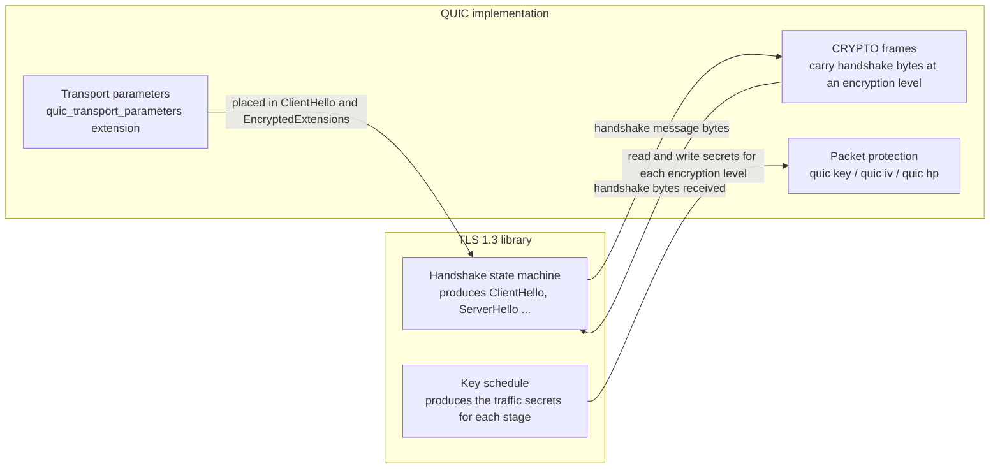
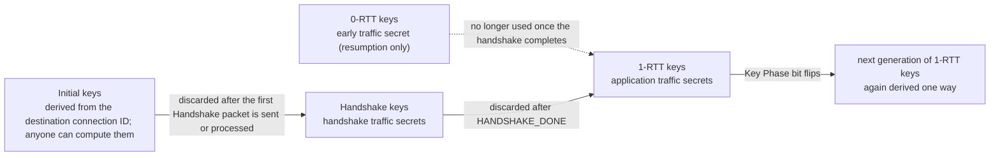
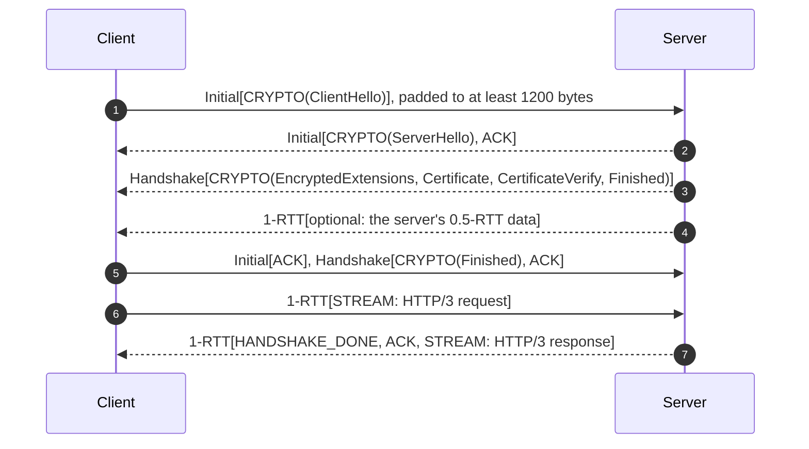

# T09 · QUIC and HTTP/3: TLS inside the transport

> Series: [[00_tls-series-overview|TLS series overview]] · Previous: [[T08_ech-and-https-record-privacy|T08 ECH and HTTPS records]] · Next: [[T10_post-quantum-tls|T10 Post-quantum TLS]]
> Prerequisites: TCP from T05, the TLS 1.3 handshake and key schedule from T06, and 0-RTT from T07. An introductory note is [[../QUIC|QUIC introduction]].
> Main standards: RFC 8999 (version-independent properties), RFC 9000 (QUIC transport), RFC 9001 (using TLS to secure QUIC), RFC 9002 (loss detection and congestion control), RFC 9114 (HTTP/3), RFC 9204 (QPACK), RFC 7838 (Alt-Svc), RFC 9369 (QUIC v2), RFC 9368 (compatible version negotiation)
> Compiled: 2026-10-16 (the Initial secrets in this note were recomputed locally from the RFC 9001 Appendix A test vector)

In the earlier notes, TLS sits on top of TCP. The two handshakes run one after the other, and the TCP round trip in the T01 accounting cannot be removed. QUIC takes another route: it rebuilds a transport protocol on UDP so that, from the first packet, connection setup is combined with the TLS 1.3 handshake. This note covers why QUIC does that, how it borrows the TLS 1.3 handshake while leaving the TLS record layer unused, how its packets are encrypted and "obfuscated", and how HTTP/3 is built on it and how browsers discover it.

## Why rebuild a transport on UDP

QUIC sets out to fix three problems with TCP.

The first is handshake latency. The TCP three-way handshake and the TLS handshake are separate protocols, so they can only run in sequence. A first connection needs at least two round trips before it can send a request. TCP Fast Open tried to remove that TCP round trip, but in practice it never got deployed (T07).

The second is head-of-line blocking. TCP provides one ordered byte stream. HTTP/2 multiplexes many requests on a single TCP connection, but if one packet is lost, TCP waits for the retransmission before it can hand any later data it has already received to the application, even data that belongs to unrelated requests. On mobile networks with a high loss rate, HTTP/2 can even be slower than HTTP/1.1 opening several connections.

The third is ossification. TCP is implemented in the operating-system kernel, so changing a behavior waits on every operating system to upgrade. The TCP header is also plaintext, and a large number of middleboxes on the path read or rewrite TCP header fields. Any new TCP option may be dropped by some device. The middlebox problems TLS 1.3 met during deployment (T04) are only more severe at the TCP layer.

QUIC's answer is to run on UDP (middleboxes mostly look only at the UDP port), implement the protocol in user space (the application ships its own stack and updates it with the application), and encrypt almost everything, including transport control information, so middleboxes have nothing to depend on and therefore nothing to ossify.

A short history is enough: Google's Jim Roskind designed the original QUIC in 2012 (later called gQUIC). From 2013 it was deployed between Chrome and Google's servers, using its own cryptographic handshake. In 2016 the IETF formed the QUIC working group and replaced that cryptography with TLS 1.3. In May 2021 it published RFC 9000, RFC 9001, and RFC 9002. In June 2022 it published HTTP/3 (RFC 9114).

## The basic structure of QUIC

```
     HTTP/3 requests and responses
+---------------------------+
|  HTTP/3 frames, QPACK      |
+---------------------------+
|  QUIC streams              |   One connection holds many independent ordered byte streams
+---------------------------+
|  QUIC frames               |   CRYPTO, STREAM, ACK, NEW_CONNECTION_ID, PATH_CHALLENGE ...
+---------------------------+
|  QUIC packets              |   Encrypted, then placed in a UDP datagram. One datagram can carry several packets
+---------------------------+
|  UDP                       |
+---------------------------+
```

QUIC commonly uses connection IDs, which let endpoints identify a connection independently of the 4-tuple (source IP, source port, destination IP, destination port) and support connection migration. QUIC also permits zero-length connection IDs; those connections rely on addressing information and give up migration and NAT-rebinding resilience. Packets use two header forms. The long header is used during the handshake for Initial, 0-RTT, Handshake, and Retry packets, and it carries a version and both peers' connection IDs. The short header is used for 1-RTT packets after the handshake, and it carries only the destination connection ID, so the overhead is small. A packet carries frames, and frames are QUIC's real control and data units: a STREAM frame carries data for one stream, an ACK frame acknowledges, and a CRYPTO frame carries TLS handshake messages.

Each stream has its own sequence space. Loss affects only the stream the lost packet belonged to. Data on other streams can still be delivered to the application, so head-of-line blocking at the TCP layer is gone.

## How QUIC uses TLS 1.3

The core design of RFC 9001 is that QUIC uses the TLS 1.3 handshake and leaves the TLS record layer unused. The TLS handshake messages (ClientHello, ServerHello, EncryptedExtensions, Certificate, CertificateVerify, Finished) are produced unchanged, but they are no longer wrapped in TLS records. They are carried in QUIC CRYPTO frames. At each stage of the handshake the TLS library hands the derived traffic secrets to QUIC, and QUIC uses those secrets to derive keys and encrypt QUIC packets.



QUIC defines four encryption levels, matching the stages of TLS 1.3:

| Encryption level | Where the secret comes from | Used for | Packet number space |
| --- | --- | --- | --- |
| Initial | Derived from the destination connection ID chosen by the client and a fixed salt | ClientHello, ServerHello | Initial |
| 0-RTT | client_early_traffic_secret | The client's early data | Application data |
| Handshake | Handshake traffic secrets | EncryptedExtensions through Finished | Handshake |
| 1-RTT | Application traffic secrets | All application data | Application data |

From connection setup through steady transfer, keys are installed and discarded in the order below. Old keys are discarded so that a packet from an old level can no longer be processed even if it is replayed:



The secret at each level is run through TLS 1.3 HKDF-Expand-Label to produce the three pieces of material QUIC uses. The labels are `quic key` (the AEAD key), `quic iv` (the IV), and `quic hp` (the header-protection key). QUIC transport parameters (maximum number of streams, flow-control windows, idle timeout, the sender's own connection IDs, and so on) are carried in the TLS extension quic_transport_parameters, inside ClientHello and EncryptedExtensions. They are therefore authenticated with the rest of the handshake, and a man in the middle cannot modify them. ALPN is mandatory in QUIC. The HTTP/3 ALPN value is `h3`.

QUIC also drops the parts of TLS that would duplicate what it already does. There is no ChangeCipherSpec, no fake message from compatibility mode, and no TLS KeyUpdate message (a key update is signaled by the Key Phase bit in the QUIC packet header). QUIC also does not use TLS EndOfEarlyData.

## Initial packets: obfuscation, with no confidentiality

At the start of the handshake the client shares no secret with the server, but QUIC wants even the first packet "encrypted", so that middleboxes do not read the contents and come to depend on them. The method is to derive the Initial keys in a way everyone knows (RFC 9001 §5.2):

```
initial_salt   = 0x38762cf7f55934b34d179ae6a4c80cadccbb7f0a   (fixed value for QUIC v1)
initial_secret = HKDF-Extract(initial_salt, destination connection ID of the client's first packet)
client_initial_secret = HKDF-Expand-Label(initial_secret, "client in", "", 32)
server_initial_secret = HKDF-Expand-Label(initial_secret, "server in", "", 32)
key = HKDF-Expand-Label(client_initial_secret, "quic key", "", 16)
iv  = HKDF-Expand-Label(client_initial_secret, "quic iv",  "", 12)
hp  = HKDF-Expand-Label(client_initial_secret, "quic hp",  "", 16)
```

The destination connection ID is written in the packet header, and the salt is a public constant, so anyone who sees the packet can compute the same keys and open it. Recomputing the RFC 9001 Appendix A test vector locally (destination connection ID `8394c8f03e515708`) matches the RFC exactly:

```
initial_secret        = 7db5df06e7a69e432496adedb00851923595221596ae2ae9fb8115c1e9ed0a44
client_initial_secret = c00cf151ca5be075ed0ebfb5c80323c42d6b7db67881289af4008f1f6c357aea
  key = 1f369613dd76d5467730efcbe3b1a22d
  iv  = fa044b2f42a3fd3b46fb255c
  hp  = 9f50449e04a0e810283a1e9933adedd2
server_initial_secret = 3c199828fd139efd216c155ad844cc81fb82fa8d7446fa7d78be803acdda951b
```

Initial-packet encryption therefore provides no confidentiality. The SNI inside the ClientHello is still visible to an observer on the path, the same as TLS 1.3 over TCP (hiding the SNI still requires ECH). It does two things: it stops middleboxes from casually depending on plaintext contents and ossifying around them, and it adds an integrity check to the Initial packet so that blind tampering fails. Each QUIC version has its own salt. QUIC v2 in RFC 9369 changes the salt and the labels so that middleboxes cannot hard-code the v1 derivation.

## Packet protection and header protection

The payload of every QUIC packet is encrypted with an AEAD (RFC 9001 §5.3), in almost the same way as the TLS 1.3 record layer: the nonce is the IV XORed with the packet number, and the additional data is the packet header. The difference is that QUIC writes the packet number directly in the header (UDP reorders and drops packets, so the receiver must know each packet's number). Packet numbers are strictly monotonic and never repeat. Retransmitted data is sent under a new packet number.

If the packet number and a few flag bits in the header (the Key Phase bit, for example) were plaintext, middleboxes would read them and come to depend on them. QUIC therefore has a second layer: header protection (RFC 9001 §5.4).

```
Short-header 1-RTT packet (logical layout before encryption)
+----------------+---------------------+----------------+-----------------------+
| First byte     | Dest. connection ID | Packet number  | Payload (frames)      |
| 0 1 S R R K P P |                     | (1-4 bytes)    |                       |
+----------------+---------------------+----------------+-----------------------+
                                        ^ packet number offset

Header protection:
  sample = 16 bytes of ciphertext, starting at packet number offset + 4
  mask   = AES-ECB(hp, sample)    (ChaCha20 suites generate the mask with ChaCha20)
  first byte ^= the low 5 bits of mask[0] (short header) or the low 4 bits (long header)   hides Key Phase and the packet number length
  packet number ^= mask[1 .. packet number length]                                         hides the packet number
```

The receiver takes a sample from the ciphertext the same way, computes the mask, restores the packet number and the flag bits, then builds the nonce from the packet number and decrypts the payload. Because the sample comes from the encrypted payload, every packet has a different mask, and the packet numbers an observer sees are a string of random values. On the path, a QUIC 1-RTT packet exposes only a few fixed bits of the first byte, the destination connection ID, and the UDP header. Everything else is encrypted or obfuscated.

## The handshake finishes transport and cryptography together



The client's first packet already contains the ClientHello. QUIC's own connection setup and the TLS handshake run at the same time. There is no separate transport handshake. The server's first reply puts ServerHello in an Initial packet and the remaining handshake messages in Handshake packets, usually in the same UDP datagram or in a few of them. Once the client receives that, it finishes the handshake and sends the request directly. From the first packet to the response, the total is two round trips, one fewer than TCP plus TLS 1.3. After the server has confirmed that the handshake is complete, it sends a HANDSHAKE_DONE frame. Both sides then discard the Handshake keys. The Initial keys were already discarded earlier, when the first Handshake packet was sent or processed (RFC 9001 §4.9).

The client's Initial packet must be padded to at least 1200 bytes (RFC 9000 §14.1). That is tied to a property of UDP: UDP has no handshake, so the source address can be forged. If the server answered a tiny forged packet with a large pile of certificates, an attacker could turn the server into a traffic amplifier aimed at the forged address. QUIC's rule is that, until the client's address has been confirmed as real, the server must not send more than three times as many bytes as it has received (the anti-amplification limit, §8.1). Padding the first packet to 1200 bytes gives the server enough "budget" to send the certificates in one go, and it also checks that the path can carry a 1200-byte datagram.

If the server suspects that the address is forged (during an attack, for example), it can first reply with a Retry packet carrying a token. The client must resend the Initial with that token, proving it can receive packets sent to this address. The cost is an extra round trip. The server can also send the client a token in a NEW_TOKEN frame during the connection, so the next connection can prove the address immediately and skip this step.

Hybrid post-quantum key exchange pushes the ClientHello past 1200 bytes (the OpenSSL ClientHello in T06 is 1469 bytes). In QUIC that ClientHello has to be split across two Initial packets. That is another detail QUIC implementations have to handle during the post-quantum migration.

## 0-RTT

QUIC's 0-RTT is TLS 1.3's 0-RTT (T07). The client uses the PSK from the previous connection to derive client_early_traffic_secret, and the first datagram carries both an Initial packet (ClientHello) and a 0-RTT packet (the request). The meaning and the risks are the same as in TLS 1.3: the data can be replayed, so it fits only idempotent requests, and there is no forward secrecy against compromise of the ticket keys. QUIC's 0-RTT does not require a kernel change the way TCP Fast Open does, and it is not exposed to middleboxes dropping a SYN that carries data. That is why, in practice, it is far more widely deployed than TCP Fast Open. 0-RTT packets are also under the anti-amplification limit. Until the server has validated the address, how much it will send in reply is limited.

## Connection IDs and connection migration

A TCP connection is bound to the 4-tuple. When a phone moves from Wi-Fi to a cellular network, the IP address changes, every TCP connection breaks, and the handshake has to run again. QUIC commonly uses connection IDs so an endpoint can recognize the same connection after the IP address or port changes (RFC 9000 §9). A zero-length connection ID is permitted, but a connection using one cannot gain that migration or NAT-rebinding resilience.

During migration the new path has to be validated first. One side sends a PATH_CHALLENGE frame carrying random data, and the other echoes it in a PATH_RESPONSE, proving the new address is reachable. That stops someone from forging an address and steering traffic at a third party. NAT rebinding (a NAT that, after the connection has been idle, gives the same client a new external port) uses the same procedure, and the user does not notice.

Nonzero connection IDs create a privacy problem. If the same connection ID is used before and after migration, an observer can tie traffic on two different networks to the same device. Endpoints can therefore send each other spare connection IDs ahead of time, in NEW_CONNECTION_ID frames, and switch to a new one on the new path. Observers on the old path and the new path then cannot link the two by connection ID alone. A server can also declare, in a transport parameter, that it does not support active migration. Deployments that route by connection ID need load balancers that can send packets to the right backend without relying on the 4-tuple. That is one of the infrastructure changes such a QUIC deployment has to make.

## Loss recovery and congestion control

RFC 9002 specifies QUIC's loss detection and congestion control. Packet numbers increase monotonically and are never reused, which removes the TCP ambiguity of "does this ACK refer to the original packet or the retransmission". RTT estimates are more accurate because of that. An ACK frame can describe many ranges at once, and it carries the delay between the receiver getting the packet and sending the ACK, which improves the RTT measurement further. The reference congestion control in RFC 9002 is similar to NewReno. Real implementations commonly use CUBIC or BBR. Because QUIC is implemented in user space, switching congestion-control algorithms is an application update. That was one of the original reasons to design QUIC.

## HTTP/3

HTTP/3 (RFC 9114) is the mapping of HTTP onto QUIC. Each request and response takes one QUIC bidirectional stream, and streams do not block each other. Separate unidirectional control streams carry connection-level settings. HTTP/2's header compression, HPACK, depends on a dynamic table that is updated in order. Copied onto QUIC, a lost packet on one stream would make headers on other streams undecodable, and head-of-line blocking would be back. HTTP/3 therefore uses QPACK (RFC 9204). Dynamic-table updates travel on dedicated unidirectional streams. Each request stream can state which version of the table it depends on, and the encoder can choose to refer only to entries the peer has acknowledged. In this way the encoder trades compression ratio against the risk of blocking.

How does a browser learn that a site supports HTTP/3? There are two ways. One is Alt-Svc (RFC 7838): the server adds `Alt-Svc: h3=":443"; ma=86400` to an HTTP/1.1 or HTTP/2 response, telling the browser that this origin can also be reached with HTTP/3 on UDP port 443. The browser tries QUIC on the next visit. The drawback is that the first visit necessarily uses TCP. The other is the DNS HTTPS record (RFC 9460, T08): `alpn=h3,h2` in the record tells the browser, before the first connection, that HTTP/3 is available. The HTTPS record for `www.cloudflare.com` looked up in T08 is exactly `alpn=h3,h2`.

Not every network allows UDP 443. Some enterprise and public networks block or rate-limit UDP. Browsers therefore start a QUIC connection and a TCP connection at the same time (or slightly staggered) and use whichever succeeds first. If QUIC fails, they fall back to TCP. That is the same idea as Happy Eyeballs for IPv4 and IPv6. The reverse is also a common way to force traffic back onto TCP: proxy clients often carry a rule that rejects QUIC, so the application uses TCP and the proxy can split traffic by SNI or domain name. This network setup includes that practice (see the section on QUIC rules in [[../../A402_VPN_Proxy/A402_001_my-network/2026_10_16_一次优化改动|2026-10-16, an optimization change]]).

## Versions and evolution

RFC 8999 defines the invariants of QUIC that do not depend on version: the long-header format, the version field, and the position of the connection ID. Those stay the same in every future version. Everything else may change with the version. Version negotiation (RFC 9368 defines compatible version negotiation) lets the client and the server move up to a higher version both support without adding a round trip. QUIC v2 (RFC 9369) is functionally identical to v1. It only changes the salt, the HKDF labels, and the packet-type encoding. It exists so the ecosystem can practice changing versions, and get used to versions changing before middleboxes freeze v1 in place. That is the same anti-ossification idea as GREASE in TLS.

## Common misconceptions

QUIC Initial packets are encrypted, so the SNI is secret. The Initial keys are derived from the connection ID in the header and a public salt. Anyone can open the packet, and the SNI is still visible. Hiding it still requires ECH.

QUIC is TLS running on UDP. QUIC uses the TLS 1.3 handshake and leaves the TLS record layer unused. Packet protection, header protection, key updates, and retransmission are all done by QUIC itself. DTLS is the TLS record layer running on UDP.

HTTP/3 means there is no head-of-line blocking. QUIC removes cross-stream head-of-line blocking at the transport. Inside a single stream the data is still ordered: if one packet of a large response is lost, that stream still waits for the retransmission. QPACK also has to trade compression ratio against blocking.

UDP is unreliable, so QUIC is unreliable. On top of UDP, QUIC implements acknowledgements, retransmission, flow control, and congestion control. The reliability it provides is comparable to TCP. What moved is the implementation, into user space.

QUIC is always faster than TCP. On a network with low loss and low latency, the gap between TCP plus TLS 1.3 and QUIC is small. Years of work on the kernel TCP stack, and NIC offload, often make TCP better for throughput and CPU efficiency. QUIC's advantages show up mainly in first-connection latency, on networks with high loss, and when the network changes.

## Sources cited in this note

- RFC 8999, Version-Independent Properties of QUIC, https://www.rfc-editor.org/rfc/rfc8999
- RFC 9000, QUIC: A UDP-Based Multiplexed and Secure Transport (§8.1 address validation and anti-amplification, §9 connection migration, §14.1 size of the Initial datagram), https://www.rfc-editor.org/rfc/rfc9000
- RFC 9001, Using TLS to Secure QUIC (§4 carrying TLS, §5.2 Initial secrets, §5.3 packet protection, §5.4 header protection, Appendix A test vectors), https://www.rfc-editor.org/rfc/rfc9001
- RFC 9002, QUIC Loss Detection and Congestion Control, https://www.rfc-editor.org/rfc/rfc9002
- RFC 9114, HTTP/3, https://www.rfc-editor.org/rfc/rfc9114
- RFC 9204, QPACK: Field Compression for HTTP/3, https://www.rfc-editor.org/rfc/rfc9204
- RFC 7838, HTTP Alternative Services, https://www.rfc-editor.org/rfc/rfc7838
- RFC 9460, SVCB and HTTPS Resource Records, https://www.rfc-editor.org/rfc/rfc9460
- RFC 9368, Compatible Version Negotiation for QUIC, https://www.rfc-editor.org/rfc/rfc9368
- RFC 9369, QUIC Version 2, https://www.rfc-editor.org/rfc/rfc9369
- Langley et al., "The QUIC Transport Protocol: Design and Internet-Scale Deployment", SIGCOMM 2017
- Local recomputation: HKDF-Expand-Label implemented in Node.js following RFC 9001 §5.2, with the Appendix A destination connection ID as input. The result matches Appendix A.1
