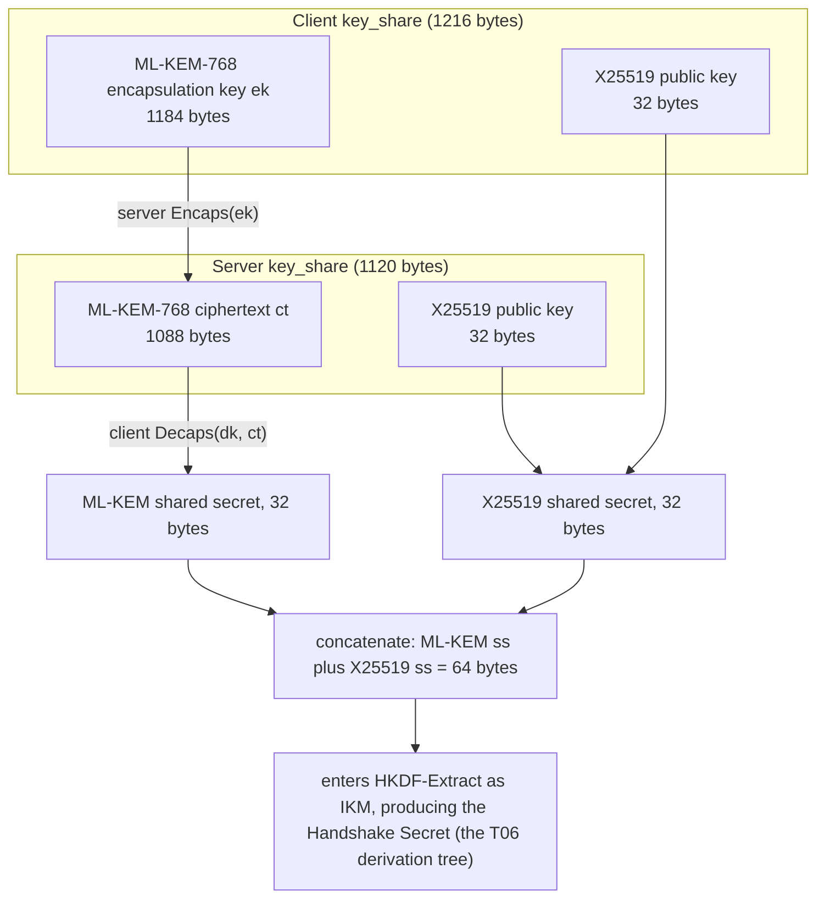
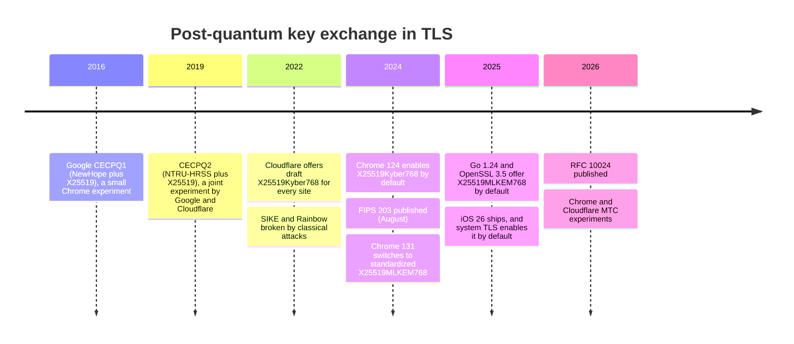
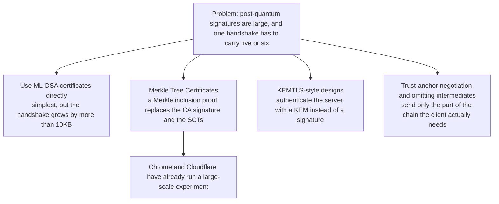

# T10 · Post-quantum TLS: ML-KEM hybrid key exchange and Merkle Tree Certificates

> Series: [[00_tls-series-overview|TLS series overview]] · Previous: [[T09_quic-and-http3|T09 QUIC and HTTP/3]] · Next: [[T11_tls-engineering-practices|T11 How large operators run TLS]]
> Prerequisites: DH, signatures, and security strength from T02, key_share and the key schedule from T06, and certificate chains and Certificate Transparency from T03.
> Main standards: FIPS 203 (ML-KEM), FIPS 204 (ML-DSA), FIPS 205 (SLH-DSA), RFC 10024 (hybrid post-quantum key agreement for TLS 1.3, 2026, draft name draft-ietf-tls-ecdhe-mlkem), draft-ietf-tls-mlkem (pure ML-KEM, in the RFC Editor queue), draft-ietf-tls-mldsa (ML-DSA for TLS, in the RFC Editor queue), the Merkle Tree Certificates draft from the IETF PLANTS working group
> Compiled: 2026-10-16 (standard status checked on 2026-10-17 against the IETF datatracker and the RFC Editor; the handshake data in this note comes from the real captures in T06 and T07)

In 2026, the TLS handshake between your browser or phone and most large sites already uses a key exchange designed against quantum computers. In the real capture in T06, the group that OpenSSL 4.0.3 negotiated with Cloudflare is X25519MLKEM768. This note covers four things: which part of TLS a quantum computer actually threatens, why key exchange has to move first, the mathematical idea behind ML-KEM and how it is plugged into TLS 1.3 as a hybrid, and why moving authentication (certificates and signatures) is much harder, and what the Merkle Tree Certificates the industry is trying actually are.

## What a quantum computer threatens

Two quantum algorithms decide the outcome.

Shor's algorithm (1994) factors large integers and solves discrete logarithms in polynomial time, including discrete logarithms on elliptic curves. Every public-key algorithm in T02 rests on one of those two problems: RSA depends on factoring, DH and ECDH depend on discrete logarithms, and ECDSA and EdDSA do too. Once a large enough fault-tolerant quantum computer exists, all of these algorithms fail. Making the keys longer does not help, because the cost of Shor's algorithm grows only polynomially with the key length.

Grover's algorithm (1996) reduces the cost of unstructured search from N to about √N. Applied to a brute-force search of a symmetric key, that nominally cuts the key strength in half, so AES-128 nominally falls to 64 bits. Grover's algorithm is essentially serial and hard to parallelize, and quantum error correction has a huge overhead, so the practical threat is far smaller than the nominal one. NIST's post-quantum security levels set AES-128 as level 1 and AES-256 as level 5. The conclusion is that symmetric encryption and hashes only need to keep enough length. They do not need new algorithms.

| Algorithm | Where TLS uses it | Against a large-scale quantum computer |
| --- | --- | --- |
| RSA, finite-field DH | Certificate signatures, older key exchange | Broken by Shor's algorithm |
| ECDH (X25519, P-256) | Key exchange | Broken by Shor's algorithm |
| ECDSA, EdDSA | Handshake signatures, certificate signatures | Broken by Shor's algorithm |
| AES-128, AES-256 | Record encryption | Grover nominally halves the strength. AES-256 is enough |
| SHA-256, SHA-384 | Transcript hash, HKDF | Limited effect |

Nobody can give a definite date for when such a quantum computer will exist. Resource estimates keep falling. In a 2025 paper, Google's Craig Gidney estimates that a 2048-bit RSA modulus could be factored with fewer than one million noisy physical qubits, in less than a week. Earlier estimates were on the order of twenty million qubits. That is a theoretical estimate, and building such a machine is still a long way off, but it is enough that the industry has stopped waiting.

## Harvest now, decrypt later: why key exchange moves first

The threats to key exchange and to signatures are asymmetric in time.

A signature only has to be unforgeable at the moment of the handshake. If, ten years later, someone can forge today's server signature, they still cannot go back and impersonate that server. That handshake is long over.

Key exchange is different. An attacker can record encrypted traffic today and store it. When a quantum computer exists, Shor's algorithm recovers the shared secret from the recorded key_share and decrypts the whole contents. This is called harvest now, decrypt later. For data that has to stay secret for a long time (medical records, diplomatic traffic, trade secrets), today's traffic is already exposed to a future threat. Michele Mosca summarizes the relationship as an inequality: if the number of years the data must stay secret, plus the number of years migration takes, is greater than the number of years until a quantum computer appears, then starting the migration now is already late.

So the post-quantum migration of TLS has two steps. Key exchange moves to a quantum-resistant algorithm first (on by default in browsers from 2024, and mainstream in 2026). Authentication can wait, but it still has to be finished before a quantum computer actually exists.

## NIST post-quantum standards

NIST opened a competition for post-quantum cryptography standards in 2016. After three rounds of public evaluation, it selected the first algorithms in 2022 and published three final standards in August 2024:

| Standard | Algorithm | Former name | Type | Mathematical basis |
| --- | --- | --- | --- | --- |
| FIPS 203 | ML-KEM | CRYSTALS-Kyber | Key encapsulation (KEM) | The LWE problem on module lattices |
| FIPS 204 | ML-DSA | CRYSTALS-Dilithium | Signature | Module lattices |
| FIPS 205 | SLH-DSA | SPHINCS+ | Signature | Relies only on hash functions |

Another lattice-based signature, Falcon, will become FIPS 206 under the name FN-DSA. In March 2025 NIST also selected HQC, based on error-correcting codes, as a backup KEM for ML-KEM, in case lattice cryptography turns out to have an unexpected weakness.

The competition itself shows why caution is warranted. SIKE, based on supersingular isogenies, had reached the fourth round and was broken in 2022 by an attack on a classical computer in about an hour. Rainbow, a third-round signature candidate, was broken by a classical attack the same year. Post-quantum algorithms are much younger than RSA and ECC, and they have had much less time under cryptanalysis. That is why TLS chose a hybrid design.

## The mathematical idea behind ML-KEM

The security of ML-KEM rests on the Learning With Errors (LWE) problem. Start with a version that has no errors: given a public matrix A and a vector b = A·s, recover the secret vector s. That is solving a linear system, and Gaussian elimination does it at once. LWE adds a small random error e to each equation: b = A·s + e (mod q). That small error is what makes the problem extremely hard in high dimension. No known classical or quantum algorithm solves it efficiently, and its hardness is backed by a reduction from worst-case lattice problems: solving LWE is at least as hard as solving those lattice problems in the worst case.

A small numeric example, modulus q = 97, two dimensions:

```
public matrix A = [[23, 61], [7, 45]], secret s = (3, 5), small error e = (1, -2)
A·s mod 97 = (23·3 + 61·5, 7·3 + 45·5) mod 97 = (374, 246) mod 97 = (83, 52)
public key b = A·s + e = (84, 50)
```

At this size a brute-force search is of course possible. Under real parameters, s has several hundred dimensions, and both brute force and the known lattice algorithms are infeasible. Encrypting one bit m, in the style of Regev, works like this: pick a small random vector r = (1, 1) and small errors e1 = (0, 1) and e2 = -1, then compute

```
u = Aᵀ·r + e1 = (23 + 7, 61 + 45) + (0, 1) mod 97 = (30, 10)
v = b·r + e2 + m·48 mod 97 = (84 + 50 - 1) + m·48 mod 97 = 36 + 48m
```

Here 48 is half of q, rounded down. The decryptor knows s and computes v - s·u:

```
s·u = 3·30 + 5·10 = 140 mod 97 = 43
when m = 0: v - s·u = 36 - 43 = -7 ≡ 90 (mod 97), close to 0, decodes to 0
when m = 1: v - s·u = 84 - 43 = 41, close to 48, decodes to 1
```

The -7 in the result is the accumulated error term e·r + e2 - s·e1 = -1 - 1 - 5. As long as the error stays small enough, it does not push the result from near 0 over to near q/2, and decryption is correct. Someone who does not know s faces a noisy linear system and has no way in. (These numbers were checked locally with a program.)

Real ML-KEM uses module lattices (Module-LWE). The entries of the matrices and vectors are polynomials modulo q = 3329 and of degree less than 256, and the ML-KEM-768 matrix is a 3×3 matrix of polynomials. Polynomial multiplication can be computed quickly with the number-theoretic transform (NTT), so ML-KEM runs at about the same speed as X25519, and sometimes faster. The cost is size:

| Parameter set | NIST security level | Encapsulation key | Ciphertext | Shared secret |
| --- | --- | --- | --- | --- |
| ML-KEM-512 | 1 | 800 bytes | 768 bytes | 32 bytes |
| ML-KEM-768 | 3 | 1184 bytes | 1088 bytes | 32 bytes |
| ML-KEM-1024 | 5 | 1568 bytes | 1568 bytes | 32 bytes |

For comparison, an X25519 public key is only 32 bytes.

## How a KEM differs from DH

ML-KEM is a key encapsulation mechanism (KEM). Its interface differs from DH:

```
KeyGen()        -> (ek, dk)        generate encapsulation key ek and decapsulation key dk
Encaps(ek)      -> (ss, ct)        use the peer's ek to produce shared secret ss and ciphertext ct
Decaps(dk, ct)  -> ss              recover the same ss from ct with your own dk
```

DH is symmetric: each side contributes a public key, and each side combines its own private key with the peer's public key to arrive at the same secret. A KEM is asymmetric: only one side has a key pair. The other side uses the peer's public key to encapsulate a random secret and send it back. The key_share flow in TLS 1.3 happens to fit that asymmetry. The client puts ek in the key_share of ClientHello. The server runs Encaps and puts the ciphertext ct in the key_share of ServerHello. The client runs Decaps. No extra round trip is required. ML-KEM, like Kyber before it, applies the Fujisaki-Okamoto transform to an underlying public-key encryption scheme to obtain chosen-ciphertext security (IND-CCA2), so in principle the same ek can be reused safely. TLS still generates a fresh key pair for every handshake, which keeps forward secrecy.

## Hybrid key exchange: X25519MLKEM768

Hybrid means doing a classical ECDH and an ML-KEM encapsulation together, concatenating the two shared secrets, and feeding both into the key schedule. If either one remains unbroken, the session is safe. If ML-KEM is later found to have a classical attack (as SIKE was), X25519 still holds. If a quantum computer appears, ML-KEM still holds. The cost is a bit over a thousand extra bytes, and a little computation.

RFC 10024 (published in 2026; the draft name was draft-ietf-tls-ecdhe-mlkem) defines three hybrid groups. The concrete layout is:

| Group | Code point | Client key_share | Server key_share | Shared secret |
| --- | --- | --- | --- | --- |
| X25519MLKEM768 | 0x11EC (4588) | ML-KEM-768 ek (1184) + X25519 (32) = 1216 bytes | ML-KEM ciphertext (1088) + X25519 (32) = 1120 bytes | ML-KEM ss (32) + X25519 ss (32) = 64 bytes |
| SecP256r1MLKEM768 | 0x11EB (4587) | P-256 (65) + ML-KEM-768 ek (1184) = 1249 bytes | P-256 (65) + ciphertext (1088) = 1153 bytes | ECDH ss (32) + ML-KEM ss (32) = 64 bytes |
| SecP384r1MLKEM1024 | 0x11ED (4589) | P-384 (97) + ML-KEM-1024 ek (1568) = 1665 bytes | P-384 (97) + ciphertext (1568) = 1665 bytes | ECDH ss (48) + ML-KEM ss (32) = 80 bytes |

The concatenation order for X25519MLKEM768 is ML-KEM first and X25519 second, the reverse of the other two groups. The specification calls out that this order is reversed. An implementation must concatenate according to the rule for each group. The data captured in T06 matches this table exactly: the client key_share is 1216 bytes, and the server key_share is 1120 bytes.



The change a hybrid makes to TLS 1.3 is very small. To TLS it is one more group in supported_groups. The key_share format, the key schedule, and the number of round trips stay the same. The only change is that the slot for the (EC)DHE shared secret holds a longer value. This design, which plugs a new algorithm in as a new group, shows exactly where the value of the negotiable cryptography described in T04 lies.

A pure ML-KEM design, with no hybrid, is also being standardized. draft-ietf-tls-mlkem defines using ML-KEM-512, ML-KEM-768, and ML-KEM-1024 directly as groups. It entered IETF last call in July 2026, the target status is Informational, and as of 2026-10-17 it is in the RFC Editor queue. It is aimed mainly at compliance settings that must use only NIST standard algorithms.

## Deployment history and the present

Experiments with post-quantum key exchange in browsers began long before the NIST standards:



By 2026, mainstream browsers offer X25519MLKEM768 in ClientHello by default. On Apple platforms, from iOS 26 and iPadOS 26, TLS 1.3 connections in URLSession and Network.framework use it by default (Apple Platform Security guide). A large number of apps therefore gained a quantum-resistant key exchange without a single line of code changing. From OpenSSL 3.5 it is placed in key_share by default, and the local OpenSSL 4.0.3 does exactly that (T06). From Go 1.24 it is on by default in crypto/tls.

Server support lags the clients. A few numbers, measured in different ways: a 2026 arXiv measurement study found that 49.30% of the sampled TLS key exchanges used X25519MLKEM768. Cloudflare's blog says the share of origins that support post-quantum key exchange (the hop from Cloudflare to the customer's server) grew from 0.5% in 2023 to 12.8%. In the measurements for these notes in T06 and T07, both Cloudflare and Google negotiated X25519MLKEM768 (Google's resumption ServerHello also carries the 1120-byte hybrid key_share).

The main trouble in deployment is size, not the cryptography. ClientHello grew from a few hundred bytes to about 1400 or 1500 bytes, past one TCP segment (1469 bytes in T06, so it has to be sent in two segments). Some server and middlebox implementations assume a ClientHello always arrives in a single read, and they fail the connection when it is segmented. While rolling this out, Chrome gave enterprises a policy to turn it off temporarily, and the community keeps sites that record broken implementations and push vendors to fix them. This is another case of the protocol ossification described in T04. GREASE, and the idea of making the new thing ordinary as early as possible, apply here too.

## Authentication is the harder half

Key exchange occupies only the two key_share values in the handshake. Authentication is spread across many places. In a typical TLS handshake, the signatures the client has to verify are: one CertificateVerify, one signature by the intermediate CA on the leaf, one signature by the root on the intermediate, plus two or three SCT signatures embedded in the leaf. That is five or six signatures, plus the two public keys in the leaf and the intermediate.

Switching to post-quantum signatures inflates the sizes by tens of times:

| Signature algorithm | Public key | Signature |
| --- | --- | --- |
| ECDSA P-256 | 65 bytes | about 72 bytes |
| Ed25519 | 32 bytes | 64 bytes |
| ML-DSA-44 (level 2) | 1312 bytes | 2420 bytes |
| ML-DSA-65 (level 3) | 1952 bytes | 3309 bytes |
| SLH-DSA-SHA2-128s | 32 bytes | 7856 bytes |
| FN-DSA-512 (Falcon) | 897 bytes | about 666 bytes |

A rough sum: five signatures plus two public keys is 5 × 72 + 2 × 65 ≈ 490 bytes with ECDSA P-256, and 5 × 2420 + 2 × 1312 ≈ 14.7KB with ML-DSA-44. That one item already exceeds the TCP initial congestion window of about 14KB (T07), so the handshake necessarily gains an extra round trip. FN-DSA is much smaller, but its signing procedure requires floating-point arithmetic and a safe implementation is hard, so it is a poor fit for servers that have to sign on every handshake at large scale. SLH-DSA depends only on hashes and is the most conservative choice, but the signatures are too large.

The specification for using ML-DSA in TLS (draft-ietf-tls-mldsa, signature-algorithm code points mldsa44 = 0x0904, mldsa65 = 0x0905, mldsa87 = 0x0906, target status Informational) had been submitted to the IESG and was in the RFC Editor queue as of 2026-10-17. The ClientHello from local OpenSSL 4.0.3 already lists these three first in signature_algorithms (T06). No CA in the public Web PKI issues ML-DSA certificates yet.

The industry is therefore trying several different paths. The goal of each is to reduce the number of signatures a handshake has to carry and verify:



## Merkle Tree Certificates

Merkle Tree Certificates (MTC) are the design drawing the most attention. The IETF PLANTS working group is standardizing them, and the work is still a draft. It turns the Certificate Transparency idea from T03 around: if every certificate has to enter a public Merkle tree anyway, then being in the tree can itself be the proof that the certificate is valid.

The CA stops signing each certificate on its own. On a schedule, it organizes a batch of certificates into a Merkle tree and signs only the root (or the state of the tree) once. A "certificate" is the certificate contents plus an inclusion proof for that certificate in the tree. The inclusion proof is only a list of hashes, about log2(n) of them, 32 bytes each. Browsers obtain these roots, called landmarks, ahead of time through their own update channel. Verification walks the inclusion proof, hashes, and matches the root. No signature is verified. The CA signature and the SCT signatures disappear from the handshake that way. The only signature left in the handshake is CertificateVerify.

The cost is freshness. A new certificate cannot be verified in MTC form until the next batch of roots is published and the browser has fetched it. MTC therefore fits alongside traditional certificates. The client uses it only when it supports MTC and already has the matching root.

Progress as of October 2026 (sources at the end of this note): Chrome and Cloudflare ran a joint feasibility experiment and served MTC to 50% of Chrome Beta 146 users. During the experiment they served billions of MTCs. At the median, a landmark MTC was about 9% faster than a traditional signature chain, mostly because the intermediate certificate was omitted. Chrome has said it does not plan to put post-quantum signatures into traditional X.509 certificates. It plans to build a quantum-resistant root store that accepts only MTC. On 2026-09-29 Cloudflare announced that it plans to become a public CA, with a goal of issuing MTC in production in the first quarter of 2027, and it has applied to the root programs of Chrome, Apple, Microsoft, and Mozilla. Let's Encrypt plans a test environment for issuing MTC at the end of 2026 and a production environment in 2027. All of these are plans. The root programs have not decided. One analysis pointed out that, as of 2026-10-05, Cloudflare had not issued any MTC.

## A migration checklist for your own servers and clients

Turn the material above into operations, in priority order:

1. Inventory. List your TLS termination points (web servers, load balancers, API gateways, internal services) and your clients (apps, SDKs, scripts), and record the TLS library and version each one uses.
2. Move key exchange first. Enable X25519MLKEM768 on the server: OpenSSL 3.5 and later, BoringSSL, and Go 1.24 and later include it by default, and nginx, Caddy, and similar servers follow the library underneath. Do the same on clients. On Apple platforms, URLSession picks it up automatically from iOS 26. Check the negotiated result with `openssl s_client -groups X25519MLKEM768` (T13).
3. Check that devices on the path can handle a ClientHello of more than a thousand bytes and a handshake that arrives in segments. Load balancers, WAFs, enterprise proxies, and security gateways can all fail here.
4. If you use a CDN, also check whether the hop from the CDN to the origin uses a post-quantum key exchange. That hop is often forgotten.
5. Leave authentication on classical certificates for now (ECDSA P-256 is the best choice). Watch the progress of MTC and of ML-DSA certificates. Do not deploy post-quantum signature certificates on the public web now.
6. Automate certificates end to end. Certificate lifetimes are getting shorter (T03, T12), and a future change of certificate type will also have to be done by automation.
7. Keep cryptographic agility. Do not hard-code algorithms in the configuration. The library should be upgradable, and groups and signature algorithms should be adjustable in configuration, so moving to the next algorithm is a configuration change.

## Common misconceptions

A quantum computer will break all encryption. It breaks public-key algorithms based on factoring and discrete logarithms (RSA, DH, ECC). Symmetric encryption and hashes feel only the limited effect of Grover's algorithm. AES-256 and SHA-384 are enough.

Quantum computers do not exist yet, so this can wait. Harvest now, decrypt later means traffic recorded today can be decrypted later. The key-exchange migration has to finish before a quantum computer exists, and most clients had already migrated by 2026.

Post-quantum algorithms will make HTTPS much slower. ML-KEM computation is fast. The main cost is a bit over a thousand extra bytes, which is almost unnoticeable on an ordinary network. What can actually slow things down is the certificate bloat from post-quantum signatures. That is the problem MTC and the other designs are trying to solve.

Using X25519MLKEM768 means the connection is fully quantum-resistant. It protects key exchange, which is confidentiality and forward secrecy. Server authentication still depends on classical ECDSA or RSA signatures. After a quantum computer exists, an attacker can forge a signature, impersonate the server, and run a live man-in-the-middle attack. The authentication migration is not finished.

A hybrid is unnecessary, and pure ML-KEM would do. Post-quantum algorithms have not had long under cryptanalysis. SIKE and Rainbow were both broken by classical attacks late in the competition. A hybrid keeps security at least as strong as the stronger of the two, and the extra cost is 32 bytes and one X25519 operation.

## Sources cited in this note

- FIPS 203, Module-Lattice-Based Key-Encapsulation Mechanism Standard, https://csrc.nist.gov/pubs/fips/203/final
- FIPS 204, Module-Lattice-Based Digital Signature Standard, https://csrc.nist.gov/pubs/fips/204/final
- FIPS 205, Stateless Hash-Based Digital Signature Standard, https://csrc.nist.gov/pubs/fips/205/final
- RFC 10024, Post-Quantum Traditional (PQ/T) Hybrid Key Agreement Mechanisms for TLS 1.3 (Kwiatkowski, Kampanakis, Westerbaan, Stebila, 2026), https://www.rfc-editor.org/info/rfc10024
- draft-ietf-tls-ecdhe-mlkem-05 (the last draft of RFC 10024), https://datatracker.ietf.org/doc/html/draft-ietf-tls-ecdhe-mlkem-05
- draft-ietf-tls-mlkem, ML-KEM Post-Quantum Key Agreement for TLS 1.3, https://datatracker.ietf.org/doc/draft-ietf-tls-mlkem/
- draft-ietf-tls-mldsa, Use of ML-DSA in TLS 1.3, https://datatracker.ietf.org/doc/draft-ietf-tls-mldsa/
- Apple Platform Security guide, TLS and X25519MLKEM768, https://support.apple.com/guide/security/sec100a75d12/web
- Cloudflare, Automatic Key Exchange for origins, https://blog.cloudflare.com/automatic-key-exchange-for-origins/
- Measurement Study of Post-Quantum Readiness of Internet: 2026 (arXiv), https://arxiv.org/html/2606.16473v1
- Help Net Security, Post-quantum website certificates from Cloudflare are scheduled for early 2027 (2026-09-30), https://www.helpnetsecurity.com/2026/09/30/cloudflare-certificate-authority-2027/
- Let's Encrypt, A Post-Quantum Future for Let's Encrypt (2026-06-03), https://letsencrypt.org/2026/06/03/pq-certs
- The Hacker News, Google Develops Merkle Tree Certificates to Enable Quantum-Resistant HTTPS in Chrome (2026-03), https://thehackernews.com/2026/03/google-develops-merkle-tree.html
- pk-sharma.com, Cloudflare's post-quantum CA has issued no certificates yet (2026-10-05), https://www.pk-sharma.com/briefing/cloudflare-post-quantum-ca-has-issued-nothing-yet
- Gidney, "How to factor 2048 bit RSA integers with less than a million noisy qubits" (2025), https://arxiv.org/abs/2505.15917
- Schwabe, Stebila, and Wiggers, "Post-Quantum TLS Without Handshake Signatures" (KEMTLS), CCS 2020
- Local check: the small LWE example (q = 97) computed in Node.js; handshake figures are the measurements in T06 and T07
