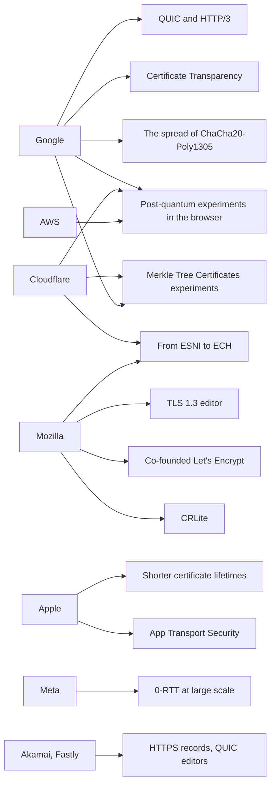

# T11 · How large operators run TLS

> Series: [[00_tls-series-overview|TLS series overview]] · Previous: [[T10_post-quantum-tls|T10 Post-quantum TLS]] · Next: [[T12_https-adoption-and-trust-governance|T12 HTTPS adoption and trust governance]]
> Prerequisites: most of T03 through T10. This note lines those mechanisms up with who built them and why.
> Main sources: each company's open-source repositories, official blogs and documentation, and the author information on the relevant RFCs. The ShangMi section follows RFC 8998 and GB/T 38636-2020.
> Compiled: 2026-10-16

Behind almost every mechanism in the previous ten notes stands one company, or several. QUIC comes from Google. The push for ECH comes from Cloudflare and Mozilla. 0-RTT was first tested at the scale of Facebook and Cloudflare. The cut that shortened certificate lifetimes was made by Apple first. TLS standards are written in the IETF, but their direction is largely set by a few companies that hold both the client and the server: they can experiment between their own browser and their own servers, collect real data, and take that data into standardization. This note sorts, by company, what they built, what they pushed, and why. It then compares the mainstream TLS libraries and covers ShangMi TLS practice in China.

## Who contributed to which standards

One way to see the influence directly is to look at where the authors and editors of the key RFCs worked at the time:

| Standard | Authors or editors (affiliation at the time) |
| --- | --- |
| RFC 8446 TLS 1.3 | Eric Rescorla (Mozilla) |
| RFC 9849 ECH | Rescorla, Kazuho Oku (Fastly), Nick Sullivan, Christopher Wood (Cloudflare) |
| RFC 9000 QUIC | Jana Iyengar (Fastly), Martin Thomson (Mozilla) |
| RFC 9001 QUIC-TLS | Martin Thomson (Mozilla), Sean Turner (sn3rd) |
| RFC 6962 Certificate Transparency | Ben Laurie, Adam Langley, Emilia Kasper (Google) |
| RFC 9460 SVCB/HTTPS records | Ben Schwartz (Google), Mike Bishop, Erik Nygren (Akamai) |
| RFC 8555 ACME | Richard Barnes, Jacob Hoffman-Andrews, Daniel McCarney, James Kasten (organizations related to Let's Encrypt) |
| RFC 10024 hybrid post-quantum key agreement | Kris Kwiatkowski (PQShield), Panos Kampanakis (AWS), Bas Westerbaan (Cloudflare), Douglas Stebila (University of Waterloo) |

## Google

What is unusual about Google is that it holds the world's most widely used browser (Chrome), some of the world's highest-traffic sites, and Android. It can deploy an experimental protocol at both ends at once and measure the effect on real traffic. That is close to the underlying reason QUIC, Certificate Transparency, and post-quantum key exchange could move quickly.

BoringSSL is the TLS library Google forked from OpenSSL in 2014, after Heartbleed. It is used in Chrome, Android, and Google's servers. It does not promise a stable API. It deletes old features and unsafe options readily. Google's internal needs drive how it evolves, and many features that later entered the standards (GREASE, post-quantum key exchange) were implemented in BoringSSL first.

QUIC was designed in 2012 by Google's Jim Roskind, deployed between Chrome and Google's servers from 2013, later handed to the IETF and switched to TLS 1.3, and became the RFC 9000 series (T09). Certificate Transparency was proposed by Google's Ben Laurie and Adam Langley after the DigiNotar incident. From 2018, Chrome has required public certificates to carry SCTs (T03). Around 2014 Google brought ChaCha20-Poly1305 into Chrome and its own servers, to speed up Android phones that had no AES hardware instructions (T02). Chrome maintains the HSTS preload list shared by every mainstream browser (hstspreload.org).

On trust governance, Chrome has, from 2022, gradually used its own Chrome Root Store and stopped depending on the operating system's root store. Through the Chrome Root Program it has carried out a series of distrust decisions: Symantec (2018), Entrust (2024), and Chunghwa Telecom and Netlock (2025). Google also operates a public CA, Google Trust Services. The certificate for www.cloudflare.com captured in T05 and T06 was issued by its intermediate CA `WE1`. In 2023 Chrome proposed shortening the maximum certificate lifetime to 90 days. The industry eventually moved, in the form of SC-081, toward 47 days (T12).

On post-quantum cryptography, Google ran the CECPQ1 experiment in 2016, ran CECPQ2 with Cloudflare in 2019, enabled X25519Kyber768 by default in Chrome 124 in 2024, and switched to the standardized X25519MLKEM768 in Chrome 131 the same year (T10). For post-quantum authentication, Chrome chose the Merkle Tree Certificates path and plans a quantum-resistant root store that accepts only MTC. In October 2026, Chrome 154 is planned to turn on "Always use secure connections" by default (T12).

## Cloudflare

Cloudflare sits in a different place. It is the proxy in front of millions of sites. It does not make a browser, but it terminates a large share of the TLS connections on the internet. Much of its engineering work is built around terminating TLS in front of other people's sites, and its scale also makes it the earliest large-scale server-side deployer of new protocols.

Universal SSL in 2014 gave every Cloudflare customer, including free accounts, HTTPS automatically, and overnight the number of sites that supported HTTPS jumped. Keyless SSL, the same year, addressed a trust problem: banks and similar customers would not hand a private key to a CDN. Keyless SSL leaves the private key on the customer's own key server. When a Cloudflare edge node needs a signature with that private key during the handshake, it sends the signing request back to the customer's key server over an encrypted channel. The private key never leaves the customer's facility.

Cloudflare enabled TLS 1.3 for customers in 2016, while it was still a draft, and later offered 0-RTT as an option customers can turn on. In the T07 measurement, www.cloudflare.com itself did not have it on. In 2018 it deployed an ESNI experiment together with Firefox, then moved to ECH. The real ECHConfig in T08 comes from Cloudflare, and its public_name is `cloudflare-ech.com`. It is currently the main server-side deployer of ECH. The 1.1.1.1 public resolver, launched in 2018, supports DoH and DoT.

On post-quantum cryptography, in October 2022 Cloudflare offered a draft Kyber hybrid key exchange for every site, then followed the standard over to X25519MLKEM768, and published on its blog the growth in post-quantum-capable origins from 0.5% to 12.8%. The Go cryptography library it maintains, CIRCL, implements HPKE, ML-KEM, and related algorithms. Its Radar service publishes statistics on TLS versions, post-quantum usage, and similar measurements, and it is a common data source for this work. Definitions differ a lot across sources, so name the source when you cite a number. On 29 September 2026, Cloudflare announced that it plans to operate a public CA, with a goal of issuing Merkle Tree Certificates in the first quarter of 2027 (T10).

## Apple

Apple controls the system network stack on iOS and macOS. Its influence works mostly through platform defaults and root-program policy.

App Transport Security (ATS, iOS 9, 2015) required apps to use HTTPS by default, and required TLS 1.2 and cipher suites with forward secrecy. An app has to declare an exception explicitly in Info.plist before it can use plaintext HTTP. Apple originally planned to enforce this for apps submitted to the store at the end of 2016, and later postponed it, but ATS as a default had already pushed a large number of apps onto HTTPS.

On the network stack, Apple replaced the old Secure Transport API with Network.framework and URLSession. TLS 1.3 has been on by default for those two APIs since iOS 12.2. Secure Transport does not support TLS 1.3. From iOS 26 and iPadOS 26, their TLS 1.3 connections use X25519MLKEM768 by default (Apple Platform Security guide). This is the largest deployment in which post-quantum key exchange arrived with no code change. In 2024 Apple deployed the post-quantum PQ3 protocol for iMessage. Developers can declare certificate pins in NSPinnedDomains in Info.plist (from iOS 14) (T12).

On certificate policy, Apple is the one that pushed shorter lifetimes. In February 2020, Apple announced that from September 2020 Safari would stop trusting new certificates with a validity longer than 398 days. A CA/Browser Forum ballot with the same content (SC-22) had failed before that. Apple completed the step unilaterally through root-program policy, and Google and Mozilla followed. In 2024 Apple proposed, again in the CA/Browser Forum, a plan to shorten validity gradually to about 45 days. That became SC-081, passed in 2025, with a final figure of 47 days. iOS also requires an extra manual step to fully trust a root the user installs (T03), which is protection at the platform level.

## Meta

What is distinctive about Meta (Facebook) is that it holds both a mobile app at the largest scale and the servers behind it. The protocol between the app and the servers can be decided entirely in house.

Fizz is Meta's TLS 1.3 library, written in C++ and open-sourced in 2018. It is used on Meta's servers and in its mobile apps, and it is designed around asynchronous operations so it fits a highly concurrent server. Before TLS 1.3 was finished, Facebook deployed a 0-RTT protocol called Zero between its own apps and servers, to test how 0-RTT behaves at large scale. That experience later showed up in the 0-RTT design of TLS 1.3 and in Fizz. In the T07 measurement, the session ticket from www.facebook.com allowed a maximum early-data size of 0xFFFFFFFF, the most aggressive of the four sites. Meta's QUIC implementation, mvfst, was open-sourced in 2019, and a large share of Meta's app traffic runs on QUIC.

## Mozilla

Mozilla's role in the TLS ecosystem is closer to that of a public institution. Its NSS root store is the de facto standard of the open-source world (the ca-certificates packages in Linux distributions and in Homebrew both come from it). Its root-program policy and its public discussion (the mozilla.dev.security.policy mailing list) are the most transparent place CA governance happens. Together with Microsoft it operates CCADB, where every public CA discloses intermediate certificates and audit reports.

Eric Rescorla, the editor of TLS 1.3, worked at Mozilla during standardization. Martin Thomson, an editor of QUIC, is also from Mozilla. Mozilla is one of the organizations that started Let's Encrypt (the founding members of ISRG also include the EFF and the University of Michigan, among others), and it has been the most active browser-side deployer of ECH since the ESNI days. On revocation, Firefox's CRLite has been on for every desktop user since Firefox 137, and it is currently the most complete local revocation check (T03). Mozilla's server-side TLS configuration guide and configuration generator are the reference operators use most often when configuring nginx, Apache, and similar servers (T12).

## Microsoft

The system TLS stack on Windows is SChannel. TLS 1.3 is supported by default from Windows 11 and Windows Server 2022. Microsoft's root program manages the Windows root store, and Microsoft operates CCADB together with Mozilla. Microsoft has open-sourced its core cryptography library, SymCrypt, and has added post-quantum algorithms, including ML-KEM, to it. The Edge browser is based on Chromium, and its TLS behavior is essentially the same as Chrome's.

## AWS

In 2015 AWS open-sourced s2n-tls (then called s2n), a TLS implementation kept deliberately small. Parts of the code have been formally verified with automated reasoning tools such as SAW. It later open-sourced s2n-quic, a QUIC implementation written in Rust. AWS-LC is the cryptography library AWS maintains from BoringSSL, with the emphasis on passing FIPS validation. On post-quantum cryptography, AWS offered hybrid post-quantum TLS early on the API endpoints of services such as KMS and Secrets Manager. Panos Kampanakis, one of the authors of RFC 10024, is from AWS.

## Let's Encrypt and ISRG

Let's Encrypt is operated by the nonprofit ISRG (Internet Security Research Group). It began public testing at the end of 2015, offers free, automated DV certificates, and pushed ACME through to RFC 8555 (T03). Its contribution to the spread of HTTPS may exceed that of any single technical improvement. Before it, a certificate cost money, had to be requested by hand, and had to be done again every year or two. After it, a certificate is something the server obtains automatically when it starts.

It has also stayed ahead of certificate policy. From the beginning it has issued only 90-day certificates. In 2025 it shut down its OCSP service. In 2026 it formally offers 6-day short-lived certificates, and it has published a timeline to a 45-day default by 2028. In June 2026 it published a plan for post-quantum certificates, intending to offer a test environment for issuing MTC at the end of 2026 (T10). Through its Prossimo project, ISRG also funds rewrites of critical infrastructure in memory-safe languages, including funding the development of rustls.

## The main TLS libraries

| Library | Language | Main users | Notes |
| --- | --- | --- | --- |
| OpenSSL | C | Most Linux servers, nginx, Apache, and the runtimes of many languages | The most widely deployed, with the broadest feature set. Provider architecture from 3.0. Built-in post-quantum algorithms from 3.5, and X25519MLKEM768 offered by default. The local 4.0.3 already carries ECH parameters |
| LibreSSL | C | OpenBSD, and the `/usr/bin/openssl` shipped with macOS | Forked from OpenSSL by OpenBSD in 2014, with a large amount of old code removed |
| BoringSSL | C/C++ | Chrome, Android, Google's servers, Cloudflare | No promise of a stable API. New features often appear here first |
| AWS-LC | C | AWS services | Based on BoringSSL, with the emphasis on FIPS validation |
| s2n-tls | C | AWS services | Small, with some formal verification |
| NSS | C | Firefox, and some Linux system components | Maintained by Mozilla, and it ships a root store |
| SChannel | C | Windows | A system component |
| Network.framework / URLSession | System framework | Apps on iOS and macOS | Post-quantum key exchange by default from iOS 26 |
| Go crypto/tls | Go | Go programs, including many cloud-native components and proxies | A pure Go implementation. X25519MLKEM768 by default from 1.24 |
| rustls | Rust | A growing set of Rust services and tools | Memory safe. TLS 1.2 and TLS 1.3 only. Funded by ISRG |
| Fizz | C++ | Meta | Asynchronous design, and practical 0-RTT experience |
| wolfSSL, Mbed TLS | C | Embedded devices and IoT | Small, and low resource use |
| Tongsuo | C | Deployments in China that need ShangMi | Formerly BabaSSL, started by Ant Group. Supports TLCP and RFC 8998 |

When you choose a library, the question worth asking is not which one is fastest. What matters is whether it picks up security fixes and new standards promptly (post-quantum, ECH), whether its defaults are safe, whether it has had many security incidents and how it improved after them, and what language it is written in. A memory-safe language removes Heartbleed-class bugs at the source.

## ShangMi TLS in China

Finance, government, and similar industries in China are required, for compliance, to use the national commercial cryptography algorithms (ShangMi). Three algorithms matter for TLS. SM2 is an elliptic-curve public-key algorithm, used for signatures and key exchange (GB/T 32918). SM3 is a hash algorithm with a 256-bit output (GB/T 32905). SM4 is a 128-bit block cipher (GB/T 32907).

At the protocol layer there are two paths. One is the national standard GB/T 38636-2020, Information security technology: Transport layer cryptography protocol (TLCP). Structurally it is similar to TLS 1.1 and TLS 1.2. Its most visible feature is a dual-certificate system: the server has a signature certificate and an encryption certificate, corresponding to two keys, and the private key of the encryption certificate is managed by a third-party escrow system. The other path is RFC 8998 (2021, Informational), which plugs the ShangMi algorithms into TLS 1.3 in the standard way. It defines the cipher suites TLS_SM4_GCM_SM3 (0x00C6) and TLS_SM4_CCM_SM3 (0x00C7), the key-exchange group curveSM2 (41), and the signature algorithm sm2sig_sm3 (0x0708). The protocol structure is identical to ordinary TLS 1.3.

In the OpenSSL 4.0.3 ClientHello captured in T06, supported_groups lists curveSM2 (41) and signature_algorithms lists sm2sig_sm3 (0x0708), which shows that a mainstream open-source library already supports these RFC 8998 parameters in its default configuration. The same list also contains curveSM2MLKEM768 (4590), a hybrid post-quantum group that combines the SM2 curve with ML-KEM. The main open-source implementation in China is Tongsuo, which supports both TLCP and RFC 8998.

On the transport, large Chinese companies have also open-sourced their own QUIC implementations, for example Alibaba's XQUIC and Tencent's TQUIC, used in their own mobile apps and CDNs.

## Patterns across these deployments

A few patterns run through all of them. New protocols are almost always tried first in an environment where one party controls both ends. Google has Chrome and its own sites, Meta has its own apps and servers, Cloudflare works with Firefox, and Apple has the system network stack. The experimental data decides which way the standard goes. The force of a platform default is far greater than advice in a document. ATS, Chrome's "not secure" label, and the default post-quantum key exchange in iOS 26 are each a change of default that affects hundreds of millions of connections. Trust governance rests on unilateral root-program policy. Apple's 398 days, and Chrome's series of distrust decisions, did not wait for consensus in the CA/Browser Forum. Automation is the precondition for the rest. Let's Encrypt and ACME are what made a certificate lifetime of 47 days possible, and they are also what will make a future change of certificate algorithm possible.

## Common misconceptions

TLS standards are written by academics in the IETF, and companies have nothing to do with them. IETF participants join as individuals, but the authors and editors of the key RFCs mostly come from browser vendors, CDNs, and cloud providers, and many designs in the standards come directly from their deployment data.

Using a large company's TLS library means the deployment is safe. Heartbleed was in OpenSSL, the most widely deployed library. ROBOT affected devices and services from several large companies. Library quality matters, and so do configuration, version updates, and key management.

ShangMi TLS and international TLS are two completely different things. TLCP is close in structure to TLS 1.1 and TLS 1.2. RFC 8998 puts ShangMi algorithms into the standard TLS 1.3 framework. Mainstream open-source libraries already support those parameters by default.

## Sources cited in this note

- Author information for RFC 8446, RFC 9849, RFC 9000, RFC 9001, RFC 6962, RFC 9460, RFC 8555, and RFC 10024, on each RFC's front page, https://www.rfc-editor.org/
- RFC 8998, ShangMi (SM) Cipher Suites for TLS 1.3, https://www.rfc-editor.org/rfc/rfc8998
- GB/T 38636-2020, Information security technology: Transport layer cryptography protocol (TLCP)
- BoringSSL, https://boringssl.googlesource.com/boringssl/
- OpenSSL, https://www.openssl.org/
- LibreSSL, https://www.libressl.org/
- AWS s2n-tls, https://github.com/aws/s2n-tls ; s2n-quic, https://github.com/aws/s2n-quic ; AWS-LC, https://github.com/aws/aws-lc
- rustls, https://github.com/rustls/rustls
- Meta Fizz, https://github.com/facebookincubator/fizz ; mvfst, https://github.com/facebook/mvfst
- Cloudflare CIRCL, https://github.com/cloudflare/circl
- Microsoft SymCrypt, https://github.com/microsoft/SymCrypt
- Tongsuo, https://github.com/Tongsuo-Project/Tongsuo
- Alibaba XQUIC, https://github.com/alibaba/xquic ; Tencent TQUIC, https://github.com/Tencent/tquic
- HSTS Preload List, https://hstspreload.org/
- Apple Platform Security guide (TLS and X25519MLKEM768), https://support.apple.com/guide/security/sec100a75d12/web
- Chrome Root Store change announcement, https://blog.google/security/sustaining-digital-certificate-security-chrome-root-store-changes/
- Cloudflare, Automatic Key Exchange for origins, https://blog.cloudflare.com/automatic-key-exchange-for-origins/
- Let's Encrypt, Decreasing Certificate Lifetimes to 45 Days, https://letsencrypt.org/2025/12/02/from-90-to-45 ; A Post-Quantum Future for Let's Encrypt, https://letsencrypt.org/2026/06/03/pq-certs
- Mozilla Hacks, CRLite in Firefox (2025-08), https://hacks.mozilla.org/2025/08/crlite-fast-private-and-comprehensive-certificate-revocation-checking-in-firefox/
- Local captures: the captures of www.cloudflare.com, www.google.com, www.facebook.com, and www.apple.com in T05, T06, and T07
