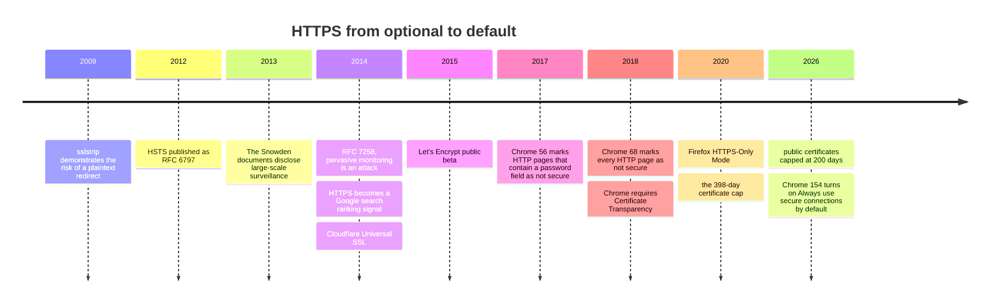
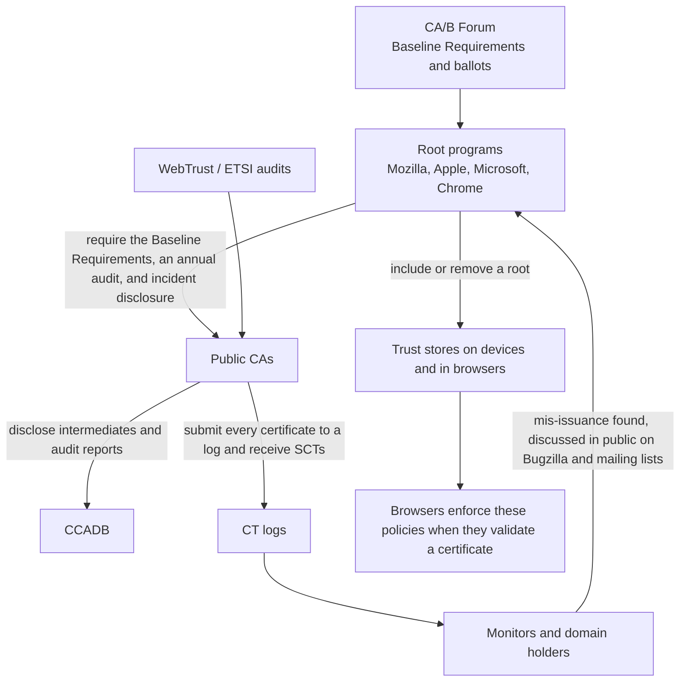

# T12 · HTTPS adoption and trust governance

> Series: [[00_tls-series-overview|TLS series overview]] · Previous: [[T11_tls-engineering-practices|T11 How large operators run TLS]] · Next: [[T13_observing-tls-with-openssl-and-curl|T13 Hands on]]
> Prerequisites: the HTTP-to-HTTPS redirect problem from T01, and the certificate system, Certificate Transparency, and certificate lifetimes from T03.
> Main standards: RFC 6797 (HSTS), RFC 7258 (pervasive monitoring is an attack), RFC 7469 (HPKP, deprecated), RFC 6698 (DANE), RFC 7672 (DANE for SMTP), RFC 8461 (MTA-STS), RFC 9325 (BCP 195, recommendations for the secure use of TLS), RFC 9460 §9.5, CA/Browser Forum Baseline Requirements
> Compiled: 2026-10-16 (the HSTS headers and preload status in this note were measured at 2026-10-17 03:19 UTC)

A protocol that nobody uses does not matter. Around 2014, most pages on the web were still loaded over plaintext HTTP. By 2026, Chrome is preparing to make HTTPS the default and to make HTTP an exception that needs the user's confirmation. What happened over those dozen or so years is half technology (free certificates, HSTS, Certificate Transparency) and half governance: browser vendors pushed the whole industry along with interface labels, defaults, and root-program policy. This note covers that adoption line and the governance system, and it ends with a recommended configuration for your own server.

## Why the change came after 2013

HTTPS existed in the 1990s, and for a long time it was used only on login and payment pages. The turning point was the large-scale network surveillance disclosed in the Snowden documents in 2013: plaintext traffic can be collected systematically, and the assumption that "only sensitive pages need encryption" no longer held. In 2014 the IETF published RFC 7258, whose title says plainly that "Pervasive Monitoring Is an Attack", and required IETF protocol design to treat it as a threat. The same year the IAB published a statement calling for encryption as the default in internet protocols. The "encrypt as much as possible" of TLS 1.3, the "encrypt even the transport headers" of QUIC, and the "encrypt even the SNI" of ECH can all be traced to that position.

Adoption after that was pushed by several forces at once.

Free, automated certificates. Let's Encrypt began public testing at the end of 2015, and a certificate went from something that cost money and had to be done by hand to something the server finishes on its own (T03, T11). Cloudflare's Universal SSL in 2014 also gave HTTPS, in one step, to a large number of sites hosted behind it.

Pressure from the browser interface. From Chrome 56, early in 2017, Chrome marked HTTP pages that contained a password field or a credit-card field as "not secure". From Chrome 68, in July 2018, every HTTP page shows "not secure" in the address bar. For a site operator, that label is more persuasive than any security white paper.

Feature gates. Browsers confine more and more new features to secure contexts. Service workers, geolocation, camera and microphone access, Web Push, and similar features work only on HTTPS pages. Browsers support HTTP/2 and HTTP/3 only over TLS (T01). Without HTTPS, much of the modern web platform is unavailable.

Search ranking. In 2014 Google announced that HTTPS would be a signal in search ranking.

The combined effect of these forces shows up in a set of numbers Google published in 2018: at the time, 64% of Chrome traffic on Android, and more than 75% of Chrome traffic on ChromeOS and Mac, was already HTTPS. Google's Transparency Report keeps publishing the share of page loads that use HTTPS, by platform. No specific figure from 2025 on was found for this note. When you cite one, use the live chart on the report page.

## Mixed content

If an HTTPS page loads an HTTP subresource, that is mixed content. If passive mixed content (images, audio, video) is tampered with, the worst result is a wrong image. If active mixed content (scripts, stylesheets, iframes) is tampered with, the attacker can control the whole page, and the HTTPS page no longer protects it. Browsers have long blocked active mixed content by default. Between 2019 and 2020, Chrome also gradually auto-upgraded passive mixed content to HTTPS, and if the upgrade fails the resource is not loaded. A site can use the CSP directive `upgrade-insecure-requests` to make the browser rewrite every HTTP subresource request on the page to HTTPS. That is a common tool when migrating an old site.

## HSTS: the browser remembers to use only HTTPS

T01 covered the plaintext request in a redirect from `http://` to `https://`, which is the window for an sslstrip-style attack. HSTS (RFC 6797) has the server send a header on the HTTPS response:

```
Strict-Transport-Security: max-age=31536000; includeSubDomains; preload
```

`max-age` is how many seconds the browser remembers the rule (31536000 seconds is one year). `includeSubDomains` means every subdomain is covered as well. `preload` means the site agrees to be added to the preload list built into browsers. Once the browser has remembered the rule, every `http://` visit to that domain during the lifetime is rewritten locally to `https://`, and no plaintext request is sent. If the certificate fails, the user also cannot click through with "continue".

The weak point of HSTS is the first visit. Until the browser has received the header, the first visit can still be plaintext. The HSTS preload list fixes that. It is a list of domain names hard-coded into the browser, maintained by the Chrome team (hstspreload.org), and Firefox, Safari, and Edge all use it. To enter the list, a domain has to meet a set of conditions: the certificate is valid; HTTP on the same host redirects to HTTPS; every subdomain supports HTTPS; the HTTPS response on the apex domain sends an HSTS header with max-age of at least one year, includeSubDomains, and preload; and then someone submits the domain at hstspreload.org. Entire top-level domains that Google operates, such as `.dev` and `.app`, were added to the preload list as a whole. Any site under those names can only be reached over HTTPS.

The cost of preload is that it is hard to undo. Removal requires a submission, then a wait for a new browser release, then a wait for users to upgrade, which often takes several months. If some subdomain can still only use HTTP, adding the name to preload makes that subdomain unreachable. Preload is a decision to make after you are sure every subdomain is already on HTTPS.

HSTS headers and preload status measured on 2026-10-17:

| Site | HSTS header in the response | Status from the preload-list API |
| --- | --- | --- |
| github.com | `max-age=31536000; includeSubdomains; preload` | preloaded |
| www.cloudflare.com | `max-age=31536000; includeSubDomains` | cloudflare.com: preloaded |
| www.apple.com | `max-age=31536000; includeSubdomains; preload` | apple.com: unknown |
| letsencrypt.org | `max-age=31536000` | unknown |
| www.google.com | The homepage response has no HSTS header | google.com: unknown |

The table itself shows several things. Writing `preload` in the HSTS header is not the same as being on the list. The header for www.apple.com contains preload, but the API returns unknown for apple.com (not on the list, and no pending submission). A name that is on the list, such as cloudflare.com, does not have to write preload on every response. letsencrypt.org uses a one-year HSTS lifetime and omits includeSubDomains, a more conservative choice. Each operator's choice depends on its subdomains and on how much operational risk it can carry.

## From optional HTTPS to HTTPS by default

HSTS and preload both require the site to opt in. The next step is the browser trying on its own. From version 83 (2020), Firefox offers HTTPS-Only Mode: once it is on, every connection tries HTTPS first, and on failure the user is prompted. Chrome first offered HTTPS-First Mode as an option. In October 2025, Google announced that Chrome 154 (October 2026) would turn on "Always use secure connections" by default: public sites are tried over HTTPS first, and the browser asks the user before visiting a site that does not support HTTPS. Before that, Chrome 147 (April 2026) enables it first for users who have turned on Enhanced Safe Browsing. An experiment on Chrome 141 showed that the median user sees this kind of prompt less than once a week. Intranet addresses and development environments are outside this default.

The DNS HTTPS record joins the same mechanism. RFC 9460 §9.5 says that if a client finds an HTTPS record for a domain, it should upgrade `http://` to `https://`. The effect is similar to HSTS, and it applies from the first visit (T08).



## Trust governance: who oversees the CAs

T03 covered the structural weakness that any root in the trust store can sign a certificate for any domain. The systematic response is a governance system. It does not live in the IETF. It is made of a few organizations and a few policies.

The CA/Browser Forum (CA/B Forum) was founded in 2005. Its members are CAs and browser vendors. The Baseline Requirements it writes (first edition in 2012) specify every detail of a publicly trusted TLS certificate: how the domain is validated (which validation methods are allowed), what a certificate must and must not contain, the maximum validity period, how keys are protected, and how incidents are reported. Changes to the rules are made as ballots. SC-063 in T03 (OCSP made optional) and SC-081 (validity shortened to 47 days) are both ballot results.

What actually has force is each root program. Mozilla, Apple, Microsoft, and Google (Chrome) each decide which roots go in their own trust store. For a CA to be trusted, it has to follow each root program's policy. Those policies usually require compliance with the Baseline Requirements, and they add requirements of their own. A root program can act without waiting for CA/B Forum consensus: the 398-day cap in 2020 was announced unilaterally by Apple (T11), because the CA/B ballot with the same content had failed. CA audit reports, lists of intermediate certificates, and incident disclosures are collected in CCADB, operated jointly by Mozilla and Microsoft. Incidents are discussed in Mozilla's Bugzilla and on public mailing lists, and anyone can read them.

Putting these roles on one diagram shows how the constraint is passed down, layer by layer:



The heaviest tool a root program has is to stop trusting a CA. The main distrust events:

| When | CA | Reason | Action |
| --- | --- | --- | --- |
| 2011 | DigiNotar | Compromised, and more than 500 forged certificates issued | Removed by every browser immediately. The company went bankrupt |
| 2015 | CNNIC | An intermediate it issued was used in a man-in-the-middle proxy appliance | Google and Mozilla stopped trusting it |
| 2016 | WoSign, StartCom | Issued SHA-1 certificates with backdated dates, and concealed an acquisition | Announced in October 2016. From January 2017, Chrome 56 and Firefox 51 stopped trusting them |
| 2017 to 2018 | Symantec (including GeoTrust, Thawte, RapidSSL, and others under it) | Long-running mis-issuance, and poor supervision of subordinate organizations | Chrome 66 (2018-04) stopped trusting certificates issued before June 2016. Chrome 70 (2018-10) stopped trusting all of them |
| 2024 | Entrust | Failed for a long time to handle mis-issuance as required | From 2024-11, Chrome, Apple, and Mozilla no longer trust certificates it newly issues |
| 2025 | Chunghwa Telecom, Netlock | A concerning pattern of behavior observed over the year | From Chrome 139, certificates issued after 2025-07-31 are not trusted |

The Symantec case shows the weight of a root program most clearly. At the time it was one of the largest CAs in the world, and the certificates it had issued covered a large number of well-known sites. Chrome published a phased schedule and stopped trusting even certificates that had already been issued and were still inside their validity period. Sites had to replace certificates before Chrome 66 and Chrome 70. In the end Symantec sold the CA business to DigiCert. The cost of that episode made later actions milder: for Entrust, Chunghwa, and Netlock, browsers stopped trusting only certificates newly issued after a given date, and left already-issued certificates to expire on their own, to reduce the impact on existing sites.

Certificate Transparency (T03) is the eyes of this governance. From 30 April 2018 for Chrome, and from October 2018 for Apple, public certificates have been required to carry SCTs, so a mis-issuance cannot be hidden. Many of the root programs' distrust decisions are based on problems found in the CT logs. Shorter certificate lifetimes (200 days from 2026, 47 days in 2029) are the other side of the same governance: revocation is unreliable, so a bad certificate should expire soon.

## HPKP: a pinning scheme that failed

In 2015 the IETF published HPKP (HTTP Public Key Pinning, RFC 7469). A site tells the browser, in an HTTP response header, "from now on, accept only a certificate chain that contains one of these public keys", and the browser enforces that for the max-age period. The aim was to generalize the pins Chrome had built in for Google's own domains (the mechanism that caught DigiNotar) to every site.

It failed in practice. The cost of a configuration mistake is catastrophic. Once a site pins a public key and then loses it (or changes CA without having prepared a backup pin), every browser that has remembered the rule cannot reach the site for the max-age period, and the site operator cannot recover it either. That is called HPKP suicide. An attacker can use it too: an attacker who has broken into the site's server can send an HPKP header pinned to the attacker's own key, and "hijack" the site into a state only the attacker can unlock. That is called ransom pinning. Deployment stayed extremely low. Chrome announced deprecation in 2017, and Chrome 72 in 2019 removed support. The later Expect-CT header (RFC 9163) was a transition, and it lost its point once CT was enforced everywhere. Certificate Transparency took the place HPKP had aimed at: instead of each site locking itself down, every issuance is made public and can be checked.

## Where certificate pinning fits now

HPKP failed, but pinning inside a client you control still has a place. When your own app connects to your own backend, the app and the server belong to the same operator. The pins can be adjusted with an app update, and there is none of HPKP's problem that "once the browser remembers it, it cannot be changed". The Douyin, iCloud, and X APIs mentioned in T03 and T11, which reject a debugging tool's certificate, are this kind of pin at work.

Pinning inside your own app comes down to three points. Pin the public key (a hash of the SPKI), not the whole certificate, so a renewal can keep the same key pair. Always pin at least one backup public key at the same time, keep its private key offline, and switch to it immediately if anything goes wrong with the primary key. Put an expiry on the pin configuration, or keep a way to update it remotely. On iOS this can be declared in NSPinnedDomains in Info.plist. The system does ordinary certificate-chain validation first, then compares the pin. On Android, use a pin-set in the Network Security Configuration, and set an expiration. For an ordinary website, the right tool is not pinning. Watch the CT logs for anyone issuing a certificate for your domain, and use CAA to limit which CAs may issue.

## DANE: a path browsers did not take

The idea of DANE (DNS-Based Authentication of Named Entities, RFC 6698) is to go around CAs. The domain holder publishes a TLSA record in DNS that states directly "the certificate or public key of this service is this one", and DNSSEC guarantees that the record is authentic. The domain holder holds the trust, and no longer depends on more than a hundred CAs.

Browsers have never adopted it, for practical reasons. DNSSEC deployment is low, and only a minority of domains are signed. A browser that wants to validate a DNSSEC chain needs extra queries, which add latency. In many networks, resolvers and middleboxes drop or tamper with DNSSEC records, so the browser can only fail open, and the security is back where it started. Handing trust to DNS only moves the trust root from the CAs to the operators of the top-level domains. Around 2011 Chrome experimented with attaching a DNSSEC signature chain to the certificate, and later removed it. The IETF later wrote "carry a DNSSEC chain in the TLS handshake" up as RFC 9102 (TLS DNSSEC Chain Extension, Experimental). Browsers did not adopt that either.

DANE did succeed for mail. SMTP between servers was originally STARTTLS in the sense of "encrypt if you can", with no certificate validation, so an attacker on the path could strip STARTTLS and have the mail sent in the clear. RFC 7672 defines DANE for SMTP, which provides mandatory encryption and authentication between mail domains that have DNSSEC on. Another design that does not depend on DNSSEC is MTA-STS (RFC 8461): the mail domain publishes a policy file over HTTPS stating that its mail servers must use TLS with a valid certificate, and the sender caches that policy. In principle it is very close to HSTS.

## A recommended server configuration

The IETF's BCP 195 (the current version is RFC 9325, 2022) gives recommendations for the secure use of TLS. Mozilla's server-side TLS guide turns those into configuration levels you can use directly. The Modern level enables only TLS 1.3. The Intermediate level enables TLS 1.2 and TLS 1.3, which fits most sites that still need to accept old clients. The core rules:

Enable only TLS 1.2 and TLS 1.3. Turn off SSL 3.0, TLS 1.0, and TLS 1.1 (RFC 8996). On TLS 1.2, use only ECDHE cipher suites with an AEAD. Do not use RSA key transport, CBC, RC4, or 3DES. Prefer an ECDSA P-256 certificate, and if you need to support old clients, deploy an RSA certificate alongside it. Prefer the key-exchange groups X25519MLKEM768 and X25519 (T10). Either turn session tickets off, or make sure the ticket keys rotate often (T07). Turn 0-RTT on only after you have confirmed that the application can tolerate replay. Send an HSTS header, and consider includeSubDomains and preload only after you have confirmed that every subdomain supports HTTPS. Publish a CAA record, and monitor the CT logs. Renew certificates automatically.

An nginx configuration written to those rules (X25519MLKEM768 needs OpenSSL 3.5 or newer; from nginx 1.25.1 the form is `http2 on;`):

```nginx
server {
    listen 443 ssl;
    listen 443 quic reuseport;          # HTTP/3
    http2 on;
    server_name example.com;

    ssl_certificate     /etc/ssl/example.com/fullchain.pem;   # leaf plus intermediates, no root
    ssl_certificate_key /etc/ssl/example.com/privkey.pem;

    ssl_protocols TLSv1.2 TLSv1.3;
    # TLS 1.2 uses only ECDHE plus AEAD. TLS 1.3 suites come from the OpenSSL defaults
    ssl_ciphers ECDHE-ECDSA-AES128-GCM-SHA256:ECDHE-RSA-AES128-GCM-SHA256:ECDHE-ECDSA-AES256-GCM-SHA384:ECDHE-RSA-AES256-GCM-SHA384:ECDHE-ECDSA-CHACHA20-POLY1305:ECDHE-RSA-CHACHA20-POLY1305;
    ssl_prefer_server_ciphers off;      # let the client choose, among equally safe suites, for its own hardware
    ssl_ecdh_curve X25519MLKEM768:X25519:prime256v1;

    ssl_session_cache shared:SSL:10m;
    ssl_session_timeout 1d;
    ssl_session_tickets off;            # or leave tickets on and rotate the ticket keys on a schedule

    add_header Strict-Transport-Security "max-age=31536000; includeSubDomains" always;
    add_header Alt-Svc 'h3=":443"; ma=86400' always;
}

server {
    listen 80;
    server_name example.com;
    return 301 https://$host$request_uri;   # a plaintext request only redirects
}
```

After the configuration is in place, check it item by item with the Qualys SSL Labs online test, the testssl.sh command-line tool, or the openssl commands in T13: the negotiated version, suite, and group, whether the certificate chain is complete, and whether the HSTS header is correct.

## Common misconceptions

HSTS means the first visit cannot be hijacked. HSTS takes effect only after the browser has received the header. The first visit is still exposed, and that gap is filled by the preload list, by an HTTPS record, or by the browser defaulting to HTTPS.

Writing preload in the HSTS header puts the site on the preload list. The site also has to meet the list's conditions and be submitted at hstspreload.org. In the measurement, www.apple.com's header contains preload, yet apple.com is not on the list.

The CA/B Forum rules are the law. The Baseline Requirements are enforced by the root programs. What actually decides whether a CA is trusted is each root program, and a root program can move faster, and be stricter, than the CA/B Forum.

Certificate pinning is a good way to protect a website. For a site reached through a browser, HPKP already showed that pinning is too risky. A site should use CT monitoring and CAA. Pinning fits the case where the operator controls both the client and the server, such as an app and its own backend.

Once the site uses HTTPS, the configuration does not matter. TLS 1.0, RSA key transport, ticket keys that are not rotated, and a missing intermediate certificate all weaken what HTTPS provides, or leave some clients unable to connect. Check the configuration against BCP 195 and the Mozilla guide on a schedule.

## Sources cited in this note

- RFC 6797, HTTP Strict Transport Security (HSTS), https://www.rfc-editor.org/rfc/rfc6797
- RFC 7258, Pervasive Monitoring Is an Attack, https://www.rfc-editor.org/rfc/rfc7258
- RFC 7469, Public Key Pinning Extension for HTTP, https://www.rfc-editor.org/rfc/rfc7469
- RFC 9163, Expect-CT Extension for HTTP, https://www.rfc-editor.org/rfc/rfc9163
- RFC 6698, The DNS-Based Authentication of Named Entities (DANE) Transport Layer Security (TLS) Protocol: TLSA, https://www.rfc-editor.org/rfc/rfc6698
- RFC 9102, TLS DNSSEC Chain Extension, https://www.rfc-editor.org/rfc/rfc9102
- RFC 7672, SMTP Security via Opportunistic DANE TLS, https://www.rfc-editor.org/rfc/rfc7672
- RFC 8461, SMTP MTA Strict Transport Security (MTA-STS), https://www.rfc-editor.org/rfc/rfc8461
- RFC 9325, Recommendations for Secure Use of TLS and DTLS (BCP 195), https://www.rfc-editor.org/rfc/rfc9325
- RFC 8996, Deprecating TLS 1.0 and TLS 1.1, https://www.rfc-editor.org/rfc/rfc8996
- RFC 9460, SVCB and HTTPS Resource Records (§9.5), https://www.rfc-editor.org/rfc/rfc9460
- CA/Browser Forum Baseline Requirements, https://cabforum.org/working-groups/server/baseline-requirements/
- HSTS Preload List, https://hstspreload.org/
- Mozilla, Server Side TLS guide and configuration generator, https://wiki.mozilla.org/Security/Server_Side_TLS , https://ssl-config.mozilla.org/
- Google Security Blog (2025-10), Chrome's plan for HTTPS by default, https://security.googleblog.com/2025/10
- Infosecurity Magazine, Chrome to Make HTTPS Mandatory by Default in 2026, https://www.infosecurity-magazine.com/news/chrome-https-mandatory-2026/
- Google, Say "yes" to HTTPS: Chrome secures the web, one site at a time (2018), https://blog.google/topics/safety-security/say-yes-https-chrome-secures-web-one-site-time
- Google Transparency Report: HTTPS encryption on the web, https://transparencyreport.google.com/https/overview
- Chrome Root Store change announcement, https://blog.google/security/sustaining-digital-certificate-security-chrome-root-store-changes/
- The Hacker News, Google Chrome to Distrust Two Certificate Authorities (2025-06), https://thehackernews.com/2025/06/google-chrome-to-distrust-two.html
- Local measurement: `curl -sI` to read the HSTS header, and `https://hstspreload.org/api/v2/status?domain=` to query preload status (2026-10-17 03:19 UTC)
