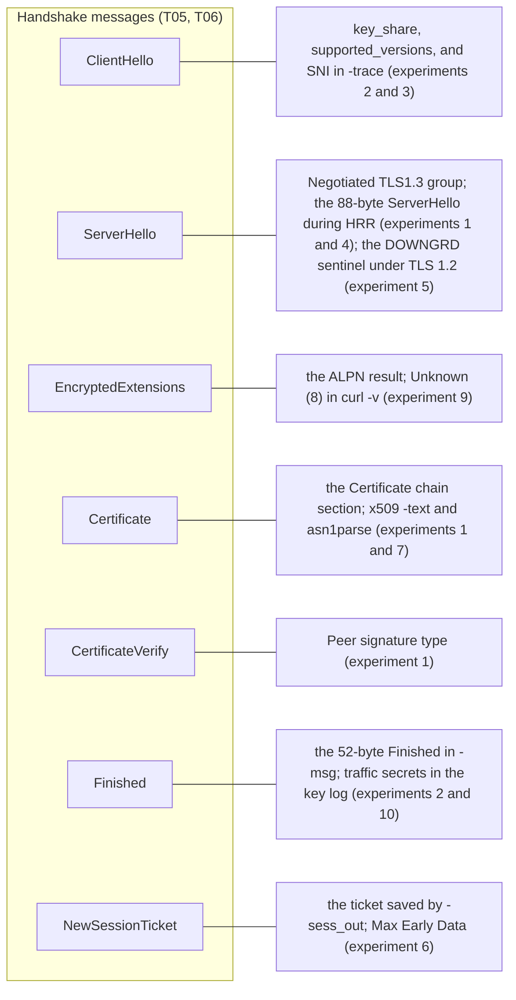

# T13 · Hands on: watch a handshake with openssl and curl

> Series: [[00_tls-series-overview|TLS series overview]] · Previous: [[T12_https-adoption-and-trust-governance|T12 HTTPS adoption and trust governance]] · Terms and standards: [[T99_glossary-and-standards-index|T99]]
> Prerequisites: the certificate structure from T03, and the handshake messages from T05 and T06. Keep those notes open while you read this one.
> Environment: macOS, Apple M3; OpenSSL 4.0.3 (`/opt/homebrew/bin/openssl`, released 2026-09-29); the system curl 8.7.1 (LibreSSL 3.3.6 backend); the system dig 9.10.6
> Compiled: 2026-10-16 (every output below was captured for real between 2026-10-17 02:49 and 03:23 UTC, connecting only to public sites)

Almost everything in the previous twelve notes can be seen on your own computer. This note is a set of experiments. Each one gives the purpose, the command, and the actual output (lines that are off the point were removed), then explains the output line by line and points back to the note that covers the mechanism. Every experiment connects only to public sites, and only observes connections that you start yourself.

## Before the experiments: see which path your traffic takes

Before any network measurement, confirm which path your traffic takes. Otherwise you will mistake the proxy's behavior for the network's. This Mac had Clash Verge's TUN mode on:

```
$ route -n get 104.16.123.96 | grep -E 'interface|gateway'
    gateway: 198.18.0.1
  interface: utun1024
```

Traffic to www.cloudflare.com (104.16.123.96) is routed to the virtual interface `utun1024`, taken over by the local mihomo core, and then sent to the target through a proxy node. That affects the experiments in two ways. The contents of the handshake are unaffected: mihomo only forwards bytes at the TCP layer and does not decrypt TLS. In every experiment below, the certificate chain verifies (`Verify return code: 0 (ok)`) and the issuer is a real CA, which is the evidence. If someone on the path were intercepting TLS, the certificate chain would be the interceptor's root. The timing measurements are affected: the TCP connection is actually established with the local TUN stack, so the measured TCP time no longer represents the round-trip time to the server (experiment 9 shows this).

Two points about the tools. The `/usr/bin/openssl` that ships with macOS is in fact LibreSSL. Its features and its output format both differ from OpenSSL. The experiments below all use OpenSSL 4.0.3 installed by Homebrew. The system dig, 9.10.6, is too old to know the HTTPS record type, so use `TYPE65` instead.

## Experiment 1: a handshake summary

Purpose: read the most useful lines in the default output of `openssl s_client`.

```
$ echo | openssl s_client -connect www.cloudflare.com:443 -servername www.cloudflare.com
---
Certificate chain
 0 s:CN=www.cloudflare.com
   i:C=US, O=Google Trust Services, CN=WE1
   a:PKEY: EC, (prime256v1); sigalg: ecdsa-with-SHA256
   v:NotBefore: Oct 12 20:43:38 2026 GMT; NotAfter: Jan 10 21:43:36 2027 GMT
 1 s:C=US, O=Google Trust Services, CN=WE1
   i:C=US, O=Google Trust Services LLC, CN=GTS Root R4
   a:PKEY: EC, (prime256v1); sigalg: ecdsa-with-SHA384
   v:NotBefore: Dec 13 09:00:00 2023 GMT; NotAfter: Feb 20 14:00:00 2029 GMT
 2 s:C=US, O=Google Trust Services LLC, CN=GTS Root R4
   i:C=BE, O=GlobalSign nv-sa, OU=Root CA, CN=GlobalSign Root CA
   a:PKEY: EC, (secp384r1); sigalg: sha256WithRSAEncryption
   v:NotBefore: Nov 15 03:43:21 2023 GMT; NotAfter: Jan 28 00:00:42 2028 GMT
---
Peer signing digest: SHA256
Peer signature type: ecdsa_secp256r1_sha256
Negotiated TLS1.3 group: X25519MLKEM768
---
SSL handshake has read 3905 bytes and written 1637 bytes
Verification: OK
---
New, TLSv1.3, Cipher is TLS_AES_256_GCM_SHA384
Protocol: TLSv1.3
Server public key is 256 bit
This TLS version forbids renegotiation.
No ALPN negotiated
Early data was not sent
Verify return code: 0 (ok)
---
ECH: NOT CONFIGURED: -103
```

`-servername` sets the SNI. Without it, many servers return a default certificate or the handshake fails outright (T08 covers why SNI is required). `echo |` makes s_client exit once the handshake is done.

The Certificate chain section is the chain the server sent in the Certificate message. s is the subject, i is the issuer, a is the public-key type and the issuer's signature algorithm, and v is the validity period. This chain has three certificates: the leaf (90 days, 2026-10-12 to 2027-01-10), Google Trust Services' intermediate CA `WE1`, and `GTS Root R4`. The issuer of the third certificate is `GlobalSign Root CA`: this is the copy of GTS Root R4 that was cross-signed by GlobalSign's old root. The server sends it so that old devices whose trust store does not yet contain GTS Root R4 can still validate, the same mechanism as the letsencrypt.org chain in T03. The leaf and the intermediate both have P-256 public keys. An ECDSA chain keeps the whole Certificate message at about 2.5KB (T07).

`Peer signature type: ecdsa_secp256r1_sha256` is the signature algorithm the server used in CertificateVerify (T06). `Negotiated TLS1.3 group: X25519MLKEM768` is the key-exchange group that was negotiated, a post-quantum hybrid (T10). In `New, TLSv1.3, Cipher is TLS_AES_256_GCM_SHA384`, New means this was a full handshake, not a session resumption. `No ALPN negotiated` is because `-alpn` was not used to offer a protocol list. A browser would offer `h2` and `http/1.1`. `Verify return code: 0 (ok)` means the certificate chain verified. This check uses OpenSSL's own certificate bundle, not the macOS system trust store. The last line is the ECH status added in OpenSSL 4.0. ECH was not configured this time.

## Experiment 2: the handshake messages, one by one

Purpose: see, on the wire, each message from T06 and its size.

```
$ echo | openssl s_client -connect www.cloudflare.com:443 -servername www.cloudflare.com -msg 2>/dev/null \
    | grep 'Handshake \['
>>> TLS 1.3, Handshake [length 05c1], ClientHello
<<< TLS 1.3, Handshake [length 04ba], ServerHello
<<< TLS 1.3, Handshake [length 000a], EncryptedExtensions
<<< TLS 1.3, Handshake [length 09da], Certificate
<<< TLS 1.3, Handshake [length 004e], CertificateVerify
<<< TLS 1.3, Handshake [length 0034], Finished
>>> TLS 1.3, Handshake [length 0034], Finished
```

`>>>` is sent, `<<<` is received, and length is hexadecimal and includes the 4-byte handshake header: ClientHello 1473 bytes, ServerHello 1210 bytes, EncryptedExtensions 10 bytes, Certificate 2522 bytes, CertificateVerify 78 bytes, and two Finished messages of 52 bytes each (48 bytes of SHA-384 verify_data plus a 4-byte header). This is the sequence diagram from T06 as it appears on the wire: one round trip, one message from the client, five from the server, then one more from the client.

To see every field, replace `-msg` with `-trace`. The whole of T06 is built on the output of that command. Only the key_share section is quoted here:

```
extension_type=key_share(51), length=1258
    NamedGroup: X25519MLKEM768 (4588)
    key_exchange:  (len=1216): CA2156AE653F0F94...
    NamedGroup: ecdh_x25519 (29)
    key_exchange:  (len=32): 80CDDA2AF368BEAD...
```

The client offered two key_share values at once, the post-quantum hybrid and plain X25519, 1216 bytes and 32 bytes. The `-trace` output is long (2514 lines this time, including the full PEM of every certificate). Read it with `grep`, or redirect it to a file first.

## Experiment 3: switch the key-exchange group

Purpose: see the byte cost of post-quantum key exchange directly. Use `-groups` to offer only one group:

```
$ openssl s_client ... -groups X25519 -msg
>>> ClientHello [length 0138]      312 bytes
<<< ServerHello [length 007a]      122 bytes

$ openssl s_client ... -groups P-256 -msg
>>> ClientHello [length 0159]      345 bytes
<<< ServerHello [length 009b]      155 bytes

$ openssl s_client ... -groups X25519MLKEM768 -msg
>>> ClientHello [length 05d2]     1490 bytes
<<< ServerHello [length 04ba]     1210 bytes
Negotiated TLS1.3 group: X25519MLKEM768
```

The ServerHello difference is the cleanest: 1210 - 122 = 1088 bytes, exactly the size of one ML-KEM-768 ciphertext (the table in T10). ClientHello grew from 312 bytes to 1490 bytes. The extra 1.2KB or so is almost entirely the 1184-byte ML-KEM encapsulation key. P-256 is a bit larger than X25519 because a P-256 public key is a 65-byte uncompressed point. These numbers are also why T06 and T10 keep coming back to the problem of a ClientHello that no longer fits in one TCP segment.

## Experiment 4: trigger a HelloRetryRequest yourself

Purpose: see the HRR described in T06. Have the client offer a key_share for a group the server will not use, and leave a group the server will use on the supported list:

```
$ echo | openssl s_client -connect www.cloudflare.com:443 -servername www.cloudflare.com \
    -groups secp521r1:X25519 -msg 2>/dev/null | grep 'Handshake \['
>>> TLS 1.3, Handshake [length 019f], ClientHello          415 bytes, key_share for P-521 only
<<< TLS 1.3, Handshake [length 0058], ServerHello          88 bytes, this is the HelloRetryRequest
>>> TLS 1.3, Handshake [length 013a], ClientHello          314 bytes, resent with an X25519 key_share
<<< TLS 1.3, Handshake [length 007a], ServerHello          the real ServerHello
<<< TLS 1.3, Handshake [length 000a], EncryptedExtensions
<<< TLS 1.3, Handshake [length 09da], Certificate
<<< TLS 1.3, Handshake [length 004f], CertificateVerify
<<< TLS 1.3, Handshake [length 0034], Finished
```

When `-groups` is written as an ordinary list like this, OpenSSL generates a key_share only for the first group on the list. Here that is P-521. Under the default configuration, OpenSSL 4.0.3 sends both X25519MLKEM768 and X25519 (see experiment 2). The server does not accept P-521, but it does support the X25519 that is on the list, so it replies with an 88-byte "ServerHello". Its random is the fixed magic value from T06, and the key_share only says "please use X25519". That is the HRR. The client then resends ClientHello with an X25519 key_share, and the handshake continues normally. This experiment adds one round trip to the handshake, the extra cost mentioned in the round-trip accounting in T01, and it shows why clients that have to guess a key_share so often pick X25519.

## Experiment 5: TLS 1.2 and TLS 1.3 side by side, and the downgrade sentinel

Purpose: see how the handshake structure differs between the two versions, and see the downgrade protection described in T06.

```
$ echo | openssl s_client -connect www.cloudflare.com:443 -servername www.cloudflare.com -tls1_2 -trace
```

The reading of the full output is in T05. Only one line is shown here, the random in the server's ServerHello:

```
random_bytes (len=28): 787BEAE192ED9360AA8D07DF0346F16AE1D3488C444F574E47524401
```

The last 8 bytes, `44 4F 57 4E 47 52 44 01`, are the ASCII `DOWNGRD` plus `0x01`. The server supports TLS 1.3, but `-tls1_2` limits it to speaking 1.2, so it writes the downgrade sentinel as required by RFC 8446 §4.1.3. Connect again with `-tls1_3`, or with the default parameters, and ServerHello.random is an ordinary random value. Put the two `-msg` outputs next to each other. TLS 1.2 adds ServerKeyExchange, ServerHelloDone, ClientKeyExchange, and two ChangeCipherSpec messages. The certificate is in the clear, and the handshake takes two round trips.

## Experiment 6: resumption and 0-RTT

Purpose: see the PSK resumption and the 0-RTT early data described in T07. Do one full handshake, save the session (the ticket) to a file, and resume with it:

```
$ printf 'GET / HTTP/1.1\r\nHost: www.google.com\r\nConnection: close\r\n\r\n' > req.txt
$ openssl s_client -connect www.google.com:443 -servername www.google.com -tls1_3 -sess_out s.pem -ign_eof < req.txt > /dev/null
$ openssl sess_id -in s.pem -noout -text | grep 'Max Early Data'
    Max Early Data: 14336
$ openssl s_client -connect www.google.com:443 -servername www.google.com -tls1_3 \
    -sess_in s.pem -early_data req.txt -msg -ign_eof < /dev/null | grep -E 'Handshake \[|Reused|Early data|HTTP/1.1'
>>> TLS 1.3, Handshake [length 06f6], ClientHello
<<< TLS 1.3, Handshake [length 04c0], ServerHello
<<< TLS 1.3, Handshake [length 000a], EncryptedExtensions
<<< TLS 1.3, Handshake [length 0034], Finished
>>> TLS 1.3, Handshake [length 0004], EndOfEarlyData
>>> TLS 1.3, Handshake [length 0034], Finished
Reused, TLSv1.3, Cipher is TLS_AES_256_GCM_SHA384
Early data was accepted
HTTP/1.1 200 OK
```

`sess_id` reads max_early_data_size out of the ticket. 14336 means Google is willing to accept at most 14336 bytes of 0-RTT data. The resumed handshake has no Certificate and no CertificateVerify. `Reused` means PSK resumption succeeded. `Early data was accepted` means the GET request was accepted as early data, and a 200 response followed. The same test against four sites is in the table in T07: all four can resume, Google and Facebook allow 0-RTT, and Cloudflare and Apple do not.

`s.pem` contains the secrets needed to resume the session. Delete it as soon as the experiment is over.

## Experiment 7: read a certificate

Purpose: find each X.509 field from T03 on a real certificate.

```
$ echo | openssl s_client -connect letsencrypt.org:443 -servername letsencrypt.org -showcerts 2>/dev/null > le.txt
$ awk '/BEGIN CERTIFICATE/{n++} n==1' le.txt > leaf.pem       # first certificate only (the leaf)
$ openssl x509 -in leaf.pem -noout -text
$ openssl asn1parse -in leaf.pem -i | head
    0:d=0  hl=4 l=1094 cons: SEQUENCE
    4:d=1  hl=4 l= 972 cons:  SEQUENCE
    8:d=2  hl=2 l=   3 cons:   cont [ 0 ]
   10:d=3  hl=2 l=   1 prim:    INTEGER           :02
   13:d=2  hl=2 l=  18 prim:   INTEGER           :0543933BE386B3A2B3ADD534F2103BC8B65F
   33:d=2  hl=2 l=  10 cons:   SEQUENCE
   35:d=3  hl=2 l=   8 prim:    OBJECT            :ecdsa-with-SHA384
```

The full `x509 -text` output, and a field-by-field reading, are in T03. `asn1parse` shows the DER structure. The SEQUENCE starting at byte 0 is the whole certificate (length 1094, 1098 bytes once the 4-byte header is included). The SEQUENCE starting at byte 4 is tbsCertificate. The INTEGER 2 inside `cont [ 0 ]` is version v3. Next come an 18-byte serial number and the signature-algorithm OID. d is the nesting depth, hl is the length of the TLV header, and l is the content length. To see only a few extensions, use `openssl x509 -in leaf.pem -noout -ext subjectAltName,ct_precert_scts`.

## Experiment 8: look up an HTTPS record and an ECH config

Purpose: see the HTTPS record and the ECHConfig described in T08.

```
$ dig +short TYPE65 crypto.cloudflare.com @1.1.1.1
\# 133 0001000001000302683200040008A29F874FA29F884F000500470045 FE0D00417500200020AD5C...
```

An old dig does not know the HTTPS type, so it prints hexadecimal in the generic format of RFC 3597. `\# 133` means 133 bytes. The leading `0001` is priority 1, `00` means the target name is the name itself, and then comes a run of parameters as "key, length, value": key 1 (alpn), key 4 (ipv4hint), key 5 (ech), and key 6 (ipv6hint). The decoded ECHConfig (version 0xfe0d, an X25519 HPKE public key, HKDF-SHA256 with AES-128-GCM, public_name cloudflare-ech.com) and a field-by-field reading are in T08. A newer dig (9.16 or later), or `kdig`, can print a readable form directly with `dig HTTPS crypto.cloudflare.com`.

## Experiment 9: time each stage with curl

Purpose: split one HTTPS request into DNS, TCP, TLS, and time to first byte, and see how a proxy affects the measurement.

```
$ curl -so /dev/null -w 'dns=%{time_namelookup} tcp=%{time_connect} tls=%{time_appconnect} ttfb=%{time_starttransfer} total=%{time_total} http=%{http_version}\n' https://www.cloudflare.com/
dns=0.002398 tcp=0.002833 tls=0.577384 ttfb=0.760159 total=1.867504 http=2
dns=0.003096 tcp=0.003599 tls=0.893899 ttfb=1.292248 total=2.948987 http=2
dns=0.003729 tcp=0.004326 tls=0.568185 ttfb=0.748195 total=1.865904 http=2
```

These curl times are all seconds accumulated from the start of the request. `time_namelookup` is when DNS finished, `time_connect` is when TCP was established, `time_appconnect` is when the TLS handshake finished, and `time_starttransfer` is when the first byte of the response arrived. On an ordinary network, `time_connect - time_namelookup` is about one RTT (the three-way handshake), `time_appconnect - time_connect` is about the number of handshake round trips times the RTT (one round trip for TLS 1.3), and `time_starttransfer - time_appconnect` is one RTT plus the server's processing time.

The TCP stage in these three measurements is only about 0.4 milliseconds, which cannot physically be the round-trip time to Cloudflare. The reason is the TUN mode described at the start: the TCP connection is accepted directly by the local mihomo stack, and only then does mihomo connect to the real server through a proxy node. That time is therefore counted inside the TLS stage, and `time_appconnect` reaches 0.57 to 0.89 seconds. This is one of the most common traps when measuring network performance. If the machine has a TUN proxy, a system proxy, or a VPN on, the per-stage times reflect the proxy. To measure the real network, confirm the traffic path first (`route get`), or measure in an environment with no proxy.

`curl -v` also shows the handshake as it proceeds:

```
* ALPN: curl offers h2,http/1.1
* (304) (OUT), TLS handshake, Client hello (1):
* (304) (IN), TLS handshake, Server hello (2):
* (304) (IN), TLS handshake, Unknown (8):
* (304) (IN), TLS handshake, Certificate (11):
* (304) (IN), TLS handshake, CERT verify (15):
* (304) (IN), TLS handshake, Finished (20):
* (304) (OUT), TLS handshake, Finished (20):
* SSL connection using TLSv1.3 / AEAD-CHACHA20-POLY1305-SHA256 / [blank] / UNDEF
* ALPN: server accepted h2
```

The numbers in parentheses are handshake message types: 1 ClientHello, 2 ServerHello, 8 EncryptedExtensions (this curl's LibreSSL backend does not know the name for type 8, and prints Unknown), 11 Certificate, 15 CertificateVerify, and 20 Finished. The system curl uses LibreSSL 3.3.6. It supports TLS 1.3. This handshake negotiated ChaCha20-Poly1305, and ALPN selected h2.

## Experiment 10: decrypt your own capture with a key log

Purpose: understand the standard way to view the plaintext of your own TLS traffic in Wireshark.

```
$ openssl s_client -connect www.cloudflare.com:443 -servername www.cloudflare.com -keylogfile kl.txt ...
$ awk '{print $1, substr($2,1,16)"...", length($3)/2 " bytes"}' kl.txt
SERVER_HANDSHAKE_TRAFFIC_SECRET 3337a9b0e3eae7de... 48 bytes
CLIENT_HANDSHAKE_TRAFFIC_SECRET 3337a9b0e3eae7de... 48 bytes
CLIENT_TRAFFIC_SECRET_0 3337a9b0e3eae7de... 48 bytes
SERVER_TRAFFIC_SECRET_0 3337a9b0e3eae7de... 48 bytes
EXPORTER_SECRET 3337a9b0e3eae7de... 48 bytes
```

A key log file records the traffic secrets of each connection in the format defined by NSS: a label, ClientHello.random, and the secret. T06 explains which node of the key schedule each label corresponds to. When you capture with Wireshark, set this file as the (Pre)-Master-Secret log filename under Preferences > Protocols > TLS. Wireshark can then use these secrets to decrypt the connection captured at the same time, and show EncryptedExtensions, the certificates, and the HTTP contents. Browsers and curl do the same thing with the `SSLKEYLOGFILE` environment variable. Wireshark is not installed on this machine, so the demonstration stops at producing the key log.

A key log file can open the corresponding connection, so treat it as a secret. Generate it only while debugging your own connection, delete it as soon as you are done, and do not leave `SSLKEYLOGFILE` set on a browser you use every day.

## How the output lines up with handshake messages



## Output you meet while debugging

`verify error:num=20:unable to get local issuer certificate`: the client could not connect the chain to a root it trusts. The most common cause is that the server omitted an intermediate certificate (a browser may fetch it over AIA and so report no error; openssl and curl will not). The next most common cause is that the local certificate bundle does not contain the matching root.

`verify error:num=62:hostname mismatch`, or a certificate subject that is wrong: usually `-servername` was left off, and the server returned its default certificate. It can also mean the connection really did reach the wrong host.

`alert handshake failure`, or `no protocols available`: the two sides have no version, suite, or group in common. Examples are using `-tls1_2` against a server that supports only TLS 1.3, or using `-groups` to name a group the server does not support and leaving no alternative.

`Verify return code: 0 (ok)`, while the browser reports an error: OpenSSL and the browser use different trust stores. OpenSSL uses its own certificate bundle. The browser uses the system trust store or the Chrome Root Store (T03).

A measurement that is obviously unreasonable (a TCP time under 1 millisecond, for example): check the traffic path first, and see whether it goes through a proxy, a TUN interface, or a VPN.

## Cleanup after the experiments

`s.pem` (the session ticket and the resumption secrets) and `kl.txt` (the traffic secrets) produced by this set of experiments should both be deleted afterward. Certificates and trace output are not sensitive, but there is no reason to keep them for long.

## Sources cited in this note

- RFC 8446, TLS 1.3 (§4.1.3 downgrade sentinel, §4.1.4 HelloRetryRequest), https://www.rfc-editor.org/rfc/rfc8446
- RFC 10024, Post-Quantum Traditional (PQ/T) Hybrid Key Agreement Mechanisms for TLS 1.3, https://www.rfc-editor.org/info/rfc10024
- RFC 5280, X.509 certificates, https://www.rfc-editor.org/rfc/rfc5280
- RFC 9460, SVCB and HTTPS records, https://www.rfc-editor.org/rfc/rfc9460
- RFC 3597, Handling of Unknown DNS Resource Record (RR) Types, https://www.rfc-editor.org/rfc/rfc3597
- OpenSSL s_client manual, https://docs.openssl.org/master/man1/openssl-s_client/
- curl `--write-out` variables, https://everything.curl.dev/usingcurl/verbose/writeout
- NSS Key Log Format, https://firefox-source-docs.mozilla.org/security/nss/legacy/key_log_format/index.html
- Wireshark TLS decryption, https://wiki.wireshark.org/TLS
