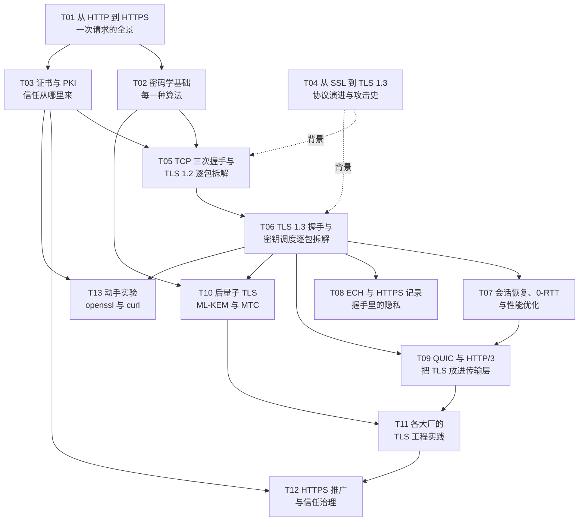
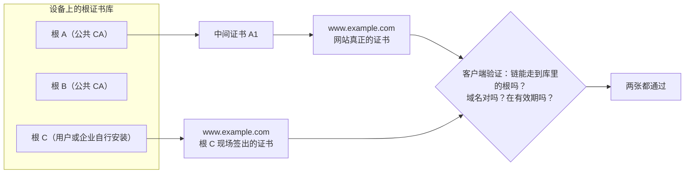
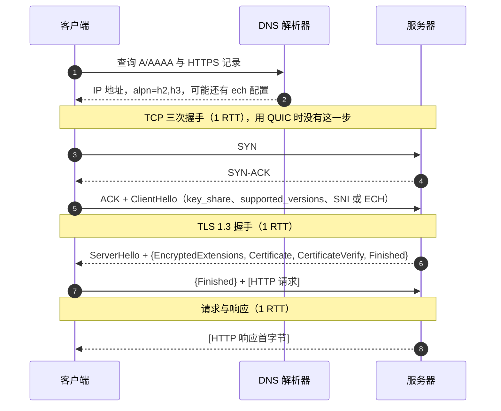

# TLS 系列 · 总览与学习路线

> 范围：从明文 HTTP 到 HTTPS，从 TCP 三次握手到 TLS 1.3 的密钥调度，从证书和 PKI 到 ECH、QUIC 和后量子密钥交换，再到各大厂的工程实践和整个 Web 推广 HTTPS 的治理过程。
> 标准基线：TLS 1.3 以 RFC 8446 及其 2026-07 发布的修订版 RFC 9846 为准（各篇按读者熟悉的 RFC 8446 标注章节号），ECH 以 RFC 9849 为准，证书以 RFC 5280 为准，QUIC 以 RFC 9000/9001 为准，混合后量子密钥交换以 RFC 10024 为准。完整清单见 [[T99_glossary-and-standards-index|T99 术语表与标准索引]]。
> 配套页面：`html/index.html`，用浏览器直接打开，可以逐步播放各种握手、展开证书链、查看密钥调度推导树。
> 整理日期：2026-10-16（标准状态与实测数据于 2026-10-17 UTC 采集）

## 这套笔记是什么

两台互不相识的机器，隔着一条任何人都能偷看和篡改的网络，怎么在一个往返里谈好一把只有它们俩知道的密钥，并且让客户端确信对面就是它想访问的那台服务器？TLS 的握手消息、每一种算法、证书体系的每一层，都是在回答这个问题的某一面，或者是在堵历史上某一次被攻破的窟窿。这套笔记沿着这个问题，把 HTTPS 从地址栏里的一把锁，拆到每一条握手消息、每一个字段、每一步密钥推导和背后的数学直觉，再放回真实世界：哪些设计是被哪次攻击逼出来的，大厂各自做了什么，Web 怎么在十年里从大部分明文走到几乎全部加密，以及 2026 年这一刻还有哪些东西在变。

TLS 难，不在某一点特别深，而在它是三件事缠在一起：一套密钥协商的密码学，一套证书与信任的公钥基础设施，一套为了性能和隐私不断演进的工程协议。所以这里按三条线拆开：T02 是密码学，T03 是证书与信任，T05 到 T09 是协议与性能，T10 到 T12 是正在发生的演进和治理。

每篇以规范为准，引用精确到章节，结尾列出引用的标准和资料。图以 mermaid 为主（Obsidian 里直接渲染），消息流用时序图，推导用流程图，字节布局用代码块里的 ASCII 图。正文里的握手、证书、HTTPS 记录、会话恢复和 0-RTT 数据，都是在这台 Mac 上用 OpenSSL 4.0.3 对公开网站真实采集的，小数字例子（RSA、DH、椭圆曲线、LWE、HKDF、QUIC Initial 密钥）都用程序验算过。

## 一张图看全系列

箭头表示"读后面那篇之前最好先读前面那篇"。T04 的历史可以随时插着读，T13 适合读完 T03 和 T06 之后边做边对照。

## 章节表

| 篇 | 回答的问题 | 主要标准 |
| --- | --- | --- |
| [[T01_http-to-https-request-lifecycle\|T01]] | 明文 HTTP 哪里不安全，TLS 在协议栈哪一层，一次 HTTPS 请求从敲回车到首字节经历几个往返 | RFC 9110、9112、9113、9114、7301、6797 |
| [[T02_cryptography-foundations-for-tls\|T02]] | 哈希、HMAC、AEAD、RSA、DH、椭圆曲线、签名、HKDF 各自做什么，数学上为什么成立 | RFC 2104、5116、5869、7748、8017、8032、8439 |
| [[T03_certificates-and-pki\|T03]] | 证书里有什么，证书链怎么验证，根证书凭什么被信任，"一个根签出来的任何证书都被信任"是什么意思，吊销和证书透明度怎么运作 | RFC 5280、9525、6960、6962、8555、8659 |
| [[T04_ssl-to-tls13-evolution-and-attacks\|T04]] | SSL 和 TLS 每一版改了什么，二十年里的著名攻击分别逼出了哪些设计 | RFC 6101、2246、4346、5246、8446、9846、8996、7457 |
| [[T05_tcp-and-tls12-handshake\|T05]] | TCP 三次握手的每个字段，TLS 1.2 每条握手消息，主密钥怎么推出来，为什么是 2-RTT | RFC 9293、5246、7627、8422 |
| [[T06_tls13-handshake-and-key-schedule\|T06]] | TLS 1.3 的 1-RTT 握手逐字段，完整的密钥调度推导树，记录层怎么加密，降级保护怎么做 | RFC 8446、9846、10024 |
| [[T07_session-resumption-0-rtt-and-performance\|T07]] | 会话恢复和 0-RTT 怎么省往返，重放风险怎么控制，证书大小、记录大小、kTLS、连接复用各省在哪里 | RFC 5077、8446、8470、8879、7413 |
| [[T08_ech-and-https-record-privacy\|T08]] | 握手里还剩哪些明文，ECH 怎么把整个真实 ClientHello 藏起来，HPKE 和 HTTPS 记录在其中的角色 | RFC 9849、9848、9180、9460 |
| [[T09_quic-and-http3\|T09]] | QUIC 怎么借用 TLS 1.3 的握手而不用它的记录层，包保护和头部保护怎么做，HTTP/3 怎么被发现 | RFC 9000、9001、9002、9114 |
| [[T10_post-quantum-tls\|T10]] | 量子计算机威胁什么，ML-KEM 混合密钥交换怎么接进 TLS 1.3，后量子证书为什么更难 | FIPS 203、204、205，RFC 10024 |
| [[T11_tls-engineering-practices\|T11]] | Google、Cloudflare、Apple、Meta、Mozilla、Microsoft、AWS、Let's Encrypt 各自造了什么、推了什么，国密 TLS 是怎么回事 | 各家公开资料，RFC 8998 |
| [[T12_https-adoption-and-trust-governance\|T12]] | Web 怎么全面转向 HTTPS，HSTS、CT、根程序、证书寿命这些治理手段各管什么，自己的服务器该怎么配 | RFC 6797、9325，CA/B Forum Baseline Requirements |
| [[T13_observing-tls-with-openssl-and-curl\|T13]] | 怎么用 openssl、curl、dig 亲眼看到上面所有东西 | 同上各篇 |
| [[T99_glossary-and-standards-index\|T99]] | 术语对照和标准索引 | |

## 三条读法

只想建立完整直觉的，按 T01、T03、T06、T08、T10 读，每篇先看图和每节第一段，跳过字节布局和推导细节。读完能说清一次 HTTPS 连接里发生了什么、信任从哪来、2026 年还在变什么。

要把协议吃透的，按 T02、T05、T06、T07、T09 读，T06 的密钥调度和 T05 的 PRF 对照着读，配合 HTML 页面里的握手播放器和推导树，再用 T13 的实验在真实输出里找到每一条消息。读完能看懂 `openssl s_client -trace` 的每一行。

关心部署和运维的，读 T03、T07、T11、T12，重点是证书自动化、吊销为什么不可靠所以证书寿命在缩短、推荐配置、各家的优化手段，以及 T10 末尾的后量子迁移清单。

## 按问题检索

握手为什么要两个往返，TLS 1.3 怎么省掉一个：T05 末节与 T06。打开网站很慢、首字节迟迟不来：T07 的性能优化与 T01 的往返账。为什么抓包时能看到要访问的域名、ECH 想解决什么：T08。证书报错、链不完整、吊销是怎么回事：T03，排错输出见 T13 末尾。为什么抓包工具能解开一部分 App 的 HTTPS、又解不开另一部分：T03 的信任模型和 T12 的证书固定一节。量子计算机到底威胁 TLS 的哪一部分、现在该不该管：T10。想自己敲命令看一遍真实握手：T13。

## 先回答一个问题："这个根签出来的任何证书"是什么意思

这句话是理解 HTTPS 信任模型的钥匙，完整的展开在 [[T03_certificates-and-pki|T03]]。

操作系统或浏览器里有一个根证书库，这台 Mac 的系统根库里有 158 张根证书。客户端验证一个网站的证书时只检查三件事：从网站证书沿着"谁给谁签名"往上，能不能走到库里的某一个根，并且每一级签名都验得过；证书在有效期内、用途对得上；证书里写的域名和正在访问的域名一致。

关键在第一条只问"能不能走到库里的某一个根"，不问"这个网站平时用的是哪家 CA"，客户端也无从知道这一点。所以库里每一个根都能为世界上任何一个域名签出一张这台设备会接受的证书。整个体系的安全等于库里最弱的那个 CA 的安全。"这个根签出来的任何证书都会被信任"说的就是这件事：一个根一旦进了你的根库，它签出来的、写着任何域名的证书，你的设备都接受。

历史上这真实发生过。2011 年荷兰 CA DigiNotar 被入侵，攻击者签出了包括 `*.google.com` 在内的 500 多张伪造证书，`*.google.com` 被用于在伊朗对约 30 万个 IP 的用户做中间人攻击；Chrome 因为内置了 Google 域名的公钥固定才发现异常，DigiNotar 随后被所有浏览器移出根库并破产。

同一个机制也解释了用户自己安装的根证书。调试工具和企业的 TLS 检查代理要求你安装并信任它们的根，这个根就成了你设备根库的一员，工具因此能为任何域名现签一张证书，系统照样验证通过。只做标准验证的 App 因此能被解开，而在标准验证之外又做了证书固定的 App（只认自己的几把公钥）会拒绝这样的证书。

行业为收窄"任何根都能签任何域名"叠了好几层机制：证书透明度让公共 CA 签出的每张证书都公开记账，签错了必然被看见；CAA 记录让域名持有者声明只允许哪些 CA 签发；nameConstraints 把一个 CA 限制在指定域名范围；根程序把出问题的 CA 移出根库；App 自己可以做证书固定；证书寿命缩短让错签的证书尽快过期。这些在 T03 和 T12 里分别展开。

## 一次 HTTPS 连接的全景

不算 DNS，TCP 加 TLS 1.3 的全新连接要两个往返之后才能发出第一个请求，第三个往返拿到响应首字节；TLS 1.2 要三个往返之后才能发请求；QUIC 首次连接一个往返后就能发请求；QUIC 或 TLS 1.3 的会话恢复加 0-RTT 可以让请求和握手一起出发。各种组合的往返账在 [[T01_http-to-https-request-lifecycle|T01]]，每个往返怎么被省掉在 [[T07_session-resumption-0-rtt-and-performance|T07]] 和 [[T09_quic-and-http3|T09]]。

## 2026 年 10 月这一刻的状态

TLS 的主体在 2018 年 RFC 8446 发布后就稳定了。近两年的变化集中在下面几个方向，读这套笔记时带着它们的时间点：

| 方向 | 状态（2026-10） | 详见 |
| --- | --- | --- |
| TLS 1.3 规范 | 修订版 RFC 9846 于 2026-07 发布，取代 RFC 8446，协议版本不变 | T04、T06 |
| 后量子密钥交换 | X25519MLKEM768 是主流浏览器、OpenSSL 3.5 以上、Go 1.24 以上和 iOS 26 的默认；规范 RFC 10024 已于 2026 年发布 | T10 |
| 后量子认证 | 传统证书放后量子签名太大，Chrome 与 Cloudflare 在试 Merkle Tree Certificates，仍是草案；ML-DSA 用于 TLS 的规范在 RFC Editor 队列中 | T10、T11 |
| SNI 隐私 | ECH 于 2026-03 发布为 RFC 9849，Firefox、Chrome 已支持，部署集中在 Cloudflare | T08 |
| 证书寿命 | CA/B Forum SC-081：2026-03-15 起最长 200 天，2027 年 100 天，2029 年 47 天；Let's Encrypt 计划 2028 年默认 45 天，已于 2025 年关闭 OCSP | T03、T12 |
| 默认 HTTPS | Chrome 154（2026-10）计划默认开启"始终使用安全连接" | T12 |

## 这套笔记怎么对待事实

协议部分以 RFC 原文为准。2024 年以后的进展（标准发布、后量子部署、证书政策、根程序变动）都注明了来源和查证时间，部署比例这类数字不同机构口径差异很大，一律注明出处，查不到的明确写出来。标准的发布状态以 RFC Editor 和 IETF datatracker 为准，二手报道和博客里的状态常常滞后。

实测数据有一个需要知道的背景：采集时这台 Mac 开着 Clash Verge 的 TUN 模式，流量经由本机的 mihomo 和代理节点转发。握手内容不受影响（代理只转发字节，证书链都验证通过、签发者都是真实的 CA），但连接的时间测量会受影响，T13 的实验 9 专门讨论了这一点。

## 配套的 HTML 页面

`html/index.html` 是这套笔记的可视化伴读页，不依赖网络，直接用浏览器打开。它把文字里最难想象的几样东西做成了可以操作的图：TLS 1.2、TLS 1.3、TLS 1.3 恢复加 0-RTT、QUIC 四种握手可以逐步播放，每一步标出这条消息用哪一级密钥保护；证书链可以逐级展开字段，并演示"任何一个根都能签任何域名"；TLS 1.3 的密钥调度推导树可以逐个节点查看输入、标签和输出；还有一条从 SSL 2.0 到后量子的时间线。页面上的每个部分都标了对应的章节，内容以这些 Markdown 笔记为准。

## 边界

这套笔记讲标准、原理和正当的工程实践。讲中间人攻击时，讲的是它为什么能成立、协议和证书体系用什么机制防它；讲证书固定，讲的是在自己的应用里怎么设计和运维；讲 ECH，讲的是 RFC 9849 定义的隐私目标和机制；讲历史攻击，只讲到机制和修复。动手实验只针对公开网站和自己的连接，用标准工具观察。

## 怎么继续

几处依赖还在变化的标准，以后要回来更新：Merkle Tree Certificates 的标准化和 Chrome 抗量子根库的进展、Cloudflare 公共 CA 能否在 2027 年第一季度开始签发 MTC，会改写 T10 和 T11 的结论；draft-ietf-tls-mlkem 和 draft-ietf-tls-mldsa 发布 RFC 后，T10 的状态表述要更新；CA/B Forum 的证书寿命时间表到 2029 年才走完，每过一个节点检查 T03 和 T12；Chrome 154 发布后核对 T12 里默认 HTTPS 的实际行为。

<!-- note-assistant:index:start -->
## 目录索引

自动生成，勿手改；由 `node .tools/vault.mjs index` 维护。

### 笔记

- [[T01_http-to-https-request-lifecycle|T01 · 从 HTTP 到 HTTPS：一次请求的全景]] #tls #https #http #网络分层 #rtt #hsts #alpn
- [[T02_cryptography-foundations-for-tls|T02 · 密码学基础：TLS 用到的每一种算法]] #tls #密码学 #哈希 #hmac #aead #aes-gcm #chacha20 #rsa #diffie-hellman #ecdh #x25519 #ecdsa #ed25519 #hkdf #前向保密
- [[T03_certificates-and-pki|T03 · 证书与 PKI：信任从哪里来]] #tls #pki #x509 #证书链 #根证书 #ca #ocsp #crl #crlite #证书透明度 #caa #acme #lets-encrypt
- [[T04_ssl-to-tls13-evolution-and-attacks|T04 · 从 SSL 到 TLS 1.3：协议演进与攻击史]] #tls #ssl #协议演进 #攻击史 #beast #crime #heartbleed #poodle #logjam #drown #robot #形式化验证
- [[T05_tcp-and-tls12-handshake|T05 · TCP 三次握手与 TLS 1.2 握手逐包拆解]] #tls #tcp #三次握手 #tls12 #记录层 #clienthello #ecdhe #prf #master-secret #密码套件
- [[T06_tls13-handshake-and-key-schedule|T06 · TLS 1.3 握手与密钥调度逐包拆解]] #tls #tls13 #rfc8446 #握手 #key_share #hkdf #密钥调度 #记录层 #降级保护 #helloretryrequest #x25519mlkem768
- [[T07_session-resumption-0-rtt-and-performance|T07 · 会话恢复、0-RTT 与握手性能优化]] #tls #性能 #会话恢复 #session-ticket #psk #0-rtt #early-data #重放 #false-start #tcp-fast-open #证书压缩 #ktls #连接复用
- [[T08_ech-and-https-record-privacy|T08 · ECH 与 HTTPS 记录：握手里的隐私]] #tls #ech #esni #sni #hpke #svcb #https-rr #doh #grease #隐私
- [[T09_quic-and-http3|T09 · QUIC 与 HTTP/3：把 TLS 放进传输层]] #tls #quic #http3 #rfc9000 #rfc9001 #包保护 #头部保护 #连接迁移 #qpack #alt-svc
- [[T10_post-quantum-tls|T10 · 后量子 TLS：ML-KEM 混合密钥交换与 Merkle Tree Certificates]] #tls #后量子 #pqc #ml-kem #kyber #ml-dsa #x25519mlkem768 #混合密钥交换 #merkle-tree-certificates #shor #grover
- [[T11_tls-engineering-practices|T11 · 各大厂的 TLS 工程实践]] #tls #工程实践 #google #cloudflare #apple #meta #mozilla #microsoft #aws #lets-encrypt #boringssl #openssl #rustls #国密 #tlcp
- [[T12_https-adoption-and-trust-governance|T12 · HTTPS 推广与信任治理]] #tls #https #hsts #preload #混合内容 #ca-b-forum #根程序 #证书透明度 #hpkp #证书固定 #dane #mta-sts #bcp195 #推荐配置
- [[T99_glossary-and-standards-index|T99 · 术语表与标准索引]] #tls #术语表 #标准索引 #rfc

### 部署与运行手册

- [[T13_observing-tls-with-openssl-and-curl|T13 · 动手实验：用 openssl 与 curl 观察握手]] #tls #动手实验 #openssl #s_client #curl #dig #keylog #wireshark #抓包

### 来自其它目录（tag: tls）

- [[../../../V000_NiceThinking_tech/记一次mcp被阿里云SNI阻断与绕过/mcp遇到SNI阻断|一次被误判为"阿里云 SNI 阻断"的 MCP TLS 故障]] #MCP #TLS #Codex #Node.js #OpenSSL #网络排障：故障分析与同目录证据记录、客户端实现对比直接相关，SNI 阻断文档提供必要背景。

<!-- note-assistant:index:end -->
