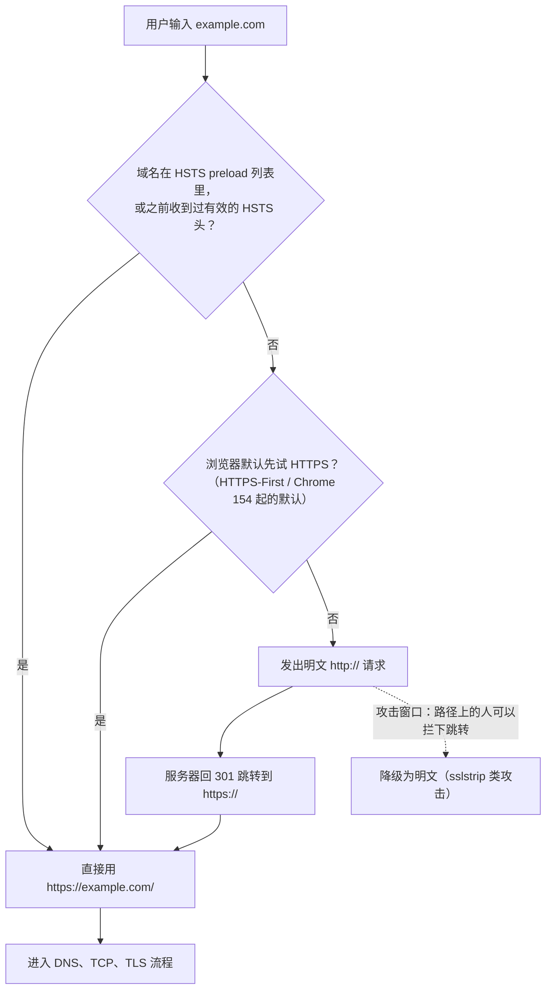
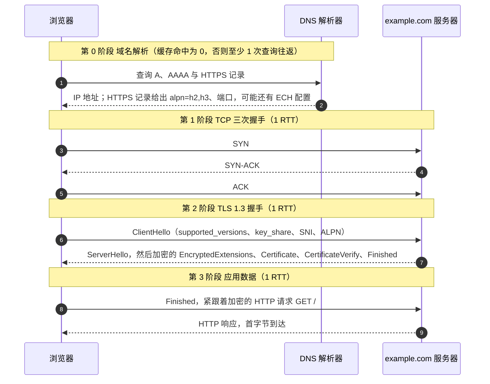
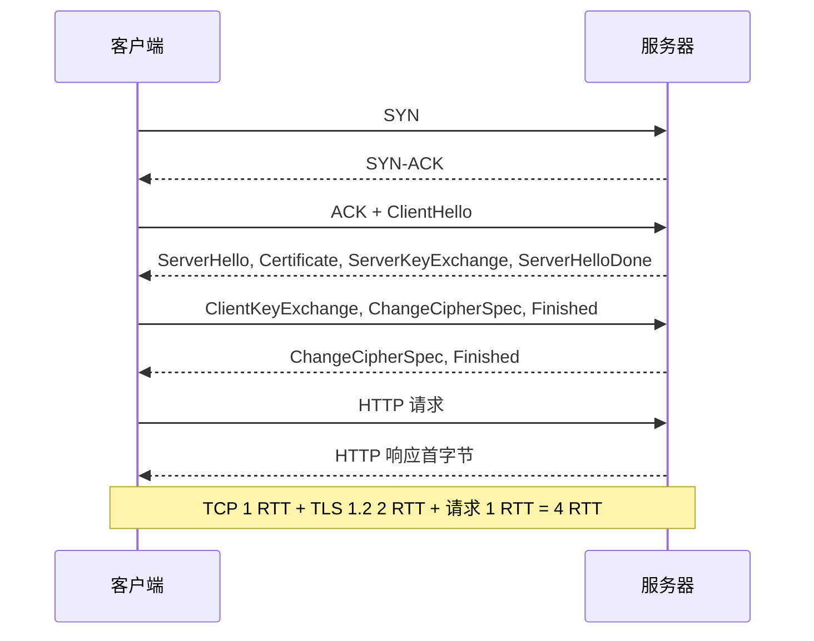
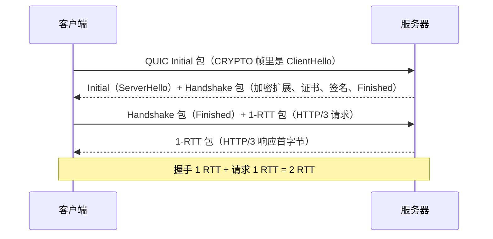
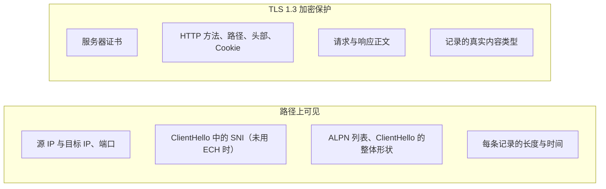

# T01 · 从 HTTP 到 HTTPS：一次请求的全景

> 系列：[[00_TLS系列总览与学习路线|TLS 系列总览]] · 下一篇：[[T02_密码学基础_TLS用到的每一种算法|T02 密码学基础]]
> 前置知识：知道 TCP/IP 分层、HTTP 是请求响应、DNS 把域名换成 IP 就够了。
> 主要标准：RFC 9110（HTTP 语义）、RFC 9112（HTTP/1.1）、RFC 9113（HTTP/2）、RFC 9114（HTTP/3）、RFC 2818（HTTP over TLS）、RFC 8446（TLS 1.3）、RFC 6066（SNI）、RFC 7301（ALPN）、RFC 6797（HSTS）、RFC 9460（HTTPS 记录）
> 整理日期：2026-10-16

这一篇不讲任何一条握手消息的细节，先把整件事的轮廓铺开：明文 HTTP 到底漏在哪，TLS 插在协议栈的哪一层、为什么插在那里，在地址栏敲一个地址回车之后到屏幕上出现第一个字节之间，网络上按什么顺序发生了什么，每种协议组合要花几个往返。后面每一篇都是在放大这张全景图里的某一块，先有这张图，后面才不会迷路。

## 明文 HTTP 漏在哪

HTTP 本身只管语义：一个请求有方法、路径、头部、正文，一个响应有状态码、头部、正文（RFC 9110）。它不管这些字节怎么安全地送过去。在它底下，HTTP/1.1 和 HTTP/2 用 TCP 把字节可靠地送到对端，TCP 又用 IP 把分组路由过去。从你的设备到目标服务器，中间要经过家里的路由器、运营商的接入网、若干骨干网路由器、目标机房的交换机，公共 Wi-Fi 下还要加上同一热点里的其他设备。这条路径上任何一个能看到你分组的节点，都能对明文 HTTP 做三件事。

第一是看。请求行、每一个 Cookie、每一个表单字段、响应里的每一段正文，对路径上的观察者都是明文。早年 Firesheep（2010）这个浏览器插件把这件事做成了一键操作：在咖啡馆的开放 Wi-Fi 里，它直接从空中抓取别人访问 Facebook、Twitter 时的会话 Cookie，点一下就能以对方身份登录。它没有利用任何漏洞，只是把"明文 Cookie 谁都能读"这件事演示得足够直观，加速了这些网站默认启用全站 HTTPS。

第二是改。中间节点可以改掉响应正文，注入一段脚本或一条广告。国内外都有运营商在 HTTP 页面里插入弹窗广告、流量提醒的记录，用户无从察觉，因为没有任何机制校验收到的字节和服务器发出的是不是同一份。2015 年的 Great Cannon 事件更进一步：中间设备在部分明文 HTTP 响应里替换了 JavaScript，让大量访问者的浏览器去攻击 GitHub 上的特定项目。

第三是冒充。既然没有任何办法验证对面是谁，中间节点可以干脆自己扮演服务器，你以为在和银行说话，其实在和它说话。DNS 被污染、ARP 被欺骗、热点名字被仿冒，都能把你的连接引到冒充者那里。

这三件事对应安全的三个目标：机密性（confidentiality，别人看不到）、完整性（integrity，别人改了你能发现）、身份认证（authentication，你能确认对面是谁）。HTTPS 要同时给到这三样。只加密不认证没有用，因为你加密的对象可能就是冒充者，你只是在和攻击者之间建立了一条很安全的通道。这一点在后面会反复出现：TLS 握手里，密钥协商和身份认证是绑在一起完成的，服务器要用证书里那把公钥对应的私钥，对整个握手过程签名，证明"和你协商出这把密钥的，正是证书上写的这个域名的持有者"。

还有一个常被忽略的边界：这三个目标保护的是传输过程，不保护两端。服务器自己记录了你的请求、浏览器把页面缓存到磁盘、手机上装了恶意软件，这些 HTTPS 都管不着。HTTPS 保护的是"在路上"的那一段。

## TLS 站在协议栈的哪一层

TLS（Transport Layer Security）坐在 TCP 之上、应用协议之下。对下面的 TCP 来说，TLS 就是一个普通的应用，借 TCP 的可靠字节流收发自己的数据；对上面的 HTTP 来说，TLS 提供的接口和 TCP 几乎一样，都是"把这段字节可靠地送到对端"，只是这段字节在路上是加密且防篡改的，而且对端的身份经过了验证。接口几乎没变，所以 HTTP 几乎不用为了跑在 TLS 上而改写自己，RFC 2818 对 HTTPS 的定义只有寥寥几页：先建 TLS，再在上面说 HTTP，默认端口 443，并且按证书里的名字核对主机名。

```
              HTTP/1.1, HTTP/2                      HTTP/3
           +--------------------+            +--------------------+
  应用层   |  HTTP 语义与帧      |            |  HTTP/3 帧与 QPACK  |
           +--------------------+            +--------------------+
  安全     |  TLS 记录层与握手   |            |  QUIC               |
           +--------------------+            |  (内嵌 TLS 1.3 握手 |
  传输层   |  TCP                |            |   和包保护)         |
           +--------------------+            +--------------------+
                                             |  UDP                |
  网络层   |  IP                 |            |  IP                 |
           +--------------------+            +--------------------+
```

左边是今天最常见的 HTTPS：HTTP/1.1 或 HTTP/2 跑在 TLS 上，TLS 跑在 TCP 上。右边是 HTTP/3：QUIC 跑在 UDP 上，它没有使用 TLS 的记录层，而是借用 TLS 1.3 的握手消息来协商密钥，再用自己的格式保护每个包（RFC 9001），所以在 QUIC 里"传输"和"安全"是同一层。

把 TLS 放在 TCP 和应用之间有它的道理。放得更低，比如放进 IP 层（IPsec 的做法），对所有应用透明，但它看不到应用的边界，证书也只能认证机器而不是域名，难以按网站配置。放得更高，让每个应用自己加密自己的字节，每个应用都要重新实现一遍密码学，错误会层出不穷。放在中间，TLS 能被任何基于 TCP 的应用复用（HTTPS、IMAPS、SMTPS、数据库连接都是同一套 TLS 加不同的应用），又能看到一条连接的开始和结束，在连接级别上协商一次参数、认证一次身份。

这个分层也解释了一个贯穿整个系列的现象：TLS 在 TCP 之上，就必须先有 TCP 连接才能开始 TLS 握手。两次握手叠在一起，是 HTTPS 首次连接比 HTTP 慢的根源，也是 QUIC 把两层合并的动机（见 [[T09_QUIC与HTTP3_把TLS放进传输层|T09]]）。

TLS 内部又分两层。靠下的是记录层（record layer），负责把上层交下来的数据切成一条条记录，加密并加上完整性校验，再交给 TCP；收到时反过来解密、校验、重组。靠上的是几个子协议：握手协议（handshake protocol）负责协商版本和算法、交换密钥材料、完成身份认证；告警协议（alert）传递错误和关闭通知；TLS 1.2 及以前还有变更密码规格协议（change cipher spec），宣告"从下一条记录开始换用新密钥"。握手消息本身也经由记录层发出，只是最早的几条还没有密钥可用，所以是明文。这一结构在 [[T05_TCP三次握手与TLS12握手逐包拆解|T05]] 里逐字节看。

## 回车之前：URL、HSTS 与那次跳转

在任何分组离开设备之前，浏览器先要决定用什么协议去连。用户在地址栏里多半只敲 `example.com`，没有写协议。过去浏览器默认补成 `http://`，先发一个明文请求，服务器回一个 `301` 或 `302` 跳转到 `https://example.com/`，浏览器再重新连一次。这次跳转有两个代价：多花一整套 TCP 连接加一个请求响应的时间；更要命的是，第一个明文请求本身就是攻击窗口。2009 年 Moxie Marlinspike 发布的 sslstrip 演示的正是这件事：路径上的攻击者拦住那个明文请求，不让跳转发生，自己和服务器走 HTTPS，和用户继续走 HTTP，用户看到的页面一切正常，只是地址栏里少了锁。

HSTS（HTTP Strict Transport Security，RFC 6797）是对这个问题的回答。服务器在 HTTPS 响应里带上 `Strict-Transport-Security: max-age=31536000; includeSubDomains` 这样的头，浏览器记住：在 `max-age` 秒之内，这个域名（和它的子域名）只能用 HTTPS 访问，用户敲 `http://` 也在本地直接改写成 `https://`，证书出错时不允许用户点"继续访问"。HSTS 的弱点是第一次访问：浏览器还没见过这个头。于是有了 HSTS preload 列表，一份内置在浏览器里的域名清单，清单里的域名从第一次访问开始就强制 HTTPS。2026 年还有一个更大的变化：Chrome 计划在 Chrome 154（2026 年 10 月）默认开启"始终使用安全连接"，对公共网站先试 HTTPS，访问没有 HTTPS 的站点前先征求用户同意（Google 安全博客，2025-10）。这条推广线在 [[T12_HTTPS推广与信任治理|T12]] 里完整展开。



## 一次 HTTPS 请求的完整时间线

现在把镜头拉到最全，看访问 `https://example.com/` 实际经历了什么。假设用的是 HTTP/2 over TLS 1.3，这是 2026 年最常见的组合之一。下面每一步都标了它花掉几个往返（RTT，round-trip time，一来一回的时间），因为对"为什么慢"这个问题，往返次数比带宽更关键：带宽决定能装多少，往返决定要等多少次。



第 0 阶段是域名解析。浏览器要把 `example.com` 换成 IP 地址。本地或系统缓存命中就是零成本，否则要向解析器查询，解析器缓存不命中时还要递归去问权威服务器。现代浏览器除了查 A（IPv4）和 AAAA（IPv6），还会查 HTTPS 记录（RFC 9460 定义的 SVCB 类型记录的一种）。这条记录一次告诉浏览器：这个域名支持哪些应用协议（`alpn=h2,h3`）、用哪个端口、有哪些备选地址，甚至给出 ECH 的公钥配置。没有它的时候，浏览器只能先用 TCP 连上，从响应头的 `Alt-Svc` 里得知对方支持 HTTP/3，下一次才用得上。HTTPS 记录是 [[T08_ECH与HTTPS记录_握手里的隐私|T08]] 的主角之一。DNS 查询本身默认是明文的，所以又有了 DoH（DNS over HTTPS，RFC 8484）和 DoT（DNS over TLS，RFC 7858），它们也跑在 TLS 上。

第 1 阶段是 TCP 三次握手，固定一个往返。客户端发 SYN，服务器回 SYN-ACK，客户端回 ACK，TCP 连接建好。客户端的 ACK 可以和下一步的第一个数据包一起发出，所以三次握手对数据来说只占一个往返。细节在 [[T05_TCP三次握手与TLS12握手逐包拆解|T05]]。

第 2 阶段是 TLS 握手。TLS 1.3 的常规握手是一个往返：ClientHello 里不只声明支持的版本和算法，还直接带上客户端一侧的密钥交换材料（key_share），相当于先猜服务器会选哪个密钥交换组，把公钥提前发过去；服务器一次回齐自己的 key_share、证书、对握手记录的签名（CertificateVerify）和 Finished，其中除了 ServerHello，其余都已经用握手密钥加密。客户端收到这一组，就能算出会话密钥、验证证书和签名，并发出自己的 Finished。TLS 1.2 在这一步要两个往返，因为它先协商算法、再交换密钥材料。TLS 1.3 怎么把它压成一个，是 [[T06_TLS13握手与密钥调度逐包拆解|T06]] 的核心。

第 3 阶段才是 HTTP 请求和响应。客户端把 Finished 和第一个 HTTP 请求放在同一批包里发出去，不用等服务器再回话，服务器处理后返回响应，首字节到达，浏览器开始解析和渲染。

把往返数加起来，不算 DNS，一次全新的 TCP 加 TLS 1.3 连接：TCP 一个往返，TLS 一个往返，之后才能发出请求，第三个往返拿到响应的首字节。下一节把各种组合的账一起算。

## 往返账：每种组合要等几次

往返是 HTTPS 性能里最硬的约束。一个往返在同城链路上可能是 5 毫秒，在中国到美国西海岸是 150 到 200 毫秒，在信号差的移动网络上可能更长。下表从客户端发出第一个包算起，不含 DNS，列出"能发出第一个 HTTP 请求之前要等几个往返"和"拿到响应首字节一共几个往返"：

| 组合 | 发出请求前的握手往返 | 首字节总往返 | 说明 |
| --- | --- | --- | --- |
| 明文 HTTP over TCP | 1 | 2 | 只有 TCP 握手，作为对照 |
| TCP + TLS 1.2 完整握手 | 3 | 4 | TLS 1.2 要两个往返（T05） |
| TCP + TLS 1.2 会话恢复，或 False Start | 2 | 3 | 恢复时跳过证书和密钥交换，False Start 允许提前发数据（T07） |
| TCP + TLS 1.3 完整握手 | 2 | 3 | 2026 年最常见的首次连接 |
| TCP + TLS 1.3 PSK 恢复并带 0-RTT 数据 | 1 | 2 | 请求跟着 ClientHello 一起走，有重放风险（T07） |
| QUIC（HTTP/3）首次连接 | 1 | 2 | 传输和 TLS 握手合并为一个往返（T09） |
| QUIC 恢复并带 0-RTT 数据 | 0 | 1 | 第一个包里就带着请求 |

表里的数字是理想情况。现实中还有三个常见的额外往返来源。一是证书链太大：TCP 慢启动时初始拥塞窗口一般是 10 个报文段（RFC 6928），大约 14KB，如果服务器的证书链加上其他握手消息超过这个量，服务器发到一半就得停下来等客户端的 ACK，凭空多出一个往返，这是证书压缩（RFC 8879）和 ECDSA 证书要解决的问题。二是 HelloRetryRequest：客户端在 key_share 里猜的密钥交换组服务器不支持，服务器要求重发 ClientHello，多一个往返。三是前面说的 HTTP 到 HTTPS 跳转，以及没有 HTTPS 记录时的协议升级探测。这些都在 [[T07_会话恢复_0-RTT与握手性能优化|T07]] 逐项拆解。

下面两张图把最常见的两种对照放在一起。先看 TLS 1.2，注意中间两个往返里服务器和客户端各说了一轮：



再看 HTTP/3 的首次连接。QUIC 的第一个包里就是 TLS 1.3 的 ClientHello，传输层的握手和加密握手同时完成：



这就是为什么往返数是理解 HTTPS 性能的钥匙。加解密本身的 CPU 成本在有 AES 硬件指令的现代处理器上几乎可以忽略，真正让用户等的是这些来回。TLS 1.3、会话恢复、0-RTT、QUIC、HTTPS 记录、连接复用，本质上都是在想办法少等几次。

## 连接建好之后：复用比握手更重要

一个页面不是一个请求，而是几十上百个：HTML、样式表、脚本、图片、字体、接口调用。如果每个请求都新建一条连接，上面那张往返账要乘以几十。所以 HTTP 一直在想办法复用连接，HTTPS 让这件事变得更重要。

HTTP/1.1 默认持久连接（RFC 9112 §9.3），一条连接上可以顺序发多个请求，但同一时刻只能有一个请求在等响应，浏览器只好对每个域名开六条左右的并行连接，每条都要付一次 TCP 加 TLS 握手。HTTP/2（RFC 9113）在一条连接里用多路复用的流同时承载多个请求，一个域名一条连接就够了，握手成本只付一次。它还允许连接合并（connection coalescing）：如果 `a.example.com` 和 `b.example.com` 解析到同一个 IP，并且服务器的证书同时覆盖这两个名字，浏览器可以直接复用已有的连接，连握手都省了（RFC 9113 §9.1.1）。HTTP/3 在 QUIC 上做同样的多路复用，并且解决了 TCP 层的队头阻塞：一个包丢了只影响它所在的那个流，而不是整条连接。

应用协议的选择本身也被放进了 TLS 握手。ALPN（Application-Layer Protocol Negotiation，RFC 7301）扩展让客户端在 ClientHello 里列出它会说的协议（`h2`、`http/1.1`），服务器在握手里选一个。没有 ALPN 的话，就得先连上、再用某种升级机制协商协议，又多一个往返。浏览器只在 TLS 上使用 HTTP/2，从来不接受明文的 HTTP/2，于是"用 HTTPS"和"用上更快的 HTTP/2、HTTP/3"在实践中被捆在了一起，这也是 HTTPS 推广的一股推力。

| 版本 | 规范 | 传输 | 一条连接上的并发 | 队头阻塞 |
| --- | --- | --- | --- | --- |
| HTTP/1.1 | RFC 9112 | TCP，通常加 TLS | 一次一个请求，靠多开连接 | 应用层和 TCP 层都有 |
| HTTP/2 | RFC 9113 | TCP + TLS（浏览器只支持加密） | 多路复用的流 | 应用层解决了，TCP 层仍有 |
| HTTP/3 | RFC 9114 | QUIC over UDP，内嵌 TLS 1.3 | 多路复用的流 | 基本解决 |

## 加密的外壳里包了什么，外面还剩什么

握手完成后，连接进入应用数据阶段，每一条 HTTP 消息都被 TLS 记录层包了一层。理解这层外壳保护了什么、暴露了什么，对后面很多篇都重要。

被保护的是记录的内容：HTTP 的请求行、所有头部（包括 Cookie 和认证令牌）、正文。TLS 1.3 连"这条记录是握手消息还是应用数据"这个类型字段都放进了密文里，外面统一标成应用数据（RFC 8446 §5.2）。路径上的观察者看到的，是一条条长度不等的密文记录，知道有数据在流动、大概多大、什么节奏，但读不出内容，也改不动内容：任何一个比特被改，接收方的完整性校验就会失败，连接随即中止。

外面还剩的是元数据。观察者能看到双方的 IP 地址和端口，443 端口基本等于 HTTPS。在握手阶段还有几样明文：客户端要访问的域名，通过 SNI（Server Name Indication，RFC 6066 §3）扩展明文放在 ClientHello 里；客户端声明的 ALPN 列表；ClientHello 整体的形状（支持哪些算法、扩展的顺序），足以粗略识别客户端是什么软件。TLS 1.2 时代服务器证书也是明文发送的，任何人都能从中读出域名，TLS 1.3 把证书挪进了加密之后的消息里。

SNI 值得专门说一句。一个 IP 上常常托管着成百上千个域名，服务器在握手刚开始、还没发证书时就必须知道客户端要访问哪个域名，才能挑出对应的证书。SNI 就是客户端为此明文报上的名字。它解决了虚拟主机的问题，代价是把"你在访问哪个站"暴露给了路径上的观察者。ECH（Encrypted Client Hello，2026 年 3 月发布为 RFC 9849）就是为了把这个名字也加密，[[T08_ECH与HTTPS记录_握手里的隐私|T08]] 专门讲它。即便内容和名字全部加密，流量的大小和时间模式本身仍可能泄露信息，这类流量分析是 TLS 在设计上没有完全解决、也很难完全解决的一面。



## 信任从哪里来：先建立一个直觉

前面说 TLS 要认证服务器身份，靠的是证书。浏览器怎么知道一张证书可信？简单说，操作系统或浏览器里预装了一个根证书库，里面是一百多家根 CA（证书颁发机构）的证书。网站的证书由某个 CA 签名，那个 CA 的证书又由更上一级签名，一路追到库里的某个根，并且证书里写的域名和你正在访问的域名一致、证书在有效期内，验证就通过。

这里有一个初看很反直觉、却是理解整套信任模型钥匙的事实：验证过程只问"这条链能不能走到库里的某一个根"，不问"这个网站平时找的是哪家 CA"。所以库里任何一个根，都能为任何一个域名签出一张能被这台设备接受的证书。这就是"这个根签出来的任何证书都会被信任"的意思。整个体系的强度取决于库里最弱的那个 CA，历史上 DigiNotar 被入侵后签出 `*.google.com` 的假证书，就是这个弱点的真实代价。你在手机上安装并信任 Loon 或 Charles 的根证书时，等于亲手往这个库里加了一个根，工具因此能为任意域名现签证书。证书透明度、CAA、证书固定这些机制，都是为了把"任何根都能签任何域名"收窄。完整的展开在 [[T03_证书与PKI_信任从哪里来|T03]]。

## HTTP 和 HTTPS 的关系，不只是加了一层

从 HTTP 到 HTTPS，表面上是在 TCP 和 HTTP 之间插了一层 TLS，实际影响要广得多。端口从 80 换成 443，防火墙和中间设备借此区分明文和加密流量。默认行为在反转：早年 `https://` 要显式写，到 2026 年 HTTP 正在变成需要用户确认的例外。应用协议跟着升级，HTTP/2 和 HTTP/3 只在加密连接上可用。运维也变了：证书要签发、续期、轮换，2026 年 3 月起公共 TLS 证书最长有效期已经缩到 200 天，2029 年会缩到 47 天（CA/B Forum SC-081），手工管证书的时代基本结束，ACME 自动化成了默认（见 [[T03_证书与PKI_信任从哪里来|T03]]、[[T12_HTTPS推广与信任治理|T12]]）。

所以到今天，HTTPS 不是 HTTP 的一个可选安全补丁，而是 Web 的默认形态，明文 HTTP 反而成了需要解释的例外。

## 常见误解

HTTPS 等于网站安全。HTTPS 保证的是传输过程的机密性、完整性和服务器身份，不保证服务器本身是善意的，也不保证页面内容是真的。一个钓鱼网站完全可以有合法的 HTTPS 证书，锁图标只说明你和这台服务器之间的通道是安全的。证书验证的是"你连的确实是 example.com"，不是"example.com 是好人"。

锁图标代表网站经过审核。浏览器早年用绿色地址栏和公司名强调 EV 证书的"高可信"，研究发现用户并不能据此判断，这些强化显示在 2019 年前后被各大浏览器取消。今天的锁只表示连接加密、域名验证通过。

HTTPS 会显著拖慢网站。加解密的 CPU 成本在现代硬件上几乎可以忽略，真正的成本是握手的往返，而这部分正被 TLS 1.3、会话恢复、0-RTT、QUIC 和连接复用一步步抹平。很多场景下 HTTPS 配合 HTTP/2、HTTP/3 比老的明文 HTTP/1.1 更快。

加密了就什么都看不到了。IP 地址、端口、流量大小和时间模式始终可见，未使用 ECH 时 SNI 里的域名也可见。HTTPS 隐藏的是内容，不是"你在和谁通信"这件事本身。

TLS 只用于网页。TLS 是通用的安全传输层，HTTPS 只是它最有名的用途，邮件、数据库、消息队列、gRPC、DoH、很多 VPN 都跑在 TLS 上。这套笔记以 HTTPS 为主线，讲的机制对其他应用同样成立。

TLS 和 SSL 是两个东西。SSL 是 TLS 的前身，TLS 1.0 本质上是 SSL 3.0 改名后的修订版。今天说的 SSL 证书、SSL 握手，基本都指 TLS，SSL 协议本身早已被 RFC 7568 等文件宣布废弃（见 [[T04_从SSL到TLS13_协议演进与攻击史|T04]]）。名字留了下来，协议已经换了几代。

## 本篇引用的标准与资料

- RFC 9110, HTTP Semantics, https://www.rfc-editor.org/rfc/rfc9110
- RFC 9112, HTTP/1.1, https://www.rfc-editor.org/rfc/rfc9112
- RFC 9113, HTTP/2, https://www.rfc-editor.org/rfc/rfc9113
- RFC 9114, HTTP/3, https://www.rfc-editor.org/rfc/rfc9114
- RFC 2818, HTTP Over TLS, https://www.rfc-editor.org/rfc/rfc2818
- RFC 8446, The Transport Layer Security (TLS) Protocol Version 1.3, https://www.rfc-editor.org/rfc/rfc8446
- RFC 9001, Using TLS to Secure QUIC, https://www.rfc-editor.org/rfc/rfc9001
- RFC 6066, TLS Extensions: Extension Definitions（SNI 在 §3）, https://www.rfc-editor.org/rfc/rfc6066
- RFC 7301, TLS Application-Layer Protocol Negotiation Extension, https://www.rfc-editor.org/rfc/rfc7301
- RFC 6797, HTTP Strict Transport Security (HSTS), https://www.rfc-editor.org/rfc/rfc6797
- RFC 9460, Service Binding and Parameter Specification via the DNS (SVCB and HTTPS Resource Records), https://www.rfc-editor.org/rfc/rfc9460
- RFC 6928, Increasing TCP's Initial Window, https://www.rfc-editor.org/rfc/rfc6928
- RFC 8879, TLS Certificate Compression, https://www.rfc-editor.org/rfc/rfc8879
- RFC 8484, DNS Queries over HTTPS (DoH), https://www.rfc-editor.org/rfc/rfc8484
- RFC 7858, Specification for DNS over Transport Layer Security (TLS), https://www.rfc-editor.org/rfc/rfc7858
- RFC 9849, TLS Encrypted Client Hello, https://www.rfc-editor.org/rfc/rfc9849
- Chrome 默认 HTTPS 计划，Google 安全博客（2025-10），https://security.googleblog.com/2025/10
- CA/B Forum Ballot SC-081v3 投票帖，https://groups.google.com/a/groups.cabforum.org/g/servercert-wg/c/bvWh5RN6tYI/m/ffUEDfhwCgAJ
