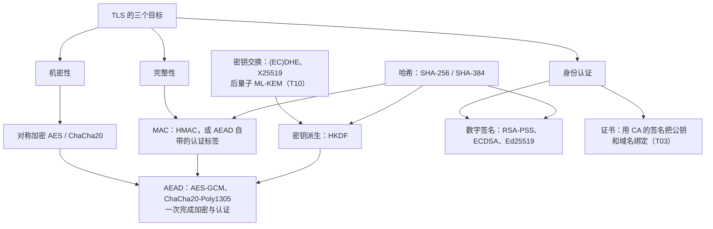
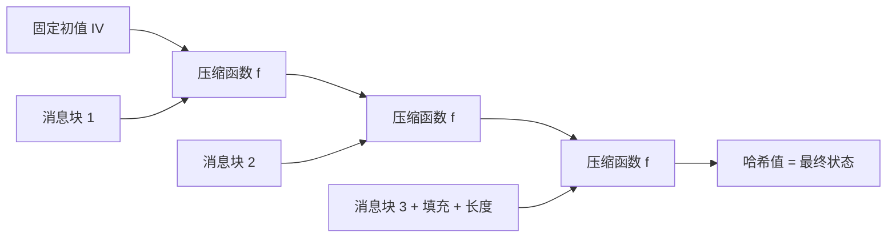
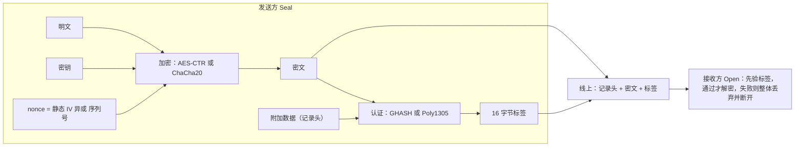
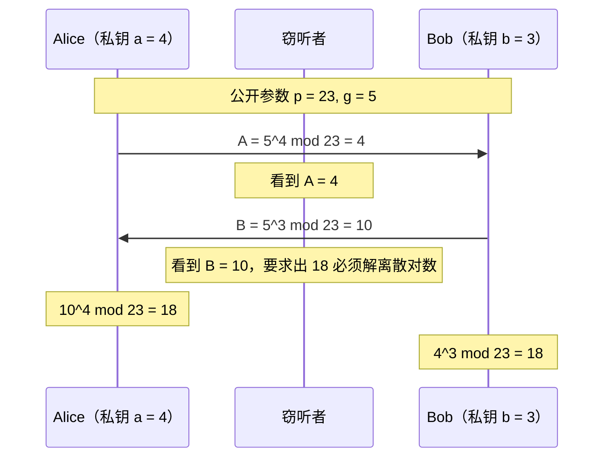
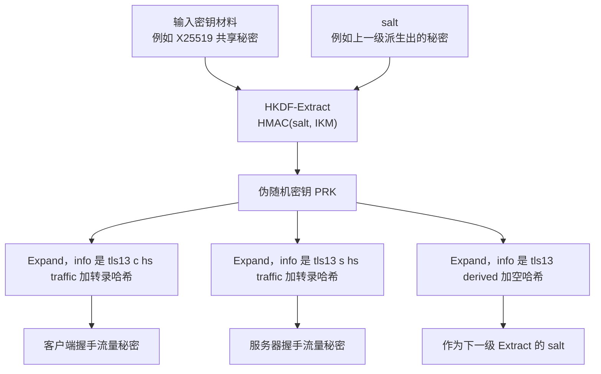
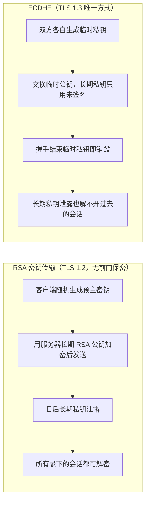

# T02 · 密码学基础：TLS 用到的每一种算法

> 系列：[[00_TLS系列总览与学习路线|TLS 系列总览]] · 上一篇：[[T01_从HTTP到HTTPS_一次请求的全景|T01 一次请求的全景]] · 下一篇：[[T03_证书与PKI_信任从哪里来|T03 证书与 PKI]]
> 前置知识：模运算（同余）的基本概念，知道异或是什么。
> 主要标准：FIPS 180-4（SHA-2）、RFC 2104（HMAC）、FIPS 197（AES）、NIST SP 800-38D（GCM）、RFC 5116（AEAD 接口）、RFC 8439（ChaCha20-Poly1305）、RFC 8017（PKCS #1 v2.2）、RFC 7919（FFDHE 组）、RFC 7748（X25519/X448）、FIPS 186-5（ECDSA、EdDSA）、RFC 8032（EdDSA）、RFC 5869（HKDF）
> 整理日期：2026-10-16

TLS 要在不安全的网络上同时做到机密性、完整性和身份认证，它手里的工具不多，也就十来种密码学原语，但每一种都有明确的分工。这一篇按"它解决什么问题、数学上为什么成立、TLS 里用在哪、历史上在哪摔过跟头"的顺序把它们过一遍。文中的小数字例子都用程序验算过，真实参数的规模另外标出。后量子算法单独放在 [[T10_后量子TLS_ML-KEM混合密钥交换与MTC|T10]]。

先给全局分工，后面每节展开：



一句话串起来：握手里用密钥交换算法让双方得到同一个共享秘密，用签名和证书证明服务器身份，用哈希把整个握手过程压成一个摘要以便签名和校验，用 HKDF 从共享秘密里派生出一组互不相关的密钥，之后每一条数据记录都用 AEAD 加密并认证。

## 哈希：把任意长的数据压成固定长的指纹

密码学哈希函数 H 把任意长度的输入映射成固定长度的输出，SHA-256 输出 32 字节，SHA-384 输出 48 字节。它要满足三条性质。抗原像：给定输出 y，找不到 x 使 H(x) = y。抗第二原像：给定 x，找不到另一个 x' 使 H(x') = H(x)。抗碰撞：找不到任意一对不同的 x、x' 使它们的哈希相同。对 n 比特输出，暴力找原像要约 2^n 次尝试，找碰撞因为生日悖论只要约 2^(n/2) 次，所以 SHA-256 的抗碰撞强度是 128 比特，这也是它和 AES-128、X25519 搭配的原因。

SHA-2 家族（FIPS 180-4）的内部结构是 Merkle-Damgård：把消息补齐到块长的整数倍，从一个固定初值出发，每次把一个消息块和当前状态喂给压缩函数，得到新状态，最后的状态就是哈希值。



这个结构有一个直接后果，叫长度扩展（length extension）：哈希值就是最终的内部状态，知道 H(m) 和 m 的长度，不知道 m 本身，也能接着算出 H(m || 填充 || m') 。所以"把密钥拼在消息前面再哈希"即 H(K || m) 不能当消息认证码用，攻击者可以在不知道 K 的情况下伪造出合法的扩展消息。这正是 HMAC 要绕开的坑。SHA-3（基于海绵结构）没有这个问题，但 TLS 1.3 的五个密码套件只用 SHA-256 和 SHA-384。

TLS 里哈希无处不在：TLS 1.3 用它维护整个握手的转录哈希（transcript hash），签名和 Finished 都是对这个摘要做的；HKDF 和 HMAC 建立在它之上；证书签名是对证书内容的哈希签名。SHA-1 和 MD5 的碰撞已被实际构造出来（2017 年 SHAttered 给出了第一对 SHA-1 碰撞 PDF），它们在 TLS 1.3 的签名里已经完全禁用。

## HMAC：带密钥的指纹

消息认证码（MAC）回答的问题是：这段数据是不是掌握同一把密钥的人发的，路上有没有被改过。HMAC（RFC 2104）用一个哈希函数构造 MAC：

```
HMAC(K, m) = H( (K' ⊕ opad) || H( (K' ⊕ ipad) || m ) )

K'   = 密钥补齐到哈希的块长（SHA-256 是 64 字节），太长则先哈希
ipad = 0x36 重复到块长
opad = 0x5c 重复到块长
```

两层嵌套正是为了堵长度扩展：外层哈希的输入是内层哈希的结果加上另一个密钥派生值，攻击者拿到 HMAC 输出，没法从中恢复内层状态继续扩展。HMAC 的安全性可以归约到压缩函数是伪随机函数这一假设上，即使底层哈希的抗碰撞性受损，HMAC 往往仍然安全，所以 HMAC-MD5 在 MD5 被攻破碰撞之后很长一段时间里并没有直接崩。

TLS 1.2 的 CBC 类密码套件用 HMAC 给每条记录做完整性校验；TLS 1.2 的 PRF、TLS 1.3 的 HKDF 和 Finished 消息都以 HMAC 为基础。TLS 1.3 里记录本身的完整性改由 AEAD 提供，HMAC 退到密钥派生和握手校验的位置。

## 对称加密：AES 与分组模式

对称加密用同一把密钥加密和解密，速度快，用来保护真正的数据。AES（FIPS 197）是一个分组密码：输入 16 字节明文块和一把 16、24 或 32 字节的密钥，输出 16 字节密文块。它内部重复若干轮（AES-128 是 10 轮，AES-256 是 14 轮），每轮做四件事：按一张固定的 S 盒逐字节替换（SubBytes，提供非线性），按行循环移位（ShiftRows），按列做有限域 GF(2^8) 上的矩阵乘法（MixColumns，让一个字节的变化扩散到整列），再和这一轮的轮密钥异或（AddRoundKey）。几轮之后，明文的每一个比特都以复杂的方式依赖于密钥的每一个比特，至今没有比暴力穷举快得多的实际攻击。现代 x86 和 ARM 处理器都有 AES 专用指令（AES-NI、ARMv8 Crypto Extensions），一个核每秒能加密数 GB。

分组密码一次只处理 16 字节，要加密任意长的数据就需要一个工作模式。ECB 模式把每个块独立加密，相同的明文块得到相同的密文块，著名的"ECB 企鹅"图片在加密后仍然能看出轮廓，所以从不用于 TLS。CBC 模式让每个明文块先和上一个密文块异或再加密，第一个块和随机初始向量（IV）异或。TLS 1.0 的 CBC 用上一条记录的最后一个密文块当下一条记录的 IV，IV 因此可预测，这正是 2011 年 BEAST 攻击的入口；TLS 1.1 改成每条记录带显式随机 IV。CTR 模式把分组密码变成流密码：加密"nonce 加计数器"得到密钥流，再和明文异或，可以并行，也不需要填充。

CBC 在 TLS 里还有一个更深的问题：TLS 1.2 及以前的做法是先算 MAC、再填充、再加密（MAC-then-Encrypt）。接收方必须先解密、检查填充、再校验 MAC，这几步的成败和耗时差异会泄露信息。2002 年 Vaudenay 提出了填充预言攻击（padding oracle），2013 年 Lucky Thirteen 证明即使只有微小的时间差，也能逐字节恢复明文，2014 年 POODLE 则利用了 SSL 3.0 填充不受检查的缺陷。正确的组合是先加密再算 MAC（Encrypt-then-MAC，RFC 7366 为 TLS 补过这个扩展），而更彻底的答案是 AEAD。这些攻击的来龙去脉在 [[T04_从SSL到TLS13_协议演进与攻击史|T04]]。

## AEAD：一次完成加密和认证

AEAD（Authenticated Encryption with Associated Data，RFC 5116）把加密和认证合成一个不容易用错的接口：

```
Seal(key, nonce, plaintext, aad) -> ciphertext || tag
Open(key, nonce, ciphertext || tag, aad) -> plaintext 或 失败
```

aad（associated data，附加数据）是需要认证但不需要加密的数据，比如记录头。解密时只要密文、标签、nonce、aad 有任何一处不对，Open 就整体失败，不会吐出任何一部分明文，于是填充预言这类问题从接口层面消失了。TLS 1.3 只允许 AEAD 密码套件，一共五个：

| 套件 | 码点 | AEAD | 哈希 |
| --- | --- | --- | --- |
| TLS_AES_128_GCM_SHA256 | 0x1301 | AES-128-GCM | SHA-256 |
| TLS_AES_256_GCM_SHA384 | 0x1302 | AES-256-GCM | SHA-384 |
| TLS_CHACHA20_POLY1305_SHA256 | 0x1303 | ChaCha20-Poly1305 | SHA-256 |
| TLS_AES_128_CCM_SHA256 | 0x1304 | AES-128-CCM | SHA-256 |
| TLS_AES_128_CCM_8_SHA256 | 0x1305 | AES-128-CCM，8 字节标签 | SHA-256 |

前三个是实际部署的主力，CCM 主要见于物联网设备。注意 TLS 1.3 的套件名里不再有密钥交换和签名算法，那两样改由独立的扩展协商（见 [[T06_TLS13握手与密钥调度逐包拆解|T06]]）。

AES-GCM（NIST SP 800-38D）由两部分组成：用 CTR 模式加密数据；用 GHASH 计算认证标签。GHASH 把附加数据和密文按 16 字节分块，看成有限域 GF(2^128) 上的元素，以哈希子密钥 H = AES_K(0^128) 为未知数求一个多项式的值，再和 AES_K(nonce 派生的初始计数块) 异或得到 16 字节标签。数学上它是一个以 H 为点的多项式求值，有乘法指令（PCLMULQDQ）时非常快。GCM 的 nonce 是 12 字节，TLS 1.3 用"每条记录的序列号异或静态 IV"构造它，保证同一把密钥下 nonce 永不重复。

nonce 不重复是 GCM 的生命线。同一把密钥下如果两次使用同一个 nonce，两段密文用的是同一条密钥流，异或一下就得到两段明文的异或；更糟的是，攻击者可以由此解出 GHASH 的子密钥 H，从而对任意消息伪造合法标签。2016 年的一项互联网扫描在 HTTPS 服务器上找到了 184 台重复使用 GCM nonce 的设备（Böck 等，"Nonce-Disrespecting Adversaries"），这是实现错误而非算法缺陷，但足以说明为什么 TLS 1.3 把 nonce 的构造写死在协议里，不交给实现自由发挥。

ChaCha20-Poly1305（RFC 8439）是另一条路线。ChaCha20 是 Daniel Bernstein 设计的流密码，状态是 16 个 32 位字（常数、256 位密钥、32 位块计数器、96 位 nonce），每个 64 字节的密钥流块经过 20 轮只用加法、异或和循环移位（ARX）的"四分之一轮"运算产生。它不需要查表，天然恒定时间，在没有 AES 硬件指令的设备上比软件实现的 AES 快得多，也不容易出现缓存时序侧信道。Poly1305 是一次性认证码：用 ChaCha20 第 0 个块的前 32 字节作为一次性密钥 (r, s)，把消息分块看成模素数 2^130 - 5 的整数，计算以 r 为点的多项式值再加 s。Google 在 2014 年前后把它引入 Chrome 和自家服务器，主要就是为了当时没有 AES 指令的安卓手机。服务端常见的做法是：如果客户端的 cipher_suites 把 ChaCha20 排在 AES-GCM 前面（说明客户端多半没有 AES 硬件），就选 ChaCha20，否则选 AES-GCM。



AEAD 还有一个容易被忽略的使用上限：同一把密钥加密的数据量不能无限大，否则区分攻击的优势会累积。RFC 8446 §5.5 给出 AES-GCM 每把密钥大约 2^24.5 条满长记录的建议上限，超过之前要用 KeyUpdate 换密钥；ChaCha20-Poly1305 的上限高到实际不会触及。

## 公钥密码：RSA

对称加密要求双方事先共享密钥，而在互联网上和陌生服务器通信时恰恰没有这个前提。公钥密码给每个人一对密钥：公钥公开，私钥保密，用公钥加密的只有私钥能解，用私钥签名的谁都能用公钥验证。

RSA（1977）的数学基础是：两个大素数相乘很容易，把乘积分解回去很难。密钥生成选两个大素数 p、q，计算 n = pq 和 φ(n) = (p-1)(q-1)，选公钥指数 e（实际几乎总是 65537），求私钥指数 d 使 e·d ≡ 1 (mod φ(n))。加密 c = m^e mod n，解密 m = c^d mod n。之所以能解回来，是因为由欧拉定理 m^(e·d) = m^(1 + kφ(n)) ≡ m (mod n)。

一个能手算验证的小例子：取 p = 61、q = 53，得 n = 3233、φ(n) = 3120。取 e = 17，求得 d = 2753，因为 17 × 2753 = 46801 = 15 × 3120 + 1。加密消息 m = 65：c = 65^17 mod 3233 = 2790；解密 2790^2753 mod 3233 = 65，回到原文。真实的 RSA 用 2048 位或 3072 位的 n，也就是两个各 1024 或 1536 位的素数；分解 2048 位 n 的最好算法（数域筛）在经典计算机上远远不可行，等效安全强度约 112 比特，3072 位约 128 比特。

教科书 RSA 不能直接用。它是确定性的（同一明文总得到同一密文），而且有乘法同态性，攻击者可以构造相关密文。所以实际使用时必须加填充。PKCS #1 v1.5 加密填充（RFC 8017 §7.2）是 TLS 1.2 及以前 RSA 密钥传输用的格式：`00 02 | 随机非零字节 | 00 | 消息`。1998 年 Bleichenbacher 发现，只要服务器对"解密后填充格式对不对"给出可区分的反应，攻击者发送大约百万个精心构造的密文，就能解出任意一个密文，这就是"百万消息攻击"。此后二十年，这个攻击以各种变体反复出现，2017 年的 ROBOT 发现很多大厂的 TLS 实现仍然可以被它攻破。OAEP（RFC 8017 §7.1）是可证明安全的加密填充，PSS（RFC 8017 §8.1）是可证明安全的签名填充。

在 TLS 里 RSA 曾经身兼两职。一是密钥传输：TLS 1.2 的 RSA 密钥交换中，客户端生成一个随机的预主密钥，用服务器证书里的 RSA 公钥加密后发给服务器。这个用法的致命问题是没有前向保密：服务器私钥一旦泄露，过去录下的所有流量都能被解密。二是签名：服务器用 RSA 私钥对握手签名，证明自己是证书的持有者。TLS 1.3 彻底删除了 RSA 密钥传输，RSA 只保留签名一个用途，并且握手中的 RSA 签名必须用 PSS（`rsa_pss_rsae_sha256` 等），PKCS #1 v1.5 签名只允许出现在证书本身的签名里（RFC 8446 §4.2.3）。

## Diffie-Hellman：在公开信道上谈出共享秘密

1976 年 Diffie 和 Hellman 提出的密钥交换，解决的是一个看上去不可能的问题：两个人在所有对话都被人听着的情况下，能不能谈出一个只有他们知道的秘密？

在有限域版本里，双方公开约定一个大素数 p 和生成元 g。Alice 随机选私钥 a，发出 A = g^a mod p；Bob 随机选私钥 b，发出 B = g^b mod p。Alice 计算 B^a = g^(ab) mod p，Bob 计算 A^b = g^(ab) mod p，两人得到同一个数。窃听者看到 p、g、A、B，但要从 A 求出 a，就是离散对数问题，在精心选择的大素数下没有已知的高效算法。

小数字例子：p = 23、g = 5。Alice 选 a = 4，发出 A = 5^4 mod 23 = 4；Bob 选 b = 3，发出 B = 5^3 mod 23 = 10。Alice 算 10^4 mod 23 = 18，Bob 算 4^3 mod 23 = 18，共享秘密是 18。



DH 本身不认证任何人：中间人可以分别和两边各做一次 DH，两边都以为在和对方说话。所以 TLS 总是把 DH 和签名绑在一起用，服务器要对自己发出的 DH 公钥（TLS 1.2 是对 ServerKeyExchange 里的参数，TLS 1.3 是对整个握手转录）签名。

"每次连接都用全新的随机私钥、用完即弃"的 DH 叫临时 DH（ephemeral DH，DHE），这是前向保密的来源，后面单独讲。有限域 DH 的参数选择是个坑：太短的素数可以被预计算攻破，2015 年 Logjam 攻击表明 512 位的"出口级" DH 可以在线破解，并估计国家级对手有能力预计算破解当时大量服务器共用的少数几个 1024 位素数。RFC 7919 为 TLS 规定了一组标准化的安全素数组（ffdhe2048、ffdhe3072 等）。今天的 TLS 基本都改用椭圆曲线版本，有限域 DH 已很少见。

## 椭圆曲线：更短的密钥，同样的难题

椭圆曲线密码用另一种群代替模 p 乘法群。在一个有限域上，满足 y^2 = x^3 + ax + b 的所有点，再加上一个无穷远点 O，构成一个群。群运算是"加点"：几何直觉是过两点作直线，与曲线交于第三点，再关于 x 轴对称，得到两点之和；一个点和自己相加用切线。标量乘法 kP 就是把 P 加上自己 k 次（实际用"倍加"算法，只需要约 log k 步）。正向算 kP 很快，已知 P 和 kP 反求 k 就是椭圆曲线离散对数问题（ECDLP），目前最好的通用算法也要约 √n 步。所以 256 位的椭圆曲线就能提供约 128 比特安全强度，而有限域 DH 和 RSA 要 3072 位。

一个小曲线上的例子：在模 17 的有限域上取曲线 y^2 = x^3 + 2x + 2，基点 G = (5, 1)，它生成的子群阶为 19：2G = (6, 3)，3G = (10, 6)，……，18G = (5, 16)，19G = O。ECDH 的做法和 DH 完全对应：Alice 选 a = 3，公开 A = 3G = (10, 6)；Bob 选 b = 10，公开 B = 10G = (7, 11)。Alice 算 3B，Bob 算 10A，都等于 30G = 11G = (13, 10)，共享秘密取这个点的 x 坐标 13。

TLS 里常见的曲线有两类。NIST 曲线 P-256 和 P-384（secp256r1、secp384r1）是 Weierstrass 形式的素域曲线，部署最广，政府合规场景常要求。它们的实现要小心：接收到对方的公钥点必须检查它确实在曲线上，否则攻击者可以送来一个落在弱曲线上的点，逐步套出私钥（无效曲线攻击，invalid curve attack）。2015 年就有研究在多个 TLS 库里发现过这类漏洞。

X25519（RFC 7748）是 Bernstein 在 2006 年设计的 Curve25519 上的 DH 函数，现在是 TLS 1.3 里使用最多的密钥交换组。它的设计目标就是"难以实现错"：用 Montgomery 曲线 y^2 = x^3 + 486662x^2 + x 定义在素数 2^255 - 19 上，只用 x 坐标做 Montgomery 阶梯（ladder）运算，天然恒定时间；任意 32 字节字符串都可以当作公钥输入，不需要像 P-256 那样做点校验（RFC 8446 §7.4.2 仍要求检查算出的共享秘密不是全零）；私钥在使用前固定清掉低 3 位和最高位、设置第 254 位（clamping），避开小子群问题。公钥和私钥都是 32 字节，比 P-256 的非压缩点 65 字节小一半。TLS 1.3 的 key_share 里，X25519 的公钥就是这 32 字节。

## 数字签名：证明"这是我说的"

签名用私钥生成、用公钥验证，回答的是"这段数据确实出自私钥持有者、并且没有被改过"。TLS 里签名出现在两处：证书里，CA 用自己的私钥给证书内容签名；握手里，服务器用证书对应的私钥给握手过程签名（TLS 1.3 的 CertificateVerify）。

RSA 签名是解密运算的镜像：对消息哈希做填充后算 s = pad(H(m))^d mod n，验证者算 s^e mod n 并检查填充和哈希。PKCS #1 v1.5 签名填充是确定性的，有过实现层面的伪造问题（2006 年 Bleichenbacher 指出部分实现在 e = 3 时解析填充过于宽松，可以伪造签名）；PSS 加入随机盐，有安全性证明。

ECDSA（FIPS 186-5）在椭圆曲线上签名。签名者每次选一个随机数 k，计算点 kG 的 x 坐标模 n 得到 r，再算 s = k^(-1)(H(m) + r·d) mod n，签名是 (r, s)。这里的 k 必须真正随机、绝不重复、绝不泄露。只要两个签名用了同一个 k，从两个方程里就能直接解出私钥 d。2010 年 fail0verflow 团队正是这样恢复出了索尼 PS3 的固件签名私钥，因为索尼的实现每次都用同一个 k；2013 年安卓系统随机数生成器的缺陷也让一批比特币钱包的 ECDSA 私钥被算出。即使 k 不重复，只要 k 的少数几个比特有偏差，用格方法也能恢复私钥。RFC 6979 提出了用私钥和消息哈希确定性地生成 k 的方法来规避这个风险。

EdDSA（RFC 8032）里最常用的是 Ed25519，它在设计上就把"随机数"拿掉了：nonce 由私钥派生出的一段秘密和消息一起哈希得到，同一消息永远得到同一签名，不同消息几乎不可能撞上同一 nonce，彻底消除了 ECDSA 的那类事故。Ed25519 公钥 32 字节、签名 64 字节，验证快，实现简单。TLS 1.3 的 signature_algorithms 里包含 `ed25519`（0x0807），但公共 Web PKI 里 CA 签发的证书至今仍以 RSA 和 ECDSA P-256/P-384 为主，因为 CA/B Forum 的基线要求和各大根程序对 EdDSA 证书的支持来得很晚。

| 算法 | 公钥大小 | 签名大小 | 经典安全强度 | TLS 1.3 中的码点示例 |
| --- | --- | --- | --- | --- |
| RSA-2048 PSS | 256 字节模数 | 256 字节 | 约 112 比特 | rsa_pss_rsae_sha256（0x0804） |
| ECDSA P-256 | 65 字节（非压缩点） | 约 70 到 72 字节（DER 编码） | 约 128 比特 | ecdsa_secp256r1_sha256（0x0403） |
| Ed25519 | 32 字节 | 64 字节 | 约 128 比特 | ed25519（0x0807） |

## HKDF：从一个秘密里长出一组密钥

DH 算出来的共享秘密不能直接当 AES 密钥用：它的分布不均匀（是群里的一个元素，而不是均匀随机的比特串），长度也未必合适，而且一次握手需要好几把互不相关的密钥（客户端发送用、服务器发送用、握手阶段用、应用数据阶段用、会话恢复用）。密钥派生函数（KDF）就是干这件事的。

HKDF（RFC 5869）是基于 HMAC 的两步式 KDF，"先提取、再扩展"：

```
提取：PRK = HKDF-Extract(salt, IKM) = HMAC-Hash(salt, IKM)
扩展：T(0) = 空串
      T(i) = HMAC-Hash(PRK, T(i-1) || info || i)，i 用一个字节表示
      OKM  = T(1) || T(2) || ... 截取前 L 字节
```

提取一步把可能分布不均的输入密钥材料（IKM，比如 DH 共享秘密）浓缩成一把均匀的伪随机密钥 PRK；扩展一步用不同的 info 字符串从同一个 PRK 里派生出任意多把彼此独立的密钥。只要 info 不同，派生出的密钥在计算上就互不相关，知道其中一把也推不出另一把，这叫密钥分离（key separation）。

RFC 5869 附录 A 的第 1 组测试向量可以直接用来校对实现：IKM 是 22 个 0x0b 字节，salt 是 0x00 到 0x0c 共 13 字节，info 是 0xf0 到 0xf9，L = 42。用 SHA-256 算出 PRK = `077709362c2e32df0ddc3f0dc47bba6390b6c73bb50f9c3122ec844ad7c2b3e5`，OKM = `3cb25f25faacd57a90434f64d0362f2a2d2d0a90cf1a5a4c5db02d56ecc4c5bf34007208d5b887185865`（这两个值在本机用 Node.js 的 `crypto.hkdfSync` 复算过，与 RFC 一致）。

TLS 1.3 的整个密钥调度就是一串 HKDF：它定义了 `HKDF-Expand-Label`，把标签写成 `"tls13 " + 用途名`（比如 `"tls13 c hs traffic"`），连同当时的转录哈希一起作为 info，从一条主链上依次派生出握手密钥、应用密钥、恢复密钥、导出密钥。这棵推导树是 [[T06_TLS13握手与密钥调度逐包拆解|T06]] 的重点。TLS 1.2 用的是另一种构造，叫 PRF（基于 HMAC 的 P_hash 迭代），在 [[T05_TCP三次握手与TLS12握手逐包拆解|T05]] 里讲。



## 前向保密：今天的私钥泄露，不该解开昨天的流量

前向保密（forward secrecy，也叫完美前向保密 PFS）指的是：即使服务器的长期私钥日后泄露，攻击者也无法解密在泄露之前录下来的会话。

用 RSA 密钥传输时做不到这一点。预主密钥是用服务器的长期 RSA 公钥加密的，谁拿到私钥，谁就能解开所有录下来的握手，推出每个会话的密钥。考虑到"先录下来、以后再解"是现实中真实存在的做法（2013 年斯诺登文件披露的大规模流量采集让业界对此警觉），这是不可接受的。

用临时 DH（DHE、ECDHE）时，会话密钥来自双方每次随机生成、用完就丢弃的 DH 私钥，长期私钥只用来签名，证明身份，不参与密钥的生成。录下来的流量里只有 DH 公钥，要解密必须解出 DH 私钥，而它们早已不存在。泄露的长期私钥只能让攻击者冒充服务器进行未来的连接，不能回溯。



TLS 1.3 把前向保密变成了强制项：完整握手只能用 (EC)DHE；会话恢复时，`psk_dhe_ke` 模式在 PSK 之外再做一次 DH 来保住前向保密，只有纯 PSK 模式和 0-RTT 早期数据例外，这个例外在 [[T07_会话恢复_0-RTT与握手性能优化|T07]] 里细说。TLS 1.2 时代还有一个容易被忽视的漏洞：会话票据（session ticket）是用服务器的一把票据密钥加密的，如果这把密钥长期不换，它就成了一把新的"长期私钥"，偷到它就能解开所有用票据恢复的会话，所以票据密钥必须频繁轮换。

## 随机数：一切的根基

上面所有算法都默认有高质量的随机数：TLS 握手里的 32 字节 random、DH 私钥、ECDSA 的 k、会话票据、填充。随机数出问题，再强的算法也一起完蛋。

两个真实的教训。2006 年 Debian 的维护者为了消除一个内存检查工具的警告，删掉了 OpenSSL 里两行把熵加入随机池的代码，结果此后近两年里 Debian 和 Ubuntu 系统生成的所有密钥，熵基本只来自进程号，总共只有约三万多种可能，2008 年被发现时，所有受影响的 SSH 和 TLS 密钥都必须作废重建。另一个是 Dual_EC_DRBG：NIST 曾标准化的一个基于椭圆曲线的随机数生成器，其常数的来源无法解释，2013 年斯诺登文件显示它很可能被植入了后门，2015 年 Juniper 的防火墙被发现其中的参数被人替换，可以被动解密 VPN 流量。今天的做法是使用操作系统的 CSPRNG（Linux 的 `getrandom`、macOS 的 `SecRandomCopyBytes` 等），不要自己造。

TLS 1.3 的 ServerHello.random 还被赋予了一个额外的职责：当服务器支持 TLS 1.3 却被迫协商较低版本时，它要在 random 的最后 8 字节写入固定的哨兵值，客户端据此识别降级攻击（RFC 8446 §4.1.3），见 [[T06_TLS13握手与密钥调度逐包拆解|T06]]。

## 安全强度对照

不同算法的密钥长度不能直接比，要换算成"攻击者需要多少次基本运算"的比特数。下表是常用的经典计算机下的对照（参考 NIST SP 800-57 第 1 部分），量子计算机的影响见 T10：

| 安全强度 | 对称加密 | 哈希（抗碰撞） | RSA / 有限域 DH | 椭圆曲线 |
| --- | --- | --- | --- | --- |
| 约 112 比特 | 3DES（已淘汰） | SHA-224 | 2048 位 | 224 位 |
| 约 128 比特 | AES-128 | SHA-256 | 3072 位 | P-256、X25519 |
| 约 192 比特 | AES-192 | SHA-384 | 7680 位 | P-384 |
| 约 256 比特 | AES-256 | SHA-512 | 15360 位 | P-521（X448 约 224 比特，介于两档之间） |

TLS 的密码套件和参数选择通常让各环节强度大致匹配：TLS_AES_128_GCM_SHA256 配 X25519 和 ECDSA P-256 是 128 比特一档，TLS_AES_256_GCM_SHA384 配 P-384 是 192 比特一档。一条链的强度由最弱的一环决定，配 AES-256 却用 RSA-2048 签名，整体仍是 112 比特一档。

## 常见误解

加密就够了，不需要单独的完整性保护。不认证的加密是可塑的：CTR 和流密码模式下翻转密文的一个比特，就精确翻转明文的对应比特，攻击者可以在不知道内容的情况下篡改数据。TLS 历史上最多的漏洞恰恰出在加密和认证的组合方式上，这是 AEAD 成为唯一选项的原因。

公钥加密用来加密数据。公钥运算比对称加密慢几个数量级，TLS 从不用它加密应用数据。公钥密码在 TLS 里只做两件事：协商出一个共享秘密（密钥交换），证明身份（签名）。数据永远由对称的 AEAD 保护。

RSA 密钥越长越好，所以 4096 位比 2048 位安全很多。4096 位确实更难分解，但签名和解密的耗时大约是 2048 位的 6 到 8 倍，证书也更大，会拖慢握手。对抗经典计算机，3072 位已经提供 128 比特强度；对抗量子计算机，任何长度的 RSA 都不够，正确的方向是迁移到后量子算法（T10）。

用了 ECDHE 就自动有前向保密。前向保密要求临时私钥真的"用完即弃"。如果服务器为了省 CPU 在很长时间里复用同一个 ECDHE 私钥，或者会话票据密钥长期不轮换，前向保密在实践中就打了折扣。

哈希就是加密。哈希是单向的、没有密钥，不能解密；它提供的是指纹和完整性的基础。把密码"加密存储"成 SHA-256 是两个概念的混淆，口令存储应该用专门的慢哈希（Argon2、scrypt、bcrypt），这和 TLS 无关，但同样是常见的误用。

## 本篇引用的标准与资料

- FIPS 180-4, Secure Hash Standard (SHS), https://csrc.nist.gov/pubs/fips/180-4/upd1/final
- RFC 2104, HMAC: Keyed-Hashing for Message Authentication, https://www.rfc-editor.org/rfc/rfc2104
- FIPS 197, Advanced Encryption Standard (AES), https://csrc.nist.gov/pubs/fips/197/final
- NIST SP 800-38D, Galois/Counter Mode (GCM) and GMAC, https://csrc.nist.gov/pubs/sp/800/38/d/final
- RFC 5116, An Interface and Algorithms for Authenticated Encryption, https://www.rfc-editor.org/rfc/rfc5116
- RFC 8439, ChaCha20 and Poly1305 for IETF Protocols, https://www.rfc-editor.org/rfc/rfc8439
- RFC 7366, Encrypt-then-MAC for TLS and DTLS, https://www.rfc-editor.org/rfc/rfc7366
- RFC 8017, PKCS #1: RSA Cryptography Specifications Version 2.2, https://www.rfc-editor.org/rfc/rfc8017
- RFC 7919, Negotiated Finite Field Diffie-Hellman Ephemeral Parameters for TLS, https://www.rfc-editor.org/rfc/rfc7919
- RFC 7748, Elliptic Curves for Security（X25519、X448）, https://www.rfc-editor.org/rfc/rfc7748
- FIPS 186-5, Digital Signature Standard (DSS), https://csrc.nist.gov/pubs/fips/186-5/final
- RFC 8032, Edwards-Curve Digital Signature Algorithm (EdDSA), https://www.rfc-editor.org/rfc/rfc8032
- RFC 6979, Deterministic Usage of DSA and ECDSA, https://www.rfc-editor.org/rfc/rfc6979
- RFC 5869, HMAC-based Extract-and-Expand Key Derivation Function (HKDF), https://www.rfc-editor.org/rfc/rfc5869
- RFC 8446, The Transport Layer Security (TLS) Protocol Version 1.3（§4.1.3 降级保护、§4.2.3 签名算法、§5.5 密钥使用上限）, https://www.rfc-editor.org/rfc/rfc8446
- NIST SP 800-57 Part 1 Rev. 5, Recommendation for Key Management, https://csrc.nist.gov/pubs/sp/800/57/pt1/r5/final
- Böck, Zauner, Devlin, Somorovsky, Jovanovic, "Nonce-Disrespecting Adversaries: Practical Forgery Attacks on GCM in TLS", USENIX WOOT 2016, https://www.usenix.org/conference/woot16/workshop-program/presentation/bock
- Adrian 等, "Imperfect Forward Secrecy: How Diffie-Hellman Fails in Practice"（Logjam）, CCS 2015, https://weakdh.org/
- Böck, Somorovsky, Young, "Return Of Bleichenbacher's Oracle Threat (ROBOT)", USENIX Security 2018, https://robotattack.org/
