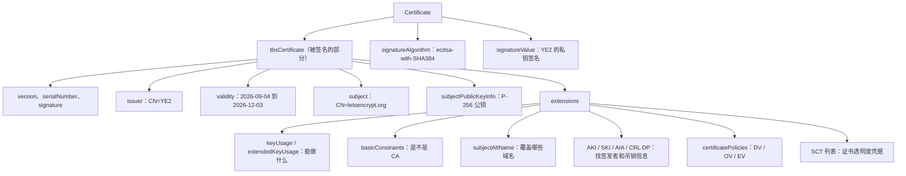
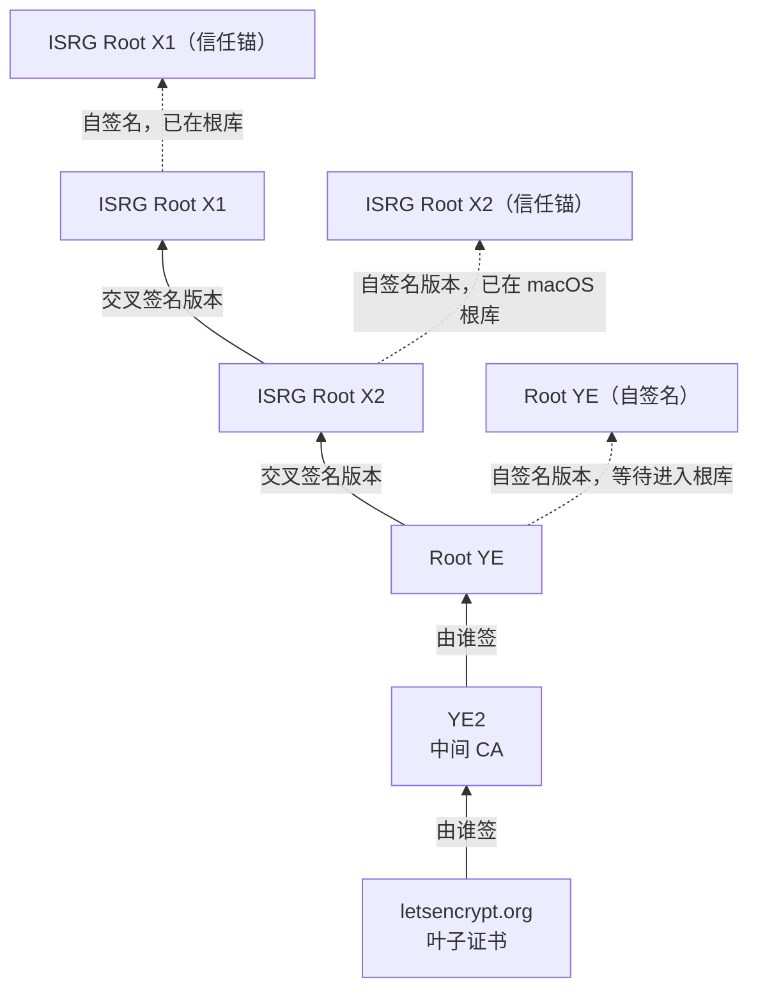
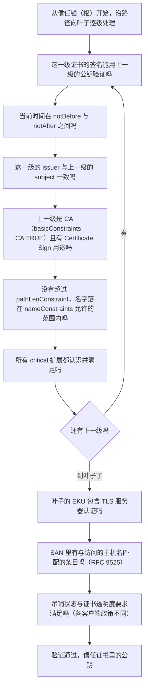
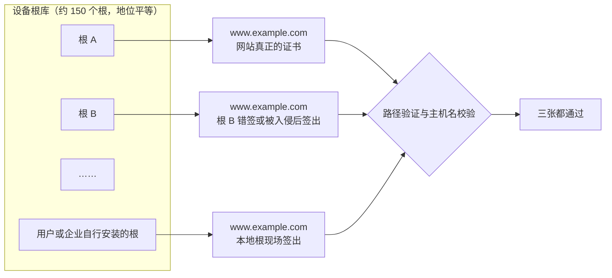
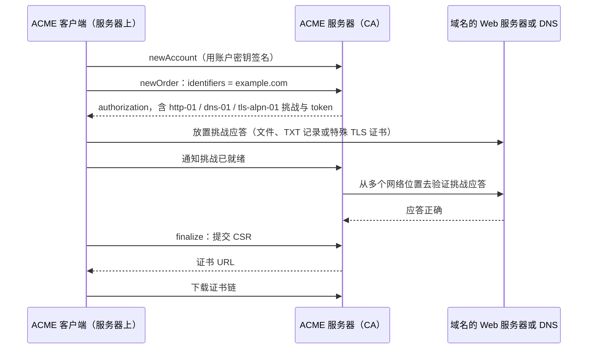
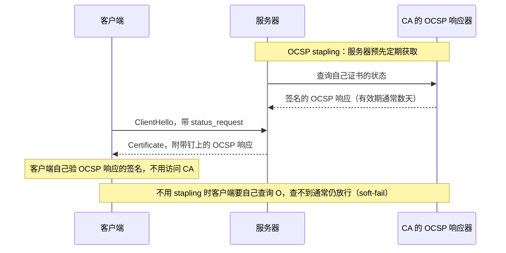
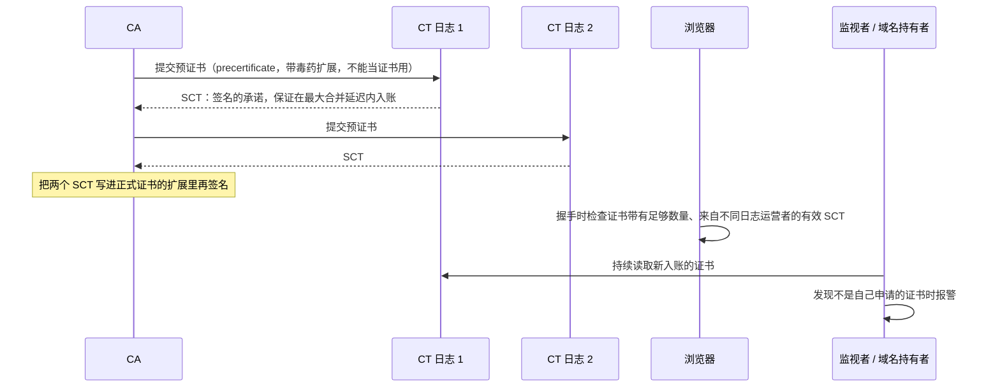

# T03 · 证书与 PKI：信任从哪里来

> 系列：[[00_TLS系列总览与学习路线|TLS 系列总览]] · 上一篇：[[T02_密码学基础_TLS用到的每一种算法|T02 密码学基础]] · 下一篇：[[T04_从SSL到TLS13_协议演进与攻击史|T04 协议演进与攻击史]]
> 前置知识：T02 的数字签名和哈希。
> 主要标准：RFC 5280（X.509 证书与 CRL）、RFC 9525（TLS 中的服务身份校验）、RFC 6960（OCSP）、RFC 6066 §8（OCSP stapling）、RFC 7633（Must-Staple）、RFC 6962 与 RFC 9162（证书透明度）、RFC 8659（CAA）、RFC 8555（ACME）、RFC 8737（TLS-ALPN-01）、CA/B Forum Baseline Requirements
> 整理日期：2026-10-16（文中真实证书于 2026-10-17 02:49 UTC 从 letsencrypt.org 抓取）

T02 讲了签名：用私钥签、用公钥验。可签名只证明"这段数据出自某把私钥"，并没有回答一个更根本的问题：这把公钥是谁的？TLS 握手里服务器会发来一把公钥，并用对应私钥签名证明它持有私钥，但如果攻击者拦在中间，换成自己的公钥和自己的签名，客户端照样验证通过，只是验证的对象变成了攻击者。证书和 PKI（Public Key Infrastructure，公钥基础设施）要解决的就是这个"公钥属于谁"的问题。这一篇从一张真实证书开始，讲它的结构、证书链怎么验证、根证书库凭什么被信任，然后专门讲清"这个根签出来的任何证书都会被信任"的含义和代价，最后是签发、吊销、证书透明度和证书寿命这些让体系保持可信的机制。

## 证书要解决什么问题

最直接的想法是让客户端事先知道每个网站的公钥，但世界上有上亿个网站，公钥还会更换，这条路走不通。证书的做法是引入一个双方都信任的第三方，证书颁发机构（CA，Certificate Authority）。CA 核实"申请者确实控制 `example.com`"之后，把"`example.com` 的公钥是这一把"这句话，连同有效期、用途等信息写成一个结构化的文档，再用 CA 自己的私钥签名，这个签了名的文档就是证书。客户端只要事先信任少数几个 CA 的公钥，就能验证任意网站的证书：验 CA 的签名，确认证书里的域名就是自己要访问的域名，就可以相信证书里的公钥属于这个域名的持有者。

于是信任被转移和压缩了：客户端不需要认识一亿个网站，只需要认识一百多个 CA。代价是，客户端对网站身份的判断，完全建立在"这些 CA 不会签错"的假设上。这一篇后半部分的大部分机制，都是在给这个假设打补丁。

## 一张真实的证书

先看一张真实的证书。下面是 2026-10-17 从 `letsencrypt.org` 抓到的服务器证书，用 OpenSSL 4.0.3 的 `openssl x509 -noout -text` 解出来，删去了公钥和签名的十六进制细节：

```
Certificate:
    Data:
        Version: 3 (0x2)
        Serial Number: 05:43:93:3b:e3:86:b3:a2:b3:ad:d5:34:f2:10:3b:c8:b6:5f
        Signature Algorithm: ecdsa-with-SHA384
        Issuer: C=US, O=Let's Encrypt, CN=YE2
        Validity
            Not Before: Sep  4 14:34:32 2026 GMT
            Not After : Dec  3 14:34:31 2026 GMT
        Subject: CN=letsencrypt.org
        Subject Public Key Info:
            Public Key Algorithm: id-ecPublicKey
                Public-Key: (256 bit field, 128 bit security level)
                ASN1 OID: prime256v1
                NIST CURVE: P-256
        X509v3 extensions:
            X509v3 Key Usage: critical
                Digital Signature
            X509v3 Extended Key Usage:
                TLS Web Server Authentication
            X509v3 Basic Constraints: critical
                CA:FALSE
            X509v3 Subject Key Identifier: 16:68:8D:1E:...
            X509v3 Authority Key Identifier: B9:59:F2:8E:...
            Authority Information Access:
                CA Issuers - URI:http://ye2.i.lencr.org/
            X509v3 Subject Alternative Name:
                DNS:cp.letsencrypt.org, DNS:cp.root-x1.letsencrypt.org, ...（共 11 个名字）
            X509v3 Certificate Policies:
                Policy: 2.23.140.1.2.1
            X509v3 CRL Distribution Points:
                URI:http://ye2.c.lencr.org/96.crl
            CT Precertificate SCTs:
                Signed Certificate Timestamp: Log ID D8:09:55:3B:...  Timestamp: Sep  4 15:33:02.377 2026 GMT
                Signed Certificate Timestamp: Log ID 46:AF:86:3D:...  Timestamp: Sep  4 15:33:02.552 2026 GMT
    Signature Algorithm: ecdsa-with-SHA384
    Signature Value: 30:65:02:31:00:ee:1d:b0:...
```

这张证书里能读出不少东西。签发者是 Let's Encrypt 的中间 CA `YE2`；有效期从 2026-09-04 到 2026-12-03，正好 90 天，这是 Let's Encrypt 目前默认的证书寿命；公钥是 P-256 椭圆曲线公钥；用途限定为数字签名和 TLS 服务器认证；它不是 CA（`CA:FALSE`），不能再给别人签证书；它覆盖 11 个域名；策略 OID `2.23.140.1.2.1` 表示这是一张域名验证（DV）证书；它带有两个来自不同证书透明度日志的时间戳；它有 CRL 分发点，却没有 OCSP 地址，这和 Let's Encrypt 在 2025 年关闭 OCSP 服务一致。下面逐项讲这些字段是什么。

## X.509 的结构

TLS 用的证书格式是 X.509 第 3 版，在互联网上的使用规范是 RFC 5280。它用 ASN.1 描述结构，用 DER（Distinguished Encoding Rules）编码成字节。最外层是三个字段：

```
Certificate ::= SEQUENCE {
    tbsCertificate       TBSCertificate,      -- 要被签名的内容
    signatureAlgorithm   AlgorithmIdentifier, -- 签发者用的签名算法
    signatureValue       BIT STRING           -- 签发者对 tbsCertificate 的签名
}

TBSCertificate ::= SEQUENCE {
    version         [0]  EXPLICIT Version DEFAULT v1,   -- v3 写作 2
    serialNumber         CertificateSerialNumber,       -- 签发者内唯一，CA/B 要求至少 64 位随机
    signature            AlgorithmIdentifier,           -- 必须与外层 signatureAlgorithm 一致
    issuer               Name,                          -- 签发者的名字
    validity             Validity,                      -- notBefore, notAfter
    subject              Name,                          -- 主体的名字
    subjectPublicKeyInfo SubjectPublicKeyInfo,          -- 算法 + 公钥，即 SPKI
    issuerUniqueID  [1]  IMPLICIT UniqueIdentifier OPTIONAL,
    subjectUniqueID [2]  IMPLICIT UniqueIdentifier OPTIONAL,
    extensions      [3]  EXPLICIT Extensions OPTIONAL   -- v3 扩展
}
```

tbs 是 to be signed 的缩写：CA 对 tbsCertificate 的 DER 字节做哈希再签名，结果放进 signatureValue。验证时客户端用签发者的公钥验这个签名，任何一个字节被改，签名就对不上。

DER 是一种 TLV（类型、长度、值）编码。上面这张证书 DER 编码后是 1098 字节，开头的字节是这样的：

```
偏移   字节                         含义
0      30 82 04 46                  SEQUENCE，长度用 2 字节表示：0x0446 = 1094，整张证书
4      30 82 03 cc                  SEQUENCE，长度 0x03cc = 972，tbsCertificate
8      a0 03 02 01 02               [0] 显式标签，内含 INTEGER 2，即 version = v3
13     02 12 05 43 93 ... b6 5f     INTEGER，长度 0x12 = 18 字节，序列号
33     30 0a 06 08 2a 86 48 ce      SEQUENCE 内含 OBJECT IDENTIFIER，长度 8
       3d 04 03 03                  1.2.840.10045.4.3.3 = ecdsa-with-SHA384
45     30 33 31 0b 30 09 06 03 ...  issuer 名字，开始是 C=US
```

`openssl asn1parse` 可以把整张证书按这个层次打印出来，[[T13_动手实验_用openssl与curl观察握手|T13]] 里有完整的操作。理解 DER 的意义在于：证书是一份精确的二进制文档，签名覆盖的是这些确切的字节；历史上不少证书验证漏洞（比如对名字字段里嵌入空字节的不同解析）都出在 ASN.1 解析不一致上。



## 扩展：证书真正说了什么

v3 扩展才是现代证书的主体。每个扩展有一个 OID、一个 critical 标志和一个值。critical 的含义是：如果验证方不认识这个扩展，必须拒绝整张证书，而不能忽略它（RFC 5280 §4.2）。

subjectAltName（SAN，RFC 5280 §4.2.1.6）列出证书覆盖的名字，可以是 DNS 名、IP 地址、邮箱等。主机名校验只看 SAN：subject 里的 CN（Common Name）以前也被用来写域名，但 RFC 9525（2023，取代 RFC 6125）明确规定 TLS 客户端不应再用 CN 做主机名匹配，Chrome 从 58 版（2017）起就只认 SAN。通配符 `*.example.com` 只匹配一层标签：能匹配 `www.example.com`，不能匹配 `example.com` 本身，也不能匹配 `a.b.example.com`。

basicConstraints（§4.2.1.9）说明这张证书是不是 CA，以及它下面还能有几层 CA（pathLenConstraint）。上面那张叶子证书是 `CA:FALSE`；它的签发者 YE2 是 `CA:TRUE, pathlen:0`，意思是 YE2 只能直接签叶子证书，不能再签下级 CA。2002 年前后，IE 等客户端曾经不检查这个字段，任何人拿一张普通网站证书就能当 CA 用，给任意域名签证书，这是 basicConstraints 必须严格检查的反面教材。

keyUsage（§4.2.1.3）和 extendedKeyUsage（§4.2.1.12）限定公钥的用途。叶子证书的 keyUsage 是 `Digital Signature`，表示这把 ECDSA 公钥只用来验签名（TLS 1.3 的 CertificateVerify）；用于 TLS 1.2 RSA 密钥传输的 RSA 证书还需要 `Key Encipherment`。EKU 是 `TLS Web Server Authentication`（OID 1.3.6.1.5.5.7.3.1），表示只能用于 TLS 服务器。中间证书和根证书的 keyUsage 里有 `Certificate Sign` 和 `CRL Sign`。

Authority Key Identifier 和 Subject Key Identifier（§4.2.1.1、§4.2.1.2）是公钥的标识符，用来在构建证书链时把"这张证书的 AKI"和"签发者证书的 SKI"对上，在签发者有多张同名证书时尤其重要。

Authority Information Access（AIA，§4.2.2.1）告诉客户端去哪里下载签发者的证书（CA Issuers），以及去哪里查询 OCSP。上面的证书只有 CA Issuers 一项。CRL Distribution Points（§4.2.1.13）给出吊销列表的下载地址。

certificatePolicies（§4.2.1.4）里的 OID 标明证书的验证等级，这些 OID 由 CA/B Forum 分配：`2.23.140.1.2.1` 是域名验证（DV），`2.23.140.1.2.2` 是组织验证（OV），`2.23.140.1.2.3` 是个人验证（IV），`2.23.140.1.1` 是扩展验证（EV）。

SCT 列表（OID 1.3.6.1.4.1.11129.2.4.2，RFC 6962 §3.3）装着证书透明度日志签发的时间戳，后面单独讲。

nameConstraints（§4.2.1.10）只出现在 CA 证书里，可以限定这个 CA 只能为某些域名签发（permittedSubtrees），或者禁止为某些域名签发（excludedSubtrees）。它是"把 CA 的权力收窄到指定范围"的标准手段，企业内部 CA 尤其该用它。

## 证书链：为什么需要中间证书

根 CA 的私钥是整个体系里最值钱的东西，泄露了就意味着它签过的一切都不可信。所以根 CA 的私钥通常放在离线的硬件安全模块（HSM）里，存放在物理隔离的机房，只在签发中间证书、签发 CRL 这类少数仪式性场合才启用。日常签发网站证书的工作交给中间 CA，中间 CA 的证书由根签发。中间 CA 出了问题，可以单独吊销或停用，而不必替换整个根，更换根需要所有操作系统和浏览器都更新根库，周期以年计。

这就形成了一条链：叶子证书（leaf，也叫终端实体证书）由中间证书签发，中间证书由根证书签发，根证书自己给自己签名（自签名），它的可信性不来自签名，而来自"它被预装在根库里"这件事。服务器在握手的 Certificate 消息里发送叶子证书和中间证书，根证书通常不发，因为客户端必须已经拥有它才可能信任它，发了也没用。

letsencrypt.org 在 2026-10-17 实际发送的链有四张证书：

```
 0 s:CN=letsencrypt.org                                   叶子，P-256，1098 字节
   i:C=US, O=Let's Encrypt, CN=YE2
 1 s:C=US, O=Let's Encrypt, CN=YE2                        中间 CA，P-384，pathlen:0，656 字节
   i:C=US, O=ISRG, CN=Root YE
 2 s:C=US, O=ISRG, CN=Root YE                             新一代根 Root YE（由 X2 交叉签名的版本），682 字节
   i:C=US, O=Internet Security Research Group, CN=ISRG Root X2
 3 s:C=US, O=Internet Security Research Group, CN=ISRG Root X2   X2（由 X1 交叉签名的版本），1140 字节
   i:C=US, O=Internet Security Research Group, CN=ISRG Root X1
```

这条链展示了一个重要的机制：交叉签名（cross-signing）。一个新的根 CA 刚建立时，还不在各家根库里，要等好几年才能被足够多的设备收录。在此期间，它请一个已经被广泛信任的老根给自己签一张证书，新根的公钥就有了两个版本的证书：一张自签名的（等着进根库），一张由老根签的（让老设备也能验证）。Let's Encrypt 自己就走过这条路：2015 年它的 ISRG Root X1 还没被信任时，靠 IdenTrust 的 DST Root CA X3 交叉签名起步；上面的链里，Root YE 由 ISRG Root X2 交叉签名，X2 又由 X1 交叉签名。本机 macOS 的系统根库里有 ISRG Root X1 和 X2，没有 Root YE，所以 macOS 会构建出 叶子、YE2、Root YE（X2 签的版本）、X2 这条路径，到 X2 停下，因为 X2 本身就是信任锚。



由此可以看出，"证书链"其实不是一条固定的链，而是一张图。服务器发来的是一包证书，客户端从叶子出发，在这包证书、本地缓存的中间证书、以及必要时按 AIA 地址下载的证书里搜索，找出一条能通到自己信任的任意一个根的路径，这叫路径构建（path building）。不同客户端的根库不同，构建出的路径可能不同，同一张叶子证书在一台设备上验证经过 X1，在另一台上经过 X2，都对。服务器漏发中间证书时，Chrome 和 Apple 平台会按 AIA 去下载补全，Firefox 则依赖预先内置的中间证书列表，命令行工具通常直接报错，这是"浏览器能打开、curl 报错"的常见原因。

## 路径验证：客户端到底检查了什么

找到候选路径后，客户端按 RFC 5280 §6 的路径验证算法逐级检查。简化后的步骤是：



注意最后两步不在 RFC 5280 的核心算法里：主机名匹配由 RFC 9525 规定，吊销检查的严格程度和证书透明度要求则由各家浏览器和操作系统自己的政策决定。还要注意一件事，这个算法里没有任何一步问"这个域名应该由哪家 CA 签发"。这正是下一节的主题。

## 根证书库与根程序

信任锚，也就是根证书，存放在根证书库（trust store）里。每个主要的平台都维护着自己的根库：Apple 的根库用于 macOS、iOS 及其上的 Safari 和大部分 App；Microsoft 的用于 Windows；Mozilla 的 NSS 根库用于 Firefox，也被大量 Linux 发行版和开源软件（包括 Homebrew 的 ca-certificates）当作事实标准；Google 从 2022 年起逐步让 Chrome 在各平台上使用自己的 Chrome Root Store，而不再依赖操作系统的根库。本机 2026-10-17 的实际数字是：macOS 系统根库 `/System/Library/Keychains/SystemRootCertificates.keychain` 里有 158 张根证书，Homebrew OpenSSL 使用的证书包里有 193 张。

一个 CA 要进入根库，要满足对应根程序（root program）的要求：遵守 CA/B Forum 的 Baseline Requirements（规定了域名验证方法、证书内容、有效期、密钥保护等），每年通过 WebTrust 或 ETSI 的独立审计，在公共数据库 CCADB 里披露自己的全部中间证书和审计报告，出了事故要按要求公开报告。根程序可以随时把不守规矩的 CA 移出，这是整个体系里最有力的惩戒手段，Symantec、Entrust 等事件都在 [[T12_HTTPS推广与信任治理|T12]] 里。

## "这个根签出来的任何证书都会被信任"

现在可以把这句话讲透了。

根库里的每一个根，在路径验证算法眼里地位完全平等。验证只问三件事：链能不能通到库里的某一个根，每一级签名、有效期、用途、约束是否都对，叶子证书里的名字是否与访问的域名匹配。它不问"`www.example.com` 平时用的是哪家 CA"，客户端也无从知道这一点。所以，库里任何一个根，或者任何一个根下面的任何一个中间 CA，只要签发了一张写着 `www.example.com` 的证书，这张证书在所有信任这个根的设备上就是合法的，不管 `example.com` 的主人是否知情、是否同意。"这个根签出来的任何证书"指的就是：一个根一旦进了你的根库，它签出来的、写着任何域名的证书，你的设备都会接受。



这带来一个结构性的弱点：整个 Web 的身份安全等于根库里最弱的那个 CA 的安全，所谓"最弱一环"。一百多个根、背后上千个中间 CA，分布在几十个国家，其中任何一个被入侵、被胁迫、或者流程出错，都可以为任何网站签出可用的证书。历史上这不是假设：

2011 年荷兰 CA DigiNotar 被入侵，攻击者签出了包括 `*.google.com` 在内的五百多张伪造证书。其中 `*.google.com` 的证书被用于在伊朗对约 30 万个 IP 的用户做中间人攻击（Fox-IT 事后调查报告的数字）。发现它靠的是 Chrome 内置的 Google 域名公钥固定：一位伊朗用户的 Chrome 报告证书与预期的公钥不符。DigiNotar 随后被所有主要浏览器和操作系统移出根库，几周后破产。

2012 年底，Google 又通过同样的固定机制发现了一张由土耳其 CA TURKTRUST 签发的 `*.google.com` 证书：TURKTRUST 在 2011 年误把两张本应是普通网站证书的证书签成了中间 CA 证书，其中一张被装进了一台防火墙，用来检查加密流量。2015 年，中国 CNNIC 签发给埃及 MCS Holdings 的一张中间证书被装进了中间人代理设备，同样被 Chrome 的固定机制发现，Google 和 Mozilla 随后停止信任 CNNIC 的根。2019 年哈萨克斯坦要求国民安装一个政府根证书，用来检查境内的 HTTPS 流量，Mozilla、Google、Apple 随即在浏览器里专门屏蔽了这个根。

同一个机制也解释了用户自己安装的根证书。企业的 TLS 检查代理、Charles、mitmproxy、Loon 这类调试工具，都要求你在设备上安装并信任它们生成的根证书。这个根一旦被信任，就成了这台设备根库中的一员，工具就能在每次连接时为你访问的那个域名现签一张证书，系统的路径验证照常通过。平台对此有专门的防护：iOS 安装描述文件之后，还要在"设置 > 通用 > 关于本机 > 证书信任设置"里手动开启完全信任，才会把它用于 TLS；Android 7.0 起，目标 API 级别为 24 及以上的 App 默认不信任用户安装的 CA，除非 App 在网络安全配置里主动声明（目标级别更低的旧 App 仍然信任）；证书透明度的要求只针对公共 CA，本地安装的根不受此约束，但也只对安装了它的这台设备有效。

整个行业为了收窄"任何根都能签任何域名"，叠加了好几层机制，每一层管的环节不同：

| 机制 | 在哪个环节起作用 | 怎么收窄 |
| --- | --- | --- |
| 证书透明度（CT） | 签发之后，事后发现 | 公共 CA 签出的每张证书必须进入公开日志，浏览器不接受没有 SCT 的证书，域名持有者可以监控有没有人为自己的域名签证书 |
| CAA 记录 | 签发之前，CA 检查 | 域名持有者在 DNS 里声明只允许哪些 CA 为它签发，其他 CA 必须拒绝 |
| nameConstraints | 验证时，客户端检查 | 把一个 CA 限定在指定的域名范围内，越界签发的证书验证失败 |
| 证书固定 | 验证时，App 自己检查 | App 只接受自己预先指定的公钥，见 T12 |
| 根程序治理 | 出事之后 | 把违规的 CA 移出根库，所有它签出的证书一起失效 |
| 短证书寿命 | 全程 | 错签或被盗的证书最多只能用到过期，2029 年起最长 47 天 |

这些机制没有一个能单独解决问题，CT 是事后发现，CAA 依赖 CA 守规矩，固定只对单个 App 有效。它们叠在一起，才让 DigiNotar 这类事件在今天难以悄无声息地发生。

## 验证等级：DV、OV、EV

CA 在签发前要核实申请者，核实到什么程度决定了证书的等级。DV（Domain Validation）只验证申请者控制这个域名，全自动，几分钟完成，Let's Encrypt 只签 DV。OV（Organization Validation）还要核实申请组织的真实存在，组织名会写进 subject。EV（Extended Validation）按 CA/B Forum 的 EV 指南做更严格的法律实体审查。

EV 曾经让浏览器在地址栏显示绿色的公司名，意在帮用户识别正规网站。但研究反复表明用户既不注意也不理解这个显示，研究者还演示过用同名的空壳公司拿到 EV 证书。2019 年 Chrome 77 和 Firefox 70 先后把 EV 的公司名移出了地址栏。今天从 TLS 的角度看，DV、OV、EV 提供的连接安全完全相同，差别只在 CA 签发前做了多少审查，以及证书里多写了哪些身份信息。

## 签发：ACME 把证书变成了自动化的事

在 Let's Encrypt 之前，申请证书是一套人工流程：生成 CSR，在 CA 网站上付款，按邮件里的链接验证域名，下载证书，手工装到服务器上，一两年后再来一遍。证书过期导致的网站故障因此屡见不鲜。2015 年 Let's Encrypt 和它推动标准化的 ACME 协议（Automatic Certificate Management Environment，2019 年发布为 RFC 8555）把这整套流程变成了机器和机器之间的对话。

ACME 客户端先用一把账户密钥注册账户，此后所有请求都是这把密钥签名的 JWS。签发流程是：客户端提交订单（newOrder），列出要签的域名；CA 为每个域名返回一个授权（authorization），里面列出可选的挑战（challenge）；客户端完成其中一个挑战，证明自己控制这个域名；CA 验证通过后，客户端提交 CSR 完成订单（finalize），下载证书。



三种挑战各有适用场景。HTTP-01 要求在 `http://<域名>/.well-known/acme-challenge/<token>` 放一个内容为"token 加账户密钥指纹"的文件，CA 只会经由 80 端口访问它，简单，但不能签通配符证书。DNS-01 要求在 `_acme-challenge.<域名>` 下放一条 TXT 记录，值是上述内容的 SHA-256 哈希，能签通配符证书，也不需要服务器对外开放任何端口，代价是 ACME 客户端需要 DNS 的写权限，这把 API 令牌本身就成了需要保护的高价值凭据。TLS-ALPN-01（RFC 8737）要求在 443 端口上用 ALPN 值 `acme-tls/1` 响应一个特殊的自签名证书，证书里的 acmeIdentifier 扩展装着那个哈希，适合只开 443 的场景。

一个具体的例子：2026-10-16 给自建 DoH 服务器续证书时，原来用的 DNS-01 依赖的 Cloudflare API 令牌已经被删除，续期因此每天失败；最后改为 HTTP-01，由 acme.sh 只在验证期间临时打开 80 端口（见 [[self-host-dns]] 的 §16）。DNS-01 和 HTTP-01 的取舍在这里很典型：前者凭据风险大但不碰端口，后者要开 80 端口但不需要任何云端令牌。

CA 验证挑战时，为了防止攻击者通过劫持某一条网络路径（比如 BGP 劫持）骗过验证，CA/B Forum 要求从多个网络位置分别验证并且结果一致（Multi-Perspective Issuance Corroboration），这项要求在 2025 年起分阶段成为强制。Let's Encrypt 的 ACME 服务器还提供 profile 选择（`classic`、`tlsserver`、`shortlived`），以及 ARI（ACME Renewal Information）扩展，让 CA 可以提前通知客户端"这张证书请在某个时间窗口内续期"，在需要大规模吊销时让客户端提前换证。

## 吊销：证书提前作废为什么这么难

证书在有效期内也可能需要作废：私钥泄露了、域名转手了、CA 发现签错了。这叫吊销（revocation）。吊销是 PKI 里公认做得最差的一环，理解它为什么难，就理解了为什么证书寿命在不断缩短。

CRL（Certificate Revocation List，RFC 5280 §5）是 CA 定期发布的、签了名的已吊销序列号清单，带有本次发布时间和下次更新时间。问题是它会越来越大：一个大 CA 的 CRL 可能有几十 MB，客户端不可能每次握手都去下载。现在的做法是把 CRL 分片，上面那张证书的 CRL 地址 `http://ye2.c.lencr.org/96.crl` 就是 YE2 的第 96 个分片。

OCSP（Online Certificate Status Protocol，RFC 6960）改为按需查询：客户端拿着序列号去问 CA 的 OCSP 响应器"这张证书现在还有效吗"，响应器回一个签了名的答复。它有三个问题。一是隐私：CA 由此知道了谁在什么时候访问了哪个网站。二是延迟和可用性：握手要多等一次对第三方的查询，响应器宕机时整个网站跟着打不开。三是最致命的软失败（soft-fail）：为了不因为响应器故障而打不开网站，浏览器普遍在查不到 OCSP 时直接放行。而一个能对你做中间人攻击、手里有一张已吊销证书的攻击者，同样能拦住你发往 OCSP 响应器的请求。Chrome 的工程师 Adam Langley 把软失败的 OCSP 比作"一条在车祸时会断的安全带"。Chrome 从 2012 年起就默认不做在线 OCSP 检查。

OCSP stapling 想解决前两个问题：服务器自己定期去取 OCSP 响应，在握手时"钉"在证书后面一起发给客户端（TLS 1.2 用 RFC 6066 §8 的 status_request 扩展，TLS 1.3 放在 Certificate 消息里每张证书的扩展中）。客户端不必再去问 CA，隐私和延迟都解决了。但只要攻击者可以干脆不钉，软失败问题依旧。Must-Staple（RFC 7633）在证书里加一个扩展，声明"没有钉上 OCSP 响应就拒绝我"，可惜部署极少，服务器端取不到响应时会把自己的网站弄挂，运维上很脆弱。



浏览器最终选择了另一条路：由浏览器厂商自己收集吊销信息，推送到客户端本地。Chrome 的 CRLSets（2012 年起）是一个精选的子集，只包含重要的吊销，通过组件更新推送。Firefox 的 CRLite 做得更彻底：Mozilla 用证书透明度日志枚举出所有公开的证书，结合各 CA 的 CRL，构造一种很紧凑的编码，客户端每 12 小时更新一次，平均每天约 300KB，就能在本地、离线、私密地查出任何一张公开证书是否被吊销。Firefox 137 起对所有桌面用户启用了 CRLite（Mozilla Hacks，2025-08）。

在这个背景下，CA/B Forum 在 2023 年通过 SC-063 投票，把公共 TLS 证书的 OCSP 改为可选、CRL 改为必须。Let's Encrypt 随后在 2025 年 5 月起不再在证书里写 OCSP 地址，2025 年 8 月关闭了 OCSP 响应器，上面那张证书的 AIA 里只有 CA Issuers、没有 OCSP，就是这个变化的结果。

## 证书透明度：让每一张证书都无处藏身

前面"最弱一环"的问题，根子在于错误签发的证书可以悄无声息地存在：CA 签了，只有攻击者和受害者见过，域名持有者完全不知道。证书透明度（Certificate Transparency，CT）的思路是让所有公共证书都必须公开记账，签错了就一定会被看见。它由 Google 的 Ben Laurie 和 Adam Langley 在 2011 年 DigiNotar 事件之后提出，2013 年发布为实验性的 RFC 6962，2021 年的 RFC 9162 定义了 2.0 版。

CT 有三类角色。日志（log）是只能追加、不能修改的公开账本，由多家独立机构运营，内部结构是一棵 Merkle 树：所有证书是叶子，每个内部节点是两个子节点哈希的哈希，根哈希代表整本账在某一时刻的状态，日志定期签名发布这个根（Signed Tree Head）。监视者（monitor）持续读取日志，比如 crt.sh、Cert Spotter，域名持有者可以订阅"有人为我的域名签了证书"的通知。审计者（auditor）验证日志的行为：任何一张证书都能用约 log2(n) 个哈希证明它确实在树里（包含证明，inclusion proof），任意两个时刻的树也能证明后者是前者的追加（一致性证明，consistency proof），日志想偷偷删改历史就会被发现。



SCT（Signed Certificate Timestamp）是日志在接收预证书时立即给出的签名承诺，CA 把它写进最终证书，上面那张证书里的两个 SCT 就来自两个不同的日志。SCT 也可以通过 TLS 扩展或钉上的 OCSP 响应传给客户端，但嵌入证书是最常见的方式。Chrome 从 2018 年 4 月 30 日起要求所有新签发的公共证书都带有符合其 CT 政策的 SCT，否则不予信任，要求的数量随证书寿命变化，并且必须来自不同的日志运营者；Apple 也有类似的政策。

CT 的威力在 2015 年就显现过：Symantec 在未经授权的情况下签发了 `google.com` 的预证书（据称用于内部测试），被 Google 在 CT 日志里发现，这件事成了后来 Symantec 被浏览器全面停止信任的起点之一。CT 不阻止错误签发，它让错误签发无法隐藏，再配合根程序的惩戒，CA 签错的代价从"可能没人知道"变成了"一定会被看见"。近年 CT 日志本身也在升级，出现了基于静态瓦片（tiles）的新一代日志接口，降低了运营大规模日志的成本。

## CAA：在签发之前说不

CAA（Certification Authority Authorization，RFC 8659）是域名持有者在 DNS 里写给 CA 看的一条指令：

```
example.com.  CAA 0 issue "letsencrypt.org"
example.com.  CAA 0 issuewild ";"
example.com.  CAA 0 iodef "mailto:security@example.com"
```

第一条表示只允许 Let's Encrypt 为这个域名签发证书，第二条表示不允许任何 CA 签通配符证书，第三条是违规申请的通知地址。自 2017 年 9 月起，CA/B Forum 要求所有公共 CA 在签发前检查 CAA，并且是沿着域名树向上查找（查 `www.example.com` 没有记录就查 `example.com`）。RFC 8657 又加了 `accounturi` 和 `validationmethods` 参数，可以把签发权限进一步限定到某一个 ACME 账户、某一种验证方式。

CAA 的局限要看清：它由 CA 在签发时检查，浏览器验证证书时并不检查它，所以它只能约束守规矩的 CA，挡不住一个被入侵或者不守规矩的 CA。它是成本很低、值得每个域名都配上的一层防护，但不是最后一道防线。

## 证书寿命为什么越来越短

既然吊销不可靠，限制一张错签或被盗证书危害的最可靠办法，就是让它早点过期。这是证书寿命不断缩短的核心理由。另外两个理由是：域名验证的结果不该长期有效，域名可能早已易主；寿命短逼着所有人自动化，而自动化是将来做任何大规模迁移（比如换成后量子算法、替换某个出问题的 CA）的前提。

| 生效时间 | 公共 TLS 证书最长有效期 | 来源 |
| --- | --- | --- |
| 2015 年以前 | 常见 5 年 | 早期惯例，2012 年的 Baseline Requirements 设上限为 60 个月 |
| 2015-04 | 39 个月 | Baseline Requirements |
| 2018-03 | 825 天 | CA/B Forum Ballot 193 |
| 2020-09 | 398 天 | Apple 先在自己的根程序政策里规定，Google、Mozilla 跟进（此前 CA/B 的 SC-22 投票在 2019 年未通过） |
| 2026-03-15 | 200 天 | CA/B Forum SC-081v3（2025-04 通过） |
| 2027-03-15 | 100 天 | SC-081v3 |
| 2029-03-15 | 47 天 | SC-081v3，同时域名验证数据的复用期最终降到 10 天 |

Let's Encrypt 从 2015 年起就只签 90 天证书，并且走得比行业时间表更快：2026 年 1 月正式提供 6 天的短期证书，2026-05-13 起可选的 `tlsserver` profile 签 45 天证书，2027-02-10 默认的 `classic` profile 改为 64 天，2028-02-16 改为 45 天（Let's Encrypt，2025-12 公告）。对自动化良好的站点这几乎没有感知；对还在手工换证书的系统，这是一个明确的最后期限。

## 证书用什么密钥：RSA 还是 ECDSA

证书里的公钥类型影响握手的大小和服务器的计算量。RSA-2048 证书的公钥约 256 字节，CA 用 RSA 签名又是 256 字节；ECDSA P-256 证书的公钥 65 字节，签名约 70 字节。更重要的是服务器每次握手都要用私钥做一次签名（TLS 1.3 的 CertificateVerify），ECDSA P-256 的签名比 RSA-2048 的私钥运算快一个数量级左右。所以现代部署倾向于 ECDSA 证书，letsencrypt.org 自己就是 P-256 叶子加 P-384 中间证书：实测它发送的四张证书一共 3576 字节（1098、656、682、1140），远小于 TCP 初始拥塞窗口约 14KB 的门槛，不会因为证书太大而多出一个往返（见 [[T07_会话恢复_0-RTT与握手性能优化|T07]]）。

为了兼容只支持 RSA 的老客户端，很多服务器同时部署一张 RSA 证书和一张 ECDSA 证书，按客户端 ClientHello 里的 signature_algorithms 选择发哪一张，nginx、Caddy 等都支持这种双证书配置。后量子签名会把这个尺寸问题放大几十倍，那是 [[T10_后量子TLS_ML-KEM混合密钥交换与MTC|T10]] 的主题。

## 常见误解

证书用来加密数据。证书只做一件事：把一把公钥和一个名字绑定起来，并由 CA 担保。数据的加密由握手协商出的对称密钥完成，在 TLS 1.3 里，证书里的公钥甚至只用来验证签名，完全不参与密钥的生成。

服务器要把根证书也发过来。根证书必须已经在客户端的根库里才有意义，服务器发了也不会被当作信任的依据，只是白白增加握手大小。服务器该发的是叶子加全部中间证书。

EV 证书更安全。EV 只代表 CA 签发前做了更多身份审查，连接的加密和认证强度与 DV 完全一样，浏览器也早已不再特别显示它。

证书一旦吊销就立刻失效。在大多数客户端上，吊销信息传播得很慢，在线 OCSP 查询普遍软失败。吊销能否生效，取决于浏览器是否有 CRLite、CRLSets 这类本地机制，以及证书本身多久之后过期。

配了 CAA 就不会被错误签发。CAA 由 CA 自觉检查，被入侵或不守规矩的 CA 不受它约束，浏览器也不检查 CAA。它要和 CT 监控配合使用。

通配符证书覆盖所有子域名。`*.example.com` 只匹配恰好一层的子域名，不匹配 `example.com` 本身，也不匹配 `a.b.example.com`。

自签名证书就是不安全。自签名证书的问题不在密码学，而在信任分发：没有一个已被信任的第三方为它担保。在自己可控的环境里，把这张证书或它的公钥预先分发给客户端（比如内部服务之间、App 和自己的后端之间做固定），自签名证书完全可以是安全的。

## 本篇引用的标准与资料

- RFC 5280, Internet X.509 Public Key Infrastructure Certificate and CRL Profile, https://www.rfc-editor.org/rfc/rfc5280
- RFC 9525, Service Identity in TLS（取代 RFC 6125）, https://www.rfc-editor.org/rfc/rfc9525
- RFC 6960, X.509 Internet PKI Online Certificate Status Protocol (OCSP), https://www.rfc-editor.org/rfc/rfc6960
- RFC 6066, TLS Extensions（§8 Certificate Status Request）, https://www.rfc-editor.org/rfc/rfc6066
- RFC 7633, X.509v3 TLS Feature Extension（Must-Staple）, https://www.rfc-editor.org/rfc/rfc7633
- RFC 6962, Certificate Transparency, https://www.rfc-editor.org/rfc/rfc6962
- RFC 9162, Certificate Transparency Version 2.0, https://www.rfc-editor.org/rfc/rfc9162
- RFC 8659, DNS Certification Authority Authorization (CAA) Resource Record, https://www.rfc-editor.org/rfc/rfc8659
- RFC 8657, CAA Record Extensions for Account URI and ACME Method Binding, https://www.rfc-editor.org/rfc/rfc8657
- RFC 8555, Automatic Certificate Management Environment (ACME), https://www.rfc-editor.org/rfc/rfc8555
- RFC 8737, ACME TLS Application-Layer Protocol Negotiation (ALPN) Challenge Extension, https://www.rfc-editor.org/rfc/rfc8737
- CA/Browser Forum Baseline Requirements, https://cabforum.org/working-groups/server/baseline-requirements/
- CA/B Forum Ballot SC-081v3 投票帖, https://groups.google.com/a/groups.cabforum.org/g/servercert-wg/c/bvWh5RN6tYI/m/ffUEDfhwCgAJ
- SC-081 时间表的整理（二手资料）, https://shop.sslinsights.com/blog/ca-browser-forum-47-day-certificate-roadmap/
- Let's Encrypt, Decreasing Certificate Lifetimes to 45 Days（2025-12）, https://letsencrypt.org/2025/12/02/from-90-to-45
- Feisty Duck, The Slow Death of OCSP, https://www.feistyduck.com/newsletter/issue_121_the_slow_death_of_ocsp
- Mozilla Hacks, CRLite: Fast, private, and comprehensive certificate revocation checking in Firefox（2025-08）, https://hacks.mozilla.org/2025/08/crlite-fast-private-and-comprehensive-certificate-revocation-checking-in-firefox/
- Fox-IT, Black Tulip: Report of the investigation into the DigiNotar Certificate Authority breach（2012-08，荷兰政府委托的调查报告）
- 本机实测：`openssl s_client -connect letsencrypt.org:443 -showcerts`（OpenSSL 4.0.3，2026-10-17 02:49 UTC），`security find-certificate -a -p /System/Library/Keychains/SystemRootCertificates.keychain`
