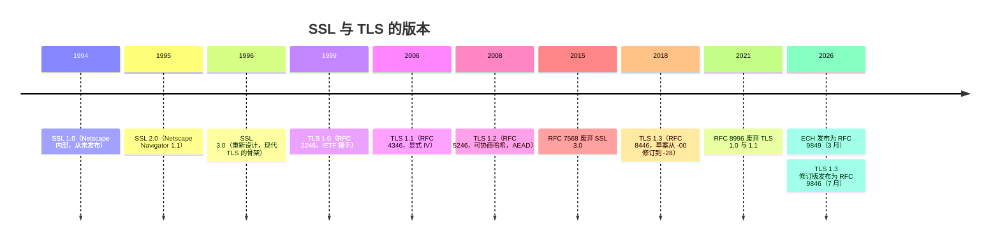
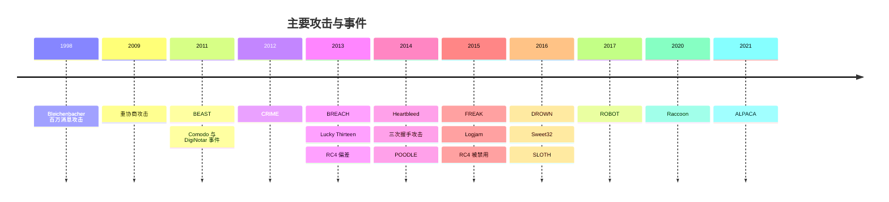
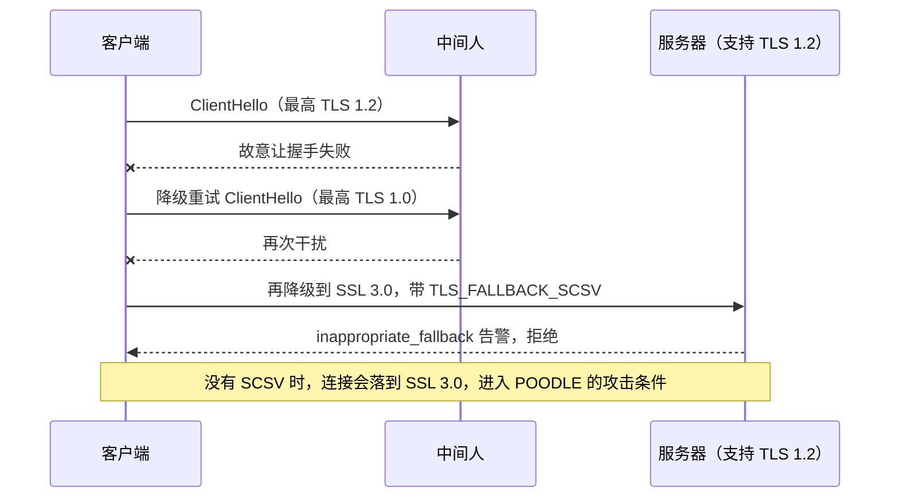
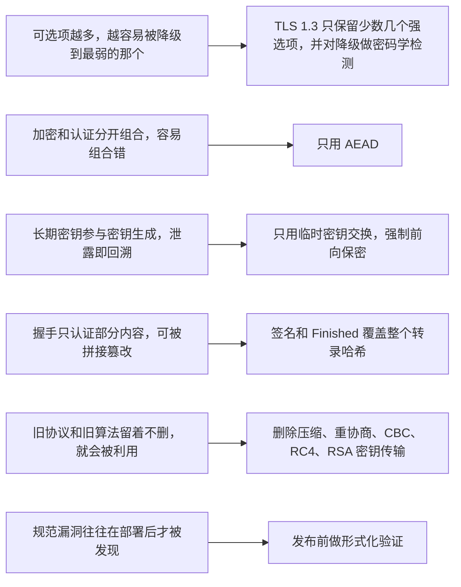

# T04 · 从 SSL 到 TLS 1.3：协议演进与攻击史

> 系列：[[00_TLS系列总览与学习路线|TLS 系列总览]] · 上一篇：[[T03_证书与PKI_信任从哪里来|T03 证书与 PKI]] · 下一篇：[[T05_TCP三次握手与TLS12握手逐包拆解|T05 TCP 与 TLS 1.2 握手]]
> 前置知识：T02 的 CBC、MAC、RSA 填充、DH 概念。
> 主要标准：RFC 6101（SSL 3.0）、RFC 6176（禁用 SSL 2.0）、RFC 7568（废弃 SSL 3.0）、RFC 2246（TLS 1.0）、RFC 4346（TLS 1.1）、RFC 5246（TLS 1.2）、RFC 8446（TLS 1.3）、RFC 8996（废弃 TLS 1.0 与 1.1）、RFC 7457（已知攻击综述）、RFC 5746、RFC 7465、RFC 7507、RFC 7627
> 整理日期：2026-10-16

TLS 1.3 看上去简洁得近乎理所当然：只有五个密码套件，全部是 AEAD；只有临时密钥交换；握手一个往返；ServerHello 之后的一切都加密。但它的每一处"删掉"背后都有一次真实的攻击，每一处"新增"都是在堵一个被证明存在的窟窿。这一篇按时间讲协议的每一版改了什么，再把二十年里最重要的攻击按"机制是什么、影响哪些版本、最终怎么修"整理一遍。目的是理解设计，攻击只讲到原理层面。

## 版本时间线

TLS 1.3 的修订版（草案名 draft-ietf-tls-rfc8446bis）在 2026 年 7 月发布为 RFC 9846，标题仍是 "The Transport Layer Security (TLS) Protocol Version 1.3"。它是对 RFC 8446 的修订，合并了发布以来的勘误和澄清，取代了 RFC 8446，同时废止 RFC 5077、5246、6961、7627、8422，并更新 RFC 5705 和 6066。协议版本号仍然是 TLS 1.3，这套笔记里引用章节号时以读者更熟悉的 RFC 8446 为准，对照 RFC 9846 时章节可能有出入。

## SSL 1.0 与 2.0：先能用再说

SSL（Secure Sockets Layer）是 Netscape 为了让浏览器能安全地做在线交易而设计的。1.0 版在 1994 年内部就被发现有严重缺陷，从未公开。1995 年随 Navigator 1.1 发布的 SSL 2.0 是第一个被广泛使用的版本，它确立了今天仍然熟悉的格局：客户端问好、服务器发证书、协商一个会话密钥、之后用对称加密保护数据。

SSL 2.0 的问题多到 2011 年 IETF 专门写了 RFC 6176 来禁止它。它对握手过程没有任何完整性保护，中间人可以把双方列出的密码套件删到只剩最弱的那个，双方都察觉不到，这是"降级攻击"这一大类问题的开端。它用同一把密钥既做加密又做 MAC，在出口限制下这意味着 MAC 也只有 40 位强度。它的 MAC 是"秘密前缀加 MD5"这种有长度扩展问题的构造。它没有安全的关闭机制，攻击者直接断开 TCP 连接，接收方无法区分"数据发完了"和"被截断了"。

## SSL 3.0：现代 TLS 的骨架

1996 年 Paul Kocher 与 Netscape 的 Phil Karlton、Alan Freier 重新设计了 SSL 3.0（2011 年作为历史文献发布为 RFC 6101）。它奠定了直到 TLS 1.2 都没有大改的结构：分层的记录协议和握手协议；用 Finished 消息对整个握手过程做 MAC，防止握手被篡改；分离的 MAC 密钥和加密密钥；关闭连接前发送 close_notify 告警防止截断；会话恢复；支持 DH 密钥交换。

它的遗留问题主要在 CBC 模式的填充：SSL 3.0 不规定填充字节的内容，也不校验，只看最后一个长度字节。这个看似无害的宽松，在 2014 年被 POODLE 攻击彻底利用，直接终结了 SSL 3.0。2015 年 RFC 7568 正式宣布废弃。

## TLS 1.0：IETF 接手

1999 年 IETF 以 SSL 3.0 为基础发布 TLS 1.0（RFC 2246），改名主要是为了表明它是开放标准而非 Netscape 的私有协议，线上的版本号写作 3.1，至今 TLS 的版本字段还保留着这个历史痕迹（TLS 1.2 是 0x0303，TLS 1.3 的 legacy_version 也写 0x0303）。和 SSL 3.0 相比，主要改动是用标准的 HMAC 替代了 SSL 3.0 自创的 MAC 构造，并定义了一个同时用 MD5 和 SHA-1 的伪随机函数（PRF），希望两个哈希里只要有一个没被攻破就安全。

TLS 1.0 最大的隐患是 CBC 的 IV：每条记录的 IV 直接取上一条记录密文的最后一个块，攻击者可以预知下一条记录的 IV。这个问题 2002 年就被指出，但直到 2011 年 BEAST 把它变成实际攻击才被重视。

## TLS 1.1：修补 CBC

2006 年的 TLS 1.1（RFC 4346）改动不大，核心是给每条 CBC 记录加上显式的随机 IV，堵住了 IV 可预测的问题；同时要求填充错误和 MAC 错误返回同一个告警，减少填充预言攻击的信息泄露。它还取消了出口级密码套件的协商。TLS 1.1 的部署一直不多，大部分实现从 1.0 直接跳到了 1.2。

## TLS 1.2：可协商的密码学

2008 年的 TLS 1.2（RFC 5246）把"密码学算法写死在协议里"改成了"可以协商"：PRF 不再固定为 MD5 加 SHA-1，而是由密码套件指定（通常是 SHA-256）；新增 signature_algorithms 扩展，让双方协商签名用哪种哈希和算法；引入 AEAD 密码套件（AES-GCM 由 RFC 5288 定义，ChaCha20-Poly1305 由 RFC 7905 定义）。TLS 1.2 在随后十年里几乎是 HTTPS 的全部，也是攻击最集中的版本：它的弹性同时也是它的负担，它保留了 RSA 密钥传输、CBC、RC4、压缩、重协商、自定义 DH 参数这些后来被一一证明有问题的选项，安全与否很大程度上取决于配置。

## TLS 1.3：删掉一切可疑的东西

TLS 1.3 从 2014 年开始设计，草案从 draft-ietf-tls-tls13-00 一直修订到 -28（共 29 版），2018 年 8 月发布为 RFC 8446。它的设计原则可以概括为"删掉一切历史上出过问题、或者分析起来太复杂的选项"，同时把握手缩短到一个往返。

| 删除的 | 原因 |
| --- | --- |
| RSA 密钥传输、静态 DH | 没有前向保密；RSA 填充预言攻击反复出现（Bleichenbacher、ROBOT） |
| CBC 模式与 MAC-then-Encrypt | BEAST、Lucky Thirteen、POODLE 等一长串填充和时序问题 |
| RC4、3DES、出口级密码 | RC4 偏差、Sweet32、FREAK、Logjam |
| MD5、SHA-1 签名与 PRF | 碰撞攻击，SLOTH 证明了转录哈希碰撞的危害 |
| 压缩 | CRIME |
| 重协商 | 2009 年的重协商攻击、三次握手攻击 |
| 自定义 DH 群 | Logjam，弱参数和后门参数难以检测 |
| ChangeCipherSpec 协议 | 状态机复杂度，CCS 注入漏洞（2014 年 OpenSSL CVE-2014-0224） |

新增的东西同样针对具体问题：所有密钥交换都是临时的，前向保密成为默认；ServerHello 之后的所有握手消息都加密，证书不再明文暴露；服务器对整个握手转录签名（CertificateVerify），而不只是对密钥交换参数签名；密钥派生改用 HKDF，每个用途一把独立的密钥；ServerHello.random 里嵌入降级哨兵，防止被迫协商旧版本；支持 0-RTT 早期数据（带着明确的重放风险说明）。

TLS 1.3 的部署过程本身也是一段历史。最初的草案沿用新的版本号，结果大量中间设备（企业防火墙、杀毒软件、负载均衡）看到不认识的版本就断开连接，这种现象叫协议僵化（ossification）。2017 年 Chrome 和 Firefox 的实验发现失败率高到无法上线。最终的方案是伪装：ClientHello 的 legacy_version 固定写 TLS 1.2 的 0x0303，真实版本放在 supported_versions 扩展里；还要求发送一条无意义的 ChangeCipherSpec 记录、回显 session_id，让握手在中间设备眼里"看起来像 TLS 1.2 的会话恢复"，这叫中间设备兼容模式（RFC 8446 附录 D.4）。GREASE（RFC 8701）也是在这个背景下提出的：客户端随机插入一些保留的无意义值，逼着服务器和中间设备正确地忽略不认识的值，防止将来再次僵化。

## 攻击史

下面按时间顺序整理影响最大的攻击。每条只讲机制、影响和修复，都是公开文献里的结论。

### 1998：Bleichenbacher 的百万消息攻击

机制：TLS 1.2 及以前的 RSA 密钥传输里，客户端用 PKCS #1 v1.5 填充把预主密钥加密后发给服务器。如果服务器对"解密结果的填充格式正确与否"有任何可观察的区别（不同的告警、不同的响应时间），这就是一个预言机。Daniel Bleichenbacher 证明，利用 RSA 的乘法性质，向这个预言机发送大约一百万个精心变换的密文，就能逐步缩小明文的范围，最终解出一个被截获的预主密钥，从而解密那次会话，或者用服务器的私钥做一次签名。影响：所有使用 RSA 密钥传输的 SSL 和 TLS 版本。修复：TLS 规范要求解密失败时生成一个随机的预主密钥继续握手，让失败和成功在外部无法区分（RFC 5246 §7.4.7.1），但这要求实现做到完全恒定时间，二十年里反复有实现做不到。最终的修复是 TLS 1.3 删除 RSA 密钥传输。

### 2009：重协商攻击

机制：TLS 允许在一条已有连接里重新做一次握手（重协商），但新握手和旧连接之间没有密码学绑定。中间人可以先和服务器建立连接、发送一段自己的数据，再把客户端的握手接到这条连接上作为"重协商"，服务器会把攻击者的那段数据和客户端随后的请求当作同一个已认证用户的连续输入，攻击者因此能在受害者的请求前面拼接内容。Marsh Ray 和 Steve Dispensa 在 2009 年披露。修复：RFC 5746 定义了 renegotiation_info 扩展，把重协商握手与之前的 Finished 值绑定。TLS 1.3 干脆取消了重协商。

### 2011：BEAST

机制：TLS 1.0 的 CBC 记录用上一条记录的最后一个密文块作为下一条记录的 IV，IV 可预测。Thai Duong 和 Juliano Rizzo 演示了在浏览器里结合注入的脚本做选择明文攻击，逐字节猜出 Cookie 的内容。影响：SSL 3.0 和 TLS 1.0 的 CBC 套件。修复：TLS 1.1 的显式 IV；浏览器在 TLS 1.0 上采用 1/n-1 记录拆分作为缓解；最终是 AEAD 和 TLS 1.3。

### 2012：CRIME 与 2013：BREACH

机制：压缩会让密文长度依赖于明文内容。如果攻击者能让一段自己控制的字符串和一个秘密（比如 Cookie）一起被压缩，猜对一个字符时压缩效果更好、密文更短，通过观察长度就能逐字符恢复秘密。CRIME（2012，Duong 和 Rizzo）针对 TLS 层和 SPDY 的压缩。BREACH（2013，Gluck、Harris、Prado）针对 HTTP 响应体的 gzip 压缩，它和 TLS 无关，所以 TLS 本身无法修复。修复：TLS 压缩被普遍关闭，TLS 1.3 直接删除；HTTP/2 和 HTTP/3 的头部压缩改用专门设计、抗这类攻击的 HPACK 和 QPACK；BREACH 只能靠应用层缓解，比如每次响应对 CSRF 令牌做随机掩码、不在压缩响应里同时反射用户输入和秘密。这类攻击说明了一个普遍的道理：加密隐藏内容，但不隐藏长度。

### 2013：Lucky Thirteen

机制：MAC-then-Encrypt 的 CBC 记录，接收方要先解密、去掉填充、再计算 MAC。填充长度不同，参与 MAC 计算的数据长度不同，计算时间就有微小差异。Nadhem AlFardan 和 Kenny Paterson 证明这个时间差足以构成填充预言机，在理想条件下逐字节恢复明文。名字来自 TLS 记录头里参与 MAC 计算的 13 个字节。影响：几乎所有 TLS 实现的 CBC 套件。修复：各实现改写为真正恒定时间的 CBC 解密代码，这非常难写对；根本的修复是 AEAD。

### 2013 至 2015：RC4 的偏差

机制：RC4 流密码的输出密钥流在统计上不是均匀的，开头几百个字节尤其明显。在 BEAST 之后很多网站改用 RC4 来避开 CBC 的问题，但 2013 年 AlFardan 等人证明，只要同一个秘密（比如 Cookie）在大量连接里被反复加密，就能利用这些偏差统计地恢复它，2015 年的进一步研究把所需的数据量降到实际可行的范围。修复：RFC 7465（2015）禁止在 TLS 中使用 RC4。

### 2014：Heartbleed

机制：这是一个实现漏洞而非协议漏洞。OpenSSL 实现 TLS 心跳扩展（RFC 6520）时，没有检查请求里声明的负载长度和实际长度是否一致，对方声明 64KB 只发 1 字节，服务器就会把自己内存里紧挨着的 64KB 原样回送。反复请求就能读出服务器内存里的会话密钥、用户口令，甚至服务器的私钥。CVE-2014-0160，影响 OpenSSL 1.0.1 到 1.0.1f，当时估计数十万台 HTTPS 服务器受影响。修复：打补丁，然后吊销并更换所有可能泄露的证书私钥。它的长远影响是行业开始资助关键开源基础设施（Linux 基金会的 Core Infrastructure Initiative），并催生了 LibreSSL 和 Google 的 BoringSSL 这两个分支。

### 2014：三次握手攻击

机制：miTLS 团队（Bhargavan 等）发现，结合 RSA 密钥传输、会话恢复和重协商，攻击者可以让两条不同的连接得到相同的主密钥和相同的 Finished 值，从而绕过 RFC 5746 的重协商保护，在客户端证书认证的场景里冒充用户。修复：RFC 7627 定义了扩展主密钥（extended_master_secret），让主密钥依赖于整个握手的哈希（session hash），两条连接只要握手内容不同，主密钥就不同。TLS 1.3 的密钥调度天然绑定转录哈希。

### 2014：POODLE

机制：SSL 3.0 的 CBC 填充不校验内容，只看最后一个长度字节，这构成了一个很容易利用的填充预言机。Google 的 Bodo Möller、Thai Duong、Krzysztof Kotowicz 披露它时，SSL 3.0 本来已经很少被主动使用，但浏览器有一种"降级重试"的兼容逻辑：TLS 握手失败时会用更低的版本再试一次。攻击者只要干扰几次握手，就能把连接一路逼降到 SSL 3.0，然后实施攻击。修复：各浏览器禁用 SSL 3.0；RFC 7507 定义了 TLS_FALLBACK_SCSV，客户端在降级重试时带上这个信号值，支持更高版本的服务器看到它就知道这是被迫降级，直接拒绝。TLS 1.3 用 ServerHello.random 里的降级哨兵提供了更彻底的保护。

### 2015：FREAK 与 Logjam

两者都和 1990 年代美国的出口管制有关：当时为了合规，SSL 和 TLS 定义了只用 512 位 RSA 或 512 位 DH 的"出口级"密码套件。二十年后它们早已无人主动使用，却仍留在很多实现里。

FREAK（Beurdouche 等，miTLS 团队的状态机研究）发现，一些客户端在没有请求出口级套件时，也会接受服务器发来的 512 位临时 RSA 密钥，这是 TLS 状态机实现的缺陷。中间人篡改握手，让服务器使用出口级 RSA，再在几个小时内分解这把 512 位密钥，就能解密会话。Logjam（Adrian 等，2015）是对 DHE_EXPORT 的类似降级，并且指出 512 位 DH 可以在线攻破，大量服务器共用少数几个 1024 位素数，使得国家级对手做一次大规模预计算后，就能被动解密相当比例的流量。修复：移除所有出口级套件，DH 至少 2048 位，使用 RFC 7919 的标准群，或改用 ECDHE。TLS 1.3 不允许自定义 DH 群。

### 2016：DROWN、Sweet32、SLOTH

DROWN（Aviram 等）是一个跨协议攻击：如果某台服务器还开着 SSL 2.0，并且它的 RSA 私钥同时被另一台只用 TLS 的服务器使用（共用证书很常见），攻击者就可以把 SSL 2.0 当作 Bleichenbacher 预言机，去解密那台 TLS 服务器上录下的会话。披露时估计约三分之一的 HTTPS 服务器受影响。它说明一个旧协议哪怕只开在一个不相干的端口上，也能拖累整个密钥的安全。

Sweet32（Bhargavan 和 Leurent）针对 64 位分组的密码（3DES、Blowfish）：在同一把密钥下加密约 2^32 个分组（约 32GB）后，生日悖论会使密文块出现碰撞，从而泄露明文信息。长连接加大量数据的场景下这是可行的。修复：弃用 3DES。

SLOTH（Bhargavan 和 Leurent）证明，在 TLS 1.2 及以前的握手签名中使用 MD5 甚至 SHA-1，会面临转录哈希碰撞攻击，攻击者可以构造出哈希相同的两个握手。修复：在签名和转录哈希中禁用 MD5 和 SHA-1。

### 2017：ROBOT

Böck、Somorovsky 和 Young 用自动化扫描发现，Bleichenbacher 的预言机在 1998 年之后的近二十年里从未真正消失：F5、Citrix、Cisco 等厂商的设备，以及 Facebook 和 PayPal 的部分服务器，都对填充错误给出了可区分的反应。攻击者可以用它们解密录下的会话，或者用服务器的密钥签名。这个结果成了"RSA 密钥传输必须被删除"的最后一记重锤。

### 2020：Raccoon 与 2021：ALPACA

Raccoon（Merget 等）利用 TLS 1.2 及以前的 DH 计算中，共享秘密的前导零字节会被去掉，导致后续哈希计算的时间随秘密而变化，在非常苛刻的条件下可以恢复预主密钥。它很难利用，TLS 1.3 不受影响，因为它保留了前导零并且使用临时密钥。

ALPACA（Brinkmann 等）是跨协议攻击：一张证书常常同时对 HTTPS、FTPS、SMTPS 等服务有效，中间人可以把浏览器发给 HTTPS 服务器的请求重定向到同一域名下的 FTP 或邮件服务器，后者会在错误的协议语境下处理这段数据，在某些条件下导致 Cookie 泄露或跨站脚本。修复：服务器严格校验 ALPN 和 SNI，拒绝与自己协议不符的连接。这类问题提醒的是：TLS 认证的是"域名"，而不是"域名上的哪个服务"。

## CA 事件：信任体系本身的攻击史

协议之外，证书体系也有自己的攻击史，它们驱动了 T03 里讲的证书透明度、CAA 和根程序治理：

| 年份 | 事件 | 后果 |
| --- | --- | --- |
| 2011 | Comodo 的一个注册机构被入侵，签出 `login.live.com`、`mail.google.com` 等 9 张伪造证书 | 证书被吊销，暴露出 CA 下游注册机构的风险 |
| 2011 | DigiNotar 被入侵，签出 500 多张伪造证书，`*.google.com` 被用于大规模中间人攻击 | 被所有浏览器移出根库后破产，直接促成证书透明度 |
| 2013 | TURKTRUST 误签出两张中间 CA 证书，其中一张被用于签发 `*.google.com` | 相关中间证书被各家吊销和屏蔽 |
| 2015 | CNNIC 签发的中间证书被装进中间人代理设备 | Google、Mozilla 停止信任 CNNIC 的根 |
| 2015 至 2017 | Symantec 旗下多次违规签发，包括未经授权的 `google.com` 测试证书 | Chrome 在 2018 年分两步停止信任 Symantec 系所有证书 |
| 2016 | WoSign 回填日期签发 SHA-1 证书、隐瞒对 StartCom 的收购 | 两家都被移出根库（2016 年 10 月宣布，2017 年 1 月起由 Chrome 56、Firefox 51 执行） |
| 2024 | Entrust 长期未按要求处理违规签发 | Chrome、Apple、Mozilla 自 2024-11 起不再信任其新签发的证书 |

## 从攻击里学到的设计原则

二十年的攻击史可以归纳成几条经验，它们直接写进了 TLS 1.3 的设计里：

最后一条值得多说一句。TLS 1.3 是第一个在发布前就经过大量形式化分析的主流安全协议。Cremers 等人用 Tamarin 证明器对草案做了符号模型下的分析，并在早期草案里发现了客户端认证与 PSK 结合时的问题；Bhargavan 等人用 ProVerif 和 CryptoVerif 做了符号和计算两种模型的分析，miTLS 项目用 F* 写出了经过验证的参考实现；Dowling 等人给出了握手的计算安全性证明。这些分析的结论反馈进了草案的修改，这种"先证明、再发布"的流程是 TLS 1.3 和之前版本最大的不同之一。

## 常见误解

TLS 1.2 已经不安全了。TLS 1.2 本身仍可以安全地使用，前提是只启用 ECDHE 加 AEAD 的密码套件，开启扩展主密钥，禁用重协商和压缩。问题在于它允许大量不安全的配置，安全性依赖运维水平；TLS 1.3 把这些不安全的选项从协议里拿掉了。

攻击都是协议设计的问题。Heartbleed、CCS 注入、ROBOT 里的大部分案例、GCM nonce 重用都是实现错误。协议设计决定了实现犯错的空间有多大：TLS 1.3 删掉的那些选项，很多是因为"规范上安全，但几乎没有人能把它实现对"。

升级到 TLS 1.3 就不用管旧版本了。DROWN 证明，只要同一把私钥还在任何一个支持旧协议的服务上使用，新协议也可能受牵连。正确的做法是在所有共享密钥和证书的服务上一起禁用旧版本。

SSL 证书和 TLS 证书是两种证书。证书格式（X.509）和协议版本无关，所谓 SSL 证书就是 TLS 用的证书，只是名字沿用了下来。

## 本篇引用的标准与资料

- RFC 6101, The Secure Sockets Layer (SSL) Protocol Version 3.0, https://www.rfc-editor.org/rfc/rfc6101
- RFC 6176, Prohibiting Secure Sockets Layer (SSL) Version 2.0, https://www.rfc-editor.org/rfc/rfc6176
- RFC 7568, Deprecating Secure Sockets Layer Version 3.0, https://www.rfc-editor.org/rfc/rfc7568
- RFC 2246, The TLS Protocol Version 1.0, https://www.rfc-editor.org/rfc/rfc2246
- RFC 4346, The TLS Protocol Version 1.1, https://www.rfc-editor.org/rfc/rfc4346
- RFC 5246, The TLS Protocol Version 1.2, https://www.rfc-editor.org/rfc/rfc5246
- RFC 8446, The TLS Protocol Version 1.3（附录 D.4 中间设备兼容模式）, https://www.rfc-editor.org/rfc/rfc8446
- RFC 9846, The Transport Layer Security (TLS) Protocol Version 1.3（2026-07，取代 RFC 8446）, https://www.rfc-editor.org/info/rfc9846
- RFC 8996, Deprecating TLS 1.0 and TLS 1.1, https://www.rfc-editor.org/rfc/rfc8996
- RFC 7457, Summarizing Known Attacks on TLS and DTLS, https://www.rfc-editor.org/rfc/rfc7457
- RFC 5746, TLS Renegotiation Indication Extension, https://www.rfc-editor.org/rfc/rfc5746
- RFC 7465, Prohibiting RC4 Cipher Suites, https://www.rfc-editor.org/rfc/rfc7465
- RFC 7507, TLS Fallback Signaling Cipher Suite Value (SCSV), https://www.rfc-editor.org/rfc/rfc7507
- RFC 7627, TLS Session Hash and Extended Master Secret Extension, https://www.rfc-editor.org/rfc/rfc7627
- RFC 8701, Applying GREASE to TLS Extensibility, https://www.rfc-editor.org/rfc/rfc8701
- RFC 6520, TLS and DTLS Heartbeat Extension, https://www.rfc-editor.org/rfc/rfc6520
- Heartbleed, https://heartbleed.com/
- DROWN, https://drownattack.com/
- Logjam 与 FREAK（WeakDH 项目）, https://weakdh.org/ ，https://mitls.org/pages/attacks/SMACK
- Sweet32, https://sweet32.info/
- ROBOT, https://robotattack.org/
- Raccoon, https://raccoon-attack.com/
- ALPACA, https://alpaca-attack.com/
- Cremers 等, "A Comprehensive Symbolic Analysis of TLS 1.3", CCS 2017
- Bhargavan 等, "Verified Models and Reference Implementations for the TLS 1.3 Standard Candidate", IEEE S&P 2017
