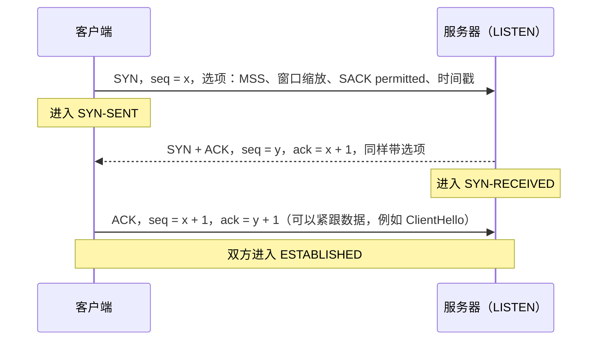
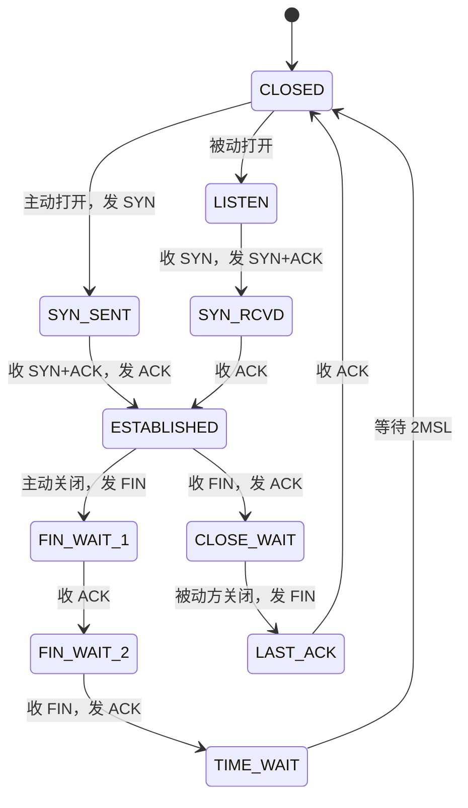
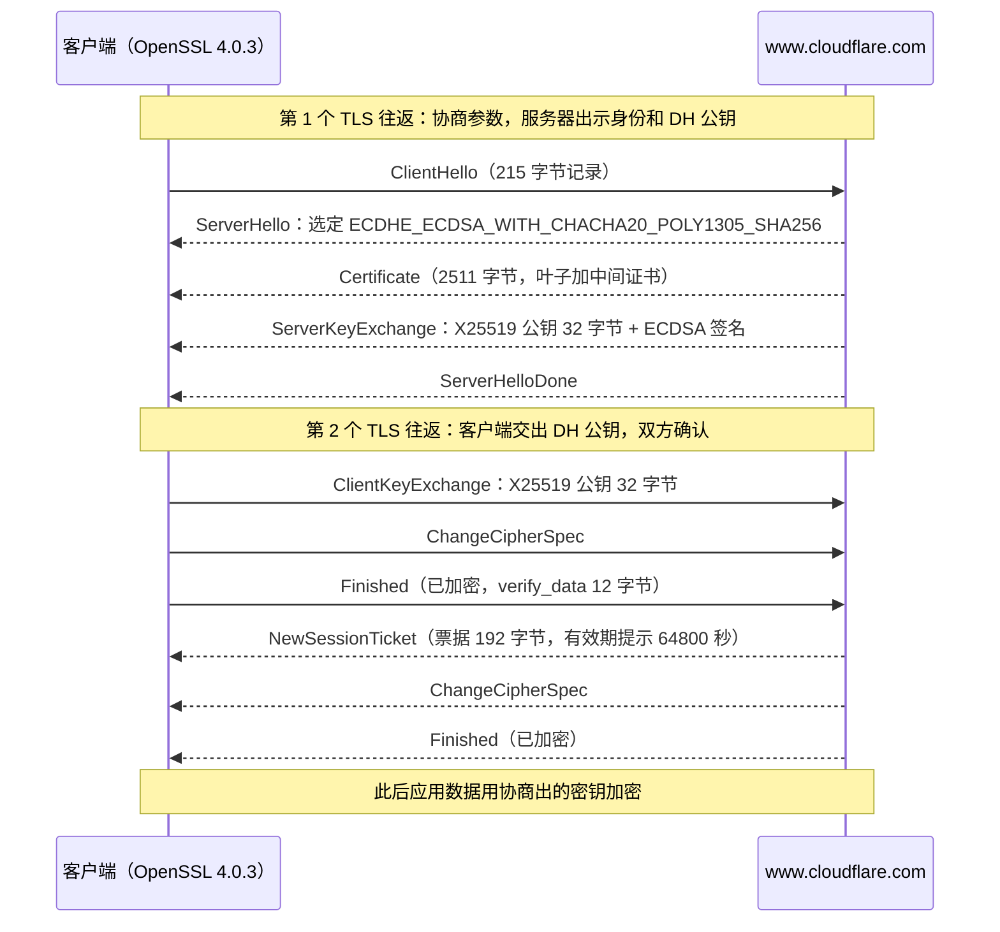
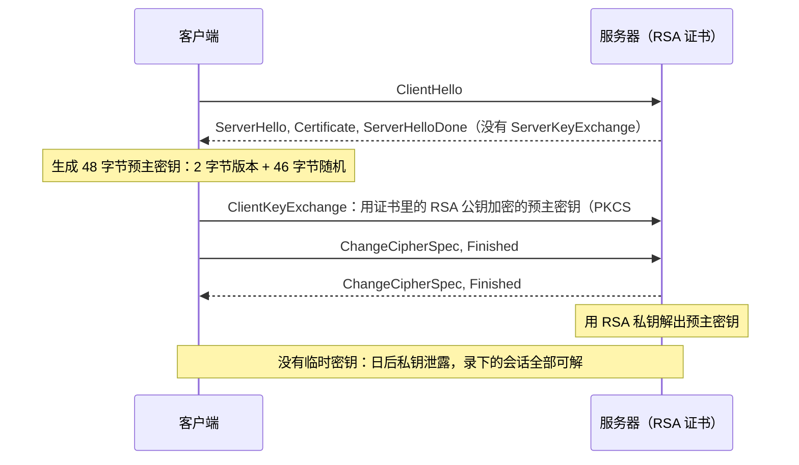
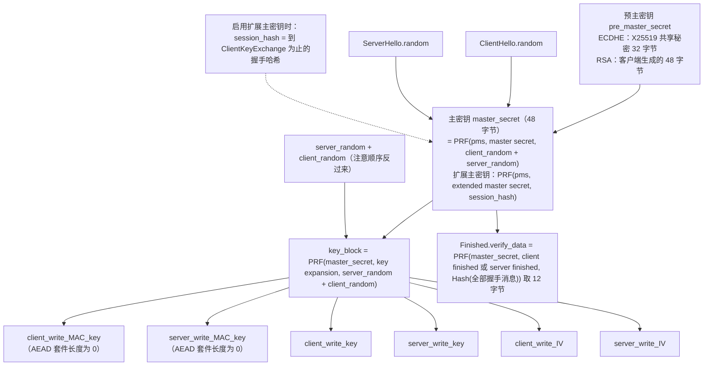
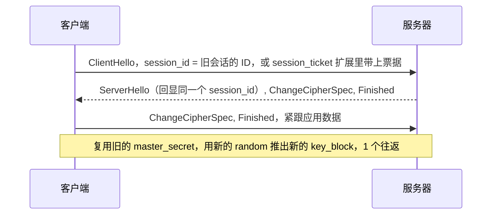

# T05 · TCP 三次握手与 TLS 1.2 握手逐包拆解

> 系列：[[00_tls-series-overview|TLS 系列总览]] · 上一篇：[[T04_ssl-to-tls13-evolution-and-attacks|T04 协议演进与攻击史]] · 下一篇：[[T06_tls13-handshake-and-key-schedule|T06 TLS 1.3 握手与密钥调度]]
> 前置知识：T02 的 DH、ECDH、签名、HMAC；T03 的证书链。
> 主要标准：RFC 9293（TCP）、RFC 7323（窗口缩放与时间戳）、RFC 2018（SACK）、RFC 6528（ISN 生成）、RFC 7413（TCP Fast Open）、RFC 5246（TLS 1.2）、RFC 8422（ECC 密码套件）、RFC 7627（扩展主密钥）、RFC 5288（AES-GCM 套件）、RFC 7905（ChaCha20-Poly1305 套件）、RFC 5077（会话票据）
> 整理日期：2026-10-16（文中 TLS 1.2 握手为 2026-10-17 02:57 UTC 对 www.cloudflare.com 的真实抓取，OpenSSL 4.0.3 `-trace`）

HTTPS 连接的第一个往返属于 TCP，接下来的两个往返属于 TLS 1.2。这一篇把这三个往返里的每一个包都拆开：TCP 段头的字段和三次握手的状态变化，TLS 记录层的格式，TLS 1.2 完整握手的每一条消息和每一个字段，以及会话密钥怎样从握手里一步步推导出来。TLS 1.2 虽然正在被 1.3 取代，但它的结构是理解 1.3 的基础，1.3 的很多设计只有和 1.2 对照着看才明白为什么要那样改。文中的 TLS 1.2 握手是一次真实抓取的结果，不是示意。

## TCP 段头

TCP（RFC 9293）在 IP 之上提供可靠、有序、带流量控制和拥塞控制的字节流。每个 TCP 段都以一个至少 20 字节的段头开始：

```
 0                   1                   2                   3
 0 1 2 3 4 5 6 7 8 9 0 1 2 3 4 5 6 7 8 9 0 1 2 3 4 5 6 7 8 9 0 1
+-+-+-+-+-+-+-+-+-+-+-+-+-+-+-+-+-+-+-+-+-+-+-+-+-+-+-+-+-+-+-+-+
|          源端口（16）           |          目的端口（16）         |
+-+-+-+-+-+-+-+-+-+-+-+-+-+-+-+-+-+-+-+-+-+-+-+-+-+-+-+-+-+-+-+-+
|                        序列号 Sequence Number（32）             |
+-+-+-+-+-+-+-+-+-+-+-+-+-+-+-+-+-+-+-+-+-+-+-+-+-+-+-+-+-+-+-+-+
|                     确认号 Acknowledgment Number（32）          |
+-+-+-+-+-+-+-+-+-+-+-+-+-+-+-+-+-+-+-+-+-+-+-+-+-+-+-+-+-+-+-+-+
| 首部长 | 保留  |C|E|U|A|P|R|S|F|          接收窗口（16）         |
| （4）  |       |W|C|R|C|S|S|Y|I|                                |
|        |       |R|E|G|K|H|T|N|N|                                |
+-+-+-+-+-+-+-+-+-+-+-+-+-+-+-+-+-+-+-+-+-+-+-+-+-+-+-+-+-+-+-+-+
|           校验和（16）          |         紧急指针（16）          |
+-+-+-+-+-+-+-+-+-+-+-+-+-+-+-+-+-+-+-+-+-+-+-+-+-+-+-+-+-+-+-+-+
|                    选项（可变长，最多 40 字节）                   |
+-+-+-+-+-+-+-+-+-+-+-+-+-+-+-+-+-+-+-+-+-+-+-+-+-+-+-+-+-+-+-+-+
```

序列号是这个段第一个数据字节在整个字节流里的编号，确认号是"我期待你下一个发来的字节编号"，也就是"此前的我都收到了"。标志位里和握手相关的是 SYN（同步序列号，建立连接）、ACK（确认号有效）、FIN（我这边发完了）、RST（重置连接）。接收窗口告诉对方"我还能收多少字节"，是流量控制的核心。

## 三次握手

建立连接的目的，是让双方都确认对方能收能发，并互相告知自己的初始序列号（ISN，Initial Sequence Number）。



为什么是三次而不是两次：两次握手只能让服务器确认"客户端能发"、让客户端确认"服务器能收能发"，服务器无法确认客户端收到了它的 ISN。更重要的是，网络里可能还游荡着一个很早以前的、过期的 SYN，如果服务器收到 SYN 就直接建立连接，就会为一个已经不存在的旧连接分配资源。第三次的 ACK 让客户端确认"这确实是我现在要建立的连接"。SYN 和 FIN 各自占用一个序列号，所以确认号是 x + 1 而不是 x。

ISN 不能从 0 开始，也不能可预测。如果攻击者能猜出服务器的 ISN，就能在不看到回包的情况下伪造一条来自任意源地址的 TCP 连接，1985 年 Robert Morris 就描述过这种攻击，1994 年 Kevin Mitnick 用它入侵了一台机器。RFC 6528 规定 ISN 由一个随时间增长的计数器加上"四元组和一个秘密密钥的哈希"组成，对外不可预测。

SYN 里的几个选项在握手时协商，之后整个连接都用：MSS（Maximum Segment Size）告诉对方自己能接收的最大段长，以太网上通常是 1460 字节；窗口缩放（RFC 7323）把 16 位窗口字段左移若干位，让窗口可以超过 64KB，高带宽长距离链路必须用它；SACK permitted（RFC 2018）表示支持选择性确认，丢包时可以告诉对方"哪几段收到了"；时间戳（RFC 7323）用于更精确地测量往返时间并防止序列号回绕。

服务器收到 SYN 后要为半开连接保存状态，这给了攻击者 SYN Flood 的机会：伪造大量源地址发 SYN，耗尽服务器的半开连接队列。SYN cookie 是标准的防御：服务器不保存状态，而是把连接信息编码进自己回复的 ISN 里，等到第三次 ACK 回来时再从确认号里解出来。

客户端的第三个包（ACK）可以携带数据，所以在 HTTPS 里，ClientHello 通常紧跟着 ACK 一起发出，三次握手对应用数据来说只占一个往返。TCP Fast Open（RFC 7413）想把这一个往返也省掉：客户端在第一次连接时拿到服务器发的 cookie，之后的连接可以在 SYN 里就带上数据。它在实践中部署很少，原因在 [[T07_session-resumption-0-rtt-and-performance|T07]] 里讲。

## 连接的状态与关闭

TCP 两端各自维护一个状态机。握手和关闭的主要路径如下：



关闭是四次挥手，因为 TCP 是全双工的，两个方向要分别关闭：主动关闭的一方发 FIN，表示自己不再发送；对方回 ACK，但可能还有数据要发；对方发完后再发自己的 FIN；主动方回 ACK。主动关闭的一方最后要在 TIME_WAIT 状态停留两倍的最大段生存期（2MSL），确保最后那个 ACK 丢了的话还能重发，并让旧连接的残余段在网络里消失，以免被同一四元组的新连接误收。RFC 里 MSL 是 2 分钟，Linux 的 TIME_WAIT 固定为 60 秒。高并发短连接的服务器上大量 TIME_WAIT 堆积，是连接复用（HTTP keep-alive、HTTP/2）重要的另一个原因。

TLS 在 TCP 关闭之上还有自己的关闭：发送 close_notify 告警，告诉对方"数据到此为止"。没有它，接收方无法区分正常结束和攻击者伪造 FIN 造成的截断，SSL 2.0 就是因为缺少这个机制而被截断攻击。

## TLS 记录层

TCP 连接建好之后，TLS 的一切都以记录（record）为单位传输。TLS 1.2 的记录格式（RFC 5246 §6.2）是 5 字节的头加上内容：

```
偏移  长度  字段
0     1     ContentType：20 change_cipher_spec，21 alert，22 handshake，23 application_data
1     2     ProtocolVersion：TLS 1.2 是 0x0303
3     2     length：内容长度，明文不超过 2^14 = 16384 字节，密文不超过 2^14 + 2048
5     n     内容：握手消息、告警、应用数据（加密后是密文）

例：16 03 01 00 d7 ...   handshake，记录头里的版本 0x0301，长度 0xd7 = 215
```

握手协议的消息在记录内容里还有一层自己的头：1 字节消息类型（1 ClientHello、2 ServerHello、4 NewSessionTicket、11 Certificate、12 ServerKeyExchange、14 ServerHelloDone、16 ClientKeyExchange、20 Finished 等）加 3 字节长度。一个握手消息可以分在多条记录里，多个握手消息也可以合并在一条记录里。

下面抓到的 ClientHello 记录头里版本写的是 0x0301（TLS 1.0），而 ClientHello 消息内部声明的是 0x0303（TLS 1.2）。这不是错误：RFC 5246 附录 E.1 允许客户端在第一条记录的头里写一个较低的版本，以兼容那些看到不认识的记录版本就断开的老服务器和中间设备。这种为了兼容而撒的"小谎"，到 TLS 1.3 变成了系统性的伪装（见 T04 和 T06）。

## TLS 1.2 完整握手：一次真实的抓取

下面是 2026-10-17 用 `openssl s_client -connect www.cloudflare.com:443 -tls1_2 -trace` 抓到的完整握手，使用的密钥交换是 ECDHE。先看全貌：



### ClientHello

```
ClientHello, Length=211
  client_version=0x303 (TLS 1.2)
  Random:
    gmt_unix_time=0x9EAEC6D9
    random_bytes (len=28): 62A6B6787AD08CFA49C63774DF49D77A92F045FFBE0F6CC397C128B9
  session_id (len=0)
  cipher_suites (len=54)          27 个套件，节选：
    {0xC0, 0x2C} TLS_ECDHE_ECDSA_WITH_AES_256_GCM_SHA384
    {0xC0, 0x30} TLS_ECDHE_RSA_WITH_AES_256_GCM_SHA384
    {0x00, 0x9F} TLS_DHE_RSA_WITH_AES_256_GCM_SHA384
    {0xCC, 0xA9} TLS_ECDHE_ECDSA_WITH_CHACHA20_POLY1305_SHA256
    ...
    {0x00, 0x2F} TLS_RSA_WITH_AES_128_CBC_SHA
  compression_methods (len=1): No Compression (0x00)
  extensions, length = 116
    renegotiate(65281)            空，表示支持安全重协商（RFC 5746）
    ec_point_formats(11)          uncompressed
    supported_groups(10)          x25519, secp256r1, x448, secp384r1, secp521r1, ffdhe2048, ffdhe3072
    session_ticket(35)            空，表示想要一张会话票据（RFC 5077）
    encrypt_then_mac(22)          如果选了 CBC 套件，用 Encrypt-then-MAC（RFC 7366）
    extended_master_secret(23)    使用扩展主密钥（RFC 7627）
    signature_algorithms(13)      0x0403 ecdsa_secp256r1_sha256, 0x0503, 0x0603, 0x0807 ed25519, 0x0808,
                                  0x0809..0x080b rsa_pss_pss, 0x0804..0x0806 rsa_pss_rsae, 0x0401.. rsa_pkcs1 ...
    server_name(0)                www.cloudflare.com
```

逐个字段看：

client_version 是客户端支持的最高版本，0x0303 即 TLS 1.2。服务器在 ServerHello 里选一个不高于它的版本。

random 是 32 字节，按 RFC 5246 的定义，前 4 字节是 gmt_unix_time（当前时间），后 28 字节随机。实际上这一次的"时间"是 0x9EAEC6D9，换算成日期在 2054 年，显然是随机数：现代实现普遍把 32 字节全部随机化，因为把时钟写进握手既泄露设备时间信息又没有实际用处。random 的作用是让每次握手的密钥派生都有新鲜的输入，即使预主密钥相同，主密钥也不同，并防止重放旧的握手。

session_id 为空，表示客户端没有可恢复的会话。如果有，客户端会在这里填上之前那个会话的 ID，请求做简化握手。

cipher_suites 是客户端按偏好排序的密码套件列表，每个套件 2 字节。TLS 1.2 的套件名把四件事写在一起，以 `TLS_ECDHE_ECDSA_WITH_AES_256_GCM_SHA384` 为例：

| 片段 | 含义 |
| --- | --- |
| ECDHE | 密钥交换：临时椭圆曲线 DH（有前向保密） |
| ECDSA | 认证：服务器证书是 ECDSA 公钥，用它签 ServerKeyExchange |
| AES_256_GCM | 记录加密：AES-256 的 GCM 模式（AEAD） |
| SHA384 | PRF 使用的哈希（AEAD 套件不再需要单独的 MAC） |

`TLS_RSA_WITH_AES_128_CBC_SHA` 这种名字里只有一个 RSA，意思是 RSA 同时负责密钥传输和认证，没有前向保密，后缀 SHA 表示记录用 HMAC-SHA1 做 MAC。OpenSSL 4.0.3 默认还会把这些旧套件列在末尾以兼容老服务器，但排在最后。

compression_methods 只有 null，TLS 压缩因为 CRIME 攻击已被所有主流实现关闭。

extensions 是 TLS 1.2 时代不断加功能的主要方式，每个扩展是"2 字节类型、2 字节长度、内容"的格式。上面列出的扩展里，supported_groups（早期叫 elliptic_curves）告诉服务器客户端支持哪些 DH 群，排第一的是 x25519；signature_algorithms 告诉服务器客户端能验证哪些签名算法，服务器据此选择用哪张证书、哪种哈希签名；server_name 即 SNI，明文写着 `www.cloudflare.com`，这是 T01 和 T08 反复说到的那个明文域名，在 trace 的原始字节里可以直接读出 `www.cloudflare.com` 这串 ASCII。

ClientHello 的字节布局可以这样画：

```
记录头    16 03 01 00 d7                         handshake, 版本 0x0301, 长度 215
握手头    01 00 00 d3                            ClientHello, 长度 211
版本      03 03
random    9e ae c6 d9 62 a6 b6 78 ... (32 字节)
session_id 长度  00
cipher_suites 长度 00 36 (54 字节 = 27 个套件)
          c0 2c c0 30 00 9f cc a9 ...
compression 长度 01，内容 00
extensions 长度 00 74 (116 字节)
          ff 01 00 01 00                         renegotiate，长度 1，内容 00
          00 0b 00 02 01 00                      ec_point_formats
          00 0a 00 10 00 0e 00 1d 00 17 ...      supported_groups，x25519 = 0x001d
          ...
          00 00 00 17 00 15 00 00 12 77 77 77 2e ... server_name，www.cloudflare.com
```

（记录头、握手头和各字段长度来自这次抓取的解析结果；扩展部分的字节按各扩展的编码规则排列，用于说明格式。）

### ServerHello

```
ServerHello, Length=63
  server_version=0x303 (TLS 1.2)
  Random: gmt_unix_time=0x6AD2E40C, random_bytes (len=28): 787BEAE1...4E47524401
  session_id (len=0)
  cipher_suite {0xCC, 0xA9} TLS_ECDHE_ECDSA_WITH_CHACHA20_POLY1305_SHA256
  compression_method: No Compression
  extensions: server_name, extended_master_secret, renegotiate, ec_point_formats, session_ticket
```

服务器从客户端的列表里选定了一个套件，并把它支持的扩展回显出来：extended_master_secret 表示双方都同意使用扩展主密钥，session_ticket 表示它会在握手末尾发一张票据。

这里有一个值得注意的细节：客户端把 AES-256-GCM 排在第一位，服务器却选了 ChaCha20-Poly1305，而这台 Mac 是带 AES 硬件指令的 Apple M3。选择权在服务器，服务器按自己的策略从客户端列表里挑选。BoringSSL 支持"同等偏好组"，服务器可以把几个套件设为同等偏好，组内按客户端的顺序挑；这次 OpenSSL 的默认列表里 ChaCha20 排在 AES-128-GCM 之前，Cloudflare 很可能就是据此选了 ChaCha20（这是根据现象的推测，没有查到 Cloudflare 公开的具体配置）。两者在安全性上同档，都是 AEAD。

### Certificate

服务器发送证书链，这次是 2511 字节，叶子证书 `CN=www.cloudflare.com` 由 Google Trust Services 的中间 CA `WE1` 签发，P-256 公钥，有效期 2026-10-12 到 2027-01-10，同样是 90 天。TLS 1.2 的证书是明文发送的，任何路径上的观察者都能读出证书里的全部域名，TLS 1.3 把它放进了加密部分。证书的验证过程见 [[T03_certificates-and-pki|T03]]。

### ServerKeyExchange

```
ServerKeyExchange, Length=110
  KeyExchangeAlgorithm=ECDHE
    named_curve: ecdh_x25519 (29)
    point (len=32): E24618F1AC362B86F1E3E9A2BB0D58640C8E8BFF9CFD66A03FA21EB5451A7D1F
  Signature Algorithm: ecdsa_secp256r1_sha256 (0x0403)
  Signature (len=70): 30440220539C78C874F15EC30D5C3247...
```

这是 ECDHE 握手的核心。服务器生成一个临时的 X25519 私钥，把对应的 32 字节公钥发出来，并用证书的私钥（ECDSA P-256）对它签名。签名覆盖的内容是 `client_random + server_random + 曲线参数 + 公钥`（RFC 8422 §5.4）。客户端用证书里的公钥验证这个签名，就知道"这把 DH 公钥确实来自证书的持有者"，中间人无法替换它。签名里包含了双方的 random，是为了防止攻击者把一次旧握手里的 ServerKeyExchange 拿来重放。

这里也藏着 TLS 1.2 的一个结构性弱点：签名只覆盖了 DH 参数和 random，没有覆盖客户端提供的密码套件列表等其他握手内容。握手的其余部分要靠最后的 Finished 来保护，而 Finished 依赖于协商出的密钥本身，如果密钥交换被降级到一个弱到可以在线破解的参数（FREAK、Logjam 正是如此），攻击者就能连 Finished 一起伪造。TLS 1.3 的 CertificateVerify 改为对整个握手转录签名，从根上堵住了这一点。

### ServerHelloDone、ClientKeyExchange、ChangeCipherSpec、Finished

ServerHelloDone 长度为 0，只是一个"我说完了"的标记，因为 TLS 1.2 的服务器在这一轮可能发送数量不定的消息（比如还可能有 CertificateRequest 请求客户端证书）。

```
ClientKeyExchange, Length=33
  KeyExchangeAlgorithm=ECDHE
    ecdh_Yc (len=32): F17CB43B6E922E4BEB6AFAB2263603CC85F0D5062E6CE276C63E5A6A5AB86C0E
```

客户端生成自己的临时 X25519 私钥，把 32 字节公钥发给服务器。到这一刻双方都有了对方的公钥，各自算出同一个 32 字节的共享秘密，也就是预主密钥（pre_master_secret）。

ChangeCipherSpec 是一个独立的子协议，内容只有一个字节 0x01，意思是"从我的下一条记录开始，使用刚刚协商出的密钥"。紧接着客户端发出 Finished，这是第一条加密的握手消息，内容是 12 字节的 verify_data，它是对此前所有握手消息的一个带密钥的摘要，服务器验证它，确认双方看到的握手完全一致、没有被篡改。

### NewSessionTicket 与服务器的 Finished

服务器先发 NewSessionTicket（有效期提示 64800 秒即 18 小时，票据本身 192 字节，是服务器用自己的票据密钥加密的会话状态），再发 ChangeCipherSpec 和自己的 Finished。客户端验证服务器的 Finished 后，握手完成，可以发送应用数据了。从 ClientHello 到这里，TLS 用了两个完整的往返。

## RSA 密钥传输：被删掉的那条路

TLS 1.2 还允许另一种完全不同的密钥交换：RSA 密钥传输，套件名形如 `TLS_RSA_WITH_AES_128_GCM_SHA256`。



它比 ECDHE 少一条消息，服务器每次握手只做一次 RSA 私钥解密，在 2000 年代 CPU 昂贵时很有吸引力。代价是没有前向保密，以及 Bleichenbacher 类的填充预言攻击（T04）。预主密钥的前两个字节写入客户端的最高版本，是为了让服务器检测版本回滚，这个检查本身又成了 ROBOT 等攻击的一部分。TLS 1.3 删除了它。

## 密钥是怎么推导出来的

TLS 1.2 的密钥推导围绕一个函数：PRF（伪随机函数，RFC 5246 §5）。对 TLS 1.2 的标准套件，PRF 基于 HMAC-SHA256（套件名以 SHA384 结尾的用 HMAC-SHA384）：

```
P_hash(secret, seed) = HMAC_hash(secret, A(1) + seed) +
                       HMAC_hash(secret, A(2) + seed) +
                       HMAC_hash(secret, A(3) + seed) + ...
其中 A(0) = seed，A(i) = HMAC_hash(secret, A(i-1))

PRF(secret, label, seed) = P_hash(secret, label + seed)，需要多长就截多长
```

用它分三步推出所有密钥：



第一步把预主密钥和双方的随机数混合成 48 字节的主密钥。RFC 7627 的扩展主密钥把第二个参数换成了整个握手的哈希，这样主密钥就和这次握手的全部内容（包括证书、DH 参数）绑定，三次握手攻击因此失效。这次抓取里双方都协商了 extended_master_secret，用的就是后一种算法。

第二步用主密钥和随机数生成足够长的 key_block，再按顺序切成六段：两个方向各一把 MAC 密钥、一把加密密钥、一个 IV。注意这里随机数的顺序是 `server_random + client_random`，和第一步正好相反，这是 SSL 3.0 遗留下来的约定，自己实现时很容易写错。对 AEAD 套件，MAC 密钥长度为 0；AES-GCM 套件的 IV 只切出 4 字节作为隐式部分，每条记录再带 8 字节的显式 nonce（RFC 5288）；ChaCha20-Poly1305 套件切出 12 字节 IV，每条记录的 nonce 是 IV 异或 64 位序列号（RFC 7905），这和 TLS 1.3 的做法相同。

第三步是 Finished。verify_data 是对此前全部握手消息哈希的 PRF 输出，取 12 字节，客户端和服务器用不同的标签（`client finished`、`server finished`），防止一方的 Finished 被反射回去冒充另一方。

两个方向使用不同的密钥，是为了避免一个方向的密文被反射到另一个方向。每条记录的序列号参与 MAC 或 nonce 的计算但不在线上传输，记录被删除、重排或重放都会导致校验失败。

## 会话恢复：一个往返的简化握手

完整握手的两个往返里，最贵的是证书传输、签名验证和 DH 计算。如果客户端不久前刚和这台服务器握过手，可以跳过这些，直接复用之前的主密钥：



session ID 方式要求服务器在内存里保存会话状态，多台服务器之间需要共享缓存；会话票据（RFC 5077）把状态加密后交给客户端保管，服务器无状态。两者都有前向保密的隐患，这次抓到的票据就是一个例子：它由服务器的一把长期票据密钥加密，这把密钥如果泄露、或者长期不轮换，所有用票据恢复的会话都可能被解开。TLS 1.3 用 PSK 重新设计了恢复机制，见 [[T07_session-resumption-0-rtt-and-performance|T07]]。

## 为什么 TLS 1.2 是两个往返

回头看完整握手的结构，第一个往返里客户端在等服务器选好、拿到服务器的 DH 参数，第二个往返里客户端才交出自己的 DH 公钥。之所以不能更快，是因为 TLS 1.2 的协商是串行的：客户端在 ClientHello 里只说"我支持哪些"，不提供任何密钥材料，必须等服务器选定了群和算法，客户端才知道该生成什么样的公钥。

TLS False Start（RFC 7918）是一种折中：客户端在发出自己的 Finished 之后、收到服务器 Finished 之前就开始发送应用数据，把有效延迟降到一个往返，代价是如果握手被篡改，最早的数据可能已经发给了攻击者，所以只允许在使用前向保密套件和强算法时这样做。

TLS 1.3 的思路是让客户端"先猜"：在 ClientHello 里直接附上它认为服务器最可能选的那个群的公钥（key_share）。猜对了，服务器在第一个回复里就能完成密钥交换并开始加密；猜错了，服务器用 HelloRetryRequest 告诉它该用哪个群，代价是多一个往返。因为绝大多数服务器都支持 X25519，几乎总能猜对。这个改动加上把证书和签名放进第一个回复里，就把握手压缩成了一个往返，这是 [[T06_tls13-handshake-and-key-schedule|T06]] 的内容。

## 常见误解

TCP 三次握手要等完才能发数据，所以 HTTPS 一定比 HTTP 多三个往返。第三个 ACK 可以携带 ClientHello，TCP 握手只占一个往返；TLS 1.2 再加两个，TLS 1.3 再加一个，会话恢复和 0-RTT 还能更少。

ChangeCipherSpec 是一条握手消息。它是一个独立的子协议（内容类型 20），不属于握手协议（内容类型 22），也不参与 Finished 的哈希计算。正因为它游离在握手状态机之外，2014 年才出现了 CCS 注入漏洞。TLS 1.3 删除了它的实际作用，只在兼容模式下发一条假的。

ServerHello 里选的密码套件就是加密算法。TLS 1.2 的套件同时决定了密钥交换、认证、记录加密和 PRF 哈希四件事。TLS 1.3 把前两件拆出去由扩展协商，套件只剩 AEAD 和哈希。

random 里的时间戳是必需的。RFC 5246 写了 gmt_unix_time，但规范也说明客户端和服务器不需要正确的时钟，现代实现普遍全部填随机数，这次抓取的两个 random 都是如此。

## 本篇引用的标准与资料

- RFC 9293, Transmission Control Protocol (TCP), https://www.rfc-editor.org/rfc/rfc9293
- RFC 7323, TCP Extensions for High Performance（窗口缩放、时间戳）, https://www.rfc-editor.org/rfc/rfc7323
- RFC 2018, TCP Selective Acknowledgment Options, https://www.rfc-editor.org/rfc/rfc2018
- RFC 6528, Defending against Sequence Number Attacks, https://www.rfc-editor.org/rfc/rfc6528
- RFC 7413, TCP Fast Open, https://www.rfc-editor.org/rfc/rfc7413
- RFC 5246, The TLS Protocol Version 1.2（§5 PRF、§6.2 记录层、§7.4 握手、§8.1 主密钥、附录 E.1 版本兼容）, https://www.rfc-editor.org/rfc/rfc5246
- RFC 8422, Elliptic Curve Cryptography (ECC) Cipher Suites for TLS Versions 1.2 and Earlier（§5.4 ServerKeyExchange）, https://www.rfc-editor.org/rfc/rfc8422
- RFC 7627, TLS Session Hash and Extended Master Secret Extension, https://www.rfc-editor.org/rfc/rfc7627
- RFC 5288, AES Galois Counter Mode (GCM) Cipher Suites for TLS, https://www.rfc-editor.org/rfc/rfc5288
- RFC 7905, ChaCha20-Poly1305 Cipher Suites for TLS, https://www.rfc-editor.org/rfc/rfc7905
- RFC 7366, Encrypt-then-MAC for TLS and DTLS, https://www.rfc-editor.org/rfc/rfc7366
- RFC 5077, TLS Session Resumption without Server-Side State, https://www.rfc-editor.org/rfc/rfc5077
- RFC 5746, TLS Renegotiation Indication Extension, https://www.rfc-editor.org/rfc/rfc5746
- RFC 7918, TLS False Start, https://www.rfc-editor.org/rfc/rfc7918
- 本机实测：`openssl s_client -connect www.cloudflare.com:443 -servername www.cloudflare.com -tls1_2 -trace`（OpenSSL 4.0.3，2026-10-17 02:57 UTC）
