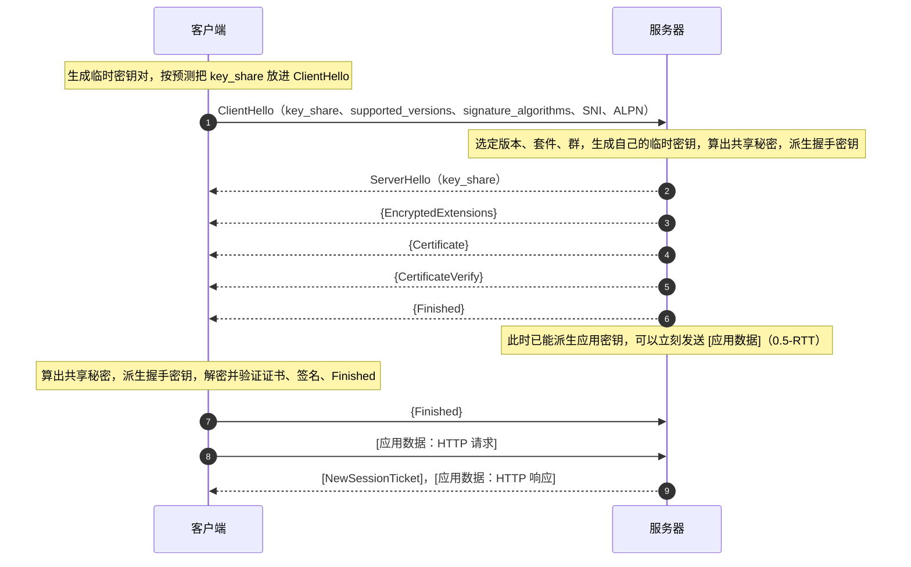
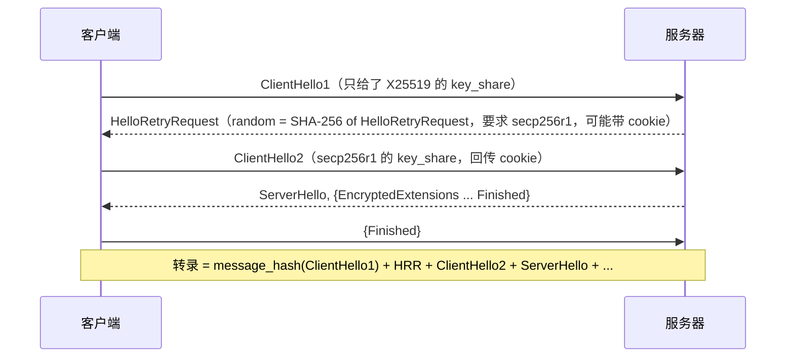
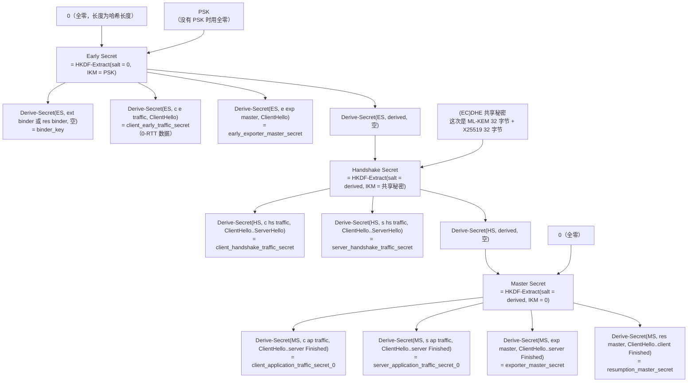

# T06 · TLS 1.3 握手与密钥调度逐包拆解

> 系列：[[00_TLS系列总览与学习路线|TLS 系列总览]] · 上一篇：[[T05_TCP三次握手与TLS12握手逐包拆解|T05 TCP 与 TLS 1.2 握手]] · 下一篇：[[T07_会话恢复_0-RTT与握手性能优化|T07 会话恢复与 0-RTT]]
> 前置知识：T02 的 HKDF、AEAD、ECDH、签名；T05 的 TLS 1.2 握手结构（本篇处处和它对照）。
> 主要标准：RFC 8446（TLS 1.3）及其修订版 RFC 9846（2026-07，取代 RFC 8446，本篇章节号按 RFC 8446 标注）、RFC 8701（GREASE）、RFC 10024（混合后量子密钥交换，2026）
> 整理日期：2026-10-16（文中握手为 2026-10-17 03:00 UTC 对 www.cloudflare.com 的真实抓取，OpenSSL 4.0.3 `-trace` 和 `-keylogfile`）

这是整个系列最核心的一篇。TLS 1.3 用一个往返完成密钥交换和服务器认证，ServerHello 之后的一切都加密，所有密钥由一棵 HKDF 推导树产生，每一把密钥都绑定在当时为止的整个握手转录上。这一篇按线上消息的顺序逐条拆开，每条讲字段、取值、作用和设计理由，再完整地画出密钥调度，最后讲记录层怎么用这些密钥。文中的握手是一次真实抓取：客户端是 OpenSSL 4.0.3，服务器是 Cloudflare，协商出的密钥交换组是混合后量子的 X25519MLKEM768，密码套件是 TLS_AES_256_GCM_SHA384。

## 设计目标与整体形状

RFC 8446 §1 列出的目标可以归成四条：握手更快（完整握手 1-RTT，恢复时可以 0-RTT）；握手更私密（ServerHello 之后的所有握手消息加密，证书不再明文）；更简单、更难配错（删掉 T04 里列出的一长串旧选项）；安全性更强、更好分析（强制前向保密，签名覆盖整个转录，密钥派生改用 HKDF 并在每一步绑定转录哈希，设计过程中做了大量形式化验证）。

整体形状是这样的。图里用 `{}` 表示用握手密钥加密的消息，`[]` 表示用应用密钥加密的消息，没有括号的是明文：



和 T05 的 TLS 1.2 对照，三个结构性变化一眼可见：客户端在第一条消息里就交出了密钥交换材料；服务器的第一组回复里同时完成了密钥交换、身份认证和握手确认；证书和签名都在加密的保护下。下面逐条看。

## ClientHello

这次抓到的 ClientHello 有 1469 字节，比 T05 里 TLS 1.2 的 211 字节大了七倍，原因几乎全在混合后量子的 key_share 上。

```
记录头: Version = TLS 1.0 (0x301), Content Type = Handshake (22), Length = 1473
ClientHello, Length=1469
  client_version=0x303 (TLS 1.2)                         即 legacy_version
  Random: 3337A9B0 E3EAE7DE93A7632CE801E9EE888276853EDC886995F6319F09944641
  session_id (len=32): BE835F13C5934BE85F79E78C0E4CFE1F64388AE16E62701387DE59220E15E5D6
  cipher_suites (len=6)
    {0x13, 0x02} TLS_AES_256_GCM_SHA384
    {0x13, 0x03} TLS_CHACHA20_POLY1305_SHA256
    {0x13, 0x01} TLS_AES_128_GCM_SHA256
  compression_methods (len=1): No Compression (0x00)
  extensions, length = 1390
    supported_groups(10): X25519MLKEM768 (4588), SecP256r1MLKEM768 (4587), curveSM2MLKEM768 (4590),
                          x25519 (29), secp256r1 (23), x448 (30), secp384r1 (24), secp521r1 (25),
                          curveSM2 (41), ffdhe2048 (256), ffdhe3072 (257)
    session_ticket(35), encrypt_then_mac(22), extended_master_secret(23)      给 TLS 1.2 服务器准备的
    signature_algorithms(13): mldsa65 (0x0905), mldsa87, mldsa44, ecdsa_secp256r1_sha256 (0x0403), ...,
                              ed25519 (0x0807), ..., rsa_pss_rsae_sha256 (0x0804), ..., sm2sig_sm3 (0x0708)
    supported_versions(43): TLS 1.3 (772 = 0x0304)
    psk_key_exchange_modes(45): psk_dhe_ke (1)
    key_share(51), length=1258
        NamedGroup: X25519MLKEM768 (4588)   key_exchange (len=1216): CA2156AE653F0F94...
        NamedGroup: ecdh_x25519 (29)        key_exchange (len=32):   80CDDA2AF368BEAD...
    server_name(0): www.cloudflare.com
```

legacy_version 固定是 0x0303。TLS 1.3 不在这里声明自己，因为 T04 讲过的中间设备僵化：看到不认识的版本号就断开。真正的版本协商挪到了 supported_versions 扩展（RFC 8446 §4.2.1），客户端在里面列出支持的版本，0x0304 就是 TLS 1.3。服务器必须看 supported_versions 而忽略 legacy_version。

random 依旧是 32 字节随机数。它在 TLS 1.3 里的作用比 1.2 小了，因为每把密钥都绑定了整个转录（转录里本来就包含 random），但它仍然保证了每次握手的唯一性。注意这个 random 的值 `3337A9B0E3EAE7DE...`，后面在 key log 文件里会再次见到它。

legacy_session_id 在 TLS 1.3 里没有会话恢复的作用（恢复改用 PSK），但这里填了 32 字节的随机值。这是中间设备兼容模式（RFC 8446 附录 D.4）：一个非空的 session_id 加上服务器回显同一个值，再配上后面那条假的 ChangeCipherSpec，整个握手在只懂 TLS 1.2 的中间设备看来，就像一次 TLS 1.2 的会话恢复，于是放行。

cipher_suites 只有 TLS 1.3 的三个套件（OpenSSL 默认不提供两个 CCM 套件）。每个套件只决定 AEAD 算法和 HKDF 用的哈希，密钥交换和签名算法由下面的扩展分别协商。这次 OpenSSL 把 AES-256-GCM 排第一，服务器照此选择。

legacy_compression_methods 必须恰好是一个字节 0（null），否则服务器必须中止握手。

### 扩展

TLS 1.3 的大部分协商都在扩展里，下表是这次 ClientHello 里出现的、以及 TLS 1.3 定义的主要扩展：

| 扩展 | 码点 | 作用 | 这次的取值 |
| --- | --- | --- | --- |
| supported_versions | 43 | 真正的版本协商 | TLS 1.3 |
| supported_groups | 10 | 支持的密钥交换群，按偏好排序 | 混合后量子三个，经典七个 |
| key_share | 51 | 预先发送的临时公钥，可以有多个 | X25519MLKEM768（1216 字节）和 X25519（32 字节） |
| signature_algorithms | 13 | 能验证的握手签名算法 | 包括 ML-DSA、ECDSA、EdDSA、RSA-PSS、SM2 |
| signature_algorithms_cert | 50 | 证书链里能接受的签名算法（不发则同上） | 未发送 |
| server_name | 0 | SNI，明文的目标域名 | www.cloudflare.com |
| application_layer_protocol_negotiation | 16 | ALPN | 这次 openssl 未指定，未发送；浏览器会发 h2、http/1.1 |
| psk_key_exchange_modes | 45 | 恢复时允许的模式 | 只允许 psk_dhe_ke |
| pre_shared_key | 41 | 恢复用的 PSK 标识和绑定值，必须是最后一个扩展 | 首次连接，未发送 |
| early_data | 42 | 声明随后有 0-RTT 数据 | 未发送 |
| cookie | 44 | HelloRetryRequest 后回传服务器给的 cookie | 未发送 |
| padding | 21 | 把 ClientHello 填充到某个长度，规避中间设备的缺陷 | 未发送 |

session_ticket、encrypt_then_mac、extended_master_secret 这三个是 TLS 1.2 的扩展。客户端同时支持 1.2 和 1.3，ClientHello 必须让两种服务器都能理解，所以一并带上；TLS 1.3 服务器会忽略它们。

浏览器的 ClientHello 还会带 GREASE（RFC 8701）：在 cipher_suites、supported_groups、扩展类型等列表里随机插入形如 0x0A0A、0x1A1A、……、0xFAFA 的保留值。正确的实现必须忽略不认识的值，GREASE 让"不认识就断开"的错误实现在今天就暴露出来，而不是等到将来引入新扩展时才集体出问题。这次的服务器在后面的 NewSessionTicket 里也带了一个类型为 47802（0xBABA）的空扩展，同样是 GREASE。

### key_share：客户端先猜

key_share（RFC 8446 §4.2.8）是 TLS 1.3 能做到 1-RTT 的关键。客户端不再只说"我支持哪些群"，而是直接为它估计服务器最可能选的群生成临时密钥，把公钥放进去。每个条目是"2 字节群编号 + 2 字节长度 + 公钥"：

| 群 | 码点 | 客户端 key_share 大小 | 服务器 key_share 大小 |
| --- | --- | --- | --- |
| x25519 | 0x001D | 32 字节 | 32 字节 |
| secp256r1 | 0x0017 | 65 字节（非压缩点 04 加 x 加 y） | 65 字节 |
| X25519MLKEM768 | 0x11EC（4588） | 1216 字节 = ML-KEM-768 封装公钥 1184 + X25519 公钥 32 | 1120 字节 = ML-KEM-768 密文 1088 + X25519 公钥 32 |

这次 OpenSSL 一共发了两个 key_share：一个混合后量子的 X25519MLKEM768，一个经典的 X25519，前者如果服务器不支持，还有后者兜底，避免多一个往返。代价是 ClientHello 变成了 1469 字节，超过了一个以太网 TCP 段（MSS 通常是 1460 字节）能装下的数据，ClientHello 要分两个 TCP 段发出。一些中间设备假设 ClientHello 一定在一个包里，遇到分段的就出错，这是后量子迁移遇到的实际问题之一（见 [[T10_后量子TLS_ML-KEM混合密钥交换与MTC|T10]]）。

如果客户端的猜测都没中（服务器支持客户端列出的某个群，但客户端没有为它发 key_share），服务器会回 HelloRetryRequest，下面单独讲。

## ServerHello

```
记录头: Version = TLS 1.2 (0x303), Content Type = Handshake (22), Length = 1210
ServerHello, Length=1206
  server_version=0x303 (TLS 1.2)                          即 legacy_version
  Random: B5AC8BC2 FB36823C082D3AD7BED3EEADD231F44BC29CC743297A69C7209A16EA
  session_id (len=32): BE835F13C5934BE8...（回显客户端的值）
  cipher_suite {0x13, 0x02} TLS_AES_256_GCM_SHA384
  compression_method: No Compression (0x00)
  extensions, length = 1134
    key_share(51): NamedGroup X25519MLKEM768 (4588), key_exchange (len=1120): 2601F76364A0E6F6...
    supported_versions(43): TLS 1.3 (772)
```

ServerHello 是最后一条明文的握手消息。它只携带协商密钥所必需的三个扩展：supported_versions（选定 TLS 1.3）、key_share（服务器自己的临时公钥，这里是 1088 字节的 ML-KEM 密文加 32 字节 X25519 公钥），以及恢复时的 pre_shared_key（选中了哪一个 PSK）。其他所有扩展的回应，比如 ALPN 选了什么、SNI 是否被接受，都放进了随后加密的 EncryptedExtensions。这个划分（RFC 8446 §4.2 的扩展位置表）是 TLS 1.3 隐私改进的一部分：能加密的都加密，明文里只留计算密钥必需的东西。

服务器发出 ServerHello 时，已经有了双方的公钥，可以算出共享秘密。对 X25519MLKEM768，共享秘密是两部分的拼接：ML-KEM 解封装得到的 32 字节加上 X25519 算出的 32 字节，一共 64 字节，作为密钥调度里 Handshake Secret 那一步的输入。只要两个算法里有一个没被攻破，共享秘密就是安全的，这就是"混合"的意义。

### 降级保护：random 末尾的哨兵

TLS 1.3 的服务器如果因为客户端只支持旧版本、或者被中间人篡改，而协商了 TLS 1.2 或更低的版本，必须在 ServerHello.random 的最后 8 字节写入固定的值（RFC 8446 §4.1.3）：

```
协商 TLS 1.2 时：44 4F 57 4E 47 52 44 01    即 ASCII "DOWNGRD" 加 0x01
协商 TLS 1.1 或更低时：44 4F 57 4E 47 52 44 00
```

一个支持 TLS 1.3 的客户端如果收到的 ServerHello 是 TLS 1.2，并且 random 以这个值结尾，就知道有人在降级它，必须中止握手。由于 random 被 TLS 1.2 的 ServerKeyExchange 签名覆盖（T05），中间人无法改掉这个值而不破坏签名。

这个机制在本系列的抓取里留下了真实的证据。T05 用 `-tls1_2` 强制 OpenSSL 只说 TLS 1.2 去连同一台 Cloudflare 服务器，服务器的 ServerHello.random 是：

```
random_bytes (len=28): 787BEAE192ED9360AA8D07DF0346F16AE1D3488C444F574E47524401
                                                          ^^^^^^^^^^^^^^^^
                                                          44 4F 57 4E 47 52 44 01 = "DOWNGRD\x01"
```

最后 8 字节正是 `DOWNGRD\x01`：服务器支持 TLS 1.3，却被要求说 1.2，于是按规范留下了哨兵。那次的客户端本来就只提供 1.2，所以继续握手是正确的；换成一个同时提供 1.3 的客户端，看到这个值就会中止。

### HelloRetryRequest

如果服务器支持客户端 supported_groups 里的某个群，但客户端没有为它提供 key_share，或者服务器需要客户端回传一个 cookie（比如为了验证地址、实现无状态），服务器回复 HelloRetryRequest（HRR，§4.1.4）。HRR 在格式上就是一条 ServerHello，只是 random 被设为一个固定的魔数，等于字符串 "HelloRetryRequest" 的 SHA-256：

```
CF 21 AD 74 E5 9A 61 11 BE 1D 8C 02 1E 65 B8 91
C2 A2 11 16 7A BB 8C 5E 07 9E 09 E2 C8 A8 33 9C
```

HRR 的 key_share 扩展里只有一个群编号，告诉客户端"请用这个群重发"。客户端用同样的参数、换上对应的 key_share 重发 ClientHello。代价是多一个往返。为了让转录哈希保持固定长度，第一个 ClientHello 在转录里被替换成一条合成的 message_hash 消息，内容是它的哈希值。



客户端预测得好，HRR 就很少发生。X25519 几乎被所有服务器支持，所以浏览器一般只发 X25519 或 X25519MLKEM768 加 X25519。对于只支持 P-256 的老服务器，就会多出这一个往返。

## 服务器的加密消息

ServerHello 之后，服务器先发了一条 1 字节的 ChangeCipherSpec 记录，这是兼容模式要求的假消息，接收方必须忽略它。然后是一条 2679 字节的记录，外层内容类型是 23（application_data），解密之后的内层类型是 22（handshake），里面依次装着四条握手消息。记录长度可以精确算出来：

```
EncryptedExtensions   4 字节握手头 +    6 =   10
Certificate           4 字节握手头 + 2518 = 2522
CertificateVerify     4 字节握手头 +   74 =   78
Finished              4 字节握手头 +   48 =   52
                                      小计  2662
+ 1 字节内层内容类型（22）
+ 16 字节 AES-GCM 认证标签
= 2679 字节，与抓到的记录长度一致
```

外层的类型永远写 application_data，路径上的观察者因此分不清这条记录里是握手消息还是应用数据，也看不到里面有几条消息。

### EncryptedExtensions

```
EncryptedExtensions, Length=6
  extensions, length = 4
    extension_type=server_name(0), length=0
```

这里是所有"与密钥计算无关"的扩展回应。空的 server_name 表示服务器确认使用了客户端提供的 SNI。如果客户端发了 ALPN，服务器选定的协议也在这里（比如 `h2`）；如果客户端尝试 0-RTT，服务器是否接受早期数据也在这里用 early_data 扩展表示。这些信息在 TLS 1.2 里都是明文，现在只有握手双方能看到。

如果服务器要求客户端也出示证书（双向 TLS，mTLS），这里之后会多一条 CertificateRequest，客户端在自己的 Finished 之前发送 Certificate 和 CertificateVerify。客户端证书在 TLS 1.3 里同样是加密传输的。

### Certificate

```
Certificate, Length=2518
  context (len=0)
  certificate_list, length=2514
    ASN.1Cert, length=930    （叶子证书 CN=www.cloudflare.com）
      No extensions
    ASN.1Cert, ...           （中间证书 WE1）
```

TLS 1.3 的 Certificate 消息（§4.4.2）和 1.2 有两处不同。一是开头多了 certificate_request_context，服务器认证时总是空的，只在客户端响应握手后认证请求时用来关联请求。二是每张证书后面都可以跟自己的扩展（CertificateEntry），OCSP stapling 的响应和证书透明度的 SCT 就放在叶子证书的扩展里，而不是像 1.2 那样作为独立的消息或握手扩展。这次叶子证书后面没有扩展：SCT 已经嵌在证书本身里了（T03），而 Cloudflare 的证书来自 Google Trust Services，这次也没有钉 OCSP 响应。

### CertificateVerify

```
CertificateVerify, Length=74
  Signature Algorithm: ecdsa_secp256r1_sha256 (0x0403)
  Signature (len=70): 3044022020C03CC39578CBF6...
```

这是服务器证明"我持有证书私钥"的地方，也是 TLS 1.3 认证模型和 1.2 最大的不同。签名的内容（§4.4.3）是：

```
0x20 重复 64 次                                  64 字节空格
"TLS 1.3, server CertificateVerify"              上下文字符串（客户端签名时是 client）
0x00                                              分隔字节
Transcript-Hash(ClientHello ... Certificate)      从 ClientHello 到 Certificate 为止的转录哈希
```

签名覆盖的是到此为止的整个握手转录的哈希，而不只是 DH 参数。于是 ClientHello 里提供的所有选项、ServerHello 选定的一切、双方的 key_share、证书本身，全都被服务器的私钥背书了。T05 里讲过 TLS 1.2 的签名只覆盖 DH 参数，降级攻击（FREAK、Logjam）正是钻了这个空子；在 TLS 1.3 里，中间人改动握手的任何一个字节，都会使这个签名失效。

开头的 64 个空格是为了防跨协议攻击。TLS 1.2 的 ServerKeyExchange 签名的内容以 32 字节的 client_random 开头，而 client_random 是客户端（也可能是攻击者）可以随意选择的。如果 TLS 1.3 的签名内容也可能以攻击者控制的字节开头，攻击者就可能拿一个 TLS 1.2 服务器的签名去冒充 TLS 1.3 的签名，或者反过来。固定的 64 字节前缀加上上下文字符串，保证 TLS 1.3 的签名内容绝不可能被解释成一个有效的 TLS 1.2 签名结构，同时用 server 和 client 两个不同的上下文字符串，保证服务器的签名不能被反射成客户端的签名（RFC 8446 §4.4.3 原文解释了这个设计）。

TLS 1.3 规定 RSA 签名必须用 PSS（rsa_pss_rsae_* 或 rsa_pss_pss_*），这次是 ECDSA P-256 签名，DER 编码的 (r, s) 共 70 字节。

### Finished

```
Finished, Length=48
  verify_data (len=48): 5E96E2C1FE8829AFDC13118B1B7EC80EE4FD32B7A03495CD...
```

Finished（§4.4.4）是对整个握手的带密钥摘要，证明发送方知道握手密钥，并且看到的握手和对方完全一致：

```
finished_key = HKDF-Expand-Label(BaseKey, "finished", "", Hash.length)
verify_data  = HMAC(finished_key, Transcript-Hash(ClientHello ... CertificateVerify))
```

服务器的 BaseKey 是 server_handshake_traffic_secret，客户端的是 client_handshake_traffic_secret。它的长度等于哈希长度，这次的套件用 SHA-384，所以是 48 字节，而 TLS 1.2 的 Finished 固定截成 12 字节。

### 客户端的第二组消息

```
Sent: ChangeCipherSpec（兼容模式的假消息）
Sent: application_data 记录，Length = 69，内层类型 Handshake
  Finished, Length=48, verify_data: 656656D6E6A9CF48BDC01CA3103B5431...
```

69 字节等于 4 字节握手头加 48 字节 verify_data，再加 1 字节内层类型和 16 字节标签。客户端验证完证书链、CertificateVerify 和服务器的 Finished，发出自己的 Finished，紧接着就可以发送用应用密钥加密的 HTTP 请求。这次抓取里，客户端的 GET 请求就跟在这条记录后面。

服务器在发出自己的 Finished 之后，其实已经能派生出应用密钥，规范允许它此时就开始发送应用数据，这叫 0.5-RTT 数据。要注意此时服务器还没收到客户端的 Finished，如果是双向 TLS，它还不知道客户端是谁，所以 0.5-RTT 数据不能是依赖客户端身份的内容。

## 密钥调度

TLS 1.3 的所有秘密都由一条 HKDF 链派生（§7.1）。先定义两个辅助函数：

```
HKDF-Expand-Label(Secret, Label, Context, Length) = HKDF-Expand(Secret, HkdfLabel, Length)

struct {
    uint16 length = Length;                      输出长度
    opaque label<7..255> = "tls13 " + Label;     标签，加固定前缀
    opaque context<0..255> = Context;            通常是转录哈希
} HkdfLabel;

Derive-Secret(Secret, Label, Messages) =
    HKDF-Expand-Label(Secret, Label, Transcript-Hash(Messages), Hash.length)
```

`"tls13 "` 这个前缀把 TLS 1.3 的所有派生和任何其他协议的 HKDF 用法隔离开。Context 放转录哈希，意味着每一把派生出的秘密都依赖于"到那一刻为止双方交换过的全部消息"。

完整的推导树如下，从上往下是三级 Extract，每一级派生出这一阶段需要的秘密：



这棵树有几个值得体会的设计。

三级 Extract 对应三个阶段，每一级都把一种新的熵源"混"进来：第一级混入 PSK（恢复时的旧秘密），第二级混入 (EC)DHE 共享秘密（新鲜的、带前向保密的秘密），第三级不再混入新熵（IKM 为零），只是为了把应用阶段和握手阶段的秘密在结构上分开。只要 PSK 和 DH 共享秘密里有一个是安全的，后面所有秘密就是安全的。

每两级之间的 `derived` 步骤，是用上一级秘密派生出下一级 Extract 的 salt，而不是直接用上一级秘密本身。这保证了没有任何一个秘密被同时用作两种用途，这种"每把密钥只有一个用途"的纪律叫密钥分离，是形式化证明里很关键的一个性质。

每个流量秘密的 Context 是不同长度的转录哈希：握手流量秘密绑定到 ServerHello 为止，应用流量秘密绑定到服务器 Finished 为止，恢复主秘密绑定到客户端 Finished 为止。所以握手的任何一处被篡改，后面所有密钥都会跟着不同，双方根本无法互相解密，这和 Finished 的校验是两道独立的保险。

两个方向用不同的秘密，客户端到服务器的数据和服务器到客户端的数据分别加密，避免反射攻击。

### 从秘密到密钥

每个流量秘密再派生出这个方向、这个阶段实际使用的 AEAD 密钥和 IV（§7.3）：

```
[sender]_write_key = HKDF-Expand-Label(traffic_secret, "key", "", key_length)   AES-256-GCM 为 32 字节
[sender]_write_iv  = HKDF-Expand-Label(traffic_secret, "iv",  "", iv_length)    12 字节
```

整个握手里，客户端和服务器各自依次使用三套密钥：明文阶段（ClientHello、ServerHello）没有密钥；握手阶段用 handshake traffic secret 派生的密钥加密 EncryptedExtensions 到 Finished；应用阶段用 application traffic secret 派生的密钥。

### 真实的 key log

OpenSSL 的 `-keylogfile` 选项会按 NSS 定义的 key log 格式，把这次连接派生出的流量秘密写到文件里，这是在 Wireshark 里解密自己抓到的包的标准方法（T13）。这次连接的 key log 是这样的（秘密只保留开头）：

```
CLIENT_HANDSHAKE_TRAFFIC_SECRET  3337a9b0e3eae7de...  80867c6c48dd7ac4...  （48 字节）
SERVER_HANDSHAKE_TRAFFIC_SECRET  3337a9b0e3eae7de...  26dc2583208f5a1b...  （48 字节）
CLIENT_TRAFFIC_SECRET_0          3337a9b0e3eae7de...  4879f4f9197d4fcc...  （48 字节）
SERVER_TRAFFIC_SECRET_0          3337a9b0e3eae7de...  469c3e7b98cb8507...  （48 字节）
EXPORTER_SECRET                  3337a9b0e3eae7de...  1560030e8c5c9e09...  （48 字节）
```

每行三列：标签、这次握手的 ClientHello.random（用来把秘密和具体的连接对上，正是上面 ClientHello 里的 `3337A9B0E3EAE7DE...`）、秘密本身。五个标签一一对应推导树里的五个节点：c hs traffic、s hs traffic、c ap traffic、s ap traffic、exp master。每个秘密都是 48 字节，因为套件的哈希是 SHA-384。这次没有 PSK 也没有 0-RTT，所以没有 early traffic secret。

这个文件给出了解密这一条连接所需的一切，所以它本身就是敏感数据，只在调试自己的连接时临时使用，用完删除。

### 恢复用的 PSK

握手完成后，服务器发来的 NewSessionTicket 让客户端将来可以恢复会话。恢复时使用的 PSK 由 resumption_master_secret 和票据里的 nonce 派生（§4.6.1）：

```
PSK = HKDF-Expand-Label(resumption_master_secret, "resumption", ticket_nonce, Hash.length)
```

这次服务器一口气发了两张票据，nonce 分别是 `00` 和 `01`，因此对应两个不同的 PSK。服务器常这样做，是为了让客户端可以把每张票据只用一次，减少同一张票据在多个连接里出现而被关联的可能。恢复握手怎么使用这个 PSK，以及 binder_key 和 0-RTT 的细节，在 [[T07_会话恢复_0-RTT与握手性能优化|T07]]。

### 导出器与密钥更新

exporter_master_secret 让上层协议可以从这条 TLS 连接里导出与连接绑定的密钥材料（§7.5，导出接口最早由 RFC 5705 定义），比如用于通道绑定（RFC 9266 的 tls-exporter），证明某个应用层的认证发生在这条具体的 TLS 连接上。

长连接上，任何一方都可以随时发送 KeyUpdate 消息更换自己发送方向的密钥（§4.6.3），新秘密由旧秘密单向派生，旧秘密随即丢弃：

```
application_traffic_secret_N+1 = HKDF-Expand-Label(application_traffic_secret_N, "traffic upd", "", Hash.length)
```

单向派生意味着即使某一时刻的密钥泄露，也推不出之前的密钥。KeyUpdate 还可以带 update_requested 标志，请对方也更新自己的方向。T02 提到的 AES-GCM 使用上限（每把密钥约 2^24.5 条满长记录，§5.5）就是靠它来遵守的。

## 记录层

TLS 1.3 的加密记录结构（§5.2）把真实的内容类型藏进了密文：

```
TLSCiphertext（线上）:
  opaque_type            1 字节   永远是 23（application_data）
  legacy_record_version  2 字节   永远是 0x0303
  length                 2 字节   encrypted_record 的长度，不超过 2^14 + 256
  encrypted_record       n 字节   AEAD 密文，末尾 16 字节是标签

TLSInnerPlaintext（加密前）:
  content                实际内容（握手消息、应用数据或告警）
  type                   1 字节   真实的内容类型
  zeros                  任意个 0x00 填充，用于隐藏长度
```

以客户端的 Finished 记录为例：

```
17 03 03 00 45                     记录头：类型 23，版本 0x0303，长度 69
[ 密文 53 字节 ]                    加密的 TLSInnerPlaintext：
                                     14 00 00 30 + 48 字节 verify_data   Finished 握手消息
                                     16                                  真实类型 22
                                     （无填充）
[ 认证标签 16 字节 ]
```

AEAD 的附加数据（aad）就是这 5 字节的记录头，于是记录头也受到完整性保护，攻击者改不了长度或类型。每条记录的 nonce 由 IV 和序列号构造（§5.3）：

```
nonce = write_iv XOR (64 位记录序列号，左侧补零到 12 字节)
```

序列号从 0 开始，每发一条记录加 1，每换一次密钥（握手阶段切到应用阶段、每次 KeyUpdate）重置为 0。序列号不在线上传输，双方各自计数，于是记录的删除、重放、重排都会导致解密失败。这个 nonce 构造保证了同一把密钥下 nonce 永不重复，T02 里那类 GCM nonce 重用的事故在协议层面不可能发生。

zeros 填充让发送方可以把记录补到任意长度，隐藏真实内容的大小。规范只提供了机制，没有规定填充策略，大多数实现默认不填充，这也是流量分析仍然有效的原因之一。

告警在 TLS 1.3 里同样加密（握手阶段之后），观察者看不到连接是因为什么错误而断开的。close_notify 表示发送方不再发送数据，TLS 1.3 允许一方关闭自己的发送方向而继续接收，和 TCP 的半关闭对应。

## NewSessionTicket

握手完成后，服务器用应用密钥加密发来了两张票据：

```
NewSessionTicket, Length=210
  ticket_lifetime_hint=64800          秒，即 18 小时；规范上限 604800 秒（7 天）
  ticket_age_add=1424153705           随机数，客户端报告票据年龄时要加上它，防止被动观察者据此关联连接
  ticket_nonce (len=1): 00            用于从 resumption_master_secret 派生这张票据的 PSK
  ticket (len=192): 8A8BC9AE...       服务器加密的会话状态，对客户端不透明
  extensions: UNKNOWN(47802)          0xBABA，GREASE 值
（第二张：ticket_age_add=2978717119，ticket_nonce=01）
```

没有 early_data 扩展，OpenSSL 因此显示 `Max Early Data: 0`，表示这两张票据不允许 0-RTT。这是 Cloudflare 对这类连接的选择，是否开启 0-RTT 由服务器决定。

## 安全性质小结

这一篇里看到的每个机制，都对应一条明确的安全性质：

| 性质 | 由什么保证 |
| --- | --- |
| 前向保密 | 完整握手只用临时 (EC)DHE，长期私钥只用于签名 |
| 握手完整性与抗降级 | CertificateVerify 签整个转录，Finished 对整个转录做 MAC，密钥本身绑定转录，ServerHello.random 的降级哨兵 |
| 服务器身份对被动观察者保密 | 证书在 ServerHello 之后加密传输（SNI 仍是明文，要靠 ECH，见 T08） |
| 密钥分离 | 每个用途一个标签、一个 Derive-Secret，Extract 之间的 derived 步骤 |
| 记录的机密性、完整性和顺序 | AEAD，aad 覆盖记录头，nonce 由序列号构造且不在线上传输 |
| 抗量子的被动解密（使用混合群时） | X25519MLKEM768 的共享秘密同时依赖 ML-KEM 和 X25519 |

这些性质大多在 TLS 1.3 定稿之前就被形式化分析过：Tamarin 和 ProVerif 在符号模型下验证了认证和保密性，CryptoVerif 和多篇计算安全性证明在密码学模型下给出了归约，分析中发现的问题（比如早期草案里 PSK 与延迟客户端认证结合时的一个缺陷）在发布前就修掉了（见 T04）。

## 常见误解

TLS 1.3 的密码套件决定了密钥交换算法。TLS 1.3 的套件只含 AEAD 和哈希，密钥交换群由 supported_groups 和 key_share 协商，签名算法由 signature_algorithms 协商。同一个 TLS_AES_128_GCM_SHA256 可以搭配 X25519、P-256 或 X25519MLKEM768。

legacy_version 是 0x0303，所以这是 TLS 1.2。在 TLS 1.3 里这个字段被冻结了，真实版本只看 supported_versions。抓包工具如果只读这个字段，会把所有 TLS 1.3 握手误报为 1.2。

TLS 1.3 里还有 ChangeCipherSpec，所以它还有作用。那条 CCS 记录是兼容模式发的假消息，接收方必须忽略，它不触发任何密钥切换。密钥何时切换完全由握手状态决定。

TLS 1.3 握手除了 ClientHello 都是加密的。ServerHello 也是明文，ClientHello 里的 SNI、ALPN、支持的算法列表也都是明文。加密从 ServerHello 之后开始。

1-RTT 就是一个包。1-RTT 说的是往返次数。这次的 ClientHello 有 1469 字节，要分两个 TCP 段；服务器的第一组回复有 4 千多字节，要分几个段。往返次数不变，但包数和大小都影响性能，混合后量子密钥交换让这一点变得更明显。

Finished 是 12 字节。那是 TLS 1.2。TLS 1.3 的 verify_data 等于哈希长度，SHA-256 套件是 32 字节，SHA-384 套件是 48 字节。

## 本篇引用的标准与资料

- RFC 8446, The Transport Layer Security (TLS) Protocol Version 1.3（§4.1.2 ClientHello、§4.1.3 ServerHello 与降级保护、§4.1.4 HelloRetryRequest、§4.2 扩展、§4.2.8 key_share、§4.4 认证消息、§4.6 握手后消息、§5 记录层、§7 密钥调度、附录 D.4 兼容模式）, https://www.rfc-editor.org/rfc/rfc8446
- RFC 9846, The Transport Layer Security (TLS) Protocol Version 1.3（2026-07）, https://www.rfc-editor.org/info/rfc9846
- RFC 5869, HKDF, https://www.rfc-editor.org/rfc/rfc5869
- RFC 8701, Applying GREASE to TLS Extensibility, https://www.rfc-editor.org/rfc/rfc8701
- RFC 5705, Keying Material Exporters for TLS, https://www.rfc-editor.org/rfc/rfc5705
- RFC 9266, Channel Bindings for TLS 1.3, https://www.rfc-editor.org/rfc/rfc9266
- RFC 10024, Post-Quantum Traditional (PQ/T) Hybrid Key Agreement Mechanisms for TLS 1.3（2026，草案名 draft-ietf-tls-ecdhe-mlkem）, https://www.rfc-editor.org/info/rfc10024
- NSS Key Log Format, https://firefox-source-docs.mozilla.org/security/nss/legacy/key_log_format/index.html
- Cremers 等, "A Comprehensive Symbolic Analysis of TLS 1.3", CCS 2017
- Bhargavan 等, "Verified Models and Reference Implementations for the TLS 1.3 Standard Candidate", IEEE S&P 2017
- 本机实测：`openssl s_client -connect www.cloudflare.com:443 -servername www.cloudflare.com -tls1_3 -trace -keylogfile`（OpenSSL 4.0.3，2026-10-17 03:00 UTC）；降级哨兵来自同一服务器的 `-tls1_2` 抓取（02:57 UTC）
