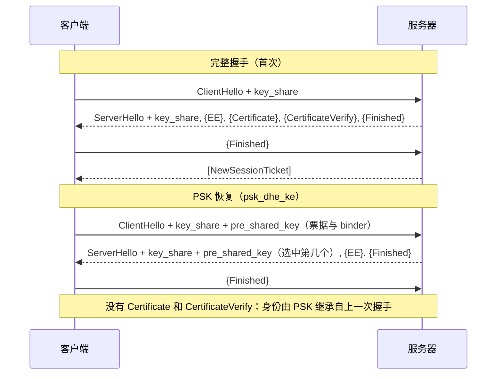
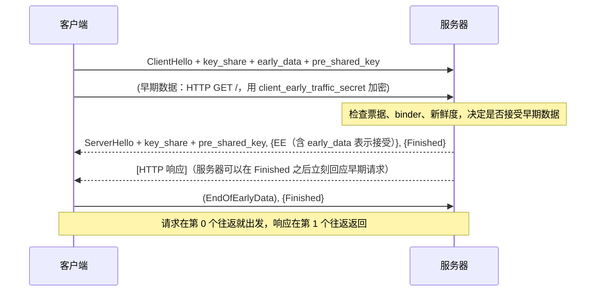
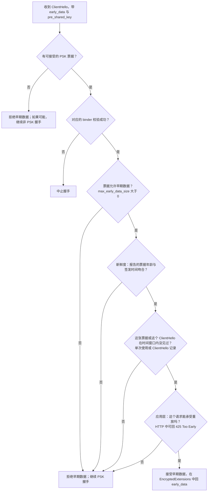
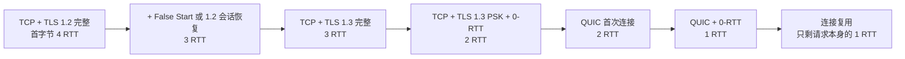

# T07 · 会话恢复、0-RTT 与握手性能优化

> 系列：[[00_tls-series-overview|TLS 系列总览]] · 上一篇：[[T06_tls13-handshake-and-key-schedule|T06 TLS 1.3 握手与密钥调度]] · 下一篇：[[T08_ech-and-https-record-privacy|T08 ECH 与 HTTPS 记录]]
> 前置知识：T01 的往返账，T05 的 TLS 1.2 会话恢复，T06 的密钥调度和 NewSessionTicket。
> 主要标准：RFC 5077（会话票据）、RFC 8446（§2.2、§2.3、§4.2.10、§4.2.11、§8）、RFC 8470（HTTP 中的早期数据）、RFC 7918（False Start）、RFC 7413（TCP Fast Open）、RFC 6928（初始拥塞窗口）、RFC 8879（证书压缩）、RFC 9113 §9.1.1（连接复用）、RFC 8336（ORIGIN 帧）、RFC 8297（103 Early Hints）
> 整理日期：2026-10-16（文中恢复与 0-RTT 实验为 2026-10-17 03:04 UTC 用 OpenSSL 4.0.3 对公开网站的实测）

T01 算过往返账：一次全新的 TCP 加 TLS 1.3 连接，要两个往返才能发出第一个 HTTP 请求。这一篇讲怎么把这些往返和字节一个个省下来：会话恢复跳过证书和签名，0-RTT 让请求和握手一起出发，False Start 和 TCP Fast Open 从不同的位置抢时间，证书压缩和 ECDSA 证书让握手塞进更少的包里，kTLS 和硬件指令降低每个字节的成本，连接复用让握手干脆少做几次。每种优化都有代价，0-RTT 的代价最需要讲清楚。

## 时间都花在哪里

握手的成本可以分成三类。第一类是往返：每一次必须等待对方回复的地方，都要付出一个 RTT，在跨洋链路上是一两百毫秒，这是用户最能感知的部分。第二类是字节：证书链、key_share、扩展都要占带宽，更要紧的是它们会不会超出 TCP 初始拥塞窗口，超出就要多等一个往返。第三类是计算：签名、密钥交换、证书验证、对称加解密，在服务器上乘以每秒成千上万次握手，就是实实在在的 CPU 和电费。

| 优化 | 主要省的 | 代价或前提 |
| --- | --- | --- |
| 会话恢复（PSK） | 证书传输、签名和验证的计算与字节 | 需要客户端缓存票据，服务器管理票据密钥 |
| 0-RTT 早期数据 | 一个往返 | 早期数据可被重放，对 PSK 泄露没有前向保密 |
| False Start（TLS 1.2） | 一个往返 | 只能用于前向保密的强套件 |
| TCP Fast Open | TCP 的一个往返 | 中间设备兼容性差，部署很少 |
| 证书压缩、ECDSA 证书 | 字节，进而避免额外的往返 | 双方都要支持 |
| 动态记录大小 | 首屏时间 | 需要服务器端实现 |
| kTLS、硬件加速 | 服务器 CPU | 内核和网卡支持 |
| 连接复用与合并 | 整次握手 | 证书覆盖多个域名，同一 IP |

## TLS 1.2 的恢复：会话 ID 与会话票据

T05 讲过 TLS 1.2 的简化握手：客户端在 ClientHello 里带上旧会话的 session_id，服务器如果还记得这个会话，就跳过证书和密钥交换，直接用旧的主密钥加新的随机数派生新密钥，握手从两个往返缩短到一个。会话 ID 的问题是服务器要保存状态，一个负载均衡后面的上百台服务器要共享会话缓存才能命中。

会话票据（RFC 5077）把状态反过来交给客户端：服务器用自己的票据密钥把会话状态加密成一张票据发给客户端，客户端下次原样交回，服务器解密就能恢复，自己不用存任何东西。T05 的真实抓取里，Cloudflare 在 TLS 1.2 握手末尾就发了一张 192 字节、有效期提示 18 小时的票据。

票据的隐患在前向保密。票据里装着主密钥，而票据由一把长期的票据密钥加密。谁拿到这把票据密钥，谁就能解开所有录下来的、用票据恢复的会话，以及签发这些票据的原始会话。所以票据密钥必须频繁轮换（大型服务通常以小时计），并且只保存在内存里、在集群内安全分发。2016 年的一项大规模测量（Springall、Durumeric、Halderman，"Measuring the Security Harm of TLS Crypto Shortcuts"，IMC 2016）发现，不少大型网站的票据密钥长达数周甚至更久不变，实际上抵消了 ECDHE 带来的前向保密。

## TLS 1.3 的 PSK 恢复

TLS 1.3 把会话恢复统一成了预共享密钥（PSK）机制（RFC 8446 §2.2）。T06 里服务器在握手后发来的 NewSessionTicket，客户端据此可以算出一个 PSK：

```
PSK = HKDF-Expand-Label(resumption_master_secret, "resumption", ticket_nonce, Hash.length)
```

下次连接时，客户端在 ClientHello 的最后一个扩展 pre_shared_key 里提供票据和一个绑定值（binder）：

```
pre_shared_key 扩展（ClientHello 中必须是最后一个扩展）
  identities:
    identity               票据本身（服务器加密的不透明数据）
    obfuscated_ticket_age  (票据年龄毫秒数 + ticket_age_add) mod 2^32
  binders:
    binder                 HMAC(binder 的 finished_key, Transcript-Hash(截掉 binders 部分的 ClientHello))
```

binder 证明客户端确实持有这个 PSK，并把 PSK 和这一条具体的 ClientHello 绑定在一起：binder_key 从 Early Secret 派生（T06 推导树里的 `res binder`），再按 Finished 的方式算 HMAC，HMAC 的输入是去掉 binders 列表之后的 ClientHello。攻击者拿到一张票据，没有对应的 PSK 就算不出 binder；把 binder 挪到另一条 ClientHello 上也对不上。pre_shared_key 必须是最后一个扩展，正是因为 binder 要覆盖它之前的全部内容。

obfuscated_ticket_age 让服务器检查票据的"年龄"是否合理（用于 0-RTT 的新鲜度检查），又不让路径上的观察者看到真实年龄。每张票据都有随机的 ticket_age_add，用来混淆其数值年龄；如果复用同一张票据，票据身份本身仍可能让观察者关联连接。票据有效期最长 7 天（§4.6.1）。

psk_key_exchange_modes 扩展规定恢复时怎么用 PSK。`psk_ke` 只用 PSK，不做 DH，计算最省，但会话密钥完全依赖 PSK，没有前向保密；`psk_dhe_ke` 在 PSK 之外再做一次 (EC)DHE，PSK 进入 Early Secret，DH 共享秘密进入 Handshake Secret，即使票据密钥日后泄露，恢复出的会话仍然安全。T06 里 OpenSSL 只提供了 `psk_dhe_ke`，浏览器也普遍只用这种模式。



恢复握手省掉的是证书链（几 KB）、服务器的签名运算和客户端的证书验证（包括证书链构建、吊销检查），往返数仍然是一个。2026-10-17 对四个网站的实测，第二次连接都显示 `Reused, TLSv1.3`，恢复握手里都没有 Certificate 消息：

| 网站 | 恢复结果 | 票据允许的早期数据 |
| --- | --- | --- |
| www.cloudflare.com | Reused，TLS_AES_256_GCM_SHA384 | 0 |
| www.google.com | Reused，TLS_AES_256_GCM_SHA384 | 14336 字节 |
| www.facebook.com | Reused，TLS_CHACHA20_POLY1305_SHA256 | 4294967295 字节（0xFFFFFFFF） |
| www.apple.com | Reused，TLS_AES_256_GCM_SHA384 | 0 |

最后一列来自票据里的 early_data 扩展（max_early_data_size），是服务器愿意接受的 0-RTT 数据上限，0 表示不接受 0-RTT。Facebook 的 0xFFFFFFFF 是协议的 uint32 最大值，约 4 GiB：它表示一个非常大的广告上限，不是真正的无上限。它的 TLS 栈来自 Meta 自研的 Fizz（见 [[T11_tls-engineering-practices|T11]]）。

## 0-RTT：让请求和握手一起出发

既然恢复时双方已经共享了 PSK，客户端为什么不能在第一个包里就用它加密请求？这就是 0-RTT 早期数据（RFC 8446 §2.3）。客户端用 PSK 派生出 client_early_traffic_secret（推导树里 Early Secret 下的 `c e traffic`，它只依赖 PSK 和 ClientHello），在 ClientHello 后面立刻发送加密的应用数据，不等服务器回复。



这不是纸面上的东西。2026-10-17 对 www.google.com 的实测：先做一次完整握手保存票据，再用 `openssl s_client -sess_in ... -early_data req.txt` 把一个 `GET /` 作为早期数据发出，结果是：

```
>>> TLS 1.3, Handshake [length 06f6], ClientHello          1782 字节（含 4 字节握手头），带 pre_shared_key 与 early_data
<<< TLS 1.3, Handshake [length 04c0], ServerHello          带混合后量子 key_share 与 pre_shared_key
<<< TLS 1.3, Handshake [length 000a], EncryptedExtensions  含 early_data，表示接受
<<< TLS 1.3, Handshake [length 0034], Finished
>>> TLS 1.3, Handshake [length 0004], EndOfEarlyData       客户端宣告早期数据结束
>>> TLS 1.3, Handshake [length 0034], Finished
Reused, TLSv1.3, Cipher is TLS_AES_256_GCM_SHA384
Early data was accepted
<<< NewSessionTicket ×2
HTTP/1.1 200 OK
```

没有 Certificate、没有 CertificateVerify，请求跟着 ClientHello 一起出发，服务器接受了早期数据并返回 200。ServerHello 里仍有 1120 字节的混合 key_share，说明这是 psk_dhe_ke 模式，握手之后的数据依然有前向保密。

### 0-RTT 的两个代价

第一个代价是重放（replay）。早期数据只用 PSK 加密，在服务器回复之前就已发出，服务器无法通过任何新鲜的交互确认它不是被录下来再次发送的。路径上的攻击者可以把这条 ClientHello 连同早期数据原样再发一次，甚至发到同一集群的另一台服务器上。如果早期数据是"转账 100 元"，重放就意味着转两次。

RFC 8446 §8 给了三种服务器端的防护，都不完美：单次使用的票据（服务器记住哪些票据已经用过，分布式集群里要全局同步才严格）；记录见过的 ClientHello（同样需要在集群内共享，并限定一个时间窗口）；新鲜度检查（用 obfuscated_ticket_age 估算票据年龄，和服务器自己记录的签发时间对比，拒绝明显太旧的请求，但只能缩小窗口不能消除重放）。规范因此要求使用 0-RTT 的应用协议必须自己定义哪些数据可以作为早期数据发送。如果没有选中可接受的 PSK，服务器可以拒绝早期数据，并在可能时继续非 PSK 握手。如果服务器已选中 PSK，对应 binder 缺失或无效必须中止握手，不能当作拒绝早期数据后的降级路径。其余早期数据检查失败时，PSK 握手可继续：



对 HTTP，这个规定在 RFC 8470 里：客户端只应在早期数据里发送安全、幂等、没有副作用的请求（典型的是 GET）；位于中间的代理或 CDN 如果是在早期数据里收到请求的，转发给后端时要加上 `Early-Data: 1` 头，后端如果认为这个请求不能冒重放的风险，就回 `425 Too Early`，让客户端在握手完成后重发。浏览器的普遍做法是只把可以安全重试的请求放进 0-RTT。

第二个代价是前向保密。早期数据的密钥只来自 PSK，没有经过新的 DH。票据密钥一旦泄露，录下的所有早期数据都能被解开，即使使用的是 psk_dhe_ke，DH 保护的只是握手之后的数据。

这两个代价就是为什么很多服务默认不开 0-RTT：实测里 Cloudflare 和 Apple 的票据都不允许早期数据，Cloudflare 把 0-RTT 作为客户可以自行打开的功能，由客户判断自己的应用能否承受重放。Google 和 Facebook 这样对自家应用的请求语义有完全掌控的公司，则愿意打开它换取一个往返。

## False Start 与 TCP Fast Open

这两种优化从 TLS 和 TCP 两头各抢一个往返。

TLS False Start（RFC 7918）是 TLS 1.2 的优化：客户端发出自己的 Finished 之后，不等服务器的 Finished，就开始发应用数据。完整握手的有效延迟因此从两个往返降到一个，和 TLS 1.3 相当。风险在于此时客户端还没有确认握手未被篡改，如果中间人把握手降级到一个可以实时破解的算法，客户端最早的那批数据就已经落到攻击者手里。所以 RFC 7918 只允许在使用前向保密的密钥交换和足够强的算法时 False Start，浏览器在 TLS 1.2 时代普遍启用了它。TLS 1.3 的 1-RTT 握手让它失去了意义。

TCP Fast Open（RFC 7413）让 TCP 的 SYN 携带数据：客户端第一次连接时向服务器要一个 cookie，之后的连接在 SYN 里带上 cookie 和数据（可以是 ClientHello），服务器验证 cookie 后可以在握手完成前就把数据交给应用。理论上它能把 TCP 加 TLS 1.3 加 0-RTT 的首字节压到一个往返。实际部署很少，原因有几个：不少中间设备会丢弃或篡改带数据的 SYN；SYN 里的数据和 0-RTT 一样可能被重放，要靠应用自己处理；cookie 可以被用来跟踪客户端。QUIC 在 UDP 上自己实现了 0-RTT 的建连，在很大程度上取代了 TCP Fast Open 想做的事（[[T09_quic-and-http3|T09]]）。

## 字节：别让握手多出一个往返

TCP 的慢启动规定，连接刚建立时发送方只能发出初始拥塞窗口那么多数据，然后等待 ACK 才能继续。RFC 6928 把初始窗口定为 10 个报文段，以 1460 字节的 MSS 计约 14KB。服务器的第一组回复（ServerHello、EncryptedExtensions、Certificate、CertificateVerify、Finished）如果超过这个大小，服务器发到一半就要停下等客户端的 ACK，凭空多出一个往返。

所以握手的字节数直接影响延迟。几个实测的数字：www.cloudflare.com 的 Certificate 消息是 2522 字节（含 4 字节握手头），www.google.com 的是 2477 字节，T03 里 letsencrypt.org 的四张证书一共 3576 字节，它们都是 ECDSA 证书链。混合后量子密钥交换让 ServerHello 增加了约 1.1KB（1120 字节的 key_share），加上证书链和签名，服务器第一组回复的总量对这几个网站来说大约在 4KB 上下，离 14KB 还有余量。容易超标的是带 RSA-4096 证书、多级中间证书、还钉了 OCSP 响应的老式配置，以及将来的后量子签名证书（[[T10_post-quantum-tls|T10]]）。

减小握手体积的手段有三种。用 ECDSA 证书代替 RSA 证书，公钥和签名都小得多（T03）。只发必要的中间证书，不发根证书。证书压缩（RFC 8879）：TLS 1.3 定义了 compress_certificate 扩展和 CompressedCertificate 消息，支持 zlib、brotli、zstd 三种算法，客户端声明支持哪些，服务器就可以把整个 Certificate 消息压缩后发送；证书里有大量重复的结构和名字，压缩效果可观。Chrome 和 Cloudflare 都支持 brotli 证书压缩。本机的 OpenSSL 4.0.3 构建没有链接这几个压缩库（`openssl version -a` 未列出），ClientHello 里没有声明支持，所以实测拿到的都是未压缩的证书，这里没有本机测得的压缩比可报。

## 记录大小与首屏

TLS 记录最大 16KB，接收方必须收齐一整条记录、验证完认证标签才能解密出任何一个字节。如果服务器在连接刚开始时就发 16KB 的大记录，而这条记录跨了十几个 TCP 段，浏览器要等全部段到达才能开始解析 HTML，任何一个段丢包重传都会卡住整条记录。

动态记录大小（dynamic record sizing）是 Google 和 Cloudflare 等在服务器端采用的做法：连接刚开始时使用小记录（每条装进一个 TCP 段，约 1.4KB），让浏览器尽早拿到数据开始渲染；连接稳定、窗口变大后再切换到 16KB 的大记录以减少开销；空闲一段时间后再回到小记录。nginx 用 `ssl_buffer_size` 指令设置一个固定的记录大小，默认 16KB，追求首屏的站点常把它调小到 4KB 左右，这是一个吞吐和延迟之间的取舍。

## 计算：签名、密钥交换和对称加密

服务器每次完整握手要做一次签名和一次密钥交换。ECDSA P-256 签名比 RSA-2048 签名快一个数量级左右，这是大型服务偏好 ECDSA 证书的另一个原因；客户端验证时 RSA 反而更快，但单个客户端只验几次，影响不大。X25519 非常便宜。ML-KEM-768 的计算速度和 X25519 同一量级，主要代价是字节而不是 CPU（T10）。会话恢复省掉了签名和证书验证，对服务器 CPU 的节省很明显。

对称加密部分，有 AES 硬件指令的处理器上 AES-GCM 每核每秒能处理数 GB，几乎不构成瓶颈；没有硬件指令的低端设备上 ChaCha20-Poly1305 更快，T02 和 T05 里讲过服务器怎么据此选套件。

真正的高吞吐场景，瓶颈会从加密本身转移到数据在内核和用户态之间的复制。kTLS（内核 TLS）把记录层的对称加解密放进内核：握手仍由用户态的 TLS 库完成，完成后把流量密钥交给内核，之后应用可以直接用 `sendfile` 把文件从磁盘送进加密的 socket，不必先读进用户态再加密再写回去。Linux 从 4.13 起支持 kTLS 发送，FreeBSD 也有完整的实现。更进一步，部分网卡支持把 TLS 记录加密卸载到硬件上。Netflix 在 FreeBSD 上用 kTLS 加网卡 TLS 卸载做视频分发，公开介绍过单台服务器 400Gb/s 量级的加密吞吐。

## 连接复用：最好的握手是不握手

所有握手优化加起来，也比不上"根本不握手"。HTTP/2 让一个域名只用一条连接承载所有请求（RFC 9113）；连接合并（connection coalescing，RFC 9113 §9.1.1）进一步允许浏览器把 `a.example.com` 的请求放到已经为 `b.example.com` 建立的连接上，前提是两个名字解析到同一个 IP、并且这条连接的证书同时覆盖这两个名字。CDN 常用一张包含很多 SAN 的证书来提高合并的机会。ORIGIN 帧（RFC 8336）让服务器主动告诉客户端"这条连接还可以用于哪些源"，不必依赖 DNS 解析结果一致。HTTP/3 有同样的机制。

页面层面还有几个提前建连的手段：`<link rel="preconnect">` 让浏览器提前完成某个域名的 DNS、TCP 和 TLS 握手；103 Early Hints（RFC 8297）让服务器在还没准备好正式响应时，先发一个信息性响应告诉浏览器"马上会用到这些资源和域名"，浏览器可以利用这段等待时间去预连接和预加载。

## 往返预算小结

把 T01 的往返表和这一篇的优化放在一起，从客户端发出第一个包算起、不含 DNS：



另外三件事决定了实际能否达到这些数字：握手体积不要超过初始拥塞窗口，客户端的 key_share 预测要准以免 HelloRetryRequest，以及 DNS 能否通过缓存或 HTTPS 记录省掉额外的查询。

## 常见误解

会话恢复就是 0-RTT。会话恢复（PSK）省的是证书和签名，往返仍是一个；0-RTT 是在恢复的基础上额外让请求随 ClientHello 出发，它需要服务器明确允许（票据的 max_early_data_size 大于 0），而且带着重放风险。实测四个网站都支持恢复，只有两个允许 0-RTT。

0-RTT 数据和普通数据一样安全。它可以被重放，并且对票据密钥的泄露没有前向保密。只应放入可以安全重复执行的请求。

开了 ECDHE，会话票据就不影响前向保密。TLS 1.2 的票据里直接装着主密钥，票据密钥泄露就能解开这些会话；TLS 1.3 用 psk_dhe_ke 可以保住握手之后数据的前向保密，但早期数据仍然没有。

证书大一点没关系，带宽够。问题不在带宽而在 TCP 初始拥塞窗口，超过约 14KB 就要多等一个往返，在高延迟链路上这比多传几 KB 显著得多。

TLS 加密很耗 CPU。现代处理器上对称加密的开销很小，签名和密钥交换才是握手的主要计算成本，而会话恢复和 ECDSA 证书能大幅降低它。真正的高吞吐瓶颈常常是数据复制，kTLS 解决的就是这一点。

## 本篇引用的标准与资料

- RFC 5077, TLS Session Resumption without Server-Side State, https://www.rfc-editor.org/rfc/rfc5077
- RFC 8446, TLS 1.3（§2.2 恢复与 PSK、§2.3 0-RTT、§4.2.10 early_data、§4.2.11 pre_shared_key、§4.6.1 NewSessionTicket、§8 0-RTT 与抗重放）, https://www.rfc-editor.org/rfc/rfc8446
- RFC 8470, Using Early Data in HTTP, https://www.rfc-editor.org/rfc/rfc8470
- RFC 7918, TLS False Start, https://www.rfc-editor.org/rfc/rfc7918
- RFC 7413, TCP Fast Open, https://www.rfc-editor.org/rfc/rfc7413
- RFC 6928, Increasing TCP's Initial Window, https://www.rfc-editor.org/rfc/rfc6928
- RFC 8879, TLS Certificate Compression, https://www.rfc-editor.org/rfc/rfc8879
- RFC 9113, HTTP/2（§9.1.1 连接复用）, https://www.rfc-editor.org/rfc/rfc9113
- RFC 8336, The ORIGIN HTTP/2 Frame, https://www.rfc-editor.org/rfc/rfc8336
- RFC 8297, An HTTP Status Code for Indicating Hints（103 Early Hints）, https://www.rfc-editor.org/rfc/rfc8297
- Linux 内核文档, Kernel TLS, https://docs.kernel.org/networking/tls.html
- Netflix, "Serving Netflix Video at 400Gb/s on FreeBSD"（Drew Gallatin，EuroBSDCon 2021）
- 本机实测：`openssl s_client -tls1_3 -sess_out` / `-sess_in` / `-early_data` / `-msg`（OpenSSL 4.0.3，2026-10-17 03:04 UTC），对 www.cloudflare.com、www.google.com、www.facebook.com、www.apple.com
