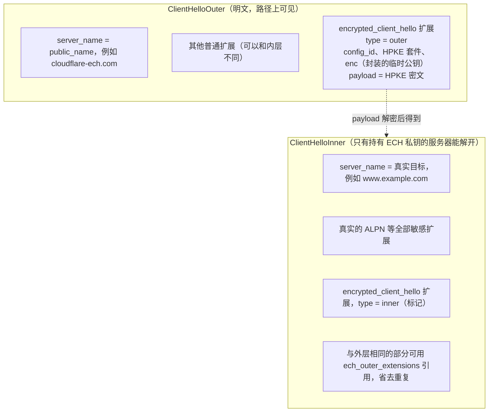
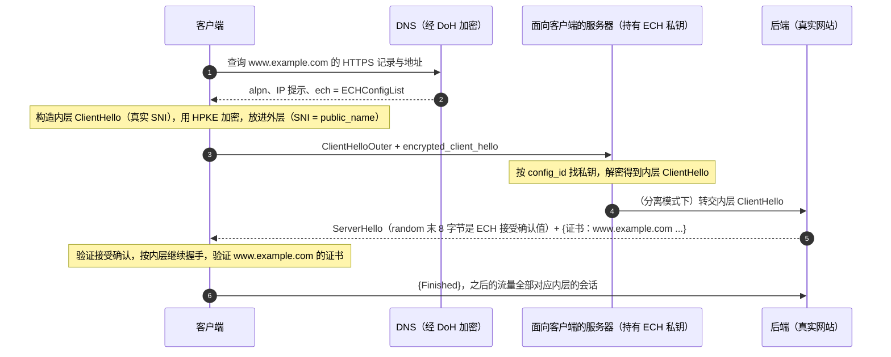
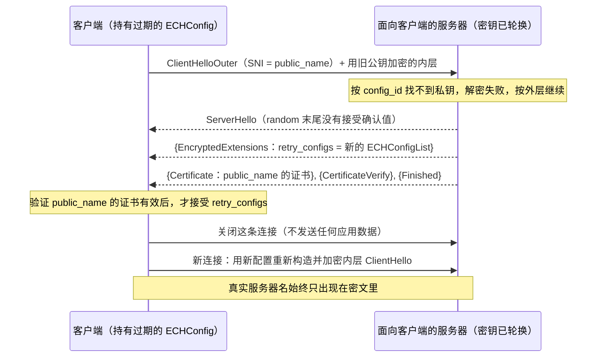

# T08 · ECH 与 HTTPS 记录：握手里的隐私

> 系列：[[00_TLS系列总览与学习路线|TLS 系列总览]] · 上一篇：[[T07_会话恢复_0-RTT与握手性能优化|T07 会话恢复与 0-RTT]] · 下一篇：[[T09_QUIC与HTTP3_把TLS放进传输层|T09 QUIC 与 HTTP/3]]
> 前置知识：T06 的 ClientHello 结构和降级哨兵思路，T02 的 AEAD 和 X25519。
> 主要标准：RFC 9849（TLS Encrypted Client Hello，2026-03）、RFC 9848（用 DNS 服务绑定引导 ECH，2026-03）、RFC 9934（ECH 密钥的 PEM 格式）、RFC 9180（HPKE）、RFC 9460（SVCB 与 HTTPS 记录）、RFC 6066 §3（SNI）、RFC 8484（DoH）、RFC 7858（DoT）、RFC 9250（DoQ）、RFC 8701（GREASE）
> 整理日期：2026-10-16（文中 HTTPS 记录为 2026-10-17 03:07 UTC 经 1.1.1.1 查询的真实结果）

TLS 1.3 把证书和大部分握手消息加密了，但 ClientHello 仍然是明文，而 ClientHello 里写着你要访问的域名。这一篇先盘点 TLS 1.3 握手里还剩哪些明文，再讲 SNI 为什么必须存在、为什么一直是明文，然后讲 ECH（Encrypted Client Hello）怎么用公钥加密把整个真实的 ClientHello 藏起来，最后讲客户端从哪里拿到加密用的公钥：DNS 的 HTTPS 记录。ECH 在 2026 年 3 月发布为 RFC 9849，这里按 RFC 讲它的目标和机制。

## TLS 1.3 握手里还剩哪些明文

| 可见的信息 | 出现在哪 | 能推断出什么 |
| --- | --- | --- |
| 源 IP、目的 IP、端口 | IP 与 TCP/UDP 头 | 在和哪台服务器通信；如果这个 IP 只托管一个站点，就等于知道了站点 |
| DNS 查询 | 未加密时的 DNS 报文 | 要访问哪个域名 |
| SNI | ClientHello 的 server_name 扩展 | 要访问哪个域名 |
| ALPN | ClientHello | 用的是 HTTP/2、HTTP/3 还是别的协议 |
| 密码套件、群、扩展的列表和顺序 | ClientHello | 客户端是什么软件、什么版本（指纹） |
| 记录的长度和时间 | 每条记录 | 流量分析可以推测访问的页面类型 |
| 服务器证书 | TLS 1.2 时明文 | TLS 1.3 已加密 |

其中 DNS 查询可以用 DoH、DoT 加密，证书在 TLS 1.3 里已经加密，剩下最直接暴露目标的就是 SNI。

## SNI 为什么存在，为什么是明文

SNI（Server Name Indication）最早在 2003 年的 RFC 3546 里定义，现行定义在 RFC 6066 §3。它要解决的问题是虚拟主机：一个 IP 地址上托管着很多网站，服务器在握手一开始就必须决定发哪一张证书，而在 TLS 的设计里，那时候服务器还什么都不知道，HTTP 的 Host 头要等握手完成才发送。客户端于是在 ClientHello 里直接告诉服务器"我要找的是 www.example.com"，服务器据此挑证书。没有 SNI，每个 HTTPS 网站就需要一个独立的 IP，这在 IPv4 地址日益紧张的时代是不可行的，CDN 这种一个 IP 服务成千上万个域名的模式更是无从谈起。

SNI 是明文，原因很简单：它出现在握手的第一条消息里，那时双方还没有任何共享的密钥可以用来加密它。要加密它，客户端必须事先就拿到服务器的某个公钥，而这个公钥又不能通过这次握手本身获得。这个"先有鸡还是先有蛋"的问题，就是 ESNI 和 ECH 要解决的。

## 从 ESNI 到 ECH

2018 年，IETF 的第一版方案叫 ESNI（Encrypted SNI，draft-ietf-tls-esni 的早期版本），Cloudflare 和 Firefox 当年就做了部署实验。它的思路是只加密 server_name 扩展：服务器在 DNS 的 TXT 记录里发布一个公钥，客户端用它加密 SNI。

ESNI 很快暴露出不足。只加密 SNI 不够，ClientHello 里的其他扩展（比如 ALPN、某些只有特定服务才会用到的扩展）同样会泄露信息；每加一个敏感的扩展就要单独设计加密方式，不可持续。密钥轮换和失败恢复的设计也有缺陷，客户端拿到的公钥过期了怎么办没有安全的答案。于是 2020 年起方案被重新设计并改名为 ECH：不再只加密某一个扩展，而是把一个完整的、真实的 ClientHello 整体加密，塞进一个外层的、"无害"的 ClientHello 里。又经过了几年、二十多版草案的修改，2026 年 3 月发布为 RFC 9849。

## ECH 的角色与外层、内层 ClientHello

ECH 引入了两个角色。客户端直接连接的叫面向客户端的服务器（client-facing server），它持有 ECH 私钥；真正提供目标网站的叫后端服务器（backend server）。两者可以是同一台机器（共享模式，shared mode），也可以分开，面向客户端的服务器解密后把连接转交给后端（分离模式，split mode）。典型的部署是一家 CDN：所有客户的网站都在同一个面向客户端的服务器后面，它对外公布一个公共名字（public_name），比如 Cloudflare 用的 `cloudflare-ech.com`。

客户端发出的握手里有两个 ClientHello：



外层 ClientHello 是一个完整、合法的 ClientHello，服务器名写的是公共名字。真实的 ClientHello 被编码后用 HPKE 加密，放在外层的 encrypted_client_hello 扩展里。为了不让外层变得太大，内层中与外层完全相同的扩展（比如 key_share 和 supported_groups 往往相同）不必重复携带，可以用 ech_outer_extensions 扩展指明"这几个扩展请照抄外层的"。

## HPKE：一次性的公钥加密

ECH 的加密用的是 HPKE（Hybrid Public Key Encryption，RFC 9180）。HPKE 是一个通用的"用接收方公钥加密一段数据"的标准构造，把 KEM（密钥封装）、KDF 和 AEAD 组合起来：

```
发送方（客户端）：
  enc, ctx = SetupBaseS(pkR, info)       用接收方公钥 pkR 封装出一个共享秘密，enc 是要发给接收方的封装值
  ct       = ctx.Seal(aad, plaintext)    用由共享秘密派生的 AEAD 密钥加密
接收方（面向客户端的服务器）：
  ctx      = SetupBaseR(enc, skR, info)  用自己的私钥 skR 和 enc 恢复同一个共享秘密
  pt       = ctx.Open(aad, ct)

在 ECH 中：
  info      = "tls ech" + 0x00 + ECHConfig      把加密绑定到具体的配置
  aad       = ClientHelloOuterAAD               外层 ClientHello（payload 字段置零）
  plaintext = EncodedClientHelloInner           编码并填充后的内层 ClientHello
```

KEM 用 X25519 时（HPKE 里叫 DHKEM(X25519, HKDF-SHA256)），封装就是生成一个临时 X25519 密钥对，enc 是临时公钥，共享秘密来自临时私钥和接收方公钥的 DH，概念上就是 T02 的 ECDH 加上 HKDF。aad 用的是外层 ClientHello，于是外层的任何一个字节被改，内层就解不开，攻击者不能在保留密文的同时篡改外层。info 里包含整个 ECHConfig，保证密文只能被这一份配置对应的私钥解开。

## 一份真实的 ECHConfig

客户端从哪里拿到 pkR？从 DNS 的 HTTPS 记录。2026-10-17 查询 `crypto.cloudflare.com` 的 HTTPS 记录（本机 `dig` 9.10.6 太老，不认识 HTTPS 类型，用 `TYPE65` 查询，得到 RFC 3597 格式的十六进制），解码后是：

```
SvcPriority  1                          服务模式（ServiceMode）
TargetName   .                          就是这个名字本身
alpn         h2
ipv4hint     162.159.135.79, 162.159.136.79
ipv6hint     2606:4700:7::a29f:874f, 2606:4700:7::a29f:884f
ech          71 字节，ECHConfigList：
  ECHConfig
    version               0xfe0d        ECH 配置的版本号
    length                65
    config_id             117           本份配置的编号，客户端回传，服务器据此找私钥
    kem_id                0x0020        DHKEM(X25519, HKDF-SHA256)
    public_key            32 字节       ad5cf6ae627c0841...
    cipher_suites         (kdf 0x0001 HKDF-SHA256, aead 0x0001 AES-128-GCM)
    maximum_name_length   0             后端最长名字未知，用默认的填充策略
    public_name           cloudflare-ech.com
    extensions            空
```

每个字段都能和 RFC 9849 §4 的 ECHConfig 定义对上。public_name `cloudflare-ech.com` 就是外层 ClientHello 里会写的名字，路径上的观察者只能看到这个。config_id 只有一个字节，是给服务器快速查找私钥用的，客户端在外层的 encrypted_client_hello 里原样带回。同一时刻查 `www.cloudflare.com` 的 HTTPS 记录，只有 `alpn=h3,h2` 和 IP 提示，没有 ech 参数，说明 ECH 是按域名逐个配置的。

## 握手怎么走



服务器怎么告诉客户端"我成功解开并使用了内层"？它把 ServerHello.random 的最后 8 字节换成一个确认值，这个值是用内层 ClientHello 的 random 和握手转录、经过 HKDF（标签 `ech accept confirmation`）算出来的（RFC 9849 §7.2）。只有真正解开了内层的服务器才能算出它，客户端算出同样的值就确认 ECH 被接受。这个思路和 T06 里降级哨兵一样，都是借 ServerHello.random 传递一个信号，而对旁观者来说它看起来仍然是随机数。

如果服务器解不开（客户端用的是过期的配置，或者服务器的密钥已经轮换），ECH 有一条安全的回退路径：服务器就当没有 ECH，用外层 ClientHello 继续握手，出示 public_name 的证书，并在加密的 EncryptedExtensions 里附上新的 retry_configs。客户端验证 public_name 的证书确实有效后，接受这份新配置，关闭这条连接，用新配置重新连接。整个过程中真实的服务器名一次都没有以明文出现，代价是多一次连接。客户端必须验证 public_name 的证书才信任 retry_configs，否则中间人可以塞给它一份假配置。



## 填充、GREASE 与匿名集

加密了内容，长度仍然可能泄露信息：`a.com` 和 `a-very-long-name.example.org` 加密后长度不同。ECH 要求客户端对内层 ClientHello 做填充（RFC 9849 §6.1.3）：至少把服务器名填充到 maximum_name_length（未知时按规范给出的默认规则），再把整个内层的长度对齐到 32 字节的倍数，让不同目标的握手看起来一样长。

GREASE ECH 解决另一个问题：如果只有真正使用 ECH 的客户端才发 encrypted_client_hello 扩展，"使用了 ECH"这件事本身就成了一个信号，网络可以据此区别对待。所以没有 ECH 配置的客户端也会发一个格式完全相同、内容随机的假扩展（RFC 9849 §6.2）。观察者从外层看不出哪些连接真的用了 ECH。T04 和 T06 讲过的 GREASE（RFC 8701）是同一种思想：让不认识的值在网络上常态化，防止僵化。

ECH 的隐私效果取决于匿名集（anonymity set）有多大：它隐藏的是"你在访问这个面向客户端的服务器后面的哪一个名字"。如果一个 public_name 后面有上百万个网站，观察者只知道你在访问其中之一；如果一台服务器只托管一个网站，ECH 加密了 SNI，IP 地址照样暴露了目标。这就是为什么 ECH 的部署天然集中在大型 CDN 上，也是为什么它和 IP 层的信息（以及流量分析）配合起来看才能评估实际的隐私收益。

## HTTPS 记录不只是为了 ECH

ECHConfig 的发布方式由 RFC 9848 规定：放在 SVCB 和 HTTPS 记录（RFC 9460）的 `ech` 参数里。HTTPS 记录本身的作用远不止这一个，T01 提过它，这里展开：

| 参数 | 键号 | 作用 |
| --- | --- | --- |
| alpn | 1 | 服务支持的应用协议，例如 h3、h2，客户端可以直接用 QUIC 连接，不必先用 TCP 连上再从 Alt-Svc 得知 |
| no-default-alpn | 2 | 不支持默认的 http/1.1 |
| port | 3 | 非默认端口 |
| ipv4hint、ipv6hint | 4、6 | 地址提示，省一次 A/AAAA 查询的等待 |
| ech | 5 | ECHConfigList（RFC 9848） |

HTTPS 记录还有两个容易被忽略的用途。一是 AliasMode（SvcPriority 为 0）：可以把裸域名 `example.com` 指向 CDN 的主机名，解决了 CNAME 不能用在区域顶点的老问题。二是升级到 HTTPS：RFC 9460 §9.5 规定，客户端发现一个域名有 HTTPS 记录，就应该把 `http://` 的访问直接升级为 `https://`，效果和 HSTS 类似，省掉了明文跳转那一步（T01）。

## DNS 也必须加密

ECH 的公钥是通过 DNS 拿到的，这里有一个前提：DNS 查询本身也必须加密。否则两件事会发生：观察者从明文 DNS 查询里就能读出要访问的域名，ECH 加密 SNI 也就失去了意义；路径上的人还可以在明文 DNS 应答里删掉 ech 参数，让客户端以为这个域名不支持 ECH。

加密 DNS 有三种标准方式：DoT（DNS over TLS，RFC 7858，853 端口）、DoH（DNS over HTTPS，RFC 8484，和普通 HTTPS 共用 443 端口）、DoQ（DNS over QUIC，RFC 9250）。浏览器启用 ECH 通常要求同时使用 DoH 或系统提供的加密 DNS，Firefox 从 129 版起可以通过操作系统的 DNS 解析器获取 ECH 配置（Mozilla wiki）。这几种方式本身也都跑在 TLS 或 QUIC 上，DNS 的隐私和 TLS 的隐私是同一件事的两面。自建 DoH 服务器的完整部署记录见 [[self-host-dns]]。

## 部署现状（2026-10）

RFC 9849 发布于 2026 年 3 月，但浏览器在草案阶段就已实现。Firefox 从 98 版起实现了 ECH，129 版起可以经由系统 DNS 获取配置；Chrome 从 117 版起默认启用（这一版本号来自二手资料）。服务器端，Cloudflare 是目前最主要的部署者，前面那份真实的 ECHConfig 就来自它。TLS 库方面，BoringSSL（Chrome 使用）和 NSS（Firefox 使用）都已支持，本机的 OpenSSL 4.0.3 的 `s_client` 也已经提供了 ECH 相关的参数。Apple 平台的系统网络栈默认不启用 ECH，Apple 开发者论坛上有开发者提交了"在 iOS 上默认启用 ECH"的反馈，iOS 26 是否改变了这一点，截至整理时未查到权威资料。

## 局限与争议

ECH 不隐藏 IP 地址，所以它的效果严重依赖匿名集；它不隐藏记录长度和时间，流量分析依然可行；外层 ClientHello 的指纹（客户端软件的特征）仍然可见；它要求加密 DNS 配合，否则意义有限。

ECH 的标准化过程中，IETF 里也有过关于网络运营和管理的讨论：一些企业网络、安全设备和家长控制方案依赖读取 SNI 来执行访问策略，ECH 让这类做法失效。IETF 早在 RFC 8404 里就系统讨论过普遍加密对网络运营的影响。标准最终选择了把隐私作为默认，把策略执行留给终端设备上的配置和管理手段（比如企业可以在受管设备上关闭 ECH 或部署本地策略）。

## 常见误解

开了 TLS 1.3，访问的网站就保密了。TLS 1.3 加密了证书，但 SNI 仍然是明文，DNS 查询如果没有加密也是明文。只有同时使用 ECH 和加密 DNS，"访问了哪个域名"才不会从握手和 DNS 里泄露，IP 地址仍然可见。

ECH 只加密了 SNI。那是 ESNI 的做法。ECH 加密的是整个内层 ClientHello，包括 SNI、ALPN 和其他所有敏感扩展。

ECH 公钥过期了连接就会失败，或者泄露真实名字。过期时服务器用外层握手出示 public_name 的证书并下发新配置，客户端验证后用新配置重连，真实名字不会以明文出现。

外层 ClientHello 里的 SNI 是假的，可以随便写。外层的 server_name 应该是 ECHConfig 里的 public_name，服务器在回退时要出示这个名字的有效证书，客户端会验证它。这是 ECH 安全回退能成立的前提。

HTTPS 记录只是给 ECH 用的。它还承担 ALPN 发现（直接用 HTTP/3）、地址提示、顶点域名别名和 HTTPS 升级，ECH 只是它的一个参数。

## 本篇引用的标准与资料

- RFC 9849, TLS Encrypted Client Hello, https://www.rfc-editor.org/rfc/rfc9849.html
- RFC 9848, Bootstrapping TLS Encrypted ClientHello with DNS Service Bindings, https://www.rfc-editor.org/info/rfc9848/
- RFC 9934, Privacy-Enhanced Mail (PEM) File Format for Encrypted ClientHello (ECH), https://datatracker.ietf.org/doc/rfc9934/
- RFC 9180, Hybrid Public Key Encryption, https://www.rfc-editor.org/rfc/rfc9180
- RFC 9460, Service Binding and Parameter Specification via the DNS (SVCB and HTTPS Resource Records), https://www.rfc-editor.org/rfc/rfc9460
- RFC 3597, Handling of Unknown DNS Resource Record (RR) Types, https://www.rfc-editor.org/rfc/rfc3597
- RFC 6066, TLS Extensions（§3 Server Name Indication）, https://www.rfc-editor.org/rfc/rfc6066
- RFC 8484, DNS Queries over HTTPS (DoH), https://www.rfc-editor.org/rfc/rfc8484
- RFC 7858, DNS over TLS, https://www.rfc-editor.org/rfc/rfc7858
- RFC 9250, DNS over Dedicated QUIC Connections, https://www.rfc-editor.org/rfc/rfc9250
- RFC 8701, Applying GREASE to TLS Extensibility, https://www.rfc-editor.org/rfc/rfc8701
- RFC 8404, Effects of Pervasive Encryption on Operators, https://www.rfc-editor.org/rfc/rfc8404
- Mozilla Wiki, Security/Encrypted Client Hello, https://wiki.mozilla.org/Security/Encrypted_Client_Hello
- Apple Developer Forums, Enable Encrypted Client Hello (ECH, RFC 9849) by default on iOS/iPadOS, https://developer.apple.com/forums/thread/842112
- 本机实测：`dig +short TYPE65 crypto.cloudflare.com @1.1.1.1`、`dig +short TYPE65 www.cloudflare.com @1.1.1.1`（2026-10-17 03:07 UTC），用 Node.js 按 RFC 9460 与 RFC 9849 的格式解码
