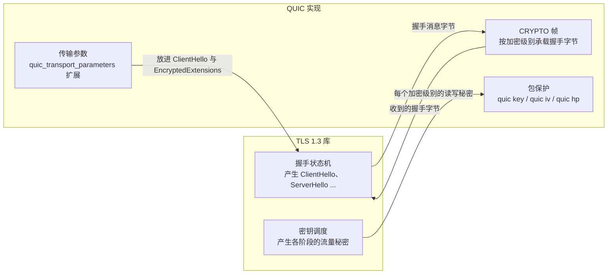
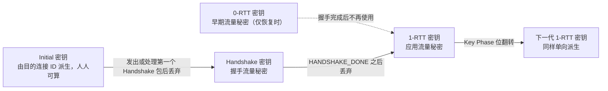
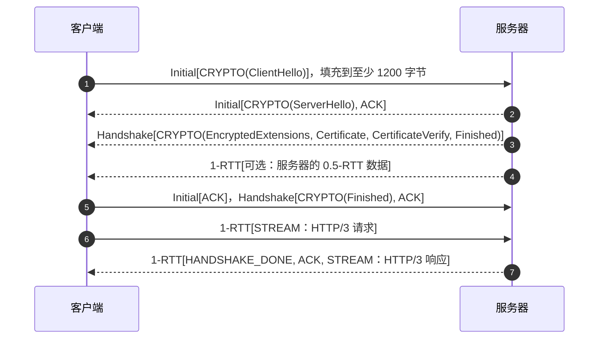

# T09 · QUIC 与 HTTP/3：把 TLS 放进传输层

> 系列：[[00_TLS系列总览与学习路线|TLS 系列总览]] · 上一篇：[[T08_ECH与HTTPS记录_握手里的隐私|T08 ECH 与 HTTPS 记录]] · 下一篇：[[T10_后量子TLS_ML-KEM混合密钥交换与MTC|T10 后量子 TLS]]
> 前置知识：T05 的 TCP，T06 的 TLS 1.3 握手和密钥调度，T07 的 0-RTT。入门性质的介绍见 [[../QUIC|QUIC 入门笔记]]。
> 主要标准：RFC 8999（版本无关属性）、RFC 9000（QUIC 传输）、RFC 9001（用 TLS 保护 QUIC）、RFC 9002（丢包检测与拥塞控制）、RFC 9114（HTTP/3）、RFC 9204（QPACK）、RFC 7838（Alt-Svc）、RFC 9369（QUIC v2）、RFC 9368（兼容版本协商）
> 整理日期：2026-10-16（文中 Initial 密钥按 RFC 9001 附录 A 的测试向量在本机复算）

前面几篇里，TLS 一直坐在 TCP 上面，两次握手叠在一起，T01 的往返账里 TCP 那一个往返怎么也省不掉。QUIC 换了一种思路：在 UDP 上重新实现一个传输协议，让它从第一个包起就和 TLS 1.3 的握手合在一起。这一篇讲 QUIC 为什么要这样做，它怎么借用 TLS 1.3 的握手却不用 TLS 的记录层，它的包是怎么被加密和"混淆"的，以及 HTTP/3 怎么建在它上面、浏览器怎么发现它。

## 为什么要在 UDP 上重造一个传输层

QUIC 要解决 TCP 的三个问题。

第一是握手延迟。TCP 的三次握手和 TLS 的握手是两个独立的协议，只能串行，首次连接至少两个往返才能发出请求。TCP Fast Open 想把 TCP 那个往返省掉，但在实践中部署不起来（T07）。

第二是队头阻塞。TCP 提供的是一条有序的字节流，HTTP/2 在一条 TCP 连接上复用了很多个请求，可一旦丢了一个包，TCP 要等这个包重传到达，才能把后面所有已经收到的数据交给应用，哪怕那些数据属于完全无关的请求。在丢包率高的移动网络上，HTTP/2 甚至可能比开多条连接的 HTTP/1.1 还慢。

第三是僵化（ossification）。TCP 的实现在操作系统内核里，改一个行为要等所有操作系统升级；更麻烦的是 TCP 头是明文的，路径上大量中间设备会读取甚至改写 TCP 头的字段，任何新的 TCP 选项都可能被某个设备丢弃。T04 里 TLS 1.3 部署时遇到的中间设备问题，在 TCP 层只会更严重。

QUIC 的回答是：跑在 UDP 上（中间设备基本只看 UDP 的端口），在用户态实现（应用自己带协议栈，随应用更新），并且几乎加密一切，包括传输层的控制信息，让中间设备无从依赖、也就无从僵化。

它的历史可以简单记为：Google 的 Jim Roskind 在 2012 年设计了最初的 QUIC（后来称 gQUIC），2013 年起在 Chrome 和 Google 服务器之间部署，使用自己的加密握手；2016 年 IETF 成立 QUIC 工作组，把加密换成了 TLS 1.3；2021 年 5 月发布 RFC 9000、9001、9002；2022 年 6 月发布 HTTP/3（RFC 9114）。

## QUIC 的基本结构

```
     HTTP/3 请求与响应
+---------------------------+
|  HTTP/3 帧、QPACK          |
+---------------------------+
|  QUIC 流（stream）          |   一个连接里有很多条相互独立的有序字节流
+---------------------------+
|  QUIC 帧（frame）           |   CRYPTO、STREAM、ACK、NEW_CONNECTION_ID、PATH_CHALLENGE ...
+---------------------------+
|  QUIC 包（packet）          |   加密后放进 UDP 数据报，一个数据报可以装几个包
+---------------------------+
|  UDP                       |
+---------------------------+
```

一个 QUIC 连接由连接 ID（Connection ID）标识，而不是像 TCP 那样由四元组（源 IP、源端口、目的 IP、目的端口）标识，这是后面连接迁移的基础。包分两种头：长头部（long header）用于握手阶段的 Initial、0-RTT、Handshake 和 Retry 包，带有版本号和双方的连接 ID；短头部（short header）用于握手完成后的 1-RTT 包，只带目的连接 ID，开销很小。包里装着帧，帧是 QUIC 真正的控制和数据单元：STREAM 帧装某一条流的数据，ACK 帧做确认，CRYPTO 帧装 TLS 握手消息。

每一条流有自己的序号空间，丢包只影响它所在的那条流，其他流的数据可以照常交给应用，TCP 层的队头阻塞因此消失了。

## QUIC 怎么使用 TLS 1.3

RFC 9001 的核心设计是：QUIC 使用 TLS 1.3 的握手，但不使用 TLS 的记录层。TLS 握手消息（ClientHello、ServerHello、EncryptedExtensions、Certificate、CertificateVerify、Finished）原封不动地产生，但不再被装进 TLS 记录，而是装进 QUIC 的 CRYPTO 帧；TLS 库在握手的各个阶段把派生出的流量秘密交给 QUIC，由 QUIC 自己用这些秘密派生密钥、加密 QUIC 包。



QUIC 定义了四个加密级别，对应 TLS 1.3 的几个阶段：

| 加密级别 | 秘密从哪来 | 用于 | 包号空间 |
| --- | --- | --- | --- |
| Initial | 由客户端选的目的连接 ID 和固定的盐派生 | ClientHello、ServerHello | Initial |
| 0-RTT | client_early_traffic_secret | 客户端的早期数据 | 应用数据 |
| Handshake | 握手流量秘密 | EncryptedExtensions 到 Finished | Handshake |
| 1-RTT | 应用流量秘密 | 所有应用数据 | 应用数据 |

一条连接从建立到稳定传输，密钥按下面的顺序启用和丢弃，丢弃旧密钥是为了让旧级别的包即使被重放也无法再被处理：



每个级别的秘密都用 TLS 1.3 的 HKDF-Expand-Label 派生出 QUIC 用的三把材料，标签分别是 `quic key`（AEAD 密钥）、`quic iv`（IV）和 `quic hp`（头部保护密钥）。QUIC 的传输参数（最大流数量、流量控制窗口、空闲超时、自己的连接 ID 等）放在 TLS 扩展 quic_transport_parameters 里，跟着 ClientHello 和 EncryptedExtensions 传输，于是它们和握手的其余部分一起被 TLS 认证，中间人无法篡改。ALPN 在 QUIC 里是必须的，HTTP/3 的 ALPN 值是 `h3`。

QUIC 也删掉了 TLS 里与它重复的东西：没有 ChangeCipherSpec，没有兼容模式的假消息，不用 TLS 的 KeyUpdate 消息（换密钥改由 QUIC 包头里的 Key Phase 位表示），也不使用 TLS 的 EndOfEarlyData。

## Initial 包：只是混淆，不是保密

握手刚开始，客户端还没有和服务器共享任何秘密，可 QUIC 希望连第一个包都"加密"，以免中间设备读取和依赖里面的内容。它的做法是用一个所有人都知道的方式派生 Initial 密钥（RFC 9001 §5.2）：

```
initial_salt   = 0x38762cf7f55934b34d179ae6a4c80cadccbb7f0a   （QUIC v1 固定值）
initial_secret = HKDF-Extract(initial_salt, 客户端第一个包的目的连接 ID)
client_initial_secret = HKDF-Expand-Label(initial_secret, "client in", "", 32)
server_initial_secret = HKDF-Expand-Label(initial_secret, "server in", "", 32)
key = HKDF-Expand-Label(client_initial_secret, "quic key", "", 16)
iv  = HKDF-Expand-Label(client_initial_secret, "quic iv",  "", 12)
hp  = HKDF-Expand-Label(client_initial_secret, "quic hp",  "", 16)
```

目的连接 ID 就写在包头里，盐是公开的常数，所以任何看到这个包的人都能算出同样的密钥并解开它。用 RFC 9001 附录 A 的测试向量（目的连接 ID 为 `8394c8f03e515708`）在本机复算，结果和 RFC 完全一致：

```
initial_secret        = 7db5df06e7a69e432496adedb00851923595221596ae2ae9fb8115c1e9ed0a44
client_initial_secret = c00cf151ca5be075ed0ebfb5c80323c42d6b7db67881289af4008f1f6c357aea
  key = 1f369613dd76d5467730efcbe3b1a22d
  iv  = fa044b2f42a3fd3b46fb255c
  hp  = 9f50449e04a0e810283a1e9933adedd2
server_initial_secret = 3c199828fd139efd216c155ad844cc81fb82fa8d7446fa7d78be803acdda951b
```

所以 Initial 包的加密不提供机密性，ClientHello 里的 SNI 对路径上的观察者照样可见，这一点和 TCP 上的 TLS 1.3 没有区别（要隐藏 SNI 仍然要靠 ECH）。它的作用是两个：防止中间设备不经意地依赖明文内容而导致僵化，以及给 Initial 包加上完整性校验，防止盲目的篡改。每个 QUIC 版本有自己的盐，RFC 9369 的 QUIC v2 换了一组盐和标签，就是为了防止中间设备把 v1 的这套派生硬编码进去。

## 包保护与头部保护

每个 QUIC 包的载荷用 AEAD 加密（RFC 9001 §5.3），做法和 TLS 1.3 的记录层几乎相同：nonce 是 IV 异或包号，附加数据是包头。不同的是 QUIC 的包号直接写在包头里（UDP 会乱序和丢包，接收方必须知道每个包的编号），而且包号严格单调递增、永不重复，重传的数据用新的包号发出。

包号和包头里的几个标志位（比如密钥阶段 Key Phase）如果是明文，中间设备就会去读它们、依赖它们，于是 QUIC 还有第二层保护：头部保护（header protection，§5.4）。

```
短头部 1-RTT 包（加密前的逻辑结构）
+----------------+---------------------+----------------+-----------------------+
| 首字节          | 目的连接 ID          | 包号（1-4 字节）| 载荷（帧）               |
| 0 1 S R R K P P |                     |                |                       |
+----------------+---------------------+----------------+-----------------------+
                                        ^ 包号偏移

头部保护：
  sample = 从包号偏移之后第 4 个字节起，取 16 字节密文
  mask   = AES-ECB(hp, sample)    （ChaCha20 套件用 ChaCha20 生成）
  首字节 ^= mask[0] 的低 5 位（短头部）或低 4 位（长头部）   遮住 Key Phase 与包号长度
  包号   ^= mask[1 .. 包号长度]                              遮住包号
```

接收方先用同样的方法从密文里取样、算出掩码、还原包号和标志位，再用包号构造 nonce 解密载荷。因为样本取自载荷的密文，每个包的掩码都不同，观察者看到的包号是一串随机数。最终，一个 QUIC 1-RTT 包在路径上可见的只有首字节的少数固定位、目的连接 ID 和 UDP 头，其余全部加密或混淆。

## 握手：传输和加密一起完成



客户端的第一个包里就是 ClientHello，QUIC 自己的连接建立和 TLS 握手同时进行，没有单独的"传输层握手"。服务器的第一组回复把 ServerHello 放在 Initial 包里、其余握手消息放在 Handshake 包里，通常装在同一个或几个 UDP 数据报中发出。客户端收到后完成握手，直接发出请求。从第一个包到收到响应，总共两个往返，比 TCP 加 TLS 1.3 少一个。服务器在确认握手完成后发送 HANDSHAKE_DONE 帧，此后双方丢弃 Initial 和 Handshake 的密钥。

客户端的 Initial 包必须填充到至少 1200 字节（RFC 9000 §14.1）。这和 UDP 的一个固有问题有关：UDP 没有握手，源地址可以伪造。如果服务器收到一个很小的伪造包就回一大堆证书，攻击者就能把服务器变成一台流量放大器，打向被伪造的那个地址。QUIC 的规定是，在确认客户端地址真实之前，服务器发出的字节数不能超过收到的三倍（反放大限制，§8.1）；客户端把第一个包填充到 1200 字节，既保证了服务器有足够的"额度"一次发出证书，也顺便验证了这条路径能通过 1200 字节的数据报。

服务器如果怀疑地址被伪造（比如正在被攻击），可以先回一个 Retry 包，里面带一个令牌，客户端必须带着令牌重发 Initial，证明自己能收到发往这个地址的包，代价是多一个往返。服务器也可以在连接里用 NEW_TOKEN 帧给客户端发一个令牌，供下次连接时直接证明地址，省掉这一步。

混合后量子密钥交换让 ClientHello 超过了 1200 字节（T06 里 OpenSSL 的 ClientHello 是 1469 字节），在 QUIC 里 ClientHello 就要分进两个 Initial 包，这是 QUIC 实现在后量子迁移时要处理的又一个细节。

## 0-RTT

QUIC 的 0-RTT 就是 TLS 1.3 的 0-RTT（T07）：客户端用上次连接得到的 PSK 派生 client_early_traffic_secret，在第一个数据报里同时发出 Initial（ClientHello）和 0-RTT 包（请求）。语义和风险都与 TLS 1.3 相同：可以被重放，只适合幂等的请求，没有针对票据密钥泄露的前向保密。QUIC 的 0-RTT 不需要像 TCP Fast Open 那样改动内核，也不怕中间设备丢弃带数据的 SYN，这是它在实践中远比 TCP Fast Open 普及的原因。0-RTT 包同样受反放大限制，服务器在验证地址之前对它的回应量是有限的。

## 连接 ID 与连接迁移

TCP 连接绑定在四元组上，手机从 Wi-Fi 切到蜂窝网络，IP 一变，所有 TCP 连接都断了，要重新握手。QUIC 连接由连接 ID 标识，IP 和端口变了，只要连接 ID 不变，服务器就知道这还是同一个连接（RFC 9000 §9）。

迁移时，新路径要先被验证：一方发送带随机数据的 PATH_CHALLENGE 帧，另一方用 PATH_RESPONSE 原样回送，证明新地址确实可达，以防有人伪造地址把流量引向第三方。NAT 重绑定（NAT 设备在连接空闲后给同一个客户端换了一个外部端口）也走同样的流程，用户无感知。

连接 ID 带来一个隐私问题：如果迁移前后用同一个连接 ID，观察者就能把两条不同网络上的流量关联到同一个设备。所以双方会通过 NEW_CONNECTION_ID 帧预先给对方发一批备用的连接 ID，迁移到新路径时换用一个新的，旧路径和新路径上的观察者无法仅凭连接 ID 把它们联系起来。服务器也可以通过传输参数声明不支持主动迁移，负载均衡器需要能按连接 ID 而不是按四元组把包路由到正确的后端，这是部署 QUIC 时基础设施要做的改造之一。

## 丢包恢复与拥塞控制

RFC 9002 规定了 QUIC 的丢包检测和拥塞控制。包号单调递增、永不复用，消除了 TCP 里"收到的 ACK 确认的是原始包还是重传包"这种歧义，RTT 的估计因此更准确。ACK 帧可以一次描述很多个区间，还带着接收方从收到包到发出 ACK 之间的延迟，进一步提高了 RTT 的测量精度。RFC 9002 给出的参考拥塞控制算法类似 NewReno，实际的实现普遍使用 CUBIC 或 BBR。因为 QUIC 在用户态实现，换一种拥塞控制算法只需要更新应用，这正是当初设计 QUIC 的动机之一。

## HTTP/3

HTTP/3（RFC 9114）是 HTTP 在 QUIC 上的映射。每个请求和响应占用一条 QUIC 双向流，流之间互不阻塞；另有单向的控制流传递连接级别的设置。HTTP/2 的头部压缩 HPACK 依赖一个按顺序更新的动态表，如果照搬到 QUIC，某条流的包丢了，其他流的头部就解不开，队头阻塞又回来了。所以 HTTP/3 改用 QPACK（RFC 9204）：动态表的更新放在专门的单向流上，每条请求流可以声明自己依赖哪个版本的表，编码器可以选择只引用对方已确认收到的表项，以此在压缩率和阻塞风险之间取舍。

浏览器怎么知道一个网站支持 HTTP/3？有两种方式。一是 Alt-Svc（RFC 7838）：服务器在 HTTP/1.1 或 HTTP/2 的响应里加上 `Alt-Svc: h3=":443"; ma=86400`，告诉浏览器"这个源还可以通过 UDP 443 上的 HTTP/3 访问"，浏览器下次就会尝试 QUIC。它的缺点是第一次访问必然走 TCP。二是 DNS 的 HTTPS 记录（RFC 9460，T08）：记录里的 `alpn=h3,h2` 让浏览器在第一次连接前就知道可以用 HTTP/3。T08 里查到的 `www.cloudflare.com` 的 HTTPS 记录正是 `alpn=h3,h2`。

不是所有网络都允许 UDP 443 通过，一些企业网络和公共网络会封锁或限速 UDP。浏览器因此会同时（或稍有错开地）发起 QUIC 和 TCP 连接，哪个先成功用哪个，QUIC 失败时无缝退回 TCP，这和 IPv4/IPv6 的 Happy Eyeballs 是同一种思路。反过来，主动拒绝 QUIC 也是让流量退回 TCP 的常用手段：代理客户端常用一条拒绝 QUIC 的规则，让应用改用 TCP，从而能按 SNI 或域名做分流，这套网络配置里就有这样的实践（见 [[../../A402_VPN_Proxy/A402_001_my-network/2026_10_16_一次优化改动|2026-10-16 一次优化改动]] 里关于 QUIC 规则的部分）。

## 版本与演进

RFC 8999 定义了 QUIC 与版本无关的不变量：长头部的格式、版本字段、连接 ID 的位置，这些在所有未来版本里都保持不变，其余一切都可以随版本改变。版本协商机制（RFC 9368 定义了兼容的版本协商）让客户端和服务器在不增加往返的情况下升级到双方都支持的更高版本。QUIC v2（RFC 9369）在功能上和 v1 完全相同，只是换了盐、HKDF 标签和包类型编码，它存在的意义就是"练习换版本"，让生态在 v1 被中间设备固化之前就习惯版本的变化，这和 TLS 里的 GREASE 是同一种防僵化思路。

## 常见误解

QUIC 的 Initial 包是加密的，所以 SNI 是保密的。Initial 密钥由包头里的连接 ID 和公开的盐派生，任何人都能解开，SNI 照样可见，要隐藏它仍然需要 ECH。

QUIC 是 TLS 跑在 UDP 上。QUIC 用的是 TLS 1.3 的握手，但不用 TLS 的记录层，包保护、头部保护、密钥更新、丢包重传全部由 QUIC 自己完成。DTLS 才是"TLS 记录层跑在 UDP 上"。

用了 HTTP/3 就没有队头阻塞了。QUIC 消除了传输层跨流的队头阻塞，但单条流内部仍然是有序的，一个大响应的某个包丢了，这条流照样要等重传。QPACK 也需要在压缩率和阻塞之间取舍。

UDP 不可靠，所以 QUIC 也不可靠。QUIC 在 UDP 之上自己实现了确认、重传、流量控制和拥塞控制，提供的可靠性和 TCP 相当，只是把这些实现搬到了用户态。

QUIC 一定比 TCP 快。在低丢包、低延迟的网络上，TCP 加 TLS 1.3 和 QUIC 的差距很小，内核 TCP 栈多年的优化（以及网卡卸载）让它在吞吐和 CPU 效率上往往更好。QUIC 的优势主要体现在首次连接延迟、高丢包网络和网络切换的场景。

## 本篇引用的标准与资料

- RFC 8999, Version-Independent Properties of QUIC, https://www.rfc-editor.org/rfc/rfc8999
- RFC 9000, QUIC: A UDP-Based Multiplexed and Secure Transport（§8.1 地址验证与反放大、§9 连接迁移、§14.1 Initial 数据报大小）, https://www.rfc-editor.org/rfc/rfc9000
- RFC 9001, Using TLS to Secure QUIC（§4 TLS 的承载、§5.2 Initial 密钥、§5.3 包保护、§5.4 头部保护、附录 A 测试向量）, https://www.rfc-editor.org/rfc/rfc9001
- RFC 9002, QUIC Loss Detection and Congestion Control, https://www.rfc-editor.org/rfc/rfc9002
- RFC 9114, HTTP/3, https://www.rfc-editor.org/rfc/rfc9114
- RFC 9204, QPACK: Field Compression for HTTP/3, https://www.rfc-editor.org/rfc/rfc9204
- RFC 7838, HTTP Alternative Services, https://www.rfc-editor.org/rfc/rfc7838
- RFC 9460, SVCB and HTTPS Resource Records, https://www.rfc-editor.org/rfc/rfc9460
- RFC 9368, Compatible Version Negotiation for QUIC, https://www.rfc-editor.org/rfc/rfc9368
- RFC 9369, QUIC Version 2, https://www.rfc-editor.org/rfc/rfc9369
- Langley 等, "The QUIC Transport Protocol: Design and Internet-Scale Deployment", SIGCOMM 2017
- 本机复算：按 RFC 9001 §5.2 用 Node.js 实现 HKDF-Expand-Label，输入附录 A 的目的连接 ID，结果与附录 A.1 一致
