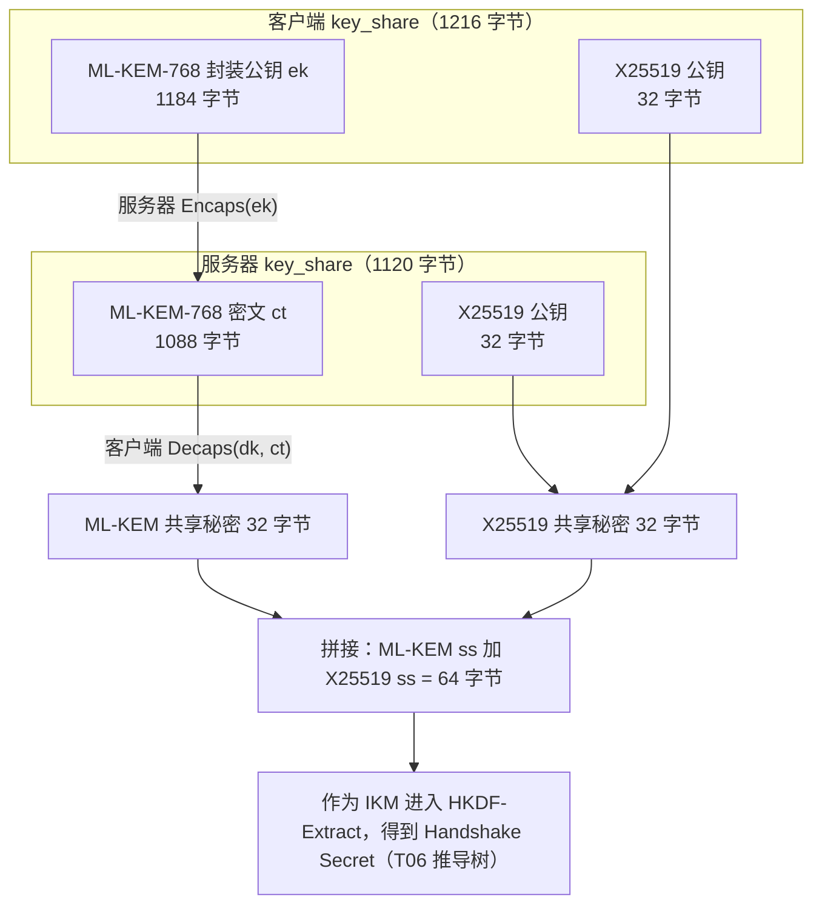
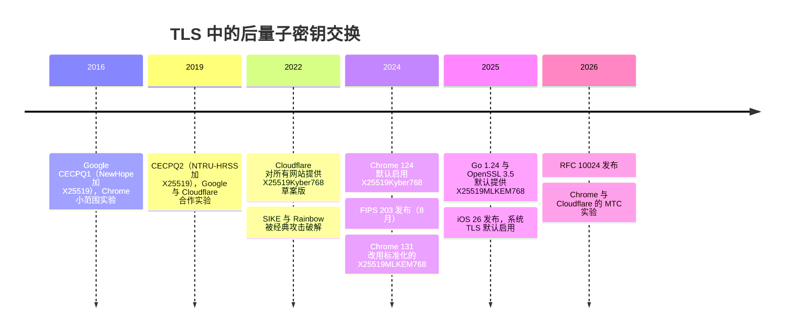
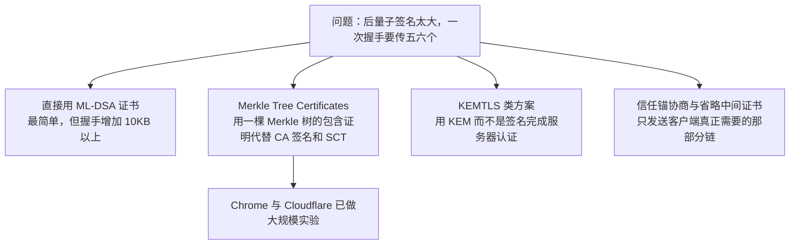

# T10 · 后量子 TLS：ML-KEM 混合密钥交换与 Merkle Tree Certificates

> 系列：[[00_TLS系列总览与学习路线|TLS 系列总览]] · 上一篇：[[T09_QUIC与HTTP3_把TLS放进传输层|T09 QUIC 与 HTTP/3]] · 下一篇：[[T11_各大厂的TLS工程实践|T11 各大厂的 TLS 工程实践]]
> 前置知识：T02 的 DH、签名和安全强度，T06 的 key_share 与密钥调度，T03 的证书链与证书透明度。
> 主要标准：FIPS 203（ML-KEM）、FIPS 204（ML-DSA）、FIPS 205（SLH-DSA）、RFC 10024（TLS 1.3 的混合后量子密钥协商，2026，草案名 draft-ietf-tls-ecdhe-mlkem）、draft-ietf-tls-mlkem（纯 ML-KEM，在 RFC Editor 队列）、draft-ietf-tls-mldsa（ML-DSA 用于 TLS，在 RFC Editor 队列）、IETF PLANTS 工作组的 Merkle Tree Certificates 草案
> 整理日期：2026-10-16（标准状态于 2026-10-17 在 IETF datatracker 与 RFC Editor 核对；文中握手数据来自 T06、T07 的真实抓取）

2026 年，你的浏览器和手机和大多数大网站之间的 TLS 握手，已经在用一种为对抗量子计算机设计的密钥交换。T06 的真实抓取里，OpenSSL 4.0.3 和 Cloudflare 协商出的群就是 X25519MLKEM768。这一篇讲清楚四件事：量子计算机到底威胁 TLS 的哪一部分，为什么密钥交换要先迁移，ML-KEM 的数学直觉以及它怎么以"混合"的方式接进 TLS 1.3，以及为什么认证（证书和签名）的迁移难得多、行业正在试的 Merkle Tree Certificates 是什么。

## 量子计算机威胁什么

两个量子算法决定了一切。

Shor 算法（1994）能在多项式时间内分解大整数、求解离散对数，包括椭圆曲线上的离散对数。T02 里所有的公钥算法都建立在这两个问题上：RSA 依赖分解，DH 和 ECDH 依赖离散对数，ECDSA 和 EdDSA 也一样。一台足够大的容错量子计算机出现之后，这些算法全部失效，增加密钥长度也没有用，因为 Shor 算法的代价只随密钥长度多项式增长。

Grover 算法（1996）能把无结构搜索的代价从 N 降到约 √N，用在对称密钥穷举上，相当于把密钥强度减半，AES-128 名义上降到 64 比特。但 Grover 算法本质上是串行的，难以并行化，再加上量子纠错的巨大开销，实际威胁远小于名义值。NIST 的后量子安全等级把 AES-128 定为第 1 级、AES-256 定为第 5 级，结论是对称加密和哈希只需要保持足够的长度，不需要更换算法。

| 算法 | 用在 TLS 的哪里 | 面对大规模量子计算机 |
| --- | --- | --- |
| RSA、有限域 DH | 证书签名、旧的密钥交换 | Shor 算法破解 |
| ECDH（X25519、P-256） | 密钥交换 | Shor 算法破解 |
| ECDSA、EdDSA | 握手签名、证书签名 | Shor 算法破解 |
| AES-128、AES-256 | 记录加密 | Grover 名义上减半，AES-256 足够 |
| SHA-256、SHA-384 | 转录哈希、HKDF | 影响有限 |

这样的量子计算机什么时候会出现，没有人能给出确定的答案。资源估计在不断下降：Google 的 Craig Gidney 在 2025 年的一篇论文里估计，用不到一百万个有噪声的物理量子比特、在不到一周的时间里就可以分解 2048 位 RSA，而之前的估计是两千万比特量级。这只是理论估计，离实际造出这样的机器还有很长的距离，但它足以让行业不再等待。

## 先存后解：为什么密钥交换先迁移

密钥交换和签名面对的威胁在时间上不对称。

签名只需要在握手的那一刻不可伪造。十年后有人能伪造今天的服务器签名，也无法回到过去冒充那台服务器，那次握手早已结束。

密钥交换不一样。攻击者今天就可以把加密的流量录下来存着，等将来有了量子计算机，再用 Shor 算法从录下的 key_share 里解出共享秘密，解密全部内容。这叫"先存后解"（harvest now, decrypt later）。对于需要长期保密的数据（医疗记录、外交通信、商业机密），今天的流量已经暴露在未来的威胁之下。Michele Mosca 把这个关系总结为一个不等式：如果数据需要保密的年限加上迁移所需的年限，大于量子计算机出现所需的年限，那么现在开始迁移就已经晚了。

所以 TLS 的后量子迁移分两步走：先把密钥交换换成抗量子的（2024 年起在浏览器里默认开启，2026 年已是主流），认证可以晚一些，但也要在量子计算机真正出现之前完成。

## NIST 后量子标准

NIST 在 2016 年发起后量子密码标准征集，经过三轮公开评选，2022 年选出了第一批算法，2024 年 8 月发布了三个正式标准：

| 标准 | 算法 | 原名 | 类型 | 数学基础 |
| --- | --- | --- | --- | --- |
| FIPS 203 | ML-KEM | CRYSTALS-Kyber | 密钥封装（KEM） | 模格上的 LWE 问题 |
| FIPS 204 | ML-DSA | CRYSTALS-Dilithium | 签名 | 模格 |
| FIPS 205 | SLH-DSA | SPHINCS+ | 签名 | 只依赖哈希函数 |

另一个基于格的签名算法 Falcon 将以 FN-DSA 的名字成为 FIPS 206，2025 年 3 月 NIST 又选定了基于纠错码的 HQC 作为 ML-KEM 的备选 KEM，以防格密码出现意外的弱点。

评选过程本身就说明了为什么要谨慎：进入第四轮的 SIKE（基于超奇异同源）在 2022 年被一个经典计算机上的攻击在一小时左右破解，第三轮的签名候选 Rainbow 也在同一年被经典攻击攻破。后量子算法比 RSA 和 ECC 年轻得多，接受密码分析的时间短得多，这正是 TLS 选择"混合"方案的原因。

## ML-KEM 的数学直觉

ML-KEM 的安全性建立在带错误学习（Learning With Errors，LWE）问题上。先看一个没有错误的版本：给定一个公开矩阵 A 和向量 b = A·s，求秘密向量 s。这就是解线性方程组，高斯消元一下就出来了。LWE 在每个方程上加了一个很小的随机误差 e：b = A·s + e (mod q)。就是这一点小误差，让问题在高维时变得极其困难，目前没有已知的经典或量子算法能高效求解，它还可以归约到格上的最坏情况问题。

一个小数字例子，取模数 q = 97，二维：

```
公开矩阵 A = [[23, 61], [7, 45]]，秘密 s = (3, 5)，小误差 e = (1, -2)
A·s mod 97 = (23·3 + 61·5, 7·3 + 45·5) mod 97 = (374, 246) mod 97 = (83, 52)
公钥 b = A·s + e = (84, 50)
```

在这个尺寸上当然可以暴力搜索，但在真实参数下，s 有几百维，暴力和已知的格算法都不可行。加密一个比特 m 的做法（Regev 风格）是：选一个小的随机向量 r = (1, 1) 和小误差 e1 = (0, 1)、e2 = -1，计算

```
u = Aᵀ·r + e1 = (23 + 7, 61 + 45) + (0, 1) mod 97 = (30, 10)
v = b·r + e2 + m·48 mod 97 = (84 + 50 - 1) + m·48 mod 97 = 36 + 48m
```

其中 48 是 q 的一半（取整）。解密者知道 s，计算 v - s·u：

```
s·u = 3·30 + 5·10 = 140 mod 97 = 43
m = 0 时：v - s·u = 36 - 43 = -7 ≡ 90 (mod 97)，离 0 近，解出 0
m = 1 时：v - s·u = 84 - 43 = 41，离 48 近，解出 1
```

结果里的 -7 就是累积的误差项 e·r + e2 - s·e1 = -1 - 1 - 5。只要误差足够小，就不会把结果从 0 附近推到 q/2 附近，解密就正确。不知道 s 的人面对的是一个带噪声的线性系统，无从下手。（这几个数在本机用程序验算过。）

真实的 ML-KEM 用的是模格（Module-LWE）：矩阵和向量的元素不是整数，而是模 q = 3329、次数小于 256 的多项式，ML-KEM-768 的矩阵是 3×3 的多项式矩阵。多项式乘法可以用数论变换（NTT）快速计算，所以 ML-KEM 的计算速度和 X25519 同一量级，甚至更快。它的代价是尺寸：

| 参数集 | NIST 安全等级 | 封装公钥 | 密文 | 共享秘密 |
| --- | --- | --- | --- | --- |
| ML-KEM-512 | 1 | 800 字节 | 768 字节 | 32 字节 |
| ML-KEM-768 | 3 | 1184 字节 | 1088 字节 | 32 字节 |
| ML-KEM-1024 | 5 | 1568 字节 | 1568 字节 | 32 字节 |

对照一下，X25519 的公钥只有 32 字节。

## KEM 与 DH 的区别

ML-KEM 是一个密钥封装机制（KEM），接口和 DH 不同：

```
KeyGen()        -> (ek, dk)        生成封装公钥 ek 和解封装私钥 dk
Encaps(ek)      -> (ss, ct)        用对方的 ek 生成共享秘密 ss 和密文 ct
Decaps(dk, ct)  -> ss              用自己的 dk 从 ct 恢复同一个 ss
```

DH 是对称的：双方各出一个公钥，各自用自己的私钥和对方的公钥算出同一个秘密。KEM 是不对称的：只有一方有密钥对，另一方用对方的公钥"封装"一个随机秘密发回去。好在 TLS 1.3 的 key_share 流程正好能容纳这种不对称：客户端在 ClientHello 的 key_share 里放 ek，服务器收到后执行 Encaps，把密文 ct 放进 ServerHello 的 key_share，客户端执行 Decaps。不需要增加任何往返。ML-KEM 在 Kyber 的基础上用 Fujisaki-Okamoto 变换获得了选择密文安全（IND-CCA2），所以理论上同一个 ek 可以安全地复用，但 TLS 仍然每次握手生成新的密钥对，保持前向保密。

## 混合密钥交换：X25519MLKEM768

混合（hybrid）的意思是同时做一次经典的 ECDH 和一次 ML-KEM，把两个共享秘密拼起来一起输入密钥调度。只要两者里有一个没被攻破，会话就是安全的：如果 ML-KEM 将来被发现有经典攻击（就像 SIKE 那样），X25519 仍然撑着；如果量子计算机出现，ML-KEM 仍然撑着。代价是多了一千多字节，以及一点点计算。

RFC 10024（2026 年发布，草案阶段名为 draft-ietf-tls-ecdhe-mlkem）定义了三个混合群，具体格式如下：

| 群 | 码点 | 客户端 key_share | 服务器 key_share | 共享秘密 |
| --- | --- | --- | --- | --- |
| X25519MLKEM768 | 0x11EC（4588） | ML-KEM-768 ek（1184）+ X25519（32）= 1216 字节 | ML-KEM 密文（1088）+ X25519（32）= 1120 字节 | ML-KEM ss（32）+ X25519 ss（32）= 64 字节 |
| SecP256r1MLKEM768 | 0x11EB（4587） | P-256（65）+ ML-KEM-768 ek（1184）= 1249 字节 | P-256（65）+ 密文（1088）= 1153 字节 | ECDH ss（32）+ ML-KEM ss（32）= 64 字节 |
| SecP384r1MLKEM1024 | 0x11ED（4589） | P-384（97）+ ML-KEM-1024 ek（1568）= 1665 字节 | P-384（97）+ 密文（1568）= 1665 字节 | ECDH ss（48）+ ML-KEM ss（32）= 80 字节 |

注意 X25519MLKEM768 的拼接顺序是 ML-KEM 在前、X25519 在后，和另外两个群相反，规范里专门指出了这个顺序是反过来的，自己实现时必须按每个群各自的规定拼接。T06 抓到的数据和这张表完全吻合：客户端 key_share 1216 字节，服务器 1120 字节。



混合方案对 TLS 1.3 的改动非常小：在 TLS 看来它只是 supported_groups 里的一个新群，key_share 的格式、密钥调度、往返次数都不变，唯一的变化是 (EC)DHE 共享秘密那一格里装的东西变长了。这种"把新算法当作新群接入"的设计，正是 T04 讲的"可协商的密码学"的价值所在。

纯 ML-KEM（不混合）的方案也在标准化：draft-ietf-tls-mlkem 定义了直接使用 ML-KEM-512/768/1024 作为群，2026 年 7 月进入 IETF 最后征求意见，目标状态是 Informational，截至 2026-10-17 在 RFC Editor 队列中。主要面向必须只用 NIST 标准算法的合规场景。

## 部署的历程与现状

后量子密钥交换在浏览器里的实验比 NIST 标准早得多：



到 2026 年，主流浏览器都默认在 ClientHello 里提供 X25519MLKEM768；Apple 平台从 iOS 26、iPadOS 26 起，URLSession 和 Network.framework 的 TLS 1.3 连接默认使用它（Apple 平台安全指南），这意味着大量 App 不改一行代码就获得了抗量子的密钥交换；OpenSSL 3.5 起默认把它放进 key_share，本机的 OpenSSL 4.0.3 就是这样做的（T06）；Go 从 1.24 起在 crypto/tls 里默认启用。

服务器端的支持滞后于客户端。几个来自不同口径的数字：一篇 2026 年的 arXiv 测量研究报告，采样到的 TLS 密钥交换中有 49.30% 使用 X25519MLKEM768；Cloudflare 的博客称，支持后量子密钥交换的源站（Cloudflare 到客户服务器这一段）比例从 2023 年的 0.5% 增长到了 12.8%。这套笔记 T06、T07 的实测里，Cloudflare 和 Google 都协商了 X25519MLKEM768（Google 的恢复握手里 ServerHello 同样带着 1120 字节的混合 key_share）。

部署中遇到的主要麻烦不是密码学而是尺寸。ClientHello 从几百字节涨到一千四五百字节，超出了一个 TCP 段（T06 里是 1469 字节，必须分两个段发送），一些服务器和中间设备的实现假设 ClientHello 一定能在一次读取里读完，遇到分段的就出错断开。Chrome 在推广时为企业提供了临时关闭的策略，社区也有专门的网站记录这类有问题的实现，督促厂商修复。这又是一次 T04 讲过的协议僵化问题，GREASE 和"让新东西尽早常态化"的思路在这里同样适用。

## 认证：难得多的那一半

密钥交换只占握手里的两个 key_share，认证却散布在握手的很多地方。一次典型的 TLS 握手里，客户端要验证的签名有：CertificateVerify 一个、叶子证书上中间 CA 的签名一个、中间证书上根的签名一个，再加上叶子证书里嵌入的两到三个 SCT 签名，共五六个签名，外加叶子和中间证书的两个公钥。

换成后量子签名，尺寸会膨胀几十倍：

| 签名算法 | 公钥 | 签名 |
| --- | --- | --- |
| ECDSA P-256 | 65 字节 | 约 72 字节 |
| Ed25519 | 32 字节 | 64 字节 |
| ML-DSA-44（第 2 级） | 1312 字节 | 2420 字节 |
| ML-DSA-65（第 3 级） | 1952 字节 | 3309 字节 |
| SLH-DSA-SHA2-128s | 32 字节 | 7856 字节 |
| FN-DSA-512（Falcon） | 897 字节 | 约 666 字节 |

粗略算一下：五个签名加两个公钥，用 ECDSA P-256 是 5 × 72 + 2 × 65 ≈ 490 字节，用 ML-DSA-44 是 5 × 2420 + 2 × 1312 ≈ 14.7KB。仅这一项就超过了 TCP 初始拥塞窗口的约 14KB（T07），握手必然多出一个往返。FN-DSA 小得多，但它的签名过程需要浮点运算，安全实现很难，不适合在每次握手都要签名的服务器上大规模使用。SLH-DSA 只依赖哈希、最保守，但签名太大。

ML-DSA 用于 TLS 的规范（draft-ietf-tls-mldsa，签名算法码点 mldsa44 = 0x0904、mldsa65 = 0x0905、mldsa87 = 0x0906，目标状态 Informational）截至 2026-10-17 已提交 IESG、在 RFC Editor 队列中。本机 OpenSSL 4.0.3 的 ClientHello 已经在 signature_algorithms 里把这三个排在最前面（T06）。但公共 Web PKI 里还没有 CA 签发 ML-DSA 证书。

于是行业在尝试几条不同的路，目标都是减少握手里要传输和验证的签名数量：



## Merkle Tree Certificates

Merkle Tree Certificates（MTC）是目前最受关注的方案，由 IETF 的 PLANTS 工作组标准化，仍是草案。它把 T03 里讲的证书透明度的思路反过来用：既然每张证书都要进入一棵公开的 Merkle 树，那不如直接让"在树里"本身成为证书的有效性证明。

做法是这样的：CA 不再为每张证书单独签名，而是定期把一批证书组织成一棵 Merkle 树，只对树根（或者树的状态）签一次名。一张"证书"就是这张证书的内容加上它在树中的包含证明，包含证明只是一串哈希（约 log2(n) 个，每个 32 字节）。浏览器事先通过自己的更新渠道获得这些树根（称为 landmark），验证时只需要沿着包含证明算一遍哈希、对上树根，不需要验证任何签名。CA 签名和 SCT 签名就这样从握手里消失了，握手里只剩 CertificateVerify 那一个签名。

代价是时效性：一张新证书要等到下一批树根发布、并且被浏览器获取之后才能用 MTC 的形式验证，所以 MTC 适合与传统证书并存，客户端在支持并且已经拿到对应树根时才使用它。

截至 2026 年 10 月的进展（来源见文末）：Chrome 与 Cloudflare 做了联合可行性实验，在 Chrome Beta 146 的 50% 用户上投放了 MTC，过程中提供了数十亿张 MTC，中位数上 landmark MTC 比传统签名链快约 9%，主要得益于省掉了中间证书；Chrome 表示不打算把后量子签名放进传统 X.509 证书，而是计划建立一个只接受 MTC 的抗量子根库；Cloudflare 在 2026-09-29 宣布计划成为公共 CA，目标是 2027 年第一季度开始在生产中签发 MTC，并已向 Chrome、Apple、Microsoft、Mozilla 的根程序提交申请；Let's Encrypt 计划在 2026 年底提供签发 MTC 的测试环境、2027 年提供生产环境。这些都是计划，根程序的决定还没有作出，有分析指出截至 2026-10-05 Cloudflare 还没有签发任何 MTC。

## 给自己的服务器和客户端的迁移清单

把上面的内容落到操作上，按优先级排：

1. 盘点：列出自己的 TLS 终结点（Web 服务器、负载均衡、API 网关、内部服务）和客户端（App、SDK、脚本），记下各自使用的 TLS 库和版本。
2. 先迁移密钥交换。服务器端启用 X25519MLKEM768：OpenSSL 3.5 及以上、BoringSSL、Go 1.24 及以上默认就带，nginx、Caddy 等跟随底层库。客户端同理，Apple 平台 iOS 26 起的 URLSession 自动生效。用 `openssl s_client -groups X25519MLKEM768` 验证协商结果（T13）。
3. 检查路径上的设备能否处理一千多字节的 ClientHello 和分段的握手：负载均衡、WAF、企业代理、安全网关都可能出问题。
4. 用了 CDN 的，同时检查 CDN 到源站这一段是否也使用了后量子密钥交换，这一段往往被遗忘。
5. 认证暂时保持经典证书（ECDSA P-256 最好），关注 MTC 和 ML-DSA 证书的进展，不要现在就在公网上部署后量子签名证书。
6. 把证书全面自动化：证书寿命在缩短（T03、T12），将来更换证书类型也要靠自动化完成。
7. 保持密码学敏捷性：配置里不要写死算法，库能升级、群和签名算法能通过配置调整，迁移到下一个算法时只是一次配置变更。

## 常见误解

量子计算机会破解所有加密。它会破解基于分解和离散对数的公钥算法（RSA、DH、ECC），对称加密和哈希只受 Grover 算法的有限影响，用 AES-256 和 SHA-384 就足够。

量子计算机还没出现，现在不用管。"先存后解"意味着今天录下的流量将来可以被解密，密钥交换的迁移必须在量子计算机出现之前完成，而大部分客户端在 2026 年已经迁移好了。

后量子算法会让 HTTPS 变慢很多。ML-KEM 的计算很快，主要代价是一千多字节的额外数据，在一般网络上几乎感觉不到。真正可能显著影响性能的是后量子签名带来的证书膨胀，这正是 MTC 等方案要解决的问题。

用了 X25519MLKEM768 就完全抗量子了。它保护的是密钥交换，也就是机密性和前向保密。服务器认证仍然依赖经典的 ECDSA 或 RSA 签名，在量子计算机出现之后，攻击者可以伪造签名冒充服务器，进行实时的中间人攻击。认证的迁移还没有完成。

混合方案是多此一举，直接用 ML-KEM 就行。后量子算法接受密码分析的时间还短，SIKE 和 Rainbow 都在评选后期被经典攻击攻破。混合方案让安全性不低于两者中较强的那个，额外代价只有 32 字节和一次 X25519 运算。

## 本篇引用的标准与资料

- FIPS 203, Module-Lattice-Based Key-Encapsulation Mechanism Standard, https://csrc.nist.gov/pubs/fips/203/final
- FIPS 204, Module-Lattice-Based Digital Signature Standard, https://csrc.nist.gov/pubs/fips/204/final
- FIPS 205, Stateless Hash-Based Digital Signature Standard, https://csrc.nist.gov/pubs/fips/205/final
- RFC 10024, Post-Quantum Traditional (PQ/T) Hybrid Key Agreement Mechanisms for TLS 1.3（Kwiatkowski、Kampanakis、Westerbaan、Stebila，2026）, https://www.rfc-editor.org/info/rfc10024
- draft-ietf-tls-ecdhe-mlkem-05（RFC 10024 的最后一版草案）, https://datatracker.ietf.org/doc/html/draft-ietf-tls-ecdhe-mlkem-05
- draft-ietf-tls-mlkem, ML-KEM Post-Quantum Key Agreement for TLS 1.3, https://datatracker.ietf.org/doc/draft-ietf-tls-mlkem/
- draft-ietf-tls-mldsa, Use of ML-DSA in TLS 1.3, https://datatracker.ietf.org/doc/draft-ietf-tls-mldsa/
- Apple 平台安全指南, TLS 与 X25519MLKEM768, https://support.apple.com/guide/security/sec100a75d12/web
- Cloudflare, Automatic Key Exchange for origins, https://blog.cloudflare.com/automatic-key-exchange-for-origins/
- Measurement Study of Post-Quantum Readiness of Internet: 2026（arXiv）, https://arxiv.org/html/2606.16473v1
- Help Net Security, Post-quantum website certificates from Cloudflare are scheduled for early 2027（2026-09-30）, https://www.helpnetsecurity.com/2026/09/30/cloudflare-certificate-authority-2027/
- Let's Encrypt, A Post-Quantum Future for Let's Encrypt（2026-06-03）, https://letsencrypt.org/2026/06/03/pq-certs
- The Hacker News, Google Develops Merkle Tree Certificates to Enable Quantum-Resistant HTTPS in Chrome（2026-03）, https://thehackernews.com/2026/03/google-develops-merkle-tree.html
- pk-sharma.com, Cloudflare's post-quantum CA has issued no certificates yet（2026-10-05）, https://www.pk-sharma.com/briefing/cloudflare-post-quantum-ca-has-issued-nothing-yet
- Gidney, "How to factor 2048 bit RSA integers with less than a million noisy qubits"（2025）, https://arxiv.org/abs/2505.15917
- Schwabe、Stebila、Wiggers, "Post-Quantum TLS Without Handshake Signatures"（KEMTLS）, CCS 2020
- 本机验算：LWE 小例子（q = 97）用 Node.js 计算；握手数据见 T06、T07 的实测
