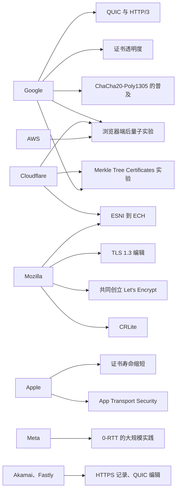

# T11 · 各大厂的 TLS 工程实践

> 系列：[[00_TLS系列总览与学习路线|TLS 系列总览]] · 上一篇：[[T10_后量子TLS_ML-KEM混合密钥交换与MTC|T10 后量子 TLS]] · 下一篇：[[T12_HTTPS推广与信任治理|T12 HTTPS 推广与信任治理]]
> 前置知识：T03 到 T10 的大部分内容，这一篇把前面的机制和"谁做的、为什么做"对应起来。
> 主要资料：各公司的开源仓库、官方博客与文档、相关 RFC 的作者信息；国密部分以 RFC 8998 和 GB/T 38636-2020 为准
> 整理日期：2026-10-16

前面十篇讲的机制，几乎每一项背后都站着一家或几家公司：QUIC 来自 Google，ECH 的推动者是 Cloudflare 和 Mozilla，0-RTT 最早在 Facebook 和 Cloudflare 的规模下被验证，证书寿命缩短的那一刀是 Apple 先砍下去的。TLS 的标准是在 IETF 写成的，但它的方向很大程度上由几家同时掌握客户端和服务器两端的大公司决定：它们能在自己的浏览器和自己的服务器之间先做实验，拿到真实的数据，再带着数据去标准化。这一篇按公司整理它们造了什么、推了什么、为什么，最后对比主流 TLS 库，并介绍国内的国密 TLS 实践。

## 谁在哪个标准里出了力

一个能直观看出影响力的角度，是看关键 RFC 的作者和编辑来自哪里：

| 标准 | 作者或编辑（当时的所属机构） |
| --- | --- |
| RFC 8446 TLS 1.3 | Eric Rescorla（Mozilla） |
| RFC 9849 ECH | Rescorla、Kazuho Oku（Fastly）、Nick Sullivan、Christopher Wood（Cloudflare） |
| RFC 9000 QUIC | Jana Iyengar（Fastly）、Martin Thomson（Mozilla） |
| RFC 9001 QUIC-TLS | Martin Thomson（Mozilla）、Sean Turner（sn3rd） |
| RFC 6962 证书透明度 | Ben Laurie、Adam Langley、Emilia Kasper（Google） |
| RFC 9460 SVCB/HTTPS 记录 | Ben Schwartz（Google）、Mike Bishop、Erik Nygren（Akamai） |
| RFC 8555 ACME | Richard Barnes、Jacob Hoffman-Andrews、Daniel McCarney、James Kasten（Let's Encrypt 相关机构） |
| RFC 10024 混合后量子密钥协商 | Kris Kwiatkowski（PQShield）、Panos Kampanakis（AWS）、Bas Westerbaan（Cloudflare）、Douglas Stebila（滑铁卢大学） |

## Google

Google 的特殊之处在于它同时拥有全世界使用最多的浏览器（Chrome）、全世界流量最大的一批网站，以及 Android。这让它可以在两端同时部署实验性协议，用真实流量测量效果，这几乎是 QUIC、CT、后量子密钥交换能够快速推进的根本原因。

BoringSSL 是 Google 在 2014 年 Heartbleed 之后从 OpenSSL 分出的 TLS 库，用于 Chrome、Android 和 Google 的服务器。它不承诺 API 稳定，会大胆地删除旧功能和不安全的选项，Google 内部的需求驱动它的演进，很多后来进入标准的特性（GREASE、后量子密钥交换）都先在 BoringSSL 里实现。

QUIC 由 Google 的 Jim Roskind 在 2012 年设计，2013 年起在 Chrome 与 Google 服务器之间部署，后来交给 IETF 并改用 TLS 1.3，成为 RFC 9000 系列（T09）。证书透明度由 Google 的 Ben Laurie 和 Adam Langley 在 DigiNotar 事件后提出，Chrome 从 2018 年起强制要求公共证书带 SCT（T03）。ChaCha20-Poly1305 在 2014 年前后被 Google 引入 Chrome 和自家服务器，为没有 AES 硬件指令的安卓手机提速（T02）。Chrome 维护着所有主流浏览器共用的 HSTS preload 列表（hstspreload.org）。

在信任治理上，Chrome 从 2022 年起逐步使用自己的 Chrome Root Store，而不再依赖操作系统的根库，并通过 Chrome Root Program 执行了一系列不信任决定：Symantec（2018）、Entrust（2024）、Chunghwa Telecom 与 Netlock（2025）。Google 自己也运营公共 CA，Google Trust Services，T05 和 T06 抓到的 www.cloudflare.com 的证书就是它的中间 CA `WE1` 签发的。Chrome 在 2023 年提出过把证书最长有效期缩短到 90 天的设想，最终行业以 SC-081 的形式走向 47 天（T12）。

后量子方面，Google 在 2016 年就做了 CECPQ1 实验，2019 年与 Cloudflare 合作 CECPQ2，2024 年 Chrome 124 默认启用 X25519Kyber768，同年 Chrome 131 改用标准化的 X25519MLKEM768（T10）。对于后量子认证，Chrome 选择了 Merkle Tree Certificates 的路线，并计划建立只接受 MTC 的抗量子根库。2026 年 10 月，Chrome 154 计划默认开启"始终使用安全连接"（T12）。

## Cloudflare

Cloudflare 的位置是另一种：它是数百万网站前面的那一层代理，自己不做浏览器，却终结着互联网上很大比例的 TLS 连接。它的很多工程创新都围绕"在别人的网站前面终结 TLS"这件事展开，而它的大规模也让它成为新协议在服务器端最早的大规模部署者。

2014 年的 Universal SSL 让所有 Cloudflare 客户（包括免费用户）自动获得 HTTPS，一夜之间让支持 HTTPS 的网站数量大幅增加。同年的 Keyless SSL 解决了一个信任问题：银行等客户不愿把私钥交给 CDN，Keyless SSL 让私钥留在客户自己的密钥服务器上，Cloudflare 的边缘节点在握手中需要用私钥签名时，把签名请求通过加密通道发回客户的密钥服务器完成，私钥从不离开客户的机房。

Cloudflare 在 TLS 1.3 还是草案时（2016 年）就为客户启用了它，随后提供了 0-RTT（作为客户可选的功能，T07 的实测里 www.cloudflare.com 本身没有开）。2018 年它和 Firefox 一起部署了 ESNI 实验，之后转向 ECH，T08 里那份真实的 ECHConfig 就来自它，public_name 是 `cloudflare-ech.com`，它也是目前 ECH 最主要的服务器端部署者。2018 年推出的 1.1.1.1 公共解析器支持 DoH 和 DoT。

后量子方面，Cloudflare 在 2022 年 10 月为所有网站提供了 Kyber 混合密钥交换的草案版本，此后跟随标准切换到 X25519MLKEM768，并在博客里公开了支持后量子的源站比例从 0.5% 到 12.8% 的增长。它维护的 Go 密码库 CIRCL 实现了 HPKE、ML-KEM 等算法。它的 Radar 服务公开发布 TLS 版本、后量子使用比例等统计数据，是研究这些问题时常用的数据源（不同来源的口径差异很大，引用时要注明）。2026 年 9 月 29 日，Cloudflare 宣布计划运营公共 CA，目标是 2027 年第一季度签发 Merkle Tree Certificates（T10）。

## Apple

Apple 控制着 iOS 和 macOS 上的系统网络栈，它的影响力主要通过平台默认值和根程序政策发挥。

2015 年的 App Transport Security（ATS，iOS 9）规定 App 默认只能用 HTTPS 连接，并要求 TLS 1.2 和前向保密的密码套件，App 必须在 Info.plist 里显式声明例外才能使用明文 HTTP。Apple 原计划在 2016 年底对上架 App 强制执行，后来推迟，但 ATS 作为默认值已经推动了大量 App 迁移到 HTTPS。

在网络栈上，Apple 用 Network.framework 和 URLSession 取代了老的 Secure Transport API。TLS 1.3 从 iOS 12.2 起对这两个 API 默认启用，Secure Transport 则不支持 TLS 1.3；从 iOS 26 和 iPadOS 26 起，它们的 TLS 1.3 连接默认使用 X25519MLKEM768（Apple 平台安全指南）。这是规模最大的一次"不改代码就获得后量子密钥交换"的部署。Apple 在 2024 年为 iMessage 部署了后量子的 PQ3 协议。开发者可以用 Info.plist 里的 NSPinnedDomains（iOS 14 起）声明式地做证书固定（T12）。

在证书政策上，Apple 是缩短证书寿命的推动者。2020 年 2 月，Apple 宣布 Safari 从 2020 年 9 月起不再信任有效期超过 398 天的新证书，在此之前 CA/B Forum 里同样内容的投票（SC-22）没有通过，Apple 用根程序政策单方面完成了这一步，Google 和 Mozilla 随后跟进。2024 年 Apple 又在 CA/B Forum 提出把有效期逐步缩短到 45 天左右的方案，最终形成了 2025 年通过的 SC-081（最终为 47 天）。iOS 对用户安装的根证书要求额外手动开启完全信任（T03），也是平台级的防护。

## Meta

Meta（Facebook）的特点是同时拥有最大规模的移动 App 和服务器，App 和服务器之间的协议可以完全自己决定。

Fizz 是 Meta 用 C++ 写的 TLS 1.3 库，2018 年开源，用于 Meta 的服务器和移动 App，设计上大量使用异步操作以适应高并发的服务器场景。在 TLS 1.3 定稿之前，Facebook 就在自己的 App 和服务器之间部署了一个叫 Zero 的 0-RTT 协议，用来验证 0-RTT 在大规模下的效果，这些经验后来体现在 TLS 1.3 的 0-RTT 设计和 Fizz 里。T07 的实测里，www.facebook.com 发出的会话票据允许的早期数据上限是 0xFFFFFFFF，是四个网站里最激进的。Meta 的 QUIC 实现 mvfst 在 2019 年开源，Meta 的 App 流量大量运行在 QUIC 上。

## Mozilla

Mozilla 在 TLS 生态里的角色更像一个公共机构：它的 NSS 根库是开源世界的事实标准（Linux 发行版、Homebrew 的 ca-certificates 都来自它），它的根程序政策和公开讨论（mozilla.dev.security.policy 邮件列表）是 CA 治理最透明的地方，它和 Microsoft 共同运营 CCADB，所有公共 CA 都在这里披露中间证书和审计报告。

TLS 1.3 的编辑 Eric Rescorla 在标准化期间任职于 Mozilla，QUIC 的编辑 Martin Thomson 也来自 Mozilla。Mozilla 是 Let's Encrypt 的发起机构之一（ISRG 的创始成员还包括 EFF、密歇根大学等），也是 ECH 从 ESNI 开始就最积极的浏览器端部署者。在吊销问题上，Firefox 的 CRLite 从 Firefox 137 起对所有桌面用户启用，是目前最完整的本地吊销检查方案（T03）。Mozilla 的服务器端 TLS 配置指南和配置生成器是运维人员配置 nginx、Apache 等最常用的参考（T12）。

## Microsoft

Windows 的系统 TLS 栈是 SChannel，Windows 11 和 Windows Server 2022 起默认支持 TLS 1.3。Microsoft 的根程序管理着 Windows 的根库，并和 Mozilla 共同运营 CCADB。Microsoft 开源了自己的核心密码库 SymCrypt，并在其中加入了 ML-KEM 等后量子算法。Edge 浏览器基于 Chromium，在 TLS 行为上与 Chrome 基本一致。

## AWS

AWS 在 2015 年开源了 s2n-tls（当时叫 s2n），一个刻意保持精简的 TLS 实现，部分代码用自动推理工具（如 SAW）做了形式化验证；后来又开源了 Rust 写的 QUIC 实现 s2n-quic；AWS-LC 是 AWS 基于 BoringSSL 维护的密码库，重点是通过 FIPS 认证。后量子方面，AWS 很早就在 KMS、Secrets Manager 等服务的 API 端点上提供了混合后量子 TLS，RFC 10024 的作者之一 Panos Kampanakis 就来自 AWS。

## Let's Encrypt 与 ISRG

Let's Encrypt 由非营利的 ISRG（Internet Security Research Group）运营，2015 年底开始公开测试，提供免费、自动化的 DV 证书，并推动 ACME 成为 RFC 8555（T03）。它对 HTTPS 普及的贡献可能超过任何一个单独的技术改进：在它之前，证书要花钱、要手工申请、要每一两年重新来一遍；在它之后，证书变成了服务器启动时自动获取的东西。

它也一直走在证书政策的前面：从一开始就只签 90 天证书，2025 年关闭了 OCSP 服务，2026 年正式提供 6 天短期证书，并公布了到 2028 年默认 45 天的时间表；2026 年 6 月公布了后量子证书的计划，打算在 2026 年底提供签发 MTC 的测试环境（T10）。ISRG 还通过它的 Prossimo 项目资助用内存安全语言重写关键基础设施，包括资助 rustls 的开发。

## 主流 TLS 库

| 库 | 语言 | 主要使用者 | 特点 |
| --- | --- | --- | --- |
| OpenSSL | C | 大部分 Linux 服务器、nginx、Apache、大量语言的运行时 | 最普及，功能最全；3.0 起改为 provider 架构，3.5 起内置后量子算法并默认提供 X25519MLKEM768；本机使用的 4.0.3 已带 ECH 参数 |
| LibreSSL | C | OpenBSD、macOS 自带的 `/usr/bin/openssl` | 2014 年 OpenBSD 从 OpenSSL 分出，大量删减旧代码 |
| BoringSSL | C/C++ | Chrome、Android、Google 服务器、Cloudflare | 不承诺 API 稳定，新特性往往最先出现在这里 |
| AWS-LC | C | AWS 服务 | 基于 BoringSSL，重点是 FIPS 认证 |
| s2n-tls | C | AWS 服务 | 精简，部分形式化验证 |
| NSS | C | Firefox、部分 Linux 系统组件 | Mozilla 维护，带根库 |
| SChannel | C | Windows | 系统组件 |
| Network.framework / URLSession | 系统框架 | iOS、macOS 上的 App | iOS 26 起默认后量子密钥交换 |
| Go crypto/tls | Go | Go 程序（包括很多云原生组件和代理） | 纯 Go 实现，1.24 起默认 X25519MLKEM768 |
| rustls | Rust | 越来越多的 Rust 服务与工具 | 内存安全，只支持 TLS 1.2 和 1.3，ISRG 资助 |
| Fizz | C++ | Meta | 异步设计，0-RTT 实践 |
| wolfSSL、Mbed TLS | C | 嵌入式与物联网设备 | 体积小，资源占用低 |
| 铜锁（Tongsuo） | C | 国内需要国密的场景 | 原名 BabaSSL，由蚂蚁集团发起，支持 TLCP 与 RFC 8998 |

选库时值得考虑的不是"哪个最快"，而是：它是否及时跟进安全修复和新标准（后量子、ECH）；它的默认配置是否安全；它是否有过大量安全事故，事故后怎么改进；它用什么语言写（内存安全的语言能从根上消除 Heartbleed 这类漏洞）。

## 国内实践：国密 TLS

国内的金融、政务等行业在合规上要求使用国家商用密码算法（国密）。和 TLS 相关的主要算法有三个：SM2 是基于椭圆曲线的公钥算法，用于签名和密钥交换（GB/T 32918）；SM3 是哈希算法，输出 256 位（GB/T 32905）；SM4 是 128 位分组密码（GB/T 32907）。

协议层面有两条路线。一条是国家标准 GB/T 38636-2020《信息安全技术 传输层密码协议（TLCP）》，它在结构上类似 TLS 1.1/1.2，最显著的特点是双证书体系：服务器有一张签名证书和一张加密证书，分别对应两把密钥，加密证书的私钥由第三方托管体系管理。另一条是 RFC 8998（2021，Informational），它把国密算法以标准的方式接入 TLS 1.3，定义了密码套件 TLS_SM4_GCM_SM3（0x00C6）和 TLS_SM4_CCM_SM3（0x00C7）、密钥交换群 curveSM2（41）和签名算法 sm2sig_sm3（0x0708），在协议结构上与普通的 TLS 1.3 完全一致。

T06 抓到的 OpenSSL 4.0.3 ClientHello 里，supported_groups 列着 curveSM2（41），signature_algorithms 列着 sm2sig_sm3（0x0708），说明主流开源库已经在默认配置里支持 RFC 8998 的这些参数；同一个列表里还有一个 curveSM2MLKEM768（4590），是把 SM2 曲线和 ML-KEM 混合的后量子群。国内的开源实现主要是铜锁（Tongsuo），它同时支持 TLCP 和 RFC 8998。

在传输协议上，国内大厂也开源了自己的 QUIC 实现，比如阿里巴巴的 XQUIC 和腾讯的 TQUIC，用于各自的移动 App 和 CDN。

## 从这些实践里看到的规律

几条贯穿各家的规律：新协议几乎都先在"同时控制两端"的环境里做实验，Google 有 Chrome 和自家网站，Meta 有自家 App 和服务器，Cloudflare 和 Firefox 合作，Apple 有系统网络栈，实验数据决定了标准的走向。平台默认值的力量远大于文档里的建议，ATS、Chrome 的"不安全"标记、iOS 26 的默认后量子密钥交换，都是一次改默认值、影响数以亿计的连接。信任治理靠的是根程序的单方面政策，Apple 的 398 天、Chrome 的一系列不信任决定，都没有等 CA/B Forum 的共识。自动化是一切的前提，Let's Encrypt 和 ACME 让证书寿命缩短到 47 天成为可能，也让将来更换证书算法成为可能。

## 常见误解

TLS 标准是 IETF 的学者写的，和公司无关。IETF 的参与者以个人身份参加，但关键 RFC 的作者和编辑大多来自浏览器厂商、CDN 和云服务商，标准里的很多设计直接来自它们的部署数据。

用了大厂的 TLS 库就一定安全。Heartbleed 出在最普及的 OpenSSL 里，ROBOT 影响了多家大厂的设备和服务。库的质量很重要，但配置、版本更新和密钥管理同样决定安全性。

国密 TLS 和国际 TLS 是两套完全不同的东西。TLCP 在结构上和 TLS 1.1/1.2 相近，RFC 8998 则是在标准 TLS 1.3 框架里换上国密算法，主流开源库已经默认支持其中的参数。

## 本篇引用的标准与资料

- RFC 8446、RFC 9849、RFC 9000、RFC 9001、RFC 6962、RFC 9460、RFC 8555、RFC 10024 的作者信息，见各 RFC 首页，https://www.rfc-editor.org/
- RFC 8998, ShangMi (SM) Cipher Suites for TLS 1.3, https://www.rfc-editor.org/rfc/rfc8998
- GB/T 38636-2020, 信息安全技术 传输层密码协议（TLCP）
- BoringSSL, https://boringssl.googlesource.com/boringssl/
- OpenSSL, https://www.openssl.org/
- LibreSSL, https://www.libressl.org/
- AWS s2n-tls, https://github.com/aws/s2n-tls ；s2n-quic, https://github.com/aws/s2n-quic ；AWS-LC, https://github.com/aws/aws-lc
- rustls, https://github.com/rustls/rustls
- Meta Fizz, https://github.com/facebookincubator/fizz ；mvfst, https://github.com/facebook/mvfst
- Cloudflare CIRCL, https://github.com/cloudflare/circl
- Microsoft SymCrypt, https://github.com/microsoft/SymCrypt
- 铜锁 Tongsuo, https://github.com/Tongsuo-Project/Tongsuo
- 阿里巴巴 XQUIC, https://github.com/alibaba/xquic ；腾讯 TQUIC, https://github.com/Tencent/tquic
- HSTS Preload List, https://hstspreload.org/
- Apple 平台安全指南（TLS 与 X25519MLKEM768）, https://support.apple.com/guide/security/sec100a75d12/web
- Chrome Root Store 变更公告, https://blog.google/security/sustaining-digital-certificate-security-chrome-root-store-changes/
- Cloudflare, Automatic Key Exchange for origins, https://blog.cloudflare.com/automatic-key-exchange-for-origins/
- Let's Encrypt, Decreasing Certificate Lifetimes to 45 Days, https://letsencrypt.org/2025/12/02/from-90-to-45 ；A Post-Quantum Future for Let's Encrypt, https://letsencrypt.org/2026/06/03/pq-certs
- Mozilla Hacks, CRLite in Firefox（2025-08）, https://hacks.mozilla.org/2025/08/crlite-fast-private-and-comprehensive-certificate-revocation-checking-in-firefox/
- 本机实测：T05、T06、T07 中对 www.cloudflare.com、www.google.com、www.facebook.com、www.apple.com 的抓取
