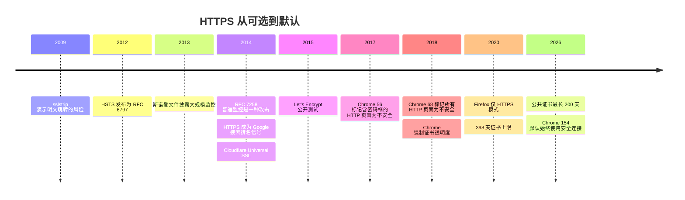
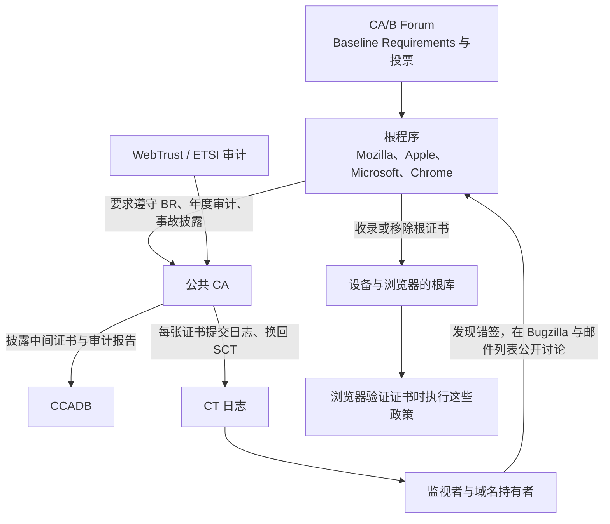

# T12 · HTTPS 推广与信任治理

> 系列：[[00_tls-series-overview|TLS 系列总览]] · 上一篇：[[T11_tls-engineering-practices|T11 各大厂的 TLS 工程实践]] · 下一篇：[[T13_observing-tls-with-openssl-and-curl|T13 动手实验]]
> 前置知识：T01 的 HTTP 到 HTTPS 跳转问题，T03 的证书体系、证书透明度与证书寿命。
> 主要标准：RFC 6797（HSTS）、RFC 7258（普遍监控是一种攻击）、RFC 7469（HPKP，已弃用）、RFC 6698（DANE）、RFC 7672（SMTP 的 DANE）、RFC 8461（MTA-STS）、RFC 9325（BCP 195，TLS 安全使用建议）、RFC 9460 §9.5、CA/B Forum Baseline Requirements
> 整理日期：2026-10-16（文中 HSTS 头与 preload 状态为 2026-10-17 03:19 UTC 的实测）

协议再好，没有人用也没有意义。2014 年前后，Web 上的大部分页面还是明文 HTTP 加载的；到 2026 年，Chrome 准备把 HTTPS 变成默认、把 HTTP 变成需要用户确认的例外。这十几年里发生的事，一半是技术（免费证书、HSTS、证书透明度），一半是治理：浏览器厂商用界面、默认值和根程序政策推着整个行业走。这一篇讲这条推广线和治理体系，最后落到一份自己服务器的推荐配置上。

## 为什么是 2013 年之后

HTTPS 在 1990 年代就有了，长期只用于登录和支付页面。转折点是 2013 年斯诺登文件披露的大规模网络监控：明文流量可以被系统性地采集，"只有敏感页面才需要加密"的假设站不住了。2014 年 IETF 发布 RFC 7258，标题直白地写着"普遍监控是一种攻击"（Pervasive Monitoring Is an Attack），要求 IETF 的协议设计把它当作威胁来对待；同年 IAB 发表声明，呼吁把加密作为互联网协议的默认。TLS 1.3 的"尽量加密一切"、QUIC 的"连传输层头部都加密"、ECH 的"连 SNI 都加密"，都可以追溯到这个立场。

此后的推广由几股力量叠加推动。

免费和自动化的证书：Let's Encrypt 2015 年底开始公开测试，证书从一项需要花钱、需要手工操作的事情，变成了服务器自动完成的事（T03、T11）。Cloudflare 2014 年的 Universal SSL 也让大量托管在它后面的网站一次性获得了 HTTPS。

浏览器界面的压力：Chrome 从 2017 年初的 Chrome 56 起，把带密码框或信用卡输入框的 HTTP 页面标为"不安全"，2018 年 7 月的 Chrome 68 起，所有 HTTP 页面都在地址栏显示"不安全"。对网站运营者来说，这个标签比任何安全白皮书都有说服力。

功能门槛：浏览器把越来越多的新功能限定在安全上下文（Secure Contexts）里，Service Worker、地理定位、摄像头和麦克风访问、Web Push 等只能在 HTTPS 页面上使用；浏览器只在 TLS 上支持 HTTP/2 和 HTTP/3（T01）。不上 HTTPS，就用不上现代 Web 平台的很多能力。

搜索排名：Google 在 2014 年宣布把 HTTPS 作为搜索排名的一个信号。

这些力量叠加的效果，可以从 Google 2018 年公布的一组数字看出：当时安卓上 64% 的 Chrome 流量、ChromeOS 和 Mac 上超过 75% 的 Chrome 流量已经是 HTTPS。Google 的透明度报告持续发布按平台的 HTTPS 页面加载比例，这里没有查到 2025 年以后的具体数字，引用时以报告页面上的实时图表为准。

## 混合内容

一个 HTTPS 页面如果加载了 HTTP 的子资源，叫混合内容（mixed content）。被动混合内容（图片、音视频）被篡改，最多显示错误的图片；主动混合内容（脚本、样式表、iframe）被篡改，攻击者就能控制整个页面，HTTPS 形同虚设。浏览器早就默认阻止主动混合内容，2019 年到 2020 年间 Chrome 又逐步把被动混合内容自动升级为 HTTPS，升级失败就不加载。网站可以用 CSP 指令 `upgrade-insecure-requests` 让浏览器把页面里所有 HTTP 子资源请求自动改为 HTTPS，这是迁移老网站时的常用工具。

## HSTS：让浏览器记住"只用 HTTPS"

T01 讲过，从 `http://` 跳转到 `https://` 的那个明文请求是 sslstrip 类攻击的窗口。HSTS（RFC 6797）的做法是服务器在 HTTPS 响应里发一个头：

```
Strict-Transport-Security: max-age=31536000; includeSubDomains; preload
```

`max-age` 是浏览器记住这条规则的秒数（31536000 秒即一年），`includeSubDomains` 表示所有子域名一并适用，`preload` 表示同意被加入浏览器内置的 preload 列表。浏览器记住之后，在有效期内对这个域名的所有 `http://` 访问都在本地直接改写为 `https://`，不会发出任何明文请求；证书出错时，用户也不能点击"继续访问"绕过。

HSTS 的弱点是第一次：浏览器还没收到过这个头时，第一次访问仍然可能是明文。HSTS preload 列表解决这个问题，它是一份硬编码进浏览器的域名清单，由 Chrome 团队维护（hstspreload.org），Firefox、Safari、Edge 都使用它。要进入列表，域名必须满足一组条件：证书有效；在同一主机上把 HTTP 重定向到 HTTPS；所有子域名都支持 HTTPS；在主域名的 HTTPS 响应里发送 max-age 至少一年、带 includeSubDomains 和 preload 的 HSTS 头；然后到 hstspreload.org 提交申请。Google 运营的整个顶级域 `.dev`、`.app` 等被整体加入了 preload 列表，这些域名下的任何网站天生只能用 HTTPS。

preload 的代价是难以撤销：从列表里移除需要提交申请，等待浏览器新版本发布，再等用户升级，往往要几个月。如果某个子域名还只能用 HTTP，加入 preload 就会让它无法访问。所以 preload 是一个"确定所有子域名都已经 HTTPS 化之后"才做的决定。

2026-10-17 实测几个网站的 HSTS 头和 preload 状态：

| 网站 | 响应里的 HSTS 头 | preload 列表 API 的状态 |
| --- | --- | --- |
| github.com | `max-age=31536000; includeSubdomains; preload` | preloaded |
| www.cloudflare.com | `max-age=31536000; includeSubDomains` | cloudflare.com：preloaded |
| www.apple.com | `max-age=31536000; includeSubdomains; preload` | apple.com：unknown |
| letsencrypt.org | `max-age=31536000` | unknown |
| www.google.com | 首页响应没有 HSTS 头 | google.com：unknown |

这张表本身就能说明几件事：HSTS 头里写了 `preload` 并不等于已经在列表里，www.apple.com 的头里有 preload，但 API 对 apple.com 返回 unknown（不在列表中，也没有待处理的申请）；在列表里的域名，比如 cloudflare.com，可以不在每个响应里都写 preload；letsencrypt.org 用了一年的 HSTS 但没有 includeSubDomains，选择了更保守的策略。各家的选择取决于子域名的情况和运维上能承受的风险。

## 从 HTTPS 可选到 HTTPS 默认

HSTS 和 preload 都要网站自己申请。下一步是浏览器主动尝试：Firefox 从 83 版（2020 年）起提供"仅 HTTPS 模式"，开启后所有连接先试 HTTPS，失败时提示用户；Chrome 先提供了 HTTPS-First 模式作为选项。2025 年 10 月，Google 宣布 Chrome 154（2026 年 10 月）将默认开启"始终使用安全连接"：对公共网站先尝试 HTTPS，访问不支持 HTTPS 的网站之前先征求用户同意；在此之前，Chrome 147（2026 年 4 月）先对开启了增强型安全浏览的用户启用。Google 在 Chrome 141 上的实验显示，中位数用户每周看到的这类提示不到一次。内网地址和开发环境不受这个默认值影响。

DNS 的 HTTPS 记录也加入了这个机制：RFC 9460 §9.5 规定，客户端发现一个域名有 HTTPS 记录，就应该把 `http://` 升级到 `https://`，效果和 HSTS 相似，而且从第一次访问起就生效（T08）。



## 信任治理：谁来管 CA

T03 讲了"根库里任何一个根都能为任何域名签证书"这个结构性弱点。对这个弱点的系统性回应是一套治理体系，它不在 IETF 里，而由几个组织和几份政策构成。

CA/Browser Forum（CA/B Forum）成立于 2005 年，成员是 CA 和浏览器厂商，它制定的 Baseline Requirements（2012 年第一版）规定了公共 TLS 证书的一切细节：怎么验证域名（允许哪些验证方法）、证书里必须和不能有什么、最长有效期、密钥怎么保护、出了事故怎么报告。规则的修改以投票（ballot）的形式进行，T03 里的 SC-063（OCSP 改为可选）、SC-081（有效期缩到 47 天）都是投票的结果。

但真正有强制力的是各家的根程序：Mozilla、Apple、Microsoft、Google（Chrome）各自决定自己的根库里放哪些根。CA 要被信任，就必须遵守每家根程序的政策，它们通常要求遵守 Baseline Requirements，还会加上自己的要求。根程序可以不等 CA/B Forum 的共识直接行动：2020 年的 398 天上限是 Apple 单方面宣布的（T11），因为当时同样内容的 CA/B 投票没有通过。CA 的审计报告、中间证书清单和事故披露集中在 Mozilla 与 Microsoft 共同运营的 CCADB 里，事故的讨论在 Mozilla 的 Bugzilla 和公开邮件列表上进行，任何人都可以看到。

把这些角色放在一张图里，可以看出约束是怎么一层层传下去的：



根程序最重的手段是停止信任一个 CA。历史上几次主要的不信任事件：

| 时间 | CA | 原因 | 处置 |
| --- | --- | --- | --- |
| 2011 | DigiNotar | 被入侵，签出 500 多张伪造证书 | 所有浏览器立即移除，公司破产 |
| 2015 | CNNIC | 签发的中间证书被用于中间人代理设备 | Google、Mozilla 停止信任 |
| 2016 | WoSign、StartCom | 回填日期签发 SHA-1 证书，隐瞒收购关系 | 2016 年 10 月宣布，2017 年 1 月起 Chrome 56、Firefox 51 停止信任 |
| 2017 至 2018 | Symantec（含旗下 GeoTrust、Thawte、RapidSSL 等） | 长期违规签发、对下属机构监管失当 | Chrome 66（2018-04）停止信任 2016 年 6 月以前签发的证书，Chrome 70（2018-10）全部停止信任 |
| 2024 | Entrust | 长期未按要求处理违规签发 | Chrome、Apple、Mozilla 自 2024-11 起不再信任其新签发的证书 |
| 2025 | Chunghwa Telecom、Netlock | 一年来观察到的令人担忧的行为模式 | Chrome 139 起不再信任 2025-07-31 之后签发的证书 |

Symantec 的案例最能说明根程序的分量：它当时是全球最大的 CA 之一，签发的证书覆盖了大量知名网站。Chrome 给出了分阶段的时间表，连已经签发、还在有效期内的证书也一并停止信任，网站必须赶在 Chrome 66 和 Chrome 70 之前换掉证书，最终 Symantec 把 CA 业务卖给了 DigiCert。这一次的代价让后来的处置变得温和：对 Entrust、Chunghwa、Netlock，浏览器只停止信任某个日期之后新签发的证书，已签发的证书留到自然过期，以减少对现有网站的冲击。

证书透明度（T03）是这套治理的眼睛：Chrome 从 2018 年 4 月 30 日起、Apple 从 2018 年 10 月起要求公共证书带有 SCT，错误签发因此无法隐藏，根程序的很多不信任决定正是基于 CT 日志里发现的问题。缩短证书寿命（2026 年起 200 天，2029 年 47 天）则是治理的另一面：吊销不可靠，就让错误的证书尽快过期。

## HPKP：一个失败的固定方案

2015 年 IETF 发布了 HPKP（HTTP Public Key Pinning，RFC 7469）：网站在 HTTP 响应头里告诉浏览器"以后只接受包含这几把公钥之一的证书链"，浏览器在 max-age 期限内强制执行。它想把 Chrome 内置的 Google 域名固定（发现 DigiNotar 的那种机制）推广到所有网站。

它在实践中失败了。配置错误的代价是灾难性的：网站一旦固定了某把公钥又丢了它（或者换了 CA 而没有提前准备备用的固定值），所有记住了这条规则的浏览器在 max-age 期限内都无法访问这个网站，网站运营者自己也救不回来，这被称为"HPKP 自杀"。它还可以被攻击者利用：入侵网站服务器的攻击者可以发送一个固定到自己密钥的 HPKP 头，把网站"劫持"成只有自己能解锁的状态，即所谓的勒索固定。部署率始终极低，Chrome 在 2017 年宣布弃用，2019 年的 Chrome 72 移除了支持。之后的 Expect-CT 头（RFC 9163）作为过渡也随着 CT 的普遍强制而失去意义。证书透明度取代了 HPKP 的位置：不是让每个网站自己锁死，而是让所有签发都公开可查。

## 证书固定今天的定位

HPKP 失败了，但在自己可控的客户端里做证书固定仍然有它的位置：自家的 App 连接自家的后端时，App 和服务器同属一个运营方，可以随 App 更新调整固定值，没有 HPKP 那种"浏览器记住了就改不掉"的问题。T03 和 T11 提到的抖音、iCloud、X 的 API 拒绝调试工具的证书，就是这类固定在起作用。

在自己的 App 里做固定，要点有三条：固定公钥（SPKI 的哈希）而不是整张证书，证书续期时可以保持同一对密钥；始终同时固定至少一个备用公钥，它的私钥离线保存，主密钥出问题时立即切换；给固定配置设置过期时间或保留远程更新的能力。在 iOS 上可以用 Info.plist 的 NSPinnedDomains 声明式地完成，系统会先做标准的证书链验证再比对固定值；在 Android 上用网络安全配置（Network Security Configuration）的 pin-set，并设置 expiration。对普通网站，正确的工具不是固定，而是监控 CT 日志里有没有人为自己的域名签发证书，再配合 CAA 限制可以签发的 CA。

## DANE：另一条没走通的路

DANE（DNS-Based Authentication of Named Entities，RFC 6698）的思路是绕过 CA：域名持有者在 DNS 里发布 TLSA 记录，直接声明"这个服务的证书或公钥是这个"，由 DNSSEC 保证记录的真实性。它让域名持有者自己掌握信任，不再依赖一百多个 CA。

浏览器始终没有采用它，原因很实际：DNSSEC 的部署率低，签名过的域名只占少数；浏览器要验证 DNSSEC 链需要额外的查询，增加延迟；很多网络环境里的解析器和中间设备会丢弃或篡改 DNSSEC 记录，浏览器只能软失败，安全性又回到原点；把信任交给 DNS，也只是把信任根从 CA 换成了顶级域的运营者。Chrome 在 2011 年前后实验过随证书附带 DNSSEC 签名链的方案，后来移除了；IETF 后来把"在 TLS 握手里携带 DNSSEC 链"写成了 RFC 9102（TLS DNSSEC Chain Extension，Experimental），浏览器同样没有采用。

DANE 在邮件领域却成功了。服务器之间的 SMTP 传输原本只是"能加密就加密"的 STARTTLS，没有证书验证，路径上的攻击者可以删掉 STARTTLS 让邮件以明文发送。RFC 7672 定义了 SMTP 的 DANE，在启用 DNSSEC 的邮件域之间提供了强制加密和身份验证。不依赖 DNSSEC 的另一种方案是 MTA-STS（RFC 8461）：邮件域通过 HTTPS 发布一份策略文件，声明自己的邮件服务器必须使用有效证书的 TLS，发送方缓存这份策略，原理上和 HSTS 非常相似。

## 推荐的服务器配置

IETF 的 BCP 195（现行版本是 RFC 9325，2022 年）给出了 TLS 安全使用的建议，Mozilla 的服务器端 TLS 指南把它落实成了可以直接用的配置档位，Modern 档只开 TLS 1.3，Intermediate 档开 TLS 1.2 和 1.3，适合大多数需要兼容旧客户端的网站。核心原则：

只开 TLS 1.2 和 1.3，关闭 SSL 3.0、TLS 1.0 和 1.1（RFC 8996）。TLS 1.2 只用 ECDHE 加 AEAD 的套件，不用 RSA 密钥传输、CBC、RC4、3DES。证书优先用 ECDSA P-256，需要兼容老客户端时并行部署一张 RSA 证书。密钥交换群优先 X25519MLKEM768 和 X25519（T10）。会话票据要么关闭，要么确保票据密钥频繁轮换（T07）。0-RTT 只在确认应用能承受重放时才开。发送 HSTS 头，确认所有子域名都支持 HTTPS 之后再考虑 includeSubDomains 和 preload。配置 CAA 记录，监控 CT 日志。证书全自动续期。

一个按这些原则写的 nginx 配置示例（需要 OpenSSL 3.5 或更新版本才能使用 X25519MLKEM768，nginx 1.25.1 起用 `http2 on;` 的写法）：

```nginx
server {
    listen 443 ssl;
    listen 443 quic reuseport;          # HTTP/3
    http2 on;
    server_name example.com;

    ssl_certificate     /etc/ssl/example.com/fullchain.pem;   # 叶子 + 中间证书，不含根
    ssl_certificate_key /etc/ssl/example.com/privkey.pem;

    ssl_protocols TLSv1.2 TLSv1.3;
    # TLS 1.2 只用 ECDHE + AEAD；TLS 1.3 的套件由 OpenSSL 默认提供
    ssl_ciphers ECDHE-ECDSA-AES128-GCM-SHA256:ECDHE-RSA-AES128-GCM-SHA256:ECDHE-ECDSA-AES256-GCM-SHA384:ECDHE-RSA-AES256-GCM-SHA384:ECDHE-ECDSA-CHACHA20-POLY1305:ECDHE-RSA-CHACHA20-POLY1305;
    ssl_prefer_server_ciphers off;      # 让客户端在同等安全的套件里按自己的硬件选择
    ssl_ecdh_curve X25519MLKEM768:X25519:prime256v1;

    ssl_session_cache shared:SSL:10m;
    ssl_session_timeout 1d;
    ssl_session_tickets off;            # 或者保持开启并确保票据密钥定期轮换

    add_header Strict-Transport-Security "max-age=31536000; includeSubDomains" always;
    add_header Alt-Svc 'h3=":443"; ma=86400' always;
}

server {
    listen 80;
    server_name example.com;
    return 301 https://$host$request_uri;   # 明文请求只做跳转
}
```

配置完成后，可以用 Qualys SSL Labs 的在线测试、命令行的 testssl.sh，或者 T13 里的 openssl 命令逐项验证：协商出的版本、套件、群、证书链是否完整，HSTS 头是否正确。

## 常见误解

有了 HSTS 就不怕第一次访问被劫持。HSTS 只在浏览器收到过这个头之后生效，第一次访问仍然有风险，要靠 preload 列表、HTTPS 记录或浏览器默认 HTTPS 来补上。

在 HSTS 头里写了 preload 就进了 preload 列表。还必须满足列表的条件并到 hstspreload.org 提交申请，实测 www.apple.com 的头里有 preload，apple.com 却不在列表里。

CA/B Forum 的规则就是法律。Baseline Requirements 本身靠根程序执行，真正决定一个 CA 能否被信任的是各家根程序，它们可以比 CA/B Forum 走得更快、更严。

证书固定是保护网站的好办法。对浏览器访问的网站，HPKP 已经证明固定风险太大；网站应该用 CT 监控和 CAA。固定适合运营方同时控制客户端和服务器的场景，比如自己的 App 和后端。

只要用了 HTTPS，配置就无所谓。TLS 1.0、RSA 密钥传输、长期不换的票据密钥、缺失的中间证书，都会让 HTTPS 的保护打折扣或者导致部分客户端连不上。配置要按 BCP 195 和 Mozilla 指南定期检查。

## 本篇引用的标准与资料

- RFC 6797, HTTP Strict Transport Security (HSTS), https://www.rfc-editor.org/rfc/rfc6797
- RFC 7258, Pervasive Monitoring Is an Attack, https://www.rfc-editor.org/rfc/rfc7258
- RFC 7469, Public Key Pinning Extension for HTTP, https://www.rfc-editor.org/rfc/rfc7469
- RFC 9163, Expect-CT Extension for HTTP, https://www.rfc-editor.org/rfc/rfc9163
- RFC 6698, The DNS-Based Authentication of Named Entities (DANE) Transport Layer Security (TLS) Protocol: TLSA, https://www.rfc-editor.org/rfc/rfc6698
- RFC 9102, TLS DNSSEC Chain Extension, https://www.rfc-editor.org/rfc/rfc9102
- RFC 7672, SMTP Security via Opportunistic DANE TLS, https://www.rfc-editor.org/rfc/rfc7672
- RFC 8461, SMTP MTA Strict Transport Security (MTA-STS), https://www.rfc-editor.org/rfc/rfc8461
- RFC 9325, Recommendations for Secure Use of TLS and DTLS（BCP 195）, https://www.rfc-editor.org/rfc/rfc9325
- RFC 8996, Deprecating TLS 1.0 and TLS 1.1, https://www.rfc-editor.org/rfc/rfc8996
- RFC 9460, SVCB and HTTPS Resource Records（§9.5）, https://www.rfc-editor.org/rfc/rfc9460
- CA/Browser Forum Baseline Requirements, https://cabforum.org/working-groups/server/baseline-requirements/
- HSTS Preload List, https://hstspreload.org/
- Mozilla, Server Side TLS 指南与配置生成器, https://wiki.mozilla.org/Security/Server_Side_TLS ，https://ssl-config.mozilla.org/
- Google 安全博客（2025-10），Chrome 默认 HTTPS 计划, https://security.googleblog.com/2025/10
- Infosecurity Magazine, Chrome to Make HTTPS Mandatory by Default in 2026, https://www.infosecurity-magazine.com/news/chrome-https-mandatory-2026/
- Google, Say "yes" to HTTPS: Chrome secures the web, one site at a time（2018）, https://blog.google/topics/safety-security/say-yes-https-chrome-secures-web-one-site-time
- Google 透明度报告：网络上的 HTTPS 加密, https://transparencyreport.google.com/https/overview
- Chrome Root Store 变更公告, https://blog.google/security/sustaining-digital-certificate-security-chrome-root-store-changes/
- The Hacker News, Google Chrome to Distrust Two Certificate Authorities（2025-06）, https://thehackernews.com/2025/06/google-chrome-to-distrust-two.html
- 本机实测：`curl -sI` 读取 HSTS 头，`https://hstspreload.org/api/v2/status?domain=` 查询 preload 状态（2026-10-17 03:19 UTC）
