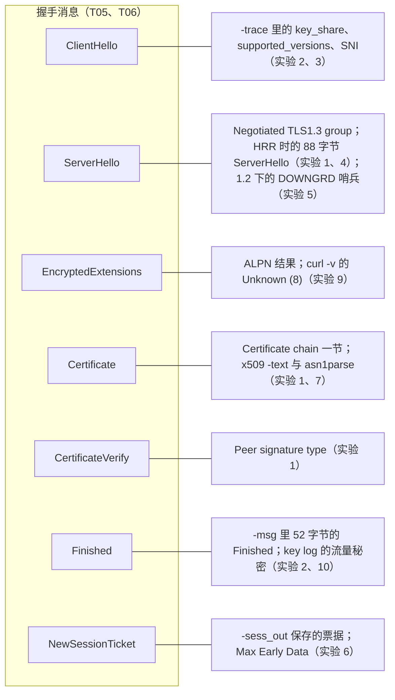

# T13 · 动手实验：用 openssl 与 curl 观察握手

> 系列：[[00_TLS系列总览与学习路线|TLS 系列总览]] · 上一篇：[[T12_HTTPS推广与信任治理|T12 HTTPS 推广与信任治理]] · 术语与标准：[[T99_术语表与标准索引|T99]]
> 前置知识：T03 的证书结构，T05、T06 的握手消息，读的时候对照着看。
> 环境：macOS，Apple M3；OpenSSL 4.0.3（`/opt/homebrew/bin/openssl`，2026-09-29 发布）；系统自带 curl 8.7.1（LibreSSL 3.3.6 后端）；系统自带 dig 9.10.6
> 整理日期：2026-10-16（所有输出为 2026-10-17 02:49 到 03:23 UTC 之间的真实采集，只连接公开网站）

前面十二篇讲的东西，几乎都能在自己的电脑上亲眼看到。这一篇是一组实验：每个实验给出目的、命令、实际输出（删掉了与主题无关的行），然后逐行解释，并指回讲原理的那一篇。所有实验只连接公开的网站，只观察自己发起的连接。

## 实验之前：看清自己的网络环境

做任何网络测量之前，先确认自己的流量走的是什么路径，否则会把代理的行为误当成网络的行为。这台 Mac 当时开着 Clash Verge 的 TUN 模式：

```
$ route -n get 104.16.123.96 | grep -E 'interface|gateway'
    gateway: 198.18.0.1
  interface: utun1024
```

去往 www.cloudflare.com（104.16.123.96）的流量被路由到虚拟网卡 `utun1024`，由本机的 mihomo 内核接管，再经由代理节点发往目标。这对实验有两个影响。握手的内容不受影响：mihomo 只是在 TCP 层转发字节，不解密 TLS，下面每个实验里证书链都验证通过（`Verify return code: 0 (ok)`）、签发者是真实的 CA，就是证据，如果中间有人做了 TLS 拦截，看到的证书链会变成拦截者的根。时间测量受影响：TCP 连接实际上是和本机的 TUN 协议栈建立的，测出的 TCP 时间不再代表到服务器的往返时间（实验 9 会看到）。

工具方面有两点要先说明。macOS 自带的 `/usr/bin/openssl` 实际上是 LibreSSL，功能和输出格式都和 OpenSSL 不同，下面的实验都用 Homebrew 安装的 OpenSSL 4.0.3。系统自带的 dig 9.10.6 太老，不认识 HTTPS 记录类型，要用 `TYPE65` 代替。

## 实验 1：一次握手的摘要

目的：看懂 `openssl s_client` 默认输出里最有用的那些行。

```
$ echo | openssl s_client -connect www.cloudflare.com:443 -servername www.cloudflare.com
---
Certificate chain
 0 s:CN=www.cloudflare.com
   i:C=US, O=Google Trust Services, CN=WE1
   a:PKEY: EC, (prime256v1); sigalg: ecdsa-with-SHA256
   v:NotBefore: Oct 12 20:43:38 2026 GMT; NotAfter: Jan 10 21:43:36 2027 GMT
 1 s:C=US, O=Google Trust Services, CN=WE1
   i:C=US, O=Google Trust Services LLC, CN=GTS Root R4
   a:PKEY: EC, (prime256v1); sigalg: ecdsa-with-SHA384
   v:NotBefore: Dec 13 09:00:00 2023 GMT; NotAfter: Feb 20 14:00:00 2029 GMT
 2 s:C=US, O=Google Trust Services LLC, CN=GTS Root R4
   i:C=BE, O=GlobalSign nv-sa, OU=Root CA, CN=GlobalSign Root CA
   a:PKEY: EC, (secp384r1); sigalg: sha256WithRSAEncryption
   v:NotBefore: Nov 15 03:43:21 2023 GMT; NotAfter: Jan 28 00:00:42 2028 GMT
---
Peer signing digest: SHA256
Peer signature type: ecdsa_secp256r1_sha256
Negotiated TLS1.3 group: X25519MLKEM768
---
SSL handshake has read 3905 bytes and written 1637 bytes
Verification: OK
---
New, TLSv1.3, Cipher is TLS_AES_256_GCM_SHA384
Protocol: TLSv1.3
Server public key is 256 bit
This TLS version forbids renegotiation.
No ALPN negotiated
Early data was not sent
Verify return code: 0 (ok)
---
ECH: NOT CONFIGURED: -103
```

`-servername` 设置 SNI，不加的话很多服务器会返回默认证书或直接握手失败（T08 讲了 SNI 为什么必要）。`echo |` 让 s_client 握手完就退出。

Certificate chain 一节是服务器在 Certificate 消息里发来的链，s 是主体，i 是签发者，a 是公钥类型和签发者的签名算法，v 是有效期。这条链有三张：叶子证书（90 天，2026-10-12 到 2027-01-10）、Google Trust Services 的中间 CA `WE1`、以及 `GTS Root R4`。注意第三张的签发者是 `GlobalSign Root CA`：这是 GTS Root R4 被 GlobalSign 的老根交叉签名的那个版本，服务器发它是为了兼容根库里还没有 GTS Root R4 的老设备，和 T03 里 letsencrypt.org 的链是同一种机制。叶子和中间证书都是 P-256 公钥，ECDSA 链让整个 Certificate 消息只有约 2.5KB（T07）。

`Peer signature type: ecdsa_secp256r1_sha256` 是服务器在 CertificateVerify 里用的签名算法（T06）。`Negotiated TLS1.3 group: X25519MLKEM768` 是协商出的密钥交换群，混合后量子（T10）。`New, TLSv1.3, Cipher is TLS_AES_256_GCM_SHA384` 里的 New 表示这是完整握手而不是会话恢复。`No ALPN negotiated` 是因为没有用 `-alpn` 提供协议列表，浏览器会提供 `h2` 和 `http/1.1`。`Verify return code: 0 (ok)` 表示证书链验证通过，这个检查用的是 OpenSSL 自己的证书包，而不是 macOS 的系统根库。最后一行是 OpenSSL 4.0 新增的 ECH 状态，这次没有配置 ECH。

## 实验 2：逐条看握手消息

目的：在线上看到 T06 讲的每一条消息和它的大小。

```
$ echo | openssl s_client -connect www.cloudflare.com:443 -servername www.cloudflare.com -msg 2>/dev/null \
    | grep 'Handshake \['
>>> TLS 1.3, Handshake [length 05c1], ClientHello
<<< TLS 1.3, Handshake [length 04ba], ServerHello
<<< TLS 1.3, Handshake [length 000a], EncryptedExtensions
<<< TLS 1.3, Handshake [length 09da], Certificate
<<< TLS 1.3, Handshake [length 004e], CertificateVerify
<<< TLS 1.3, Handshake [length 0034], Finished
>>> TLS 1.3, Handshake [length 0034], Finished
```

`>>>` 是发出，`<<<` 是收到，length 是十六进制、包含 4 字节握手头：ClientHello 1473 字节，ServerHello 1210 字节，EncryptedExtensions 10 字节，Certificate 2522 字节，CertificateVerify 78 字节，两个 Finished 各 52 字节（SHA-384 的 48 字节 verify_data 加 4 字节头）。这正是 T06 序列图的线上样子：一个往返，客户端一条，服务器五条，客户端再一条。

想看每个字段，把 `-msg` 换成 `-trace`。T06 全篇都建立在这条命令的输出上，这里只摘 key_share 一段：

```
extension_type=key_share(51), length=1258
    NamedGroup: X25519MLKEM768 (4588)
    key_exchange:  (len=1216): CA2156AE653F0F94...
    NamedGroup: ecdh_x25519 (29)
    key_exchange:  (len=32): 80CDDA2AF368BEAD...
```

客户端同时提供了混合后量子和纯 X25519 两个 key_share，1216 字节和 32 字节。`-trace` 的输出很长（这次 2514 行，包括每张证书的完整 PEM），用 `grep` 或重定向到文件里再看。

## 实验 3：换一个密钥交换群

目的：直接看到后量子密钥交换的字节代价。用 `-groups` 只提供一个群：

```
$ openssl s_client ... -groups X25519 -msg
>>> ClientHello [length 0138]      312 字节
<<< ServerHello [length 007a]      122 字节

$ openssl s_client ... -groups P-256 -msg
>>> ClientHello [length 0159]      345 字节
<<< ServerHello [length 009b]      155 字节

$ openssl s_client ... -groups X25519MLKEM768 -msg
>>> ClientHello [length 05d2]     1490 字节
<<< ServerHello [length 04ba]     1210 字节
Negotiated TLS1.3 group: X25519MLKEM768
```

ServerHello 的差值最干净：1210 - 122 = 1088 字节，正好是一个 ML-KEM-768 密文的大小（T10 的表）。ClientHello 从 312 字节涨到 1490 字节，多出的约 1.2KB 几乎全部来自 1184 字节的 ML-KEM 封装公钥。P-256 比 X25519 大一些，因为 P-256 的公钥是 65 字节的非压缩点。这组数字也说明了为什么 T06、T10 反复提到 ClientHello 超出一个 TCP 段的问题。

## 实验 4：亲手触发一次 HelloRetryRequest

目的：看到 T06 讲的 HRR。让客户端先提供一个服务器不愿意用的群的 key_share，同时在支持列表里留一个服务器愿意用的：

```
$ echo | openssl s_client -connect www.cloudflare.com:443 -servername www.cloudflare.com \
    -groups secp521r1:X25519 -msg 2>/dev/null | grep 'Handshake \['
>>> TLS 1.3, Handshake [length 019f], ClientHello          415 字节，只带 P-521 的 key_share
<<< TLS 1.3, Handshake [length 0058], ServerHello          88 字节，这就是 HelloRetryRequest
>>> TLS 1.3, Handshake [length 013a], ClientHello          314 字节，换成 X25519 的 key_share 重发
<<< TLS 1.3, Handshake [length 007a], ServerHello          真正的 ServerHello
<<< TLS 1.3, Handshake [length 000a], EncryptedExtensions
<<< TLS 1.3, Handshake [length 09da], Certificate
<<< TLS 1.3, Handshake [length 004f], CertificateVerify
<<< TLS 1.3, Handshake [length 0034], Finished
```

用 `-groups` 这样写一个普通的列表时，OpenSSL 只为列表里的第一个群生成 key_share，这里是 P-521（默认配置下 OpenSSL 4.0.3 会同时发 X25519MLKEM768 和 X25519 两个，见实验 2）。服务器不接受 P-521，但列表里的 X25519 它支持，于是回了一条只有 88 字节的"ServerHello"，它的 random 是 T06 里那个固定的魔数，key_share 里只写着"请用 X25519"，这就是 HRR。客户端随后带着 X25519 的 key_share 重发了 ClientHello，握手才正常继续。这个实验里握手多了一个往返，正是 T01 往返账里提到的那种额外开销，也说明了客户端预测 key_share 时为什么普遍选 X25519。

## 实验 5：TLS 1.2 和 TLS 1.3 对照，以及降级哨兵

目的：看两个版本握手结构的差别，以及 T06 讲的降级保护。

```
$ echo | openssl s_client -connect www.cloudflare.com:443 -servername www.cloudflare.com -tls1_2 -trace
```

完整输出的解读在 T05。这里只看一行，服务器 ServerHello 里的 random：

```
random_bytes (len=28): 787BEAE192ED9360AA8D07DF0346F16AE1D3488C444F574E47524401
```

最后 8 字节 `44 4F 57 4E 47 52 44 01` 是 ASCII 的 `DOWNGRD` 加 `0x01`。服务器支持 TLS 1.3，却被 `-tls1_2` 限定只能说 1.2，于是按 RFC 8446 §4.1.3 写入了降级哨兵。用 `-tls1_3` 或默认参数再连一次，ServerHello.random 就是普通的随机数。把两次的 `-msg` 输出并排看，TLS 1.2 多出 ServerKeyExchange、ServerHelloDone、ClientKeyExchange、两条 ChangeCipherSpec，证书是明文的，握手是两个往返。

## 实验 6：会话恢复与 0-RTT

目的：看到 T07 讲的 PSK 恢复和 0-RTT 早期数据。先做一次完整握手，把会话（票据）保存到文件，再用它恢复：

```
$ printf 'GET / HTTP/1.1\r\nHost: www.google.com\r\nConnection: close\r\n\r\n' > req.txt
$ openssl s_client -connect www.google.com:443 -servername www.google.com -tls1_3 -sess_out s.pem -ign_eof < req.txt > /dev/null
$ openssl sess_id -in s.pem -noout -text | grep 'Max Early Data'
    Max Early Data: 14336
$ openssl s_client -connect www.google.com:443 -servername www.google.com -tls1_3 \
    -sess_in s.pem -early_data req.txt -msg -ign_eof < /dev/null | grep -E 'Handshake \[|Reused|Early data|HTTP/1.1'
>>> TLS 1.3, Handshake [length 06f6], ClientHello
<<< TLS 1.3, Handshake [length 04c0], ServerHello
<<< TLS 1.3, Handshake [length 000a], EncryptedExtensions
<<< TLS 1.3, Handshake [length 0034], Finished
>>> TLS 1.3, Handshake [length 0004], EndOfEarlyData
>>> TLS 1.3, Handshake [length 0034], Finished
Reused, TLSv1.3, Cipher is TLS_AES_256_GCM_SHA384
Early data was accepted
HTTP/1.1 200 OK
```

`sess_id` 读出票据里的 max_early_data_size，14336 表示 Google 愿意接受最多 14336 字节的 0-RTT 数据。恢复握手里没有 Certificate 和 CertificateVerify，`Reused` 表示 PSK 恢复成功，`Early data was accepted` 表示 GET 请求作为早期数据被接受，随后拿到了 200 响应。对四个网站做同样的测试，结果见 T07 的表：四个都能恢复，Google 和 Facebook 允许 0-RTT，Cloudflare 和 Apple 不允许。

`s.pem` 里有恢复会话所需的秘密，实验完立即删除。

## 实验 7：读一张证书

目的：把 T03 讲的 X.509 字段在真实证书上一一找到。

```
$ echo | openssl s_client -connect letsencrypt.org:443 -servername letsencrypt.org -showcerts 2>/dev/null > le.txt
$ awk '/BEGIN CERTIFICATE/{n++} n==1' le.txt > leaf.pem       # 只取第一张（叶子）
$ openssl x509 -in leaf.pem -noout -text
$ openssl asn1parse -in leaf.pem -i | head
    0:d=0  hl=4 l=1094 cons: SEQUENCE
    4:d=1  hl=4 l= 972 cons:  SEQUENCE
    8:d=2  hl=2 l=   3 cons:   cont [ 0 ]
   10:d=3  hl=2 l=   1 prim:    INTEGER           :02
   13:d=2  hl=2 l=  18 prim:   INTEGER           :0543933BE386B3A2B3ADD534F2103BC8B65F
   33:d=2  hl=2 l=  10 cons:   SEQUENCE
   35:d=3  hl=2 l=   8 prim:    OBJECT            :ecdsa-with-SHA384
```

`x509 -text` 的完整输出和逐字段解释在 T03。`asn1parse` 显示的是 DER 的层次结构：第 0 字节开始的 SEQUENCE 是整张证书（长度 1094，加上 4 字节头共 1098 字节），第 4 字节开始的 SEQUENCE 是 tbsCertificate，`cont [ 0 ]` 里的 INTEGER 2 是 version v3，接着是 18 字节的序列号和签名算法 OID。d 是嵌套深度，hl 是 TLV 头的长度，l 是内容长度。只想看某几个扩展，可以用 `openssl x509 -in leaf.pem -noout -ext subjectAltName,ct_precert_scts`。

## 实验 8：查 HTTPS 记录和 ECH 配置

目的：看到 T08 讲的 HTTPS 记录和 ECHConfig。

```
$ dig +short TYPE65 crypto.cloudflare.com @1.1.1.1
\# 133 0001000001000302683200040008A29F874FA29F884F000500470045 FE0D00417500200020AD5C...
```

老版本 dig 不认识 HTTPS 类型，按 RFC 3597 的通用格式输出十六进制：`\# 133` 表示 133 字节，开头 `0001` 是优先级 1，`00` 是目标名为本身，接着是一串"键号、长度、值"的参数：键 1（alpn）、键 4（ipv4hint）、键 5（ech）、键 6（ipv6hint）。解码后的 ECHConfig（版本 0xfe0d，X25519 的 HPKE 公钥，HKDF-SHA256 加 AES-128-GCM，public_name 为 cloudflare-ech.com）和逐字段解释在 T08。较新的 dig（9.16 以后）或 `kdig` 可以直接用 `dig HTTPS crypto.cloudflare.com` 得到可读的输出。

## 实验 9：用 curl 看各阶段耗时

目的：把一次 HTTPS 请求拆成 DNS、TCP、TLS、首字节几个阶段，并看清代理对测量的影响。

```
$ curl -so /dev/null -w 'dns=%{time_namelookup} tcp=%{time_connect} tls=%{time_appconnect} ttfb=%{time_starttransfer} total=%{time_total} http=%{http_version}\n' https://www.cloudflare.com/
dns=0.002398 tcp=0.002833 tls=0.577384 ttfb=0.760159 total=1.867504 http=2
dns=0.003096 tcp=0.003599 tls=0.893899 ttfb=1.292248 total=2.948987 http=2
dns=0.003729 tcp=0.004326 tls=0.568185 ttfb=0.748195 total=1.865904 http=2
```

curl 的这几个时间都是从请求开始累计的秒数：`time_namelookup` 是 DNS 完成的时刻，`time_connect` 是 TCP 建立的时刻，`time_appconnect` 是 TLS 握手完成的时刻，`time_starttransfer` 是收到响应首字节的时刻。在一条普通的网络上，`time_connect - time_namelookup` 约等于一个 RTT（三次握手），`time_appconnect - time_connect` 约等于 TLS 握手的往返数乘以 RTT（TLS 1.3 是一个），`time_starttransfer - time_appconnect` 是一个 RTT 加上服务器处理时间。

这三次测量的 TCP 阶段只有 0.4 毫秒左右，这在物理上不可能是到 Cloudflare 的往返时间。原因就是开头说的 TUN 模式：TCP 连接是本机的 mihomo 协议栈直接接受的，mihomo 随后才通过代理节点去连接真正的服务器，于是这部分时间被算进了 TLS 阶段，`time_appconnect` 达到 0.57 到 0.89 秒。这是测量网络性能时最常见的陷阱之一：本机开着 TUN 代理、系统代理或者 VPN 时，测出的分阶段时间反映的是代理的行为，要测真实的网络，必须先确认流量路径（`route get`）或者在没有代理的环境里测。

`curl -v` 还能看到握手的过程：

```
* ALPN: curl offers h2,http/1.1
* (304) (OUT), TLS handshake, Client hello (1):
* (304) (IN), TLS handshake, Server hello (2):
* (304) (IN), TLS handshake, Unknown (8):
* (304) (IN), TLS handshake, Certificate (11):
* (304) (IN), TLS handshake, CERT verify (15):
* (304) (IN), TLS handshake, Finished (20):
* (304) (OUT), TLS handshake, Finished (20):
* SSL connection using TLSv1.3 / AEAD-CHACHA20-POLY1305-SHA256 / [blank] / UNDEF
* ALPN: server accepted h2
```

括号里的数字是握手消息类型：1 ClientHello、2 ServerHello、8 EncryptedExtensions（这个 curl 的 LibreSSL 后端不认识类型 8 的名字，显示为 Unknown）、11 Certificate、15 CertificateVerify、20 Finished。系统 curl 用的是 LibreSSL 3.3.6，它支持 TLS 1.3，这次协商出 ChaCha20-Poly1305，ALPN 选了 h2。

## 实验 10：用 key log 解密自己的抓包

目的：理解在 Wireshark 里查看自己的 TLS 流量明文的标准方法。

```
$ openssl s_client -connect www.cloudflare.com:443 -servername www.cloudflare.com -keylogfile kl.txt ...
$ awk '{print $1, substr($2,1,16)"...", length($3)/2 " 字节"}' kl.txt
SERVER_HANDSHAKE_TRAFFIC_SECRET 3337a9b0e3eae7de... 48 字节
CLIENT_HANDSHAKE_TRAFFIC_SECRET 3337a9b0e3eae7de... 48 字节
CLIENT_TRAFFIC_SECRET_0 3337a9b0e3eae7de... 48 字节
SERVER_TRAFFIC_SECRET_0 3337a9b0e3eae7de... 48 字节
EXPORTER_SECRET 3337a9b0e3eae7de... 48 字节
```

key log 文件按 NSS 定义的格式记录每条连接的流量秘密：标签、ClientHello.random、秘密。T06 详细解释了每个标签对应密钥调度里的哪个节点。用 Wireshark 抓包时，在"首选项 > Protocols > TLS"里把这个文件设为 (Pre)-Master-Secret log filename，Wireshark 就能用这些秘密解密同一时间抓到的这条连接，显示 EncryptedExtensions、证书和 HTTP 内容。浏览器和 curl 支持 `SSLKEYLOGFILE` 环境变量做同样的事。这台机器没有安装 Wireshark，这里只演示到生成 key log。

key log 文件能解开对应的连接，必须当作秘密对待：只在调试自己的连接时临时生成，用完立即删除，不要在日常使用的浏览器上常开 `SSLKEYLOGFILE`。

## 实验输出与握手消息的对照



## 排错时常见的输出

`verify error:num=20:unable to get local issuer certificate`：客户端没能把链连到自己信任的根，最常见的原因是服务器漏发了中间证书（浏览器可能靠 AIA 下载补全所以没报错，openssl 和 curl 不会），其次是本机的证书包里没有对应的根。

`verify error:num=62:hostname mismatch` 或证书主体不对：多半是没有加 `-servername`，服务器返回了默认证书；也可能是真的访问错了主机。

`alert handshake failure` 或 `no protocols available`：双方没有共同支持的版本、套件或群，比如用 `-tls1_2` 去连只支持 TLS 1.3 的服务器，或者用 `-groups` 指定了服务器不支持的群而又没有留备选。

`Verify return code: 0 (ok)` 但浏览器报错：两边用的根库不同。OpenSSL 用自己的证书包，浏览器用系统的根库或 Chrome Root Store（T03）。

测量结果明显不合理（比如 TCP 时间不到 1 毫秒）：先查流量路径，看是否经过了代理、TUN 或 VPN。

## 实验后的清理

这组实验产生的 `s.pem`（会话票据和恢复秘密）、`kl.txt`（流量秘密）都应该在实验后删除；证书和 trace 输出不敏感，但没有必要长期保留。

## 本篇引用的标准与资料

- RFC 8446, TLS 1.3（§4.1.3 降级哨兵、§4.1.4 HelloRetryRequest）, https://www.rfc-editor.org/rfc/rfc8446
- RFC 10024, Post-Quantum Traditional (PQ/T) Hybrid Key Agreement Mechanisms for TLS 1.3, https://www.rfc-editor.org/info/rfc10024
- RFC 5280, X.509 证书, https://www.rfc-editor.org/rfc/rfc5280
- RFC 9460, SVCB 与 HTTPS 记录, https://www.rfc-editor.org/rfc/rfc9460
- RFC 3597, Handling of Unknown DNS Resource Record (RR) Types, https://www.rfc-editor.org/rfc/rfc3597
- OpenSSL s_client 手册, https://docs.openssl.org/master/man1/openssl-s_client/
- curl `--write-out` 变量说明, https://everything.curl.dev/usingcurl/verbose/writeout
- NSS Key Log Format, https://firefox-source-docs.mozilla.org/security/nss/legacy/key_log_format/index.html
- Wireshark TLS 解密说明, https://wiki.wireshark.org/TLS
